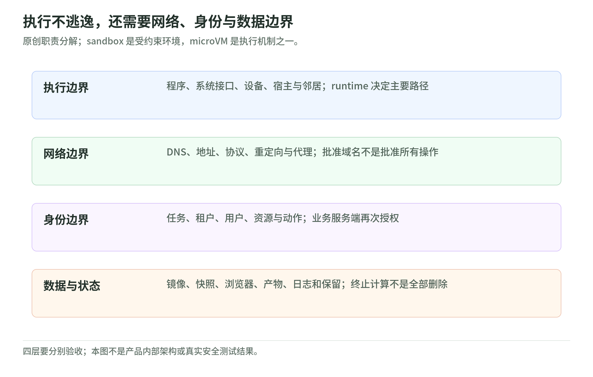

# 01 系统模型：Agent 为什么需要一个可验收的执行边界

资料核验：2026-11-04。本章的组件拆分、任务例和风险表是原创教学模型；安全机制的外部事实分别链接原始文档。

## 不是把整个 Agent 塞进一个盒子就结束了

设想一个研究 Agent：读取用户要求，搜索网页，下载表格，写 Python，最后交付报告。模型推理可以在外部服务，调度程序在企业后端，Python 在沙箱，文件保存在对象存储；浏览器又可能是独立工具。这里至少存在五种主体：用户、控制程序、模型服务、工具执行环境、被访问的业务系统。

因此，“Agent 部署”有两种容易混淆的任务：

- **部署 Agent runtime**：运行受信任的控制循环、对话状态与工具选择逻辑。
- **部署执行 sandbox**：运行生成或下载的代码、浏览器、构建脚本及其他不完全可信的工作负载。

两者可以在同一台机器，也可以通过 API 分开。重要的是谁可改变约束。若不可信代码能够修改调度器配置、选另一份宽松策略或读取沙箱管理 token，物理上多一个进程并不能完成该教学模型要求的控制面隔离。Docker 管理 API 和 QEMU monitor 都是具有高权限影响的接口，官方文档分别要求保护它们。[Docker 安全](https://docs.docker.com/engine/security/)、[QEMU 安全](https://www.qemu.org/docs/master/system/security.html)。

## 四条需要分别验收的边界

<!-- illustration: agbox-boundaries-8cf0d1521f -->

*图：执行不逃逸，还需要网络、身份与数据边界。原创职责分解；sandbox 是受约束环境，microVM 是执行机制之一。*
<!-- /illustration: agbox-boundaries-8cf0d1521f -->

| 边界 | 要问的问题 | 原创示例 |
| --- | --- | --- |
| 执行边界 | 程序能否影响宿主、其他任务或资源预算？ | 陌生构建脚本不能访问邻居目录 |
| 网络边界 | 可以联系哪些目标、协议和端口？ | 不能访问实例元数据或企业内部服务 |
| 身份边界 | 每次动作以谁的权限执行？ | 读取文档不自动获得删除文档权限 |
| 数据与生命周期边界 | 数据如何进入、导出、保留与销毁？ | 上一位用户的浏览器状态不能进入下一会话 |

执行隔离可以减少内核暴露，但网络可达业务 API 仍然可能成为另一条路径。这也是 gVisor 安全模型明确区分系统接口、硬件侧信道与其他系统攻击面的原因。[gVisor 安全模型](https://gvisor.dev/docs/architecture_guide/security/)。

## 先写攻击者，不先写产品名

以下是用于讨论的分级，不是通用行业标准：

| 威胁假设 | 不可信内容 | 必须重点验证 |
| --- | --- | --- |
| A：可信代码可能有 bug | 内部代码和输入 | 最小权限、资源限制、失败恢复 |
| B：代码来自模型或外部仓库 | 任意 shell、依赖安装脚本、解析器输入 | 宿主接口、文件和网络隔离 |
| C：租户可能主动攻击 | 恶意程序、持续探测、大量并发 | 跨租户边界、配额、管理面保护 |
| D：宿主运营方也不可信 | 管理员、hypervisor、宿主系统 | TEE、证明与密钥释放，另评可用性 |

A 到 C 不只是“代码质量更差”，而是默认策略和拒绝测试必须不同。D 又改变了信任方向：普通 VM 主要限制 guest 对宿主的影响；Confidential Containers 的模型主要把宿主排除在 guest 数据的信任域之外。[Confidential Containers 信任模型](https://confidentialcontainers.org/docs/architecture/trust-model/trust-model/)。

**工程建议**：没有明确评估 D 时，不把部署在普通云 VM 内的 sandbox 宣称为“连云服务商都看不到数据”；没有明确评估 C 时，不把一次内部脚本执行成功宣称为“安全多租户”。

## 任意代码、任意输入、任意权限是三个维度

运行经过审查的 Python 工具，仍可能处理恶意文件；运行模型生成的 shell，可能只接触公开数据；运行完全可信的 API 客户端，却可能持有过大的删除权限。不能仅按“是否使用 LLM”划危险等级。

原创任务例：

1. 给 Agent 一份公开 CSV，并允许它计算均值：执行面宽，业务身份面窄。
2. 给 Agent 固定查询函数，但连接全库管理员：执行面窄，授权风险高。
3. 给 Agent 登录企业浏览器、安装包、读写共享目录：执行、网络、身份与数据面都宽。

选 sandbox 可以改善第一和第三种的部分风险，却不会自动修复第二种。应把**代码信任、输入信任、身份权限、租户关系**分别写进任务合同。

## 隔离粒度为什么是架构决策

一个团队共享一个沙箱、每个用户一个沙箱、每段对话一个沙箱、每次工具调用一个沙箱，会产生不同状态与攻击面：

| 粒度 | 可能的收益 | 必须接受或补救的代价 |
| --- | --- | --- |
| 每次调用 | 状态短、清理相对明确 | 重复启动、文件和上下文需要传输 |
| 每个任务 | 保留任务内工作目录与进程 | 长任务预算、失败恢复、任务内多调用授权 |
| 每段会话 | 适合 coding、浏览器和持续工作空间 | 会话积累污染、身份轮换、休眠清理 |
| 每个租户 | 重用依赖与缓存 | 同租户不同用户也未必互相信任 |

这里比较的是原创设计取舍，不是所有平台支持全部粒度。Firecracker 官方建议每个进程对应一个租户工作负载；Kata 在 Kubernetes 中以 Pod 为 VM sandbox 粒度。因此，一台 VM 中运行多个容器，不等于这些容器之间获得同等 VM 级隔离。[Firecracker 生产宿主建议](https://raw.githubusercontent.com/firecracker-microvm/firecracker/main/docs/prod-host-setup.md)、[Kata 设计](https://github.com/kata-containers/kata-containers/blob/main/docs/design/virtualization.md)。

## 威胁模型要有明确的不覆盖项

主机内核与 CPU 微码补丁、硬件侧信道、出口代理、可信控制面、镜像供应链都可能处在执行运行时的信任基础或责任边界内。Firecracker 生产文档和 gVisor 安全模型都要求宿主侧防护，不能从名称推出所有硬件风险已被消除。[Firecracker 宿主](https://raw.githubusercontent.com/firecracker-microvm/firecracker/main/docs/prod-host-setup.md)、[gVisor](https://gvisor.dev/docs/architecture_guide/security/)。

**工程建议**：把下面五句写入方案，而不是用“安全隔离”四字代替。

- 哪些用户、代码和宿主组件视为可信？
- 哪些目录、设备、网络目标和业务动作明确允许？
- 资源耗尽和任务副作用由谁约束？
- 跨会话状态、凭证与产物由谁清理？
- 已验收了哪些负向用例，哪些能力没有测？

## 自测与答案

1. Agent 在 microVM 内、同时持有全库删除凭证，是否完成最小权限？**没有。** 执行边界与业务权限不同。
2. 每个 Kubernetes namespace 一个租户，是否意味着独立内核？**不意味着。** namespace 是编排和访问范围的一部分；实际边界取决于 Pod 运行时等配置。
3. 每个任务一个新 sandbox，是否保证环境可信？**不保证。** 镜像、依赖、挂载、控制接口和身份仍需核验。

[专题导读](README.md) · [下一章：Linux 与容器](02-linux-and-containers.md)
