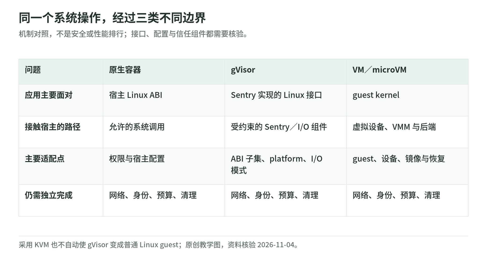

# 02 Linux 与容器：几项互补的约束，不是一种万能隔离

资料核验：2026-11-04。配置建议用于理解，不包含本轮已执行的 Docker 或 Kubernetes 部署。

## 从一次文件读取理解容器

<!-- illustration: agbox-execution-paths-6590fe47a5 -->

*图：同一个系统操作，经过三类不同边界。机制对照，不是安全或性能排行；接口、配置与信任组件都需要核验。*
<!-- /illustration: agbox-execution-paths-6590fe47a5 -->

普通 Linux 容器里的进程执行文件、socket、内存等操作时，仍然使用宿主内核。容器用 namespaces 改变“看见的系统”，用资源控制和权限机制约束“能做什么”；它并不是自带一个独立 Linux kernel 的虚拟机。Docker 官方文档把内核、daemon、容器配置和加固机制列为需要共同审查的部分。[Docker 安全](https://docs.docker.com/engine/security/)。

对于“运行自己的后端应用”和“向互联网租户开放任意代码”，相同的 Docker 命令不对应相同的风险接受。容器的价值是标准打包、生态和较小的额外层次；共享内核意味着要明确接受并维护这个信任边界。

## 把六种原语放回各自的位置

| 原语 | 主要职责 | 不能独立证明什么 |
| --- | --- | --- |
| namespaces | 分隔进程、挂载、网络、用户等视图 | 不使宿主内核漏洞消失 |
| cgroups v2 | 进程层级与 CPU、内存、I/O、进程数等资源控制 | 不是目录授权或网络目的地过滤 |
| capabilities | 将 root 权能拆分，减少不必要权限 | 非 root 也不等于无内核攻击面 |
| seccomp BPF | 根据系统调用编号和参数限制调用 | 不等于业务语义授权或完整 sandbox |
| SELinux／AppArmor 等 LSM | 按安全策略限制对象访问 | 策略未启用、过宽或配置不匹配仍有缺口 |
| Landlock | 允许进程叠加自我限制的访问规则 | 不是独立内核，也不是域名出口防火墙 |

这张职责表综合[Docker](https://docs.docker.com/engine/security/)、[cgroup v2](https://docs.kernel.org/admin-guide/cgroup-v2.html)、[seccomp](https://docs.kernel.org/userspace-api/seccomp_filter.html)和[Landlock](https://docs.kernel.org/userspace-api/landlock.html)，不表示所有发行版默认启用所有项。

## namespaces：资源视图与权限不能混为一谈

PID namespace 使一个环境看到不同进程集合；mount namespace 给出不同挂载树；network namespace 分隔网络栈；user namespace 提供 UID／GID 映射。它们可组合，但实际允许的挂载和连接仍由配置决定。把宿主目录或高权限 socket 主动映射进去，会增加这个环境能够使用的资源。[Docker 安全](https://docs.docker.com/engine/security/)、[bubblewrap](https://github.com/containers/bubblewrap)。

**工程建议**：审查配置时不只看“是否用了 namespace”，还要看哪些 namespace 与宿主共享，哪些文件描述符从父进程继承，哪些 mount 为读写，以及环境是否能联系宿主上的控制 API。

`chroot` 主要改变文件系统路径起点，不单独完成进程、网络、权限和内核面隔离。bubblewrap 也明确说明自己是构建环境的低层工具，保护程度由调用参数决定，并非自带完整政策的即用沙箱。[bubblewrap 官方说明](https://github.com/containers/bubblewrap)。

## cgroups：预算与数据访问是两回事

cgroup v2 组织进程层级，控制器用于资源分配与限制。CPU 权重是竞争时的相对份额，不应误当严格最大 CPU 时间；内存高水位与最大值也有不同作用。进程数控制器单独约束 fork／clone 出来的任务数量。[cgroup v2](https://docs.kernel.org/admin-guide/cgroup-v2.html)。

**教学建议的资源合同**至少写清：

- CPU 带宽／时间、wall-clock timeout 与最多并发任务；
- 内存、swap、进程数和打开文件数；
- 可写磁盘容量、I/O 与网络速率；
- stdout／stderr／日志与导出文件的总量；
- 超额时是节流、拒绝新调用、终止工作负载还是转人工。

CPU、内存限制并不能自动涵盖所有其他项。文件系统容量、网络、平台 API 配额和日志消费者通常还需其他机制。限制数值应由实际工作负载测试决定，不能机械复制本章。

## seccomp：缩小系统接口，不解释任务目的

seccomp 过滤读取系统调用编号与参数，不能任意解引用指针来理解其指向的数据。内核文档明确说这不是完整 sandbox，而是减少暴露面的工具。[内核文档](https://docs.kernel.org/userspace-api/seccomp_filter.html)。

比如允许建立 socket，不等于只允许查询某家文档网站；允许写文件，不等于只允许生成报告。系统调用层很难独立理解“本次动作符合用户请求吗”。文件、网络和业务层要配合。

Docker 默认 seccomp 是面向兼容性的策略起点，具体阻止集合会随版本变化。本专题不把某个阻止数量当成长期验收指标，也不建议为消除报错直接启用 `unconfined`。[Docker seccomp](https://docs.docker.com/engine/security/seccomp/)。

## rootless、userns-remap 和 non-root 的区别

| 设置 | 哪个主体降权 | 仍要检查什么 |
| --- | --- | --- |
| 容器 `USER`／`runAsNonRoot` | 容器工作负载 | daemon、挂载、capabilities 和内核 |
| `userns-remap` | 容器 UID／GID 映射 | daemon 仍可为 root |
| Rootless Docker | daemon 与容器放在非 root 用户体系内 | 支持条件、实际资源控制与网络功能 |

Docker rootless 文档明确区分它与 daemon 仍为 root 的 `userns-remap`。[Rootless](https://docs.docker.com/engine/security/rootless/)。

所以“容器里 `id` 不是 root”只是一个检查结果，不是完整隔离报告。控制面的 Docker socket 也不应因需要构建镜像就直接交给不可信代码；其 API 可以影响宿主资源，权限模型要单独处理。[Docker daemon 攻击面](https://docs.docker.com/engine/security/)。

## Landlock 与轻量沙箱工具的位置

Landlock 是可叠加的 LSM：进程可以约束自身及后续子进程的环境权利。它需要实际内核支持、配置与 ABI 检查；新文档列出的权利不自动存在于旧发行版。文件描述符、线程继承和规则涵盖范围也影响效果。[Landlock](https://docs.kernel.org/userspace-api/landlock.html)。

对于可信桌面用户运行 Agent CLI，这是值得理解的机制；对于恶意多租户任意代码，仍需完整威胁模型，不能因为“不需要 root”就把它升级成 VM 等价边界。网络端口权限也不等于 FQDN、HTTP 路径、租户和企业 API 授权。

[nsjail](https://github.com/google/nsjail)组合 namespaces、cgroups、rlimits 与 seccomp；[bubblewrap](https://github.com/containers/bubblewrap)强调调用方定义政策。二者是构建积木，不是租户调度、快照、账号体系和审计的一站式服务。官方示例中的高权限运行方式不能不经分析就复制到生产。

## 容器加固检查表：原创建议

1. 镜像固定到明确 digest，依赖经过审查与扫描。
2. 用非 root 工作负载，移除不需要的 capabilities，关闭提权。
3. 使用实际支持的 seccomp 和 LSM 策略，不静默降级。
4. 根文件系统只读，只给任务目录必要写权限。
5. 禁止任意宿主挂载、host PID／IPC／network 和管理 socket。
6. 设置资源与日志预算；需要联网时另做出站策略。
7. 不自动暴露控制面凭证；每任务的业务凭证范围独立。
8. 测试完成、超时、取消和故障后的进程与数据回收。

Kubernetes 的 Pod Security Standards 可以作为基线参考，但标准本身也指出沙箱保护依赖具体方法，不存在适合所有 sandboxed workloads 的单一推荐配置。[Pod Security Standards](https://kubernetes.io/docs/concepts/security/pod-security-standards/)。

## 自测与答案

1. 设置 512 MiB 内存能禁止访问宿主文件吗？**不能。** 它约束预算，不负责文件授权。
2. Rootless Docker 是否另起 guest kernel？**没有。** 它改变用户权限结构，不把普通容器变成 VM。
3. 用 seccomp 允许网络系统调用，是否已限定企业业务域名？**没有。** 出站目的地与业务授权需其他层实现。

[专题导读](README.md) · [上一章：系统模型与威胁](01-system-model-and-threats.md) · [下一章：gVisor](03-gvisor.md)
