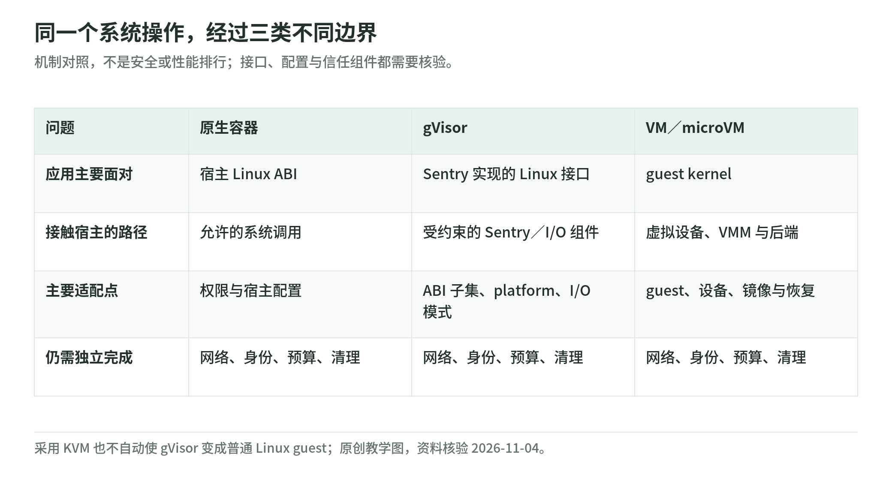

# 03 gVisor：在应用与宿主内核之间实现一套系统接口

资料核验：2026-11-04。阅读目标：理解应用内核、系统调用过滤和传统 VM 的区别，不把项目设计当成特定部署的实测安全结论。

## 同一个 read，三条不同路径

<!-- illustration: agbox-execution-paths-f145aae0fd -->

*图：同一个系统操作，经过三类不同边界。机制对照，不是安全或性能排行；接口、配置与信任组件都需要核验。*
<!-- /illustration: agbox-execution-paths-f145aae0fd -->

原生容器把应用允许的系统调用交给宿主 Linux；seccomp 在入口决定是否允许。gVisor 则由 Sentry 实现受支持的 Linux 系统接口，应用不是直接把原始调用及参数传到宿主内核。传统 VM 又是应用调用 guest Linux，再经虚拟硬件与 VMM 接触宿主。[gVisor 介绍](https://gvisor.dev/docs/architecture_guide/intro/)、[安全模型](https://gvisor.dev/docs/architecture_guide/security/)。

这三条路径是机制对照，不是安全排名。应用内核与 VM 都改变了宿主暴露面，但各自的实现、配置、接口和可信组件不同。

## Sentry、Gofer 与 runsc

| 名称 | 职责 | 不能混淆为 |
| --- | --- | --- |
| Sentry | 实现系统调用、内存、信号、线程等应用内核功能 | 简单系统调用 allowlist |
| Gofer | 中介或辅助访问允许的文件系统资源 | 任意宿主文件都不可见的保证 |
| runsc | 与容器生态集成的 OCI runtime 入口 | 租户、业务授权与计费平台 |
| platform | 系统调用拦截、上下文切换和地址空间等底层实现 | 另一套应用 API |

依据：[gVisor 概述](https://gvisor.dev/docs/)、[文件系统](https://gvisor.dev/docs/user_guide/filesystem/)、[platform](https://gvisor.dev/docs/architecture_guide/platforms/)。

“每个应用调用都有 Sentry 的实现”不等于“从不执行任何宿主系统调用”。实际文件 I/O 等仍需要受约束的宿主操作；重点是减少应用直接控制宿主系统接口的能力。[安全模型](https://gvisor.dev/docs/architecture_guide/security/)。

## systrap 和 KVM 不要只看名字

当前官方平台指南把 systrap 作为默认平台，并说明它通过 seccomp 的 trap 机制接管系统调用；旧 ptrace 平台不再受支持。KVM 平台利用虚拟化扩展，让 Sentry 承担 guest OS 与 VMM 相关角色，但没有传统虚拟硬件层，仍保留进程模型。[gVisor 平台指南](https://gvisor.dev/docs/architecture_guide/platforms/)。

因此下面两句都不准确：

- “gVisor 只能不用硬件虚拟化。”
- “选 KVM 后，gVisor 就成为一台运行普通 Linux 的 Firecracker microVM。”

官方指南建议在 bare-metal 等适合的环境评估 KVM，在已处于 VM 或无虚拟化支持环境中考虑 systrap。嵌套虚拟化是否可用及其成本取决于真实宿主，不应从云实例名或平台品牌直接推断。

## 兼容性为什么必须跑自己的工作负载

gVisor 实现的是 Linux 接口的大量子集，不承诺完整等价。官方兼容性文档明确说最终要试运行，并列出设备、文件系统、内核功能和在沙箱内使用 KVM 等限制。[兼容性](https://gvisor.dev/docs/user_guide/compatibility/)。

原创兼容性测试应至少包含：

| 任务 | 测什么 | 报错后不要立即做什么 |
| --- | --- | --- |
| Python 数据分析 | 二进制 wheels、线程、共享内存、文件和网络 | 直接改成默认 runtime 并称已通过 |
| Node／代码构建 | 进程创建、文件监听、包管理器、缓存 | 放开整个宿主目录 |
| 浏览器自动化 | 浏览器自身 sandbox、共享内存、渲染与网络 | 为跑通而全面关闭浏览器隔离 |
| 编译与测试 | 信号、进程树、debug 工具、并发文件 I/O | 任意启用 ptrace 或高权限 |
| 设备工作负载 | 驱动版本与明确支持的 GPU／TPU 通路 | 把 GPU 支持泛化成所有硬件透传 |

gVisor 当前文档包含特定 GPU／TPU 支持例外，不能再绝对说它“永不支持 GPU”；同样不能由这一点推出任意设备 ABI 都可用。[兼容性说明](https://gvisor.dev/docs/user_guide/compatibility/)。

## 文件系统模式与优化也是安全配置

Gofer、文件描述符、LISAFS、directfs、overlay 等选择影响文件访问路径与性能。不要沿用“所有文件访问永远经过 9P”这样的旧概括；当前官方说明应与实际版本配置一起阅读。[文件系统](https://gvisor.dev/docs/user_guide/filesystem/)、[安全模型](https://gvisor.dev/docs/architecture_guide/security/)。

**工程建议**：把文件系统与网络模式加入部署配置的版本记录。测试某个安全模式通过，不能自动替另一个优化模式背书。对 syscall 密集、细碎文件或高并发网络任务，应测实际 I/O 与端到端成功率，不用单个计算循环证明整套系统开销。

## 它没有代替哪些约束

gVisor 依赖宿主资源机制进行资源耗尽防护，网络政策也需要容器／平台层实施。它不一般性消除硬件侧信道，也不保护一个本来就允许访问的业务 API 免受越权调用。[安全模型](https://gvisor.dev/docs/architecture_guide/security/)。

另一个容易忽略的细节是沙箱内部 cgroup 能力：官方兼容性文档区分资源记账与限额执行，提示宿主 cgroup 对整个 sandbox 的约束不等于沙箱内不同进程之间的完整限额执行。[兼容性](https://gvisor.dev/docs/user_guide/compatibility/)。

**教学选型建议**：若团队已有 Kubernetes／OCI 工作流、宿主对嵌套虚拟化支持有限、任务主要依赖常见 Linux 用户态接口，gVisor 值得进入候选。若任务依赖大量未覆盖内核功能、特定设备或高度 syscall 密集路径，则要先评估适配或转向 VM。该建议不是“gVisor 总比 microVM 快／慢”的声明。

## 适配失败要有可审计的退出规则

生产策略可区分：拒绝任务、转到同等或经批准的另一个隔离池、要求审查、调整任务工具。最危险的处理是让系统自动退到无约束 runtime，却继续沿用原来的安全标记。

建议保存：镜像 digest、runsc 版本、platform、文件系统与网络模式、宿主内核、测试集和批准例外。不存在的 runtime 或不满足条件的策略应失败关闭，而不是“尽量运行”。Kubernetes RuntimeClass 是运行时选择入口，实际 handler 仍需要节点配置。[RuntimeClass](https://kubernetes.io/docs/concepts/containers/runtime-class/)。

## 自测与答案

1. gVisor 是对原始宿主 syscall 做允许／拒绝吗？**不只是。** Sentry 实现受支持的应用系统接口。
2. gVisor KVM 是否意味着拥有普通 Linux guest kernel？**不意味着。** 要看应用内核及平台模型。
3. 一段 Python 跑通是否证明浏览器或复杂编译链兼容？**不证明。** 要测具体工作负载与模式。

[专题导读](README.md) · [上一章：Linux 与容器](02-linux-and-containers.md) · [下一章：microVM 与 Kata](04-microvm-and-kata.md)
