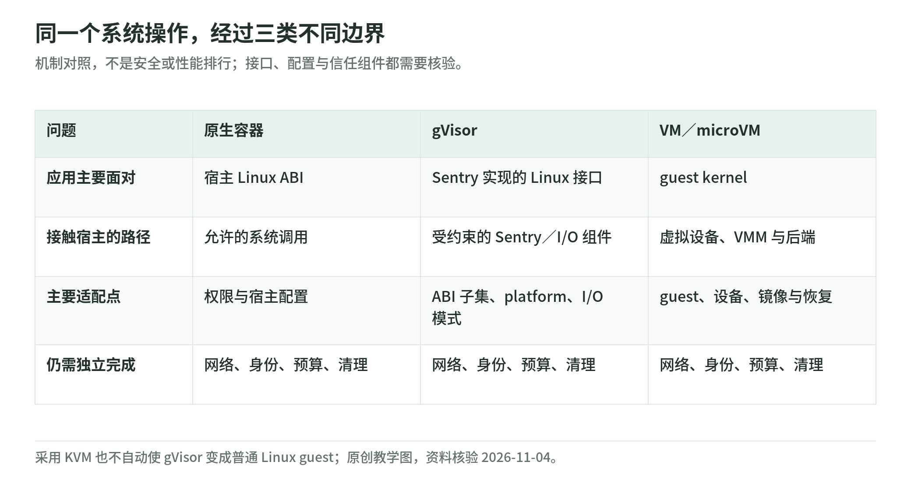

# 04 VM、microVM 与 Kata：虚拟硬件边界之外还有宿主工程

资料核验：2026-11-04。下文不把启动演示、官方性能宣传或设计原则当成本轮实测结果。

## 先分清 KVM、VMM 和 guest

<!-- illustration: agbox-execution-paths-367b12d141 -->

*图：同一个系统操作，经过三类不同边界。机制对照，不是安全或性能排行；接口、配置与信任组件都需要核验。*
<!-- /illustration: agbox-execution-paths-367b12d141 -->

KVM 提供 Linux 的硬件虚拟化能力；VMM 是配置 vCPU、内存和设备、处理虚拟机运行的用户态组件；guest kernel 是虚拟机内部的操作系统。Firecracker 使用 KVM，单个 Firecracker 进程封装一个 microVM，包含 API、VMM 与 vCPU 线程。[Firecracker 设计](https://github.com/firecracker-microvm/firecracker/blob/main/docs/design.md)。

“给用户一台 VM”不是“给用户宿主上的 VMM 管理权限”。创建磁盘、挂载宿主文件、更新设备和加载快照等应由受信任管理组件完成。QEMU 文档专门把 monitor 当作特权控制接口。[QEMU 安全](https://www.qemu.org/docs/master/system/security.html)。

## microVM 小在哪里

microVM 仍然是虚拟机。它面向特定云工作负载精简硬件模型、启动路径和功能范围，换取较低固定开销及减少部分设备暴露面。Firecracker 不是完整桌面／通用硬件模拟器，而是刻意限制设备范围的 VMM。[Firecracker 设计](https://github.com/firecracker-microvm/firecracker/blob/main/docs/design.md)。

“精简”不推出“所有 Linux 软件与设备均可使用”，也不推出“永久比其他 VM 更安全”。应一起看设备模型、host kernel、guest kernel、VMM 约束、可共享资源以及管理面。

## 一次文件与网络访问的主要路径

教学示意：应用 → guest Linux → virtio 等设备接口 → VMM／后端 → 宿主资源。CPU 执行主要借助硬件虚拟化，而 I/O 仍跨过明确的接口。

因此，缩小虚拟设备模型的意义是缩小一部分接口，不是使 I/O 或宿主代码消失。复杂磁盘后端、共享文件系统、设备透传和网络代理都可能重新增加可信或受攻击组件。QEMU 安全文档明确要求最小权限和 guest 磁盘、网络的隔离，并提示其不同后端存在不同安全范围。[QEMU 安全](https://www.qemu.org/docs/master/system/security.html)。

## Firecracker 的组合拳，不只是一份二进制

| 组件或措施 | 主要作用 | 平台仍承担什么 |
| --- | --- | --- |
| KVM 与虚拟化扩展 | guest／host 执行边界 | 内核、CPU 微码与宿主配置 |
| 精简设备模型 | 减少部分虚拟设备接口 | 设备后端、磁盘和网络配置 |
| seccomp | 限制 VMM 的宿主系统调用 | 不随意禁用或放宽 |
| jailer | 降权、namespace、cgroup 等宿主约束 | 可信路径、每实例身份和配额 |
| API socket | 管理 microVM | 控制面鉴权、参数检查与可达性 |
| 外部防火墙与代理 | 约束 guest 出站 | IPv4／IPv6、元数据、内网与租户网络 |

Firecracker 官方要求使用 jailer 或同等／更严格的约束；生产宿主文档还明确指出它**不执行网络流量过滤**，guest 数据包交给 TAP，运营者需实现限制地址的政策。[生产宿主文档](https://raw.githubusercontent.com/firecracker-microvm/firecracker/main/docs/prod-host-setup.md)。

这意味着“已经用了 Firecracker，所以可以默认联网、把宿主角色凭证留在可达元数据里”不是官方设计支持的结论。

## 自建的隐藏工作清单

以下是原创拆解，帮助估算真实工程范围：

1. guest kernel、rootfs、包源与镜像构建；
2. 创建、隔离和回收 TAP、路由、磁盘、UID／GID；
3. 调度、容量、预热、健康探测与宿主排空；
4. 给工作负载设置 CPU、内存、磁盘、网络、日志预算；
5. guest 内任务执行代理与可信通信协议；
6. 快照、恢复、版本兼容、身份与随机状态刷新；
7. 宿主／guest／VMM 更新，异常进程检测；
8. 租户授权、计费、审计、产物导出与清理。

这些不是 Firecracker API 自动补齐的平台功能。尤其日志与串口可能由 guest 行为影响，运营者需设置有界消费与存储；官方宿主文档专门讨论了这类问题。[生产宿主文档](https://raw.githubusercontent.com/firecracker-microvm/firecracker/main/docs/prod-host-setup.md)。

## Kata：把 VM 边界接到容器管理链路

Kata 在 namespace 容器之外增加硬件虚拟化层，guest Linux 中运行容器；Kubernetes 常见路径是 kubelet → CRI 实现 → Kata OCI runtime → VM → 容器。官方虚拟化设计把 VM sandbox 粒度描述为 Pod。[Kata 虚拟化设计](https://github.com/kata-containers/kata-containers/blob/main/docs/design/virtualization.md)。

因此 Kata 和 Firecracker 不是同层的二选一：

- Firecracker 是一种 VMM。
- Kata 是对接容器／CRI 的运行时与配套组件体系，可以涉及不同虚拟化后端。
- Kubernetes RuntimeClass 选择节点已配置的 runtime handler，不会仅凭一个 YAML 名字安装所需后端。[RuntimeClass](https://kubernetes.io/docs/concepts/containers/runtime-class/)。

**工程建议**：以一个 Pod 中的容器属于同一 VM 信任域为默认审查起点。若不同用户不互信，不应因为它们是“两个 container”就放在同一个 Pod 后宣称实现相互的 VM 级隔离。

## 不只 Firecracker：其他 VMM 与库

| 项目 | 已公开定位 | 选型需要多查的一层 |
| --- | --- | --- |
| [Cloud Hypervisor](https://www.cloudhypervisor.org/docs/prologue/introduction/) | Rust VMM，面向现代云工作负载，精简硬件模拟 | 设备、virtio-fs、透传、迁移与实际 Kata 配置 |
| [QEMU](https://www.qemu.org/docs/master/system/security.html) | 多用途虚拟化／模拟器，明确区分安全支持范围 | accelerator、machine type 与 backend 的安全合同 |
| [crosvm](https://doc.crosvm.dev/book/architecture/overview.html) | 重视隔离的 VMM，虚拟设备进程使用 minijail | 支持平台、设备以及与自己的控制面集成 |
| [libkrun](https://github.com/containers/libkrun/blob/main/README.md) | 嵌入式库方式运行虚拟化环境，Linux KVM／部分 macOS HVF 场景 | 稳定分支、共享文件与网络、平台适配 |

这些项目不是都以相同方式提供“microVM SaaS”。本次看到的 libkrun 主分支还明确提醒 2.0 API／ABI 开发中，生产源码构建应选择稳定分支；不把主分支说明当成全部发行版事实。

QEMU 的 TCG 模拟与硬件虚拟化用例有不同安全支持合同，不能因“程序启动了”就认为任意 QEMU machine 配置满足恶意 guest 隔离。[QEMU 官方安全范围](https://www.qemu.org/docs/master/system/security.html)。

## GPU、嵌套虚拟化、桌面与 unikernel

**GPU**：设备透传、vGPU、驱动或专用支持都需要逐项核验。CPU guest 独立不自动证明 GPU 内存、多租户设备和宿主驱动边界成立。

**嵌套虚拟化**：某云 VM 能运行 Docker，不等于它向 guest 暴露可用 `/dev/kvm`。应在目标机型、架构和配置上确认能力；Firecracker getting-started 也要求验证 KVM 访问。[起步文档](https://github.com/firecracker-microvm/firecracker/blob/main/docs/getting-started.md)。

**桌面环境**：浏览器或 computer-use 除执行隔离外，还涉及 display、音频、输入、剪贴板、用户登录态与文件传输。选择面向函数的精简 guest，不代表已解决 GUI 工具链。

**unikernel**：将应用与裁剪的操作系统功能组合，是另一个 guest 构造方向，不是直接替所有 shell／包管理器／浏览器提供兼容环境。应按真实 guest 与接口需求判断，不作为本专题默认路线。

以上为工程审查方向，不声称本轮实测了任何设备或桌面栈。

## 自测与答案

1. jailer 是 guest 内的 Python 工具吗？**不是。** 它约束宿主侧 VMM 执行环境。
2. Firecracker 会自动拒绝 guest 到企业内网的连接吗？**不会自动替平台完成。** 官方明确要求外部网络政策。
3. Kata 每个 Pod 一台 VM，是否等于每个 container 一台 VM？**不等于。** 隔离粒度要按实际运行时配置验证。

[专题导读](README.md) · [上一章：gVisor](03-gvisor.md) · [下一章：Wasm 与机密计算](05-wasm-and-confidential-computing.md)
