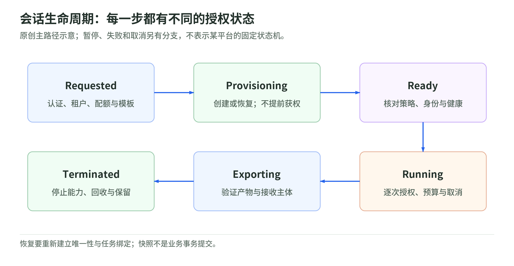

# 06 生命周期与编排：一个会话不只是一个 PID

资料核验：2026-11-04。状态机、任务合同和恢复协议是原创建议；公开项目能力与限制链接到官方来源。

## 为什么 Deployment 不是所有任务的默认答案

Agent 的工作空间可能持续一段对话：保持终端进程、安装过的依赖、浏览器 context、工作目录和服务端口。它与可随意替换的无状态 API 副本不同。

Kubernetes SIG Apps 的 Agent Sandbox 项目提供 CRD 与 controller，围绕有状态、单实例、稳定身份的工作负载管理生命周期。官方 README 明确把自己定位为**编排器**，通过 RuntimeClass 委托 gVisor／Kata 等底层运行时实现隔离。[项目来源](https://github.com/kubernetes-sigs/agent-sandbox)。

所以对象名叫 `Sandbox` 不等于底层已经存在安全边界。应用用户获得 controller API 权限，是否也能选择任意 runtime、宿主挂载、镜像和身份，仍由平台准入约束。

## 一个可讨论的状态机

<!-- illustration: agbox-lifecycle-10eacc3e62 -->

*图：会话生命周期：每一步都有不同的授权状态。原创主路径示意；暂停、失败和取消另有分支，不表示某平台的固定状态机。*
<!-- /illustration: agbox-lifecycle-10eacc3e62 -->

教学模型的主路径：Requested → Provisioning → Ready → Running → Exporting → Terminated。

| 状态 | 可信控制面需要完成 | 不应开放的能力 |
| --- | --- | --- |
| Requested | 用户认证、租户、配额、策略与模板选择 | 未验收任务先获得业务秘密 |
| Provisioning | 创建或恢复实例，核对有效 runtime 与隔离配置 | 不完整环境先接受任意调用 |
| Ready | 策略、身份、网络及执行代理健康检查 | 默认等同“所有业务动作获准” |
| Running | 限时、取消、逐次工具授权和任务状态更新 | 由 guest 自行放宽策略 |
| Exporting | 冻结或一致读取结果，验证交付清单 | 不受约束地同步整个目录 |
| Terminated | 停止能力、回收运行资源、按政策处理数据 | 残留句柄继续使用 |

还需要 Failed、Cancelling、Paused 和恢复中的路径。**教学重点**是权限随状态变化：在 Paused 或恢复过程不得使用旧能力；Terminated 是终态，不应由迟到请求重新激活。[离线实验](lab.md)用小状态机演示这一点，不创建真实实例。

## 幂等、实例代次与迟到消息

原创例：创建请求超时，客户端重试，但第一次其实已成功。若只按请求次数新建，会出现两台环境；若连接只用可重复名字，旧请求又可能连接到重建后的新实例。

建议同时保存：

- 创建幂等键与可信任务标识；
- sandbox 唯一 ID、实例代次／generation；
- 租户、用户、policy hash 和模板 digest；
- 当前状态、授权到期时间与清理进度；
- 业务副作用的单独幂等记录。

“实例名字相同”不是身份相同。控制面重试要检查实际状态，不能让 guest 自报“我是旧任务”重新获得凭证。这是设计建议，不宣称某 CRD 自动包含完整 broker 协议。

## 预热池改善什么，也增加什么

Agent Sandbox 的扩展包括 SandboxTemplate、SandboxClaim 和 SandboxWarmPool：模板生成环境，claim 申请，warm pool 管理预先准备的实例。[官方 README](https://github.com/kubernetes-sigs/agent-sandbox)。

预热把一部分成本从用户请求之后移到之前，但没有让成本消失。它占用 idle 内存／CPU／存储，受到容量、模板更新、突发补池与控制面限流影响。下面是原创审查表：

| 预热方式 | 移走哪些请求后工作 | 新风险或工作 |
| --- | --- | --- |
| 预拉 OCI image | 下载、解压部分等待 | cache 容量与 digest 管理 |
| 预启动无身份实例 | 内核／用户态准备 | 空闲成本、租户附加与实例泄漏 |
| 恢复无身份快照 | 部分启动与依赖初始化 | clone uniqueness、恢复协议与兼容性 |
| 复用上一任务实例 | 多数初始化 | 跨任务状态污染；不能默认允许 |

**工程建议**：warm pool 内不得携带某个人的 Cookie、生产 token 或上个任务数据。分配后先附加新身份、策略和期限，再允许工作负载行动。清理无法可靠证明时，销毁并重建；不要把清缓存等同可信重置。

## 快照不是镜像，也不是事务提交

| 对象 | 保存的主要内容 | 不自动解决 |
| --- | --- | --- |
| OCI image／rootfs | 软件与文件系统模板 | 运行中内存、连接和任务身份 |
| VM snapshot | guest 内存、设备状态及相关磁盘集合 | 业务一致性、唯一性、秘密刷新 |
| 应用 checkpoint | 应用定义的进度与持久状态 | 已发出的外部副作用 |
| Artifact | 明确导出的交付结果 | 运行环境可恢复性 |

Firecracker 快照包含 guest memory 与虚拟硬件状态，磁盘由集成者管理；它也明确要求保护快照文件，不能用仅针对偶然损坏的 CRC 代替真实性和完整性保护。[快照文档](https://raw.githubusercontent.com/firecracker-microvm/firecracker/main/docs/snapshotting/snapshot-support.md)。

原创例：快照记录“邮件尚未发送”，但邮件服务已接受请求、ACK 尚未回到 guest。恢复后重发会产生重复副作用。应由应用／业务端用幂等记录与重试规则解决，不能从“恢复到某一内存状态”推出 exactly-once。

## Clone uniqueness：最容易被低估的恢复问题

同一快照恢复到多台实例，会复制原以为唯一的 ID、随机状态、缓存 token 和应用会话。Firecracker 文档明确认为在没有强机制维持唯一性的情况下，从同一状态多次恢复不安全。VMGenID 可以通知 guest 并帮助内核随机池刷新，但**应用缓存的随机值、身份和 token 仍会被复制**。[快照安全](https://raw.githubusercontent.com/firecracker-microvm/firecracker/main/docs/snapshotting/snapshot-support.md)。

**教学恢复协议**：

1. 在实例可用前撤去模板内任何业务身份。
2. 生成新实例代次和任务绑定；验证可信身份。
3. 刷新应用需要唯一的状态，不仅依赖内核熵池。
4. 重建网络与 vsock 连接，处理过期 socket 和时钟。
5. 重新拉取当前策略、凭证和租户资源。
6. 通过 Ready 验收后才开放任务执行。

Firecracker 明确不保证恢复后的网络连接状态继续存在，vsock 旧连接会关闭；快照恢复环境还存在软件／硬件匹配约束。不能把快照描述成跨任意版本、机型和架构的便携格式。[官方限制](https://raw.githubusercontent.com/firecracker-microvm/firecracker/main/docs/snapshotting/snapshot-support.md)。

## Kubernetes 集成要查到节点

RuntimeClass 关联 handler，还可声明调度约束与 Pod Overhead。不存在的 RuntimeClass 或 CRI 无法执行的 handler 会导致失败；未指定则使用默认 runtime。[RuntimeClass](https://kubernetes.io/docs/concepts/containers/runtime-class/)。

工程建议：

- 不允许不可信调用方改成默认 handler；准入校验与节点配置同时检查。
- 使用支持相应 runtime 的专用节点池或明确 selector／taint。
- 核对 RuntimeClass overhead、guest 固定开销与可调度容量。
- Namespace、RBAC、ResourceQuota、Pod Security 和 NetworkPolicy 分别设计。
- PVC／对象存储按任务或租户隔离，检查回收策略与备份。
- router／执行服务每次连接检查租户、任务和实例代次；稳定 hostname 不代替授权。

这些是组合建议，不是一份已安装的 Kubernetes 配置。controller 文档中的 desired characteristics 和 roadmap 也必须与已经实现的能力分开，不把目标“deep hibernation”等直接写成所有版本保证。[项目 README](https://github.com/kubernetes-sigs/agent-sandbox)。

## 取消与销毁要闭环

教学建议按“先停止新能力 → 撤销／停止续期 → 终止进程树与连接 → 按需安全导出 → 回收运行资源 → 处理存储保留 → 验证清理完成”设计取消。

结束一个 PID，不等于其后代、宿主代理、网络连接、临时磁盘、日志与对象存储都已结束。cgroup v2 的层级和 populated 等状态可提供进程清理证据的一部分，但不覆盖全部数据副本。[cgroup v2](https://docs.kernel.org/admin-guide/cgroup-v2.html)。

## 自测与答案

1. claim 获得预热实例后，可以立即沿用模板中的企业 token 吗？**不应。** 身份必须重新绑定。
2. 快照恢复成功是否意味着外部交易不会重复？**不意味着。** 业务幂等是另一个协议。
3. `Sandbox` CRD 是否自带独立 guest kernel？**不由名称决定。** 看实际 runtime 和节点。

[专题导读](README.md) · [上一章：Wasm 与机密计算](05-wasm-and-confidential-computing.md) · [下一章：平台版图](07-platform-landscape.md)
