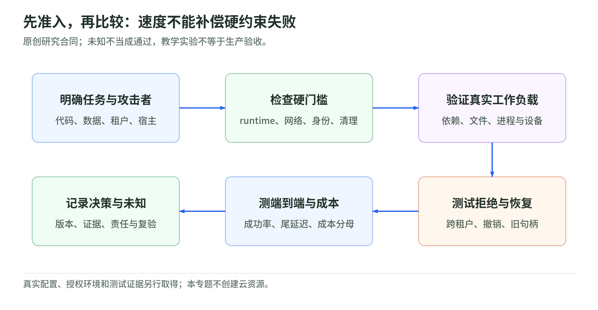

# 08 选型与参考架构：先淘汰不满足约束的，再比较代价

资料核验：2026-11-04。本章的场景决策、打分与架构是原创工程建议，不是已部署案例、采购意见或安全评级。

## 六个问题比一句“哪种最好”更有用

1. 是否执行任意代码／安装外部依赖，还是只调用固定函数？
2. 谁不可信：模型输出、仓库、用户、其他租户，还是宿主运营方？
3. 任务需要完整 Linux、特殊 syscall、浏览器／桌面、GPU 或嵌套虚拟化吗？
4. 状态保存多久：一次调用、任务、会话还是长期 workspace？
5. 数据、凭证、内网、地域与治理要求是什么？
6. 团队能否维护宿主／guest／VMM、镜像、调度与值班？

机制依据在[容器](02-linux-and-containers.md)、[gVisor](03-gvisor.md)、[microVM](04-microvm-and-kata.md)、[Wasm](05-wasm-and-confidential-computing.md)；产品能力按[平台章](07-platform-landscape.md)的第一方来源核对。

## 机制对照，不是安全排行榜

| 技术路径 | 应用面对的主要接口 | 兼容性审查点 | 平台必须补齐 |
| --- | --- | --- | --- |
| 加固原生容器 | 宿主 Linux ABI，受 OS 约束 | 原生生态通常易适配，但权限与内核仍共享 | 准入、网络、身份、资源与清理 |
| gVisor | Sentry 实现的 Linux 接口 | 未实现功能、文件／网络模式、特殊设备 | runtime 配置、宿主预算与业务权限 |
| microVM／VM | guest kernel 与虚拟硬件 | guest ABI、设备、启动／恢复与镜像 | VMM 约束、宿主网络、身份与编排 |
| Kata | guest 中容器，接入 CRI／OCI | 后端 VMM、Pod 粒度、存储与设备 | 节点 runtime、调度、准入与平台接口 |
| Wasm | 显式导入与 WASI／host API | 重编译、组件版本、原生扩展与 host functions | 能力设计、预算与输出校验 |
| confidential VM | TEE 中的 guest 及测量链 | 硬件、证明、镜像测量、密钥政策 | 可信验证者、业务权限和可用性 |

对照依据：[gVisor](https://gvisor.dev/docs/architecture_guide/security/)、[Kata](https://github.com/kata-containers/kata-containers/blob/main/docs/design/virtualization.md)、[Wasmtime](https://docs.wasmtime.dev/security.html)、[Confidential Containers](https://confidentialcontainers.org/docs/architecture/trust-model/trust-model/)。

没有“容器 = 1 分、gVisor = 2 分、microVM = 3 分”的普适安全轴。弱管理面和宽网络可以破坏任何路径；缩减接口也可能不满足任务兼容性。

## 硬约束门槛与软指标分开

<!-- illustration: agbox-selection-gates-1ebf8ada75 -->


*图：先准入，再比较：速度不能补偿硬约束失败。原创研究合同；未知不当成通过，教学实验不等于生产验收。*
<!-- /illustration: agbox-selection-gates-1ebf8ada75 -->

原创选择流程：

- **先过硬门槛**：租户边界、运行时、数据政策、网络、必要设备和版本支持。未满足／未知都不能假装通过。
- **再过任务测试**：依赖、文件、进程、网络、浏览器、构建和恢复。
- **最后比较软指标**：首次命令延迟、端到端完成率、尾延迟、密度、全成本和运维负担。

两个候选都不满足数据地域或凭证要求时，不能靠其中一个启动更快来补偿。某 API 成功也不能替代隔离配置证据。[离线准入实验](lab.md)演示“低延迟候选被硬门槛拒绝”，不表示真实产品评分。

## 七类场景的候选与退出条件

| 场景 | 首批候选（教学建议） | 需要升级或退出的条件 |
| --- | --- | --- |
| 固定工具的企业 Agent | 受信任服务＋逐次业务授权 | 工具开始执行任意代码或持有宽身份 |
| 内部已审查的数据脚本 | 加固容器作为基线 | 来源不再可信，跨租户或需要更独立边界 |
| 用户任意 Python／Node | gVisor 与 microVM 对照 | ABI／设备不兼容，出口／身份达不到门槛 |
| coding Agent／构建测试 | 会话 sandbox，gVisor／microVM／Kata | 需要危险宿主权限、跨任务缓存难隔离 |
| browser／computer-use | 专用会话环境，VM 或验证过的其他运行时 | 需要关闭多层隔离才能运行、登录态难清理 |
| RL 大规模并行环境 | 编排器＋经核验 runtime＋独立评估器 | 并发／补池／控制面瓶颈、评测状态污染 |
| GPU／敏感数据研究 | 已验证设备栈，必要时独立主机或 TEE 路线 | 没有设备隔离证据，或证明政策／硬件不适配 |

这不是默认允许高权限的理由；任何退出都要明确拒绝、改造任务或取得新批准，不能静默降级。

## 参考架构 A：内部分析 Agent

教学目标：处理企业授权的文件，允许 Python 分析，但不直接持有全部企业数据权限。

组件关系：

1. 受信任控制面认证用户并选择精确文档。
2. 文件导入服务验证格式与大小，复制任务所需数据。
3. 加固容器或核验后的 gVisor 执行分析，默认无业务凭证。
4. 需要数据扩展时，由 broker 检查用户、资源与动作。
5. 报告经导出校验后交付当前用户，日志按数据政策保存。

**适用前提**：任务来源、用户关系与数据分类已清楚。若转成恶意多租户代码服务，应重新威胁建模，不直接复用“内部”前提。容器安全机制和 daemon 管理面须分别审查。[Docker 安全](https://docs.docker.com/engine/security/)。

## 参考架构 B：互联网 coding Agent 平台

教学目标：不同用户可上传仓库，安装依赖、编译测试并获得产物。

分离三个池：受信任控制面、无身份模板／warm pool、不可信工作负载池。控制面只允许已批准模板与策略；每任务获得独立实例与临时存储。出站通过不可绕过的代理；包源与模型端点获准也不代表上传任意数据。Git／云凭证由外部 broker 代用或短期限额发放；执行环境不接触 sandbox 管理 API。

候选可以是托管 sandbox，也可以是自建 microVM，或 Kubernetes Agent Sandbox＋gVisor／Kata。编排器官方明确将底层隔离委托 runtime；自建 Firecracker 又明确要求平台处理出站过滤。[Agent Sandbox](https://github.com/kubernetes-sigs/agent-sandbox)、[Firecracker 宿主](https://raw.githubusercontent.com/firecracker-microvm/firecracker/main/docs/prod-host-setup.md)。

**验收重点**：跨租户连接拒绝、镜像与 runtime 不可由 guest 放宽、包安装兼容、撤销连接、产物路径、磁盘配额、任务结束回收、warm pool 重绑定。不要只验 Python 计算均值。

## 参考架构 C：有 Kubernetes 运维能力的企业平台

教学目标：复用集群治理和生命周期 API，隔离执行工作负载。

- 独立节点池配置 Kata 或 runsc，明确支持架构和版本。
- RuntimeClass 选定 handler，准入强制允许列表及调度配置。
- Agent Sandbox／其他经审查 controller 管任务／会话与预热。
- Namespace、RBAC、ResourceQuota 与 Pod Security 控制管理与配置面。
- CNI／出口代理控制实际网络，broker 控制业务能力。
- PVC 和产物存储分开，终止与保留政策分开。

RuntimeClass 还可声明开销供调度器核算，未指定 runtime 则进入默认 handler；因此让用户自行省略该字段不是可接受的验收捷径。[RuntimeClass](https://kubernetes.io/docs/concepts/containers/runtime-class/)。

**适用前提**：节点 patch、runtime 升级、controller、存储和 CNI 都有维护责任人。已经运行 Kubernetes 不等于具备上述整套能力。

## 参考架构 D：受窄接口约束的工具插件

教学目标：无需完整 Linux，只运行解析、格式转换、规则或纯计算插件。

Wasm 运行时只授予输入与结果，特殊 I/O 通过已授权 host API；模块预算和 host I/O 预算分开。模块更新固定摘要与编译目标；输出经 schema 检查再进入 Agent。若插件需要广泛 shell 或未适配的 native extensions，优先改造接口，或明确转入另一隔离路线。

价值来自接口本身可窄化，而不是“Wasm 天然快”的笼统判断。[Wasmtime 安全](https://docs.wasmtime.dev/security.html)。

## 自建还是托管：不要只算 vCPU 单价

| 选择 | 可能减少的工作 | 仍需负责 |
| --- | --- | --- |
| 托管 sandbox API | 宿主、VMM、创建接口与部分运维 | 数据出口、租户集成、授权、版本／套餐核对 |
| Kubernetes runtime＋controller | 自己发明编排模型的工作 | 节点、CNI、guest、controller 和故障恢复 |
| 自建 microVM 平台 | 最大化控制与定制 | 全部平台工程、容量、安全升级与值班 |
| 专用 VM／主机 | 某些设备与信任模型更易明确 | 成本、可用性、数据与凭证、配置硬化 |

“开源可自建”不等于与 SaaS 相同默认策略、功能、SLA 或维护成本。产品章明确标注资料能支持的能力和未回答的问题。

## 决策记录模板

将以下条目写进自己的 ADR，而不是复制本章的候选名：

```text
任务类型／不可信主体：
租户与隔离粒度：
允许目录、设备、网络、业务动作：
必要 ABI、镜像、架构与版本：
候选与硬门槛失败原因：
任务、负向、生命周期测试证据：
端到端延迟、成功率、容量与成本口径：
剩余风险、责任人、重新评估触发条件：
```

## 自测与答案

1. SaaS 使用 microVM，是否因此满足企业数据地域要求？**不能推出。** 地域、保留和合同另查。
2. 代码编译失败，可以自动改成 privileged 容器吗？**不应。** 这改变原威胁模型与批准范围。
3. 用总分把数据泄漏风险换成启动性能可以吗？**不可以作为本章方法。** 硬约束先单独准入。

[专题导读](README.md) · [上一章：平台版图](07-platform-landscape.md) · [下一章：网络、身份与数据](09-network-identity-and-data.md)
