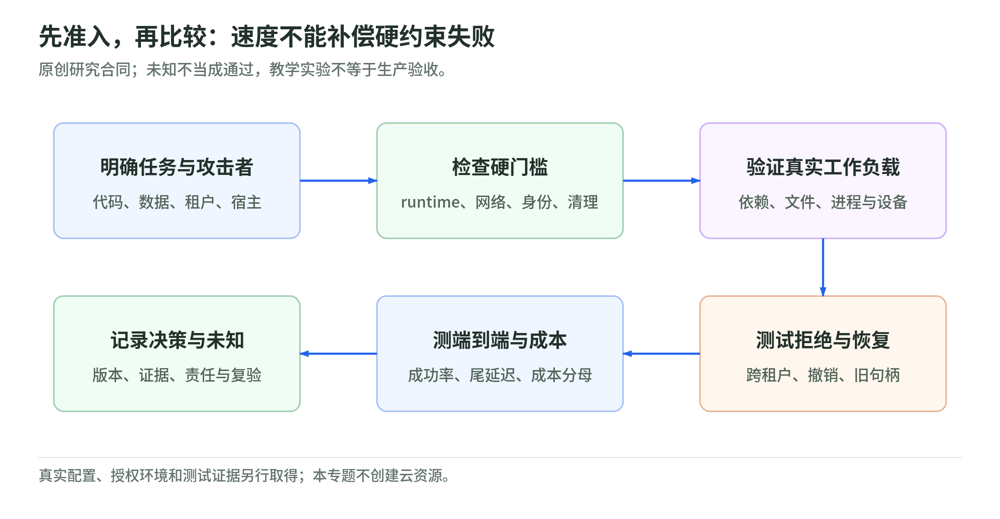

# 10 生产运维与验收：测任务成功，不只测开机

资料核验：2026-11-04。本章给出原创测量合同、容量算例和验收表；未部署云资源、运行产品性能比较或执行逃逸测试。

## 七个时间点避免口径混淆

原创事件记录：

| 时间点 | 事件 | 相邻差值说明什么 |
| --- | --- | --- |
| t0 | 客户端发出请求 | 用户可见起点 |
| t1 | 平台受理 | API／网络路径 |
| t2 | 获得调度资源 | 排队与容量 |
| t3 | runtime／guest 开始 | 准备与创建 |
| t4 | 环境 Ready | 启动／恢复＋身份／网络／代理 |
| t5 | 首个业务命令成功 | runtime Ready 到实际工具可用 |
| t6 | 任务与导出成功 | 端到端结果 |

同一测试定义 `first_command_latency = t5 - t0`、`task_latency = t6 - t0`。若镜像拉取、依赖安装、失败重试或导出未计入，单独报告，不藏进“环境启动时间”。冷启动、预拉镜像、预热实例和快照恢复应分成不同实验组。

某项目给出的 VMM 启动、某服务给出的 API Ready、某编排器给出的 warm claim，可能是不同区间。没有相同条件，不直接比较。Firecracker 文档也指出快照性能受内存、vCPU、设备以及具体宿主行为影响。[快照文档](https://raw.githubusercontent.com/firecracker-microvm/firecracker/main/docs/snapshotting/snapshot-support.md)、[宿主配置](https://raw.githubusercontent.com/firecracker-microvm/firecracker/main/docs/prod-host-setup.md)。

## 给性能测试一个能复现的合同

教学建议先记录：

- 宿主机型、CPU 架构、内核、VMM／runsc 版本、guest kernel；
- 镜像 digest、依赖集合、工作目录大小、网络模式；
- 冷／热／快照、池大小、并发、到达率与压测位置；
- 任务种类、成功定义、总预算、失败和重试政策；
- 计时起终点、采样次数、分位数算法、测量开销；
- 被排除项，如模型服务延迟、包下载或外部 API；
- 实际安全配置及为兼容开启的例外。

最后一项很重要：关闭重要防护后的速度不该当成开启防护路线的速度。

## 不同任务要有不同基准

| 基准类别 | 原创样例 | 观察 |
| --- | --- | --- |
| 计算 | 纯 CPU 数组／文本转换 | CPU、内存、预算与结果正确性 |
| syscall／文件 | 小文件、目录扫描、元数据、读写 | I/O 模式、缓存、ABI 与尾延迟 |
| 依赖／构建 | Python wheels、npm、编译器、测试 | 首次安装、缓存、进程与失败率 |
| 网络 | 受控目标与不同请求大小 | DNS、连接、代理、重试与限流 |
| 浏览器 | 固定本地测试站点的页面流程 | 浏览器隔离、渲染、context 清理 |
| 生命周期 | 创建、取消、恢复、销毁、重建 | 幂等、泄漏、策略更新与句柄失效 |
| 突发并发 | 稳定到达＋短时突发 | claim、补池、控制面与宿主瓶颈 |

gVisor 文档要求试运行具体容器才能判断兼容性；快照恢复也存在连接与版本约束。因此，只有一个 hello world 或计算循环的报告不足以代替任务级测试。[gVisor 兼容性](https://gvisor.dev/docs/user_guide/compatibility/)、[Firecracker 快照](https://raw.githubusercontent.com/firecracker-microvm/firecracker/main/docs/snapshotting/snapshot-support.md)。

## 容量算术：平均需求与尾部余量分开

原创稳态教学模型，假设到达率 λ = 2 个任务／秒，平均占用时间 W = 30 秒；任务从占用实例到释放实例计时：

```text
平均在服任务 L = λ × W = 60
按 70% 目标占用率估算在线槽位 = ceil(60 / 0.7) = 86
再留 10 个未分配预热槽位，总计 96
每槽假设 512 MiB；仅槽位内存 = 96 × 512 MiB = 48 GiB
```

这些数字是假想的，不是任何产品价格或容量承诺。没有计入控制面、宿主、VMM、guest 固定开销、page cache、备份、异常峰值和宿主故障余量。

λW 是长时间平均，不是 p95 并发或突发保障。稳态系统条件、到达分布、长尾任务、预热耗尽和补池速度都要测。不能把一个任意峰值 λ 代进平均 W 后说“容量已证明”。

RuntimeClass 的 overhead 是将运行时额外资源纳入调度的入口，不自动替团队测出正确数字。[RuntimeClass](https://kubernetes.io/docs/concepts/containers/runtime-class/)。

[离线容量实验](lab.md)用相同假设验算 60、86、96 与 48 GiB，仅演示算术。

## 总成本按成功任务分母计算

原创建议的口径：

```text
期间总成本 =
  active compute + idle/warm compute + storage/snapshot
  + network/proxy + logs/observability + control plane
  + retries/failures + security/operations

单位成功任务成本 = 期间总成本 / 期间成功任务数
```

托管价格还要查计费状态、最小粒度、CPU／内存、快照／存储、出口、套餐、限额和税务等实际口径。本章不录入未经账户与地域核对的“最新单价”，也不把开源二进制免费理解成平台免费。

比较两个平台时，同时保留任务成功率；否则把失败任务不计时、却也不计成本，会使不可靠方案看起来更快更便宜。

## 安全配置证据与负向测试一起保留

<!-- illustration: agbox-selection-gates-353dbdd3f5 -->


*图：先准入，再比较：速度不能补偿硬约束失败。原创研究合同；未知不当成通过，教学实验不等于生产验收。*
<!-- /illustration: agbox-selection-gates-353dbdd3f5 -->

教学建议，全部是待执行验收项：

| 维度 | 正向用例 | 负向用例与证据 |
| --- | --- | --- |
| runtime | 获准任务在指定 handler 成功 | 不可改 handler／开启宿主权限；记录有效配置 |
| 文件 | 读写任务专属目录 | 无敏感测试标记不能跨租户读取 |
| 网络 | 访问批准的测试端点 | 元数据、内网、双栈、直连、重定向按政策拒绝 |
| 身份 | 受限任务调用指定资源 | 错误租户、过期、撤销、参数变化拒绝 |
| 资源 | 预算内任务完成 | 超 CPU／内存／磁盘／日志预算按政策处理 |
| 生命周期 | 创建、恢复、导出正常 | 旧连接、旧代次、重复请求和终态不会重新获权 |
| 数据 | 合法产物交付当前用户 | 越界路径／未经批准格式拒绝，秘密不进日志 |

这些测试应在专门授权环境，用非敏感标记执行。不需要把已知逃逸漏洞载荷发进生产，也不应以“没有复现攻击”证明无漏洞。对真实多租户安全，需要进一步审计、补丁管理与相称的专业验证。

Kubernetes NetworkPolicy 需要支持的插件，规则是允许集合叠加，还存在节点与已有连接的实现边界。因此证据要包含有效路径，不能只保留 YAML。[NetworkPolicy](https://kubernetes.io/docs/concepts/services-networking/network-policies/)。

## 配置示例：说明准入意图，不直接部署

下面仅展示 Kubernetes Pod 的部分安全字段；省略了可信镜像、节点配置、RBAC、出口和存储。`approved-sandbox` 是教学名字，须映射到管理员实际设置的 runtime handler，不是可直接安装的产品。

```yaml
spec:
  runtimeClassName: approved-sandbox
  automountServiceAccountToken: false
  securityContext:
    runAsNonRoot: true
    seccompProfile:
      type: RuntimeDefault
  containers:
    - name: task
      image: registry.example.invalid/task@sha256:<verified-digest>
      securityContext:
        allowPrivilegeEscalation: false
        readOnlyRootFilesystem: true
        capabilities:
          drop: ["ALL"]
```

字段依据：[Pod Security Standards](https://kubernetes.io/docs/concepts/security/pod-security-standards/)、[RuntimeClass](https://kubernetes.io/docs/concepts/containers/runtime-class/)。

它不是所有 sandboxed runtimes 的统一最优 profile。Pod Security 官方指出保护依赖隔离方法，没有适合所有 sandboxed workloads 的单一推荐配置。应用若需要写缓存，必须另给受限写目录；若需要业务访问，走明确身份方案，而非恢复宽服务账户 token。

## 升级、灰度与宿主排空

教学建议给每个运行实例关联版本账本：宿主 kernel、微码、runtime／VMM、guest、镜像、策略、执行代理与恢复模板。某一项变化后，重新跑相关兼容、负向、快照和性能用例。

Firecracker 官方要求持续更新宿主／guest 内核与微码，并提醒硬件漏洞需要宿主措施；snapshot 的跨环境恢复又不应默认假设兼容。[生产宿主](https://raw.githubusercontent.com/firecracker-microvm/firecracker/main/docs/prod-host-setup.md)、[snapshot](https://raw.githubusercontent.com/firecracker-microvm/firecracker/main/docs/snapshotting/snapshot-support.md)。

灰度时先停止向旧池分配新任务，等待或按任务合同取消既有任务，再替换节点／模板。回滚需要兼容性证据；不要把旧快照反复恢复成回滚手段，却忽略它复制的凭证和应用状态。

## 必备运行指标

原创建议至少观察：

- 创建／Ready／首命令／任务／导出成功率与 p50／p95／p99；
- warm pool 可用数、补池速率、claim 等待与策略拒绝；
- 每租户并发、CPU throttling、OOM、磁盘与日志超额；
- 活跃与暂停时长、恢复失败、超时／取消后残留；
- 连接撤销时间、凭证刷新失败、数据导出拒绝；
- host capacity、故障节点、scheduler／controller／proxy 饱和。

安全拒绝不应都算系统 bug；获准任务失败也不应被包装成“安全很强”。记录原因类别才能区分防护正常、兼容失败和平台故障。

## 上线签字应说明“未知”还在哪里

交付一份 ADR、配置快照、版本记录、任务与负向结果、故障恢复证据、成本分母和责任清单。无法看到厂商内部实现，不必伪造事实；可以把缺口转成合同问题、独立审计材料要求或不采购的退出条件。

未测试的 GPU 隔离、硬件侧信道、跨区域恢复、平台数据删除等仍保持未测试。本专题完成的是学习材料与本地教学验证，不是这些生产验收。

## 自测与答案

1. t4 很快、但包安装失败很多，平台就一定更适合吗？**不一定。** 要看首次命令与成功任务。
2. 平均并发 60，可否只配 60 个槽位就保证尾延迟？**不能。** 突发、波动、补池与故障另测。
3. RuntimeClass 配置、负向测试和无漏洞保证是否等价？**不等价。** 各有不同证据范围。

[专题导读](README.md) · [上一章：网络、身份与数据](09-network-identity-and-data.md) · [学习路线](learning-roadmap.md) · [离线实验](lab.md)
