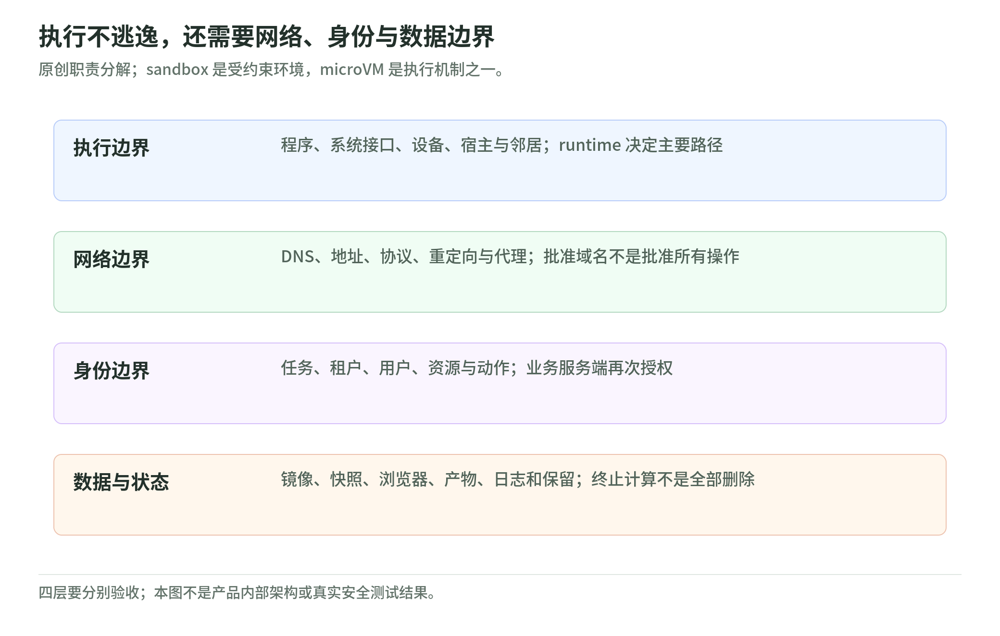

# Agent 部署的 Sandbox、容器与 microVM：从隔离原理到生产选型

资料核验与整理日期：2026-11-04。定位：面向工程师、平台团队和架构讨论的中文专题读本，不是产品采购排名、安全认证或已执行的云端性能测试。

一个 Agent 能读网页、下载依赖、运行脚本、操作浏览器，也可能持有企业身份。此时问题不只是“代码跑在哪里”，而是：陌生代码能触及哪些内核接口，网络能到哪里，凭证代表谁，任务结束后还留下什么。技术选型必须同时回答这些问题。

本专题用官方文档、项目源码说明和第一方产品资料，分开描述**实现机制、项目声明、原创工程建议、尚未核实事项**。底层源码链接中的 `main`／`master` 是本次阅读入口，不是假装固定到某个发布版；部署前要重新核对稳定版本与实际配置。[来源与研究边界](sources.md)说明核验方法及未执行项。

## 先建立一张分层地图

<!-- illustration: agbox-boundaries-2a0202d17d -->

*图：执行不逃逸，还需要网络、身份与数据边界。原创职责分解；sandbox 是受约束环境，microVM 是执行机制之一。*
<!-- /illustration: agbox-boundaries-2a0202d17d -->

Sandbox 是受约束的执行环境，不是某个唯一实现。Linux 权限约束、应用内核、硬件虚拟化与 Wasm 可以承担不同边界；调度、快照、网络和业务授权则在其他层。Linux 文档明确指出 seccomp 过滤不是完整 sandbox；gVisor 文档也提醒隔离环境不能替代安全架构。[seccomp](https://docs.kernel.org/userspace-api/seccomp_filter.html)、[gVisor 安全模型](https://gvisor.dev/docs/architecture_guide/security/)。

| 你正在决定什么 | 常见候选 | 不应据此直接推断 |
| --- | --- | --- |
| 给代码什么权限 | namespaces、cgroups、seccomp、LSM、Landlock | 配上其中一项就完成多租户隔离 |
| 代码经过什么执行边界 | 原生容器、gVisor、VM／microVM、Wasm | 存在一条适合所有场景的安全／速度排名 |
| 怎样管理任务环境 | OCI runtime、Kata、Kubernetes Agent Sandbox、沙箱服务 | 一个 CRD 或 SDK 本身决定隔离强度 |
| 怎样管理实际行动 | 出站代理、凭证 broker、工具授权、审批、产物验证 | VM 能替代身份授权或防止所有提示注入 |

这张表是本专题的阅读框架。具体机制见第 02–05 章；平台公开声明见第 07 章。

## 十章阅读地图

| 章节 | 核心问题 | 应带走的判断 |
| --- | --- | --- |
| [01 系统模型与威胁](01-system-model-and-threats.md) | Agent、工具、环境和控制面之间如何划线？ | 先定义攻击者和资产，再谈隔离 |
| [02 Linux 与容器](02-linux-and-containers.md) | namespaces、cgroups、seccomp、LSM 各管什么？ | 不把非 root 或资源限制当完整证明 |
| [03 gVisor 应用内核](03-gvisor.md) | 拦截并实现系统调用，与过滤有什么不同？ | 看 ABI 兼容性、平台模式与配置 |
| [04 VM、microVM 与 Kata](04-microvm-and-kata.md) | KVM、VMM、guest kernel、jailer 如何组合？ | microVM 是精简虚拟机，不是免运维平台 |
| [05 Wasm 与机密计算](05-wasm-and-confidential-computing.md) | 能力接口与 TEE 分别保护谁？ | 限制代码与不信任宿主是不同方向 |
| [06 生命周期与编排](06-lifecycle-and-orchestration.md) | 任务、会话、预热、快照和持久化怎样协调？ | 运行状态不等于业务状态 |
| [07 平台版图](07-platform-landscape.md) | E2B、Modal、Daytona、Cloudflare、Vercel、Fly、AWS 各提供什么？ | 对比可核查边界，不猜内部实现 |
| [08 选型与参考架构](08-selection-and-architectures.md) | 什么时候用容器、应用内核、microVM 或专用 VM？ | 硬约束先筛选，再测适配性 |
| [09 网络、身份与数据](09-network-identity-and-data.md) | 为什么隔离成功仍可能发生数据泄漏或越权？ | 权限、出站与输出需要独立约束 |
| [10 生产运维与验收](10-production-and-benchmarks.md) | 如何测延迟、可靠性、成本与隔离配置？ | 不以一次启动成功代替验收 |

配套：[学习路线与自测](learning-roadmap.md)、[中英术语](glossary.md)、[免费离线实验](lab.md)、[一手来源与未知项](sources.md)。

## 一分钟选方向：建议，不是产品认证

- 只调用固定、经过授权的业务 API，不运行任意代码：先解决工具身份、参数与副作用授权，不必为“Agent”标签额外自建 microVM。
- 单团队、已审查代码的批处理：加固容器通常值得作为兼容性与成本基线；接受共享宿主内核这一前提。
- 用户上传代码、自动安装陌生依赖、开放式 coding Agent：优先评估 gVisor 或 VM 级边界，并单独设计网络、租户和凭证隔离。
- 需要完整 Linux ABI、复杂编译链或系统工具：评估 microVM、Kata 或专用 VM；有特殊设备需求时先查实际支持，不能从“Linux”推出“所有设备可用”。
- 可重编译、接口很窄的工具插件：评估 Wasm；不要把它当无需适配的通用 Python／浏览器环境。
- 不能信任宿主运营者、涉及使用中敏感数据：额外评估机密计算与 attestation；它不是对上述隔离方案的简单替换。

这些建议是根据机制的工程推导；前提、反例和退出条件见[选型章](08-selection-and-architectures.md)。

## 容易混淆的六句话

1. **“Docker image”不等于“共享内核容器”。** 镜像是打包与分发对象；最终可以由不同运行时放进容器、Kata guest 或平台 microVM。
2. **“使用 KVM”不等于“启动完整 Linux guest”。** gVisor KVM 平台仍保持它的应用内核／进程模型。[平台说明](https://gvisor.dev/docs/architecture_guide/platforms/)。
3. **“一台 microVM”不等于“一个用户的一切”。** 要明确按任务、会话还是租户划边界；Kata 的 Kubernetes VM sandbox 通常是 Pod 粒度。[Kata 虚拟化设计](https://github.com/kata-containers/kata-containers/blob/main/docs/design/virtualization.md)。
4. **“暂停”不等于“清洁重置”。** 快照可能复制内存中的身份、随机状态和应用缓存；guest 与控制面还要执行恢复协议。[Firecracker 快照](https://github.com/firecracker-microvm/firecracker/blob/main/docs/snapshotting/snapshot-support.md)。
5. **“无法逃逸”不等于“无法作恶”。** 获准访问的数据、网络和工具本身可能足以造成损害。[gVisor 安全模型](https://gvisor.dev/docs/architecture_guide/security/)。
6. **“预热很快”不等于“端到端很快”。** 本专题把排队、环境就绪、首次命令和任务成功分别计时，不拿厂商不同口径数字组成榜单。

## 研究覆盖与边界

这套读本覆盖执行原语、运行时、编排与产品层，包含四张本地中文机制图和三个标准库教学实验。实验只演示配置准入、容量算术与状态机，**不执行陌生代码，不创建容器／VM，不访问云账户，不证明真实逃逸防御**。

本轮未调用独立的 Deep Research 产品；采用多轮实时检索与两个有明确分工的后台研究任务，交叉整理第一方资料。未做全行业穷举、漏洞情报订阅、商用方案账户级测试或付费性能比较。未明确公开的平台内部实现保留为未知，产品架构陈述不提升为独立验证结论。

## 与已有 Wiki 衔接

- [安全体系的工作负载与容器](../security/security-101/07-workload-and-container-security.md)：补足容器安全、RBAC、运行身份和供应链。
- [AI 与 Agent 安全](../security/security-101/09-ai-and-agent-security.md)：业务权限和未可信输入与本专题的执行边界互补。
- [Agentic RL 的工具与环境](../deep-learning/training/agentic-rl-lab/tools-and-environments.md)：训练期间的执行环境，也需要独立任务与数据边界。
- [自我改进的评测与安全](../deep-learning/self-improvement/evaluation-and-safety.md)：评估器隔离、修改权限和计算预算不能由候选 Agent 自行放宽。

[开始阅读：系统模型与威胁](01-system-model-and-threats.md) · [回到主题索引](../README.md)
