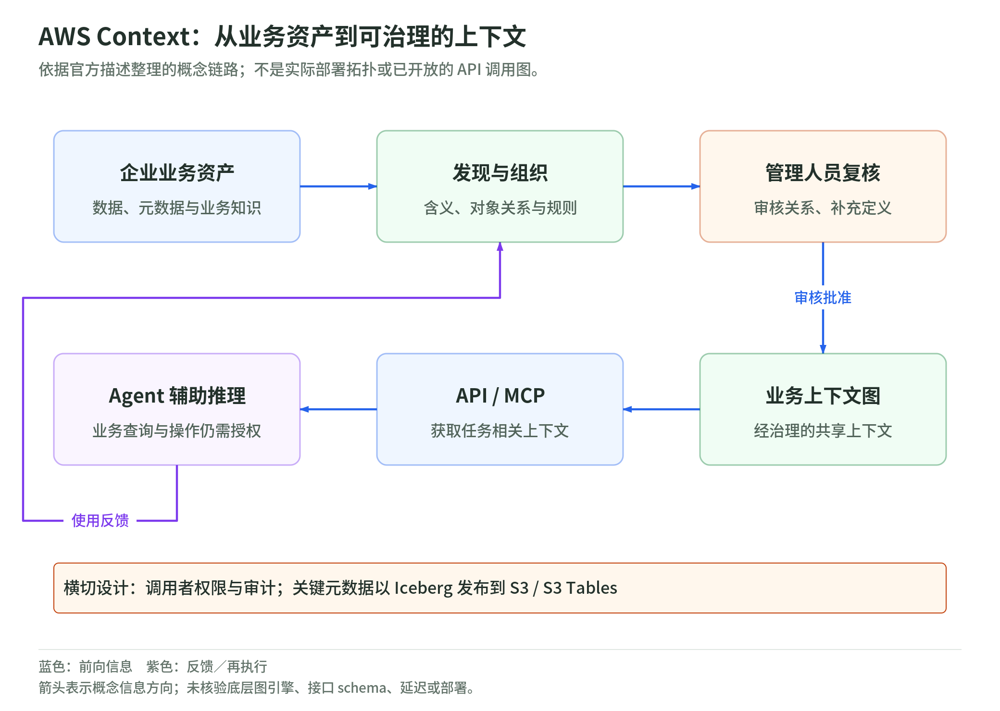
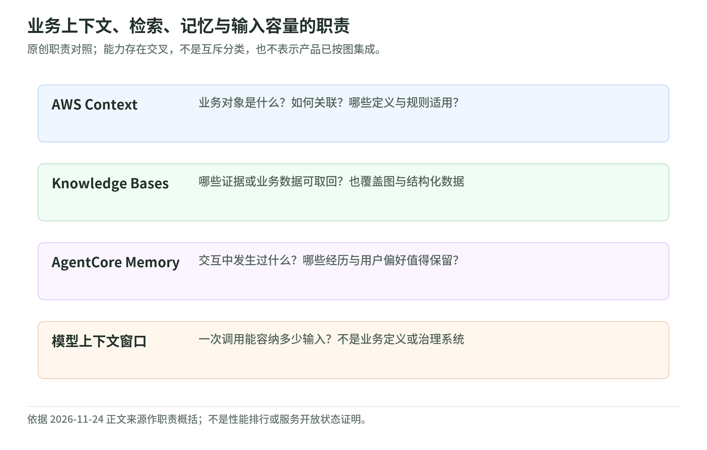

# AWS Context：企业 Agent 的业务语义与上下文层

整理与核查日期：2026-11-24（Asia/Shanghai）。本文基于 AWS 官方公告、文档与开源项目，区分**官方产品描述、已核验的公开状态、分析判断和验证建议**。研究对象是 AWS Context 服务，不是 Lambda 的 context 对象，也不是模型的上下文窗口。

结论：AWS Context 可以理解为给企业 AI Agent 使用的业务语义与上下文层。它试图帮助 Agent 理解数据的业务含义、对象关系和规则，而不只是找到相关文本。当前宜跟踪产品方向，不宜直接按“已经正式开放、已有完整接口与价格”的托管服务制定生产计划。[S1](sources.md#s1)、[S4](sources.md#s4)

阅读顺序：[定位](#它解决什么问题) → [概念链路](#官方描述能支持到哪一层架构) → [产品对比](#与现有-aws-能力的关系) → [采用建议](#怎样验证是否值得采用) → [可用性](#发布与可用性核查)。配套：[一手来源与证据边界](sources.md)。

## 它解决什么问题

AWS Summit 公告把自动关联已有数据、形成知识图谱，以及运行时 agentic search 列为服务定位。核心问题是：企业数据分别存放在多个系统中，Agent 如何知道它们在业务中意味着什么？[S3](sources.md#s3)

### 先分清四种上下文

| 概念 | 主要回答的问题 |
| --- | --- |
| 模型上下文窗口 | 一次模型调用能够接收多少输入？不是 AWS Context 的产品定位。 |
| Agent 会话与记忆 | 过去发生了什么，用户有什么偏好？AgentCore Memory 文档主要讨论这一层。[S10](sources.md#s10) |
| 企业业务上下文 | 客户、合同、产品是什么，彼此如何关联，哪些规则影响判断？这是对 Context 定位的概括。[S1](sources.md#s1) |
| 数据目录与业务元数据 | 有哪些资产，其业务术语和定义是什么？Glue business context 已覆盖其中一部分。[S11](sources.md#s11) |

**本 Wiki 的分析：价值在于减少业务语义的临场猜测。** 例如，“活跃客户”按过去 30 天登录计算，还是按有效合同计算？CRM 与合同系统中的同名客户是否为同一主体？这些需要明确的定义和关联，不是增加输入长度就能解决。

## 官方描述能支持到哪一层架构

<!-- illustration: awsctx-concept-flow-cdcd756429 -->


*图：AWS Context：从业务资产到可治理的上下文。自动发现与人工复核分别承担不同责任；查询反馈辅助维护。权限与开放格式是官方描述，不代表本 Wiki 已实测。*
<!-- /illustration: awsctx-concept-flow-cdcd756429 -->

下图整理公告中的概念关系，**不是官方 API 调用图或底层部署拓扑**。图中的发现、复核、查询和反馈表示不同职责，不承诺具体协议或执行顺序。[S1](sources.md#s1)

官方公布的设计要点包括：

- **自动发现与组织：** 从企业资产中发现关系、业务含义和规则，形成供 Agent 使用的上下文图。
- **人工治理：** 数据管理人员可以审核推断关系、批准进入生产，并补充业务定义和规则；不是完全无人参与。
- **使用反馈：** 根据查询中的来源、连接路径和规则使用情况改进上下文，并在组织内复用。
- **开放格式：** 关键上下文元数据以 Apache Iceberg 发布到 S3/S3 Tables，可由兼容引擎消费。
- **身份与权限：** 查询设计为继承调用者的 IAM 与 Lake Formation 权限，并支持审计；公告也提到与 Glue Data Catalog、SageMaker Unified Studio、Lake Formation 的集成。[S1](sources.md#s1)

这些是产品描述，不是本 Wiki 对实际服务的测试结果。Iceberg 方向已经公布，但本轮未获得具体表 schema 或完整导出合同；底层图引擎、图查询语言、ontology 文件格式、增量协议与一致性合同也未完成核验。**不能把 COA 的 Neptune 实现直接套到 Context 托管服务上。**

### 一个具体场景

以下是原创示意，不是 AWS 客户案例：

> “能不能给华东地区 A 客户推荐延保促销？”

Agent 可能需要同时判断：CRM 与合同系统是否指向同一客户；产品与合同如何关联；保修是否有效；营销授权是否有效；适用规则是否已经更新。

检索出“延保促销方案”还不等于判断正确。上下文层有价值的前提，是提供正确对象关联、规则和适用范围；Agent 获取实际业务数据时仍须遵守权限。这是待验证的假设，不是已交付功能的确认。

### 不能从公告推出什么

- 自动发现，不等于未写下来的业务知识能够被可靠推断。
- 理解规则，不等于具有确定性规则引擎或执行阻断机制。
- 提供上下文，不等于替代业务数据库、所有检索或所有工具。
- 使用 MCP，不等于自动解决授权、提示注入或错误操作。
- 持续维护，不等于已有明确的新鲜度、冲突处理、删除传播与版本回滚保证。

这些是供应商说明和 PoC 需要回答的问题，不是本轮发现的产品缺陷。

## 与现有 AWS 能力的关系

<!-- illustration: awsctx-responsibilities-193a4a18c7 -->


*图：业务上下文、检索、记忆与输入容量的职责。Context 强调企业业务语义，Knowledge Bases 强调检索与数据访问，Memory 强调交互记忆；实际能力并非互斥。*
<!-- /illustration: awsctx-responsibilities-193a4a18c7 -->

下图是职责对照，不是互斥分类，也不表示这些产品已经按图集成。检索与语义能力存在交叉，应从实际缺口判断是否需要新增组件。

| 能力 | 一手资料能确认的重点 | 与 Context 的关系：本 Wiki 分析 |
| --- | --- | --- |
| Bedrock Knowledge Bases | 知识检索、Neptune Analytics 图、结构化数据源接入；当前 Managed Knowledge Base 文档还列出多步检索与推理。[S9](sources.md#s9) | 更接近检索和数据访问路径。不能简化成“只会向量检索”，也不能确认与 Context 的完整集成合同。 |
| Glue business context | 为 Data Catalog 增加业务术语、资产元数据、语义搜索和 Agent skill；本次 getting-started 文档标注 preview。[S11](sources.md#s11) | 存在语义元数据重叠。应核实谁是定义的权威来源，以及哪些资产可以复用。 |
| AgentCore Memory | 短期记忆保存交互事件；长期记忆从交互中提取和维护有用信息。[S10](sources.md#s10) | 主要是交互经历与偏好，不应仅从会话中推断正式政策或企业主数据。 |
| Context Ontology Accelerator（COA） | AWS 开源、自管理方案；使用 ontology、Amazon Neptune、Bedrock 等组件构建供 Agent 使用的语义与图能力。[S4](sources.md#s4)、[S12](sources.md#s12) | 是可研究和验证的实现，但不是 Context 托管服务。其组件和性能不应直接外推。 |

关键区别不是“RAG vs 图”。选择 Context 前，应先检查现有方案在对象关联、业务定义、规则适用范围和治理方面缺什么。

## COA 可以参考，不能替代托管服务证据

COA 官方资料展示从业务描述构建 ontology、人工复核、数据映射与 Agent 使用的流程；仓库明确为部署到用户 AWS 账户的自管理方案。[S12](sources.md#s12)、[S13](sources.md#s13)

它可以用于验证“明确的业务模型是否能减少业务判断错误”，也能帮助形成对托管服务的验收问题。但不能把它的部署组件、MCP 工具、访问控制、示例性能或软件许可证，当作 Context 的接口、性能、价格与安全合同。

开源软件可获取，不代表运行所需的云资源免费。本次整理未部署 COA、未调用模型，也未产生云资源账单。

## 怎样验证是否值得采用

以下均为原创选型与实验建议，不是 AWS 要求。

### 先定位错误来源

优先评估跨 CRM、ERP、合同、工单的业务 Agent，以及依赖统一指标、对象关系和业务规则的多步任务。

如果只是简单文档问答或单一数据源查询，先检查检索质量、业务数据和权限配置。增加语义层不能自动修复错误数据，也会增加维护和运维责任。

### 用同口径 PoC 比较

建议准备 **50–100 道真实业务问题**，覆盖对象消歧、跨系统关联、术语歧义、规则冲突、时间有效性、缺失证据与越权访问。

使用相同模型、数据、权限身份和答案判定口径：

1. **基线 A：** 现有检索方案；已有 GraphRAG 或结构化查询能力不应人为移除。
2. **基线 B：** 在 A 上增加人工整理、可审计的业务上下文。
3. **实验 C：** 能够实际访问的语义图方案，如经授权部署的 COA；Context 获得正式接入和接口说明后另测。

分别记录答案正确性、关系与规则错误、证据追溯、权限拒绝、新鲜度、人工维护成本、端到端延迟，以及单次成功任务成本。不能用召回率代替业务判断正确性，也不能把 COA 的结果当作 Context 性能。

### 向 AWS 核实的五组问题

| 维度 | 需要确认 |
| --- | --- |
| 开放与商业合同 | 账号接入、区域、价格、配额、SLA、支持范围 |
| 建模与权威性 | 资产范围、人工模型导入、审核、纠错、定义冲突 |
| 接口合同 | API/MCP 工具、输入输出、认证、分页、错误处理 |
| 安全与治理 | 请求身份与源权限、敏感关系泄露、删除、审计、隔离 |
| 运维与可退出 | 更新延迟、回滚、来源追踪、导出，以及与既有服务的分工 |

建议现在推进业务语义资产梳理与小范围验证；生产引入 Context 应以正式开放状态、接口和治理合同为前提。

## 发布与可用性核查

截至 2026-11-24，以下结论只覆盖本次公开资料核查；**未找到不等于不存在**，不排除受邀或非公开开放。

| 项目 | 已核验事实与边界 |
| --- | --- |
| 首次公开介绍 | 2026-06-17；博客与 AWS 作者索引交叉确认。[S1](sources.md#s1)、[S2](sources.md#s2) |
| Context 公开状态 | 已核验的首篇博客与 Summit 公告仍标注 Coming soon；本轮未确认能更新为 preview/GA 的一手公告。[S1](sources.md#s1)、[S3](sources.md#s3) |
| 7/31 公告 | 发布对象是 COA，不是 Context 托管服务；其用户自定义 ontology 成为 Context 原生全托管能力，仍以未来事项描述。[S4](sources.md#s4) |
| 正向技术证据 | CloudTrail 已列出 `context.amazonaws.com`、`context-mcp.amazonaws.com` 事件源；不是可调用 endpoint、IAM prefix 或 GA 证明。[S5](sources.md#s5) |
| API 与 MCP | 公告描述了接入方向，但本轮未核验完整 API reference 或逐项 MCP 工具清单。[S1](sources.md#s1) |
| 定价、区域、配额 | 未获得可核验的独立公开规格，保留未知。 |
| SDK、CLI 与 IAM | 本次目录检查不足以证明不存在支持；专用 client、actions 与 ARN 格式未完成核验。[S6](sources.md#s6)、[S7](sources.md#s7)、[S8](sources.md#s8) |

要确定账号级开放情况，应另行检查控制台、正式邀请或 AWS 的直接答复。本次未执行这些检查。

## 与已有专题连接

- [大数据技术](../README.md)：把 Context 放在“业务语义与操作层”，而不是数据库或存储层。
- [Palantir Ontology](../palantir-ontology.md)：从业务对象、关系与动作理解语义层；不能仅凭都使用 ontology 就认定两个产品等价。
- [Agent 记忆系统](../../agent-memory/README.md)：区分企业业务定义、交互记忆和一次调用的输入。
- [AI 与 Agent 安全](../../security/security-101/09-ai-and-agent-security.md)：上下文有用不代表可以扩大权限或信任范围。

## 图件与执行边界

两张图为本 Wiki 的原创概念整理，依据正文一手来源，不是厂商内部架构、生产部署或性能复现。图型选择与内容归纳采用 document-illustrator 方法，矢量布局与校验采用 fireworks-tech-graph 方法，使用仓库本地渲染器生成可编辑 SVG 与 2× PNG；没有调用图像生成 API。

配图清单位于 `scripts/figures/aws-context.json`，图片存于上级 `images/`，正文使用本地相对路径。可从仓库根目录重建：

```bash
python3 scripts/render_figures.py --embed --id-prefix awsctx-
python3 scripts/render_figures.py --check --id-prefix awsctx-
```

本页保留 2026-11-24 的核查口径；产品开放状态变化后，应更新来源台账和结论，不能仅改图中的文字。
