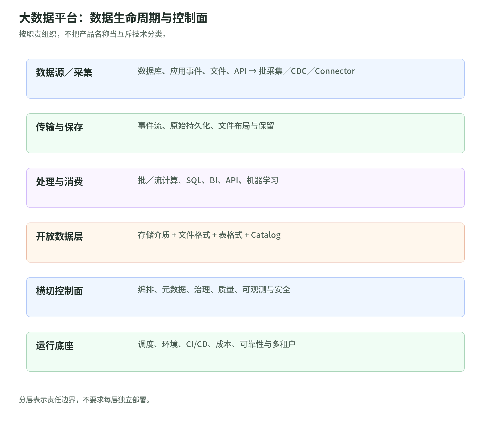
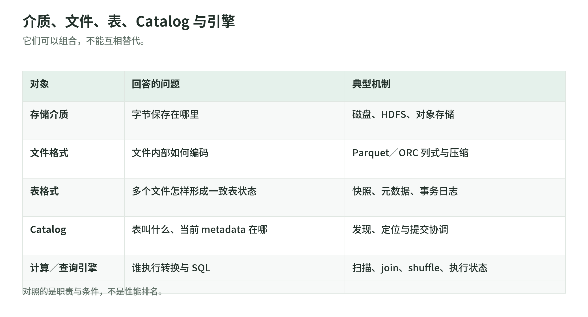
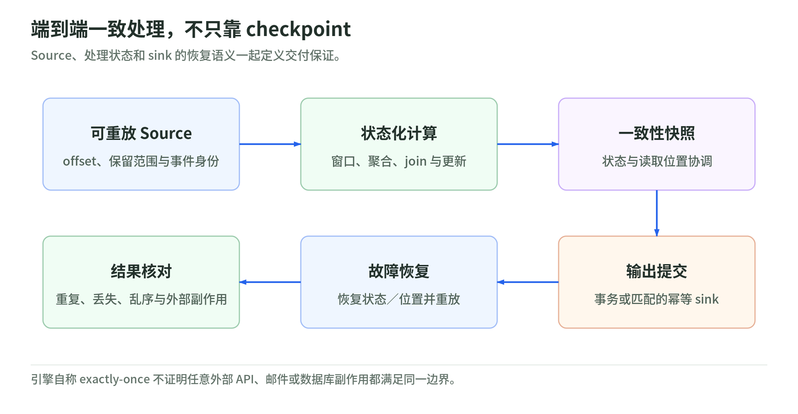
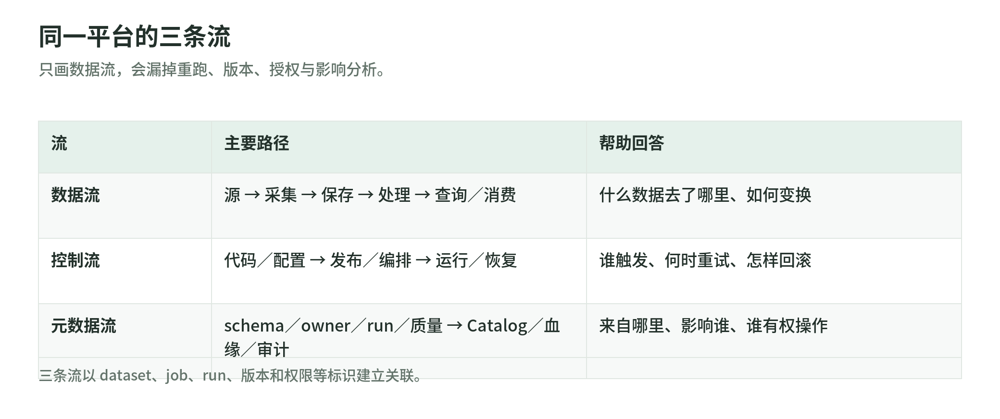

# 大数据技术体系整理研究

- 研究日期：2026-09-03
- 研究目标：建立一套不依赖具体产品热度、可以长期维护的大数据技术整理框架
- 来源范围：Apache 项目官方文档、云厂商官方架构文档、开放表格式及相关开放规范的官方文档

## 结论摘要

<!-- illustration: data-platform-layers-3129a21d4a -->


*图：大数据平台：数据生命周期与控制面。按职责组织，不把产品名称当互斥技术分类。*
<!-- /illustration: data-platform-layers-3129a21d4a -->

大数据技术不应按厂商或产品名称平铺，而应按两条轴线整理：

1. **数据生命周期**：数据产生后，如何被采集、传输、保存、处理、查询和消费。
2. **平台控制面**：如何编排任务，管理元数据与质量，保障可观测、安全、资源和交付。

Azure 的端到端分析架构从多类数据源开始，经过实时或批量接入、湖仓/数仓存储、转换和分析后提供给消费端，同时把治理、身份、密钥、监控和 CI/CD 放在支撑整条链路的平台层；AWS 的现代数据架构也把可扩展存储、数据集成、分析与机器学习、Catalog 和治理组合成协同架构，而不是让一个系统承担所有负载。[Azure Architecture Center: Analytics end-to-end](https://learn.microsoft.com/en-us/azure/architecture/example-scenario/dataplate2e/data-platform-end-to-end) [AWS Prescriptive Guidance: Modern data architecture](https://docs.aws.amazon.com/prescriptive-guidance/latest/strategy-aws-data/aws-architecture.html)

因此，建议用下面的结构作为 Wiki 主骨架：

```text
数据平面

数据源
  -> 采集
  -> 消息与事件流
  -> 存储介质与文件
  -> 批处理 / 流处理
  -> SQL / 查询 / 数据服务

开放数据层

对象存储 + 文件格式 + 表格式 + Catalog

横切控制面

编排 | 元数据与治理 | 数据质量 | 可观测性 | 安全

运行底座

平台工程 | 资源调度 | 环境与交付 | 成本与可靠性
```

这里的“层”是**职责边界**，不是强制的部署边界。一个产品可能覆盖多层，但笔记仍应把它的职责拆开。例如 Kafka 同时提供持久化事件日志、消息传递和流处理接口；Spark 同时提供批计算、流计算和 SQL；湖仓产品可能同时提供表格式、Catalog、计算和治理。整理时应先记录它承担的能力，再记录产品。

## 一、先固定五个最容易混淆的对象

<!-- illustration: file-table-catalog-engine-ac42fff640 -->


*图：介质、文件、表、Catalog 与引擎。它们可以组合，不能互相替代。*
<!-- /illustration: file-table-catalog-engine-ac42fff640 -->

### 1. 存储介质

回答“字节最终保存在哪里”。典型对象包括本地磁盘、HDFS 和云对象存储。HDFS 通过 NameNode 管理命名空间和块映射，由 DataNode 保存实际数据块；它的设计目标包括大数据集、流式访问和运行于通用硬件。[Apache Hadoop: HDFS Architecture](https://hadoop.apache.org/docs/current/hadoop-project-dist/hadoop-hdfs/HdfsDesign.html)

对象存储提供按对象和键组织的持久存储。以 Amazon S3 为例，官方文档说明其 PUT 和 DELETE 操作具有强读后写一致性。[Amazon S3 data consistency model](https://docs.aws.amazon.com/AmazonS3/latest/userguide/Welcome.html#ConsistencyModel)

### 2. 文件格式

回答“单个或一组文件内部如何编码数据”。Parquet 是面向复杂嵌套数据的列式存储格式，设计目标是高效压缩和编码；它不是事务表，也不负责跨文件快照、并发提交或 Catalog。[Apache Parquet overview](https://parquet.apache.org/docs/overview/)

### 3. 表格式

回答“如何把许多数据文件组织成具有表语义的逻辑对象”。Iceberg 使用元数据树和快照跟踪表状态，支持 schema evolution、hidden partitioning、partition evolution 和 time travel；Delta Lake 用事务日志在数据湖上提供 ACID 事务和可扩展元数据处理；Hudi 通过 Copy-on-Write 和 Merge-on-Read 表类型适配不同写入与查询权衡。[Apache Iceberg introduction](https://iceberg.apache.org/docs/latest/) [Apache Iceberg evolution](https://iceberg.apache.org/docs/latest/evolution/) [Delta Lake introduction](https://docs.delta.io/latest/delta-intro.html) [Apache Hudi table types](https://hudi.apache.org/docs/table_types/)

### 4. Catalog 与元数据服务

回答“表叫什么、在哪里、schema 是什么、谁拥有它、引擎如何发现它”。Catalog 不等于数据文件，也不等于查询引擎。Iceberg 的 Catalog 负责定位表的当前 metadata file，并可提供原子提交所需的协调能力。[Apache Iceberg reliability](https://iceberg.apache.org/docs/latest/reliability/)

### 5. 计算与查询引擎

回答“谁读取数据、执行转换或 SQL、管理执行状态并返回结果”。Spark SQL 使用 DataFrame/Dataset 和统一 SQL 接口处理结构化数据；Trino 把查询拆分为 stage、task、split 和 driver，并通过 connector 访问外部数据源。[Apache Spark SQL guide](https://spark.apache.org/docs/latest/sql-programming-guide.html) [Trino concepts](https://trino.io/docs/current/overview/concepts.html)

这五个对象可以组合，但不能互相替代：

```text
对象存储/HDFS
  保存
Parquet/ORC 文件
  由
Iceberg/Delta/Hudi 表元数据组织
  经
Catalog 发现与协调
  被
Spark/Flink/Trino 等引擎读写
```

## 二、技术分层

### 1. 数据源与采集

#### 解决的问题

把业务数据库、应用事件、日志、文件、API 和设备数据可靠地引入分析平台，同时控制对源系统的影响，并保留必要的来源、顺序和 schema 信息。

#### 核心概念

- **批量抽取**：按时间窗口或快照周期读取一批有界数据。
- **CDC**：读取数据库变更日志，把 insert、update、delete 转换为变更事件。Debezium 官方架构说明其连接器从数据库日志捕获行级变更，并把变更记录发送到 Kafka topic。[Debezium architecture](https://debezium.io/documentation/reference/stable/architecture.html)
- **数据流路由与背压**：控制不同来源和目标之间的流速、排队、重试和优先级。NiFi 的核心概念包括 FlowFile、Processor、Connection、back pressure 和 data provenance。[Apache NiFi overview](https://nifi.apache.org/nifi-docs/overview.html)
- **Connector**：把外部系统接入消息或计算平台。Kafka Connect 以 source connector 和 sink connector 在 Kafka 与外部系统之间移动数据，并支持分布式扩展和状态管理。[Apache Kafka Connect](https://kafka.apache.org/documentation/#connect)
- **数据契约与 schema 演进**：在生产者和消费者之间明确字段、类型、兼容策略、所有者和变更流程。

#### 代表技术

- 批量或文件/API 数据流：Apache NiFi。
- 数据库 CDC：Debezium；托管云数据库迁移/CDC 服务。
- 通用连接器框架：Kafka Connect、Flink connectors。

代表技术用于理解不同采集模型，不意味着每条链路都需要同时部署它们。

#### 技术选型维度

- 来源类型：数据库日志、表快照、文件、API、日志还是设备事件。
- 时效目标：天/小时级批量，还是秒级持续采集。
- 正确性：是否允许丢失、重复、乱序；是否需要源端一致性快照。
- 对源系统影响：全表扫描、增量列还是事务日志读取。
- schema 变化：新增、删除和类型变更如何传播。
- 重放与审计：能否从原始数据或日志重新构建下游。
- 连接器成熟度：目标系统覆盖、故障恢复、限流和版本兼容。

#### 与相邻层的边界

采集负责**从源头取得并交付数据**；消息与流层负责**缓冲、排序、保留和分发事件**；计算层负责**转换和聚合**。CDC 连接器产生变更事件，但它本身通常不承担复杂业务计算。

### 2. 消息与事件流

#### 解决的问题

解耦生产者和消费者，以可扩展、可重放的方式承载持续事件，为实时处理和异步集成提供稳定入口。

#### 核心概念

- **Topic 与 partition**：Kafka topic 被划分为 partition；相同 key 的事件可路由到同一 partition，partition 内保持顺序。[Apache Kafka introduction](https://kafka.apache.org/documentation/#intro_concepts_and_terms)
- **Offset 与 replay**：消费者用 offset 表示读取位置，保留期内可以重新读取事件。
- **Consumer group**：组内消费者共同分摊 partition，实现并行消费；不同组可以独立消费同一事件流。
- **持久化与保留**：事件流不是只存在于发送瞬间，而是在保留策略内可重复读取。
- **交付语义**：at-most-once、at-least-once、exactly-once 必须结合生产、处理、状态和 sink 的完整链路判断。Kafka 官方设计文档明确区分这些交付语义，并说明 exactly-once 依赖事务生产和消费处理方式。[Apache Kafka design: delivery semantics](https://kafka.apache.org/documentation/#semantics)
- **背压与流量隔离**：慢消费者、热点 partition 和突发流量不应拖垮生产端或其他租户。

#### 代表技术

- Apache Kafka：分区事件日志和事件流平台。
- Apache Pulsar：以 broker、topic、subscription 和 BookKeeper 持久化为核心的消息与流平台。[Apache Pulsar architecture](https://pulsar.apache.org/docs/next/concepts-architecture-overview/)
- 云厂商托管事件流与消息服务。

#### 技术选型维度

- 峰值吞吐、单条消息大小和端到端延迟。
- 顺序范围：全局、topic、partition/key 还是无需顺序。
- 保留时间、回放频率和历史积压规模。
- 消费模型：队列、发布订阅、多租户、多地域复制。
- 交付语义及与下游事务的协同。
- 分区扩缩容、热点处理和运维复杂度。
- 协议、客户端、schema registry 和 connector 生态。

#### 与相邻层的边界

消息平台可以持久化事件，但通常不替代面向多年历史分析的低成本数据湖，也不替代有状态流计算。它提供事件的传输、缓冲和重放；窗口、join、聚合和业务状态属于流计算层。

### 3. 存储

#### 解决的问题

以合适的成本、持久性和访问性能保存原始数据、加工数据及服务数据，并支持预期的读取、更新和保留模式。

#### 核心概念

- **分区与数据布局**：按查询裁剪维度组织文件或数据，减少扫描。
- **复制与持久性**：应对节点、磁盘和可用区故障。
- **行式与列式**：行式更适合读取或更新完整记录；Parquet 等列式格式适合只扫描所需列并进行压缩。[Apache Parquet overview](https://parquet.apache.org/docs/overview/)
- **压缩、编码和小文件**：决定存储成本、扫描吞吐、元数据压力和任务启动开销。
- **存算耦合与分离**：HDFS 把计算尽量靠近数据；对象存储让多个弹性计算集群共享持久数据，但增加网络、请求和元数据设计的重要性。
- **工作负载类型**：大范围扫描、点查、搜索、时序、图和低延迟 OLAP 对存储组织要求不同。

#### 代表技术

- 分布式文件系统：HDFS。
- 云对象存储：Amazon S3、Azure Data Lake Storage、Google Cloud Storage。
- 分析文件格式：Apache Parquet、Apache ORC。
- 服务型存储：按需求选择列族、KV、搜索、时序或实时 OLAP 系统，不把它们与数据湖混为一层。

#### 技术选型维度

- 访问模式：扫描、点查、范围查询、更新、删除还是追加。
- 数据温度、保留周期和生命周期分层。
- 一致性、事务、并发写入和恢复要求。
- 计算位置、网络带宽、跨区费用和数据本地性。
- 文件大小、分区基数、压缩率和 schema 演进。
- RPO、RTO、版本、备份和跨地域复制。
- 开放格式与多引擎互操作要求。

#### 与相邻层的边界

存储介质负责字节持久化，文件格式负责文件内布局，表格式负责跨文件表语义，计算引擎负责执行。把“数据湖”等同于“对象存储桶”会遗漏表事务、Catalog、治理和运维。

### 4. 批处理与流处理

<!-- illustration: end-to-end-delivery-2e8ba71426 -->


*图：端到端一致处理，不只靠 checkpoint。Source、处理状态和 sink 的恢复语义一起定义交付保证。*
<!-- /illustration: end-to-end-delivery-2e8ba71426 -->

#### 解决的问题

对大规模有界或无界数据执行清洗、关联、聚合、特征计算和模型构建，并在失败后恢复到可解释的正确状态。

#### 核心概念

- **有界与无界数据**：Flink 把 batch 视为有界流的特例，把 streaming 用于有界或无界数据，并使用同一运行时执行两类作业。[Apache Flink: batch and streaming](https://nightlies.apache.org/flink/flink-docs-stable/docs/learn-flink/overview/)
- **事件时间、处理时间与 watermark**：事件时间表示事件实际发生时间；watermark 表示系统对事件时间进度的判断，用于处理乱序和触发窗口。[Apache Flink: event time and watermarks](https://nightlies.apache.org/flink/flink-docs-stable/docs/concepts/time/)
- **状态与 checkpoint**：有状态算子的恢复依赖一致性状态快照。Flink checkpoint 在流持续运行时周期性生成可恢复状态。[Apache Flink: checkpoints](https://nightlies.apache.org/flink/flink-docs-stable/docs/ops/state/checkpoints/)
- **微批与连续处理**：Spark Structured Streaming 默认使用 micro-batch，把流式查询表达为对持续追加输入表的增量查询。[Apache Spark Structured Streaming guide](https://spark.apache.org/docs/latest/streaming/index.html)
- **shuffle、倾斜和并行度**：跨分区重分布通常是批流计算的主要网络和磁盘成本来源。
- **端到端 exactly-once**：不仅取决于引擎 checkpoint，还取决于 source 可重放、状态一致性和 sink 的幂等或事务能力。

#### 代表技术

- Apache Spark：批处理、SQL、机器学习及微批流处理。
- Apache Flink：以状态化流处理为核心，并统一处理有界与无界数据。
- Apache Beam：用 Pipeline、PCollection、transform 和 runner 描述可移植的批流数据处理模型。[Apache Beam programming guide](https://beam.apache.org/documentation/programming-guide/)

#### 技术选型维度

- 数据是否有界，允许的业务延迟是小时、分钟、秒还是更低。
- 状态大小、状态访问模式和 checkpoint 时间。
- 事件时间、乱序范围、迟到数据和重算需求。
- SQL、代码 API、机器学习库和 connector 生态。
- exactly-once 的真实端到端边界。
- 作业启动时间、弹性、资源利用率和单位数据成本。
- 大状态升级、savepoint、回放和版本迁移能力。

#### 与相邻层的边界

计算引擎执行转换；编排器决定多个作业何时运行及如何依赖；消息平台保存和分发事件；查询引擎面向交互式读取。Spark 或 Flink 可以覆盖多项能力，但笔记应分别评价其执行模型、SQL 能力和运行方式。

### 5. SQL、查询与数据服务

#### 解决的问题

让分析师、应用和 BI 工具以可接受的延迟访问数据，并针对交互式分析、报表、搜索或在线服务选择合适的执行与存储方式。

#### 核心概念

- **逻辑计划与物理计划**：SQL 先转换为关系算子，再由优化器选择 join、聚合、扫描和数据交换策略。
- **MPP 与分布式执行**：查询拆成 stage/task/split，在多个 worker 上并行执行。[Trino concepts](https://trino.io/docs/current/overview/concepts.html)
- **谓词下推、列裁剪和分区裁剪**：尽可能少读取文件、行组和列。
- **向量化执行与列式内存**：按批处理列值以提高 CPU 和缓存效率。
- **联邦查询**：通过 connector 查询多个系统，但跨源 join 的数据移动、统计信息和权限会成为限制。Trino connector 提供对外部数据源的适配，并由 catalog 把 connector 配置暴露给查询。[Trino connectors](https://trino.io/docs/current/connector.html)
- **服务等级**：临时报表、固定 BI、秒级 OLAP、毫秒点查和全文搜索不是同一种查询负载。

#### 代表技术

- 通用数据处理 SQL：Spark SQL。
- 分离式交互查询：Trino。
- 低延迟分析服务：Apache Druid 等实时 OLAP 系统。Druid 官方文档将其定位为面向事件数据的实时分析数据库，并采用 segment、时间分区和列式存储。[Apache Druid design](https://druid.apache.org/docs/latest/design/)
- 专用数据仓库与云查询服务。

#### 技术选型维度

- 并发数、P50/P95/P99 延迟和扫描数据量。
- 查询形态：点查、宽表聚合、复杂 join、搜索还是混合负载。
- 数据新鲜度、缓存和预计算要求。
- 写入频率、更新/删除需求和数据布局。
- 优化器统计信息、动态过滤和物化视图能力。
- 数据源 connector、SQL 兼容性和 BI 生态。
- workload management、隔离、弹性和成本上限。

#### 与相邻层的边界

SQL 是接口，不代表底层架构相同。Spark SQL 偏向通用处理，Trino 偏向交互式联邦查询，实时 OLAP 系统把存储和查询紧密结合。查询引擎也不等于表格式：前者执行计划，后者管理表的文件和快照。

### 6. 湖仓与开放表格式

#### 解决的问题

在低成本、开放的文件/对象存储之上增加可靠的表级事务、并发提交、schema 与 partition 演进、快照读取、变更处理和多引擎互操作。

#### 核心概念

- **快照与原子提交**：Iceberg 每次写入生成新 metadata，并通过原子替换当前 metadata 指针提交；读者使用稳定快照，不会看到部分提交。[Apache Iceberg reliability](https://iceberg.apache.org/docs/latest/reliability/)
- **乐观并发控制**：写入者基于当前表状态提交，冲突时重试或失败。
- **schema evolution**：按字段 ID 跟踪列，避免仅按名称或位置解释变更。[Apache Iceberg evolution](https://iceberg.apache.org/docs/latest/evolution/)
- **hidden partitioning 与 partition evolution**：查询不需要硬编码物理分区列，表布局可随数据量和查询模式演进。[Apache Iceberg partitioning](https://iceberg.apache.org/docs/latest/partitioning/)
- **time travel 与 rollback**：按历史快照读取或回退表状态。
- **compaction、clustering 和文件维护**：持续写入会产生小文件、删除文件或未优化布局，需要后台维护。
- **Catalog**：提供命名、发现、当前元数据定位和提交协调。

#### 代表技术

- Apache Iceberg：开放表格式，突出多引擎、快照、演进和隐藏分区。
- Delta Lake：基于事务日志提供 ACID、schema enforcement、time travel 和批流统一的数据表。[Delta Lake introduction](https://docs.delta.io/latest/delta-intro.html)
- Apache Hudi：突出增量处理、upsert/delete 和 Copy-on-Write、Merge-on-Read 权衡。[Apache Hudi overview](https://hudi.apache.org/docs/overview/) [Apache Hudi table types](https://hudi.apache.org/docs/table_types/)

#### 技术选型维度

- 写入模式：append、upsert、delete、CDC 合并还是高频小批写入。
- 读取模式：全量扫描、快照、增量读取、流式消费还是 time travel。
- 引擎与 Catalog 兼容矩阵，避免只看格式规范。
- 并发写入、冲突检测和提交协调。
- schema、partition 和 sort order 演进能力。
- compaction、清理、孤儿文件回收和元数据扩展性。
- 行级删除、变更数据读取和监管删除。
- 开放性、迁移成本和厂商扩展依赖。

#### 与相邻层的边界

湖仓不是单个产品，也不只是“数据湖 + SQL”。完整能力至少涉及对象存储、文件格式、表格式、Catalog、计算/查询引擎、治理和运维。表格式解决表级元数据与事务，不自动解决查询加速、任务编排、质量和权限。

### 7. 编排

#### 解决的问题

管理多个数据任务之间的依赖、触发、重试、超时、回填、补数、参数、SLA 和人工干预，使数据产品能够按预期重复运行。

#### 核心概念

- **DAG**：Airflow DAG 封装 schedule、tasks、task dependencies、callbacks 等工作流结构。[Apache Airflow DAGs](https://airflow.apache.org/docs/apache-airflow/stable/core-concepts/dags.html)
- **逻辑日期与数据区间**：调度时间不等于数据所属时间；补数和重跑必须绑定明确的数据区间。
- **幂等、重试与补偿**：相同分区或业务日期重复执行应得到可预测结果。
- **backfill/catchup**：为历史数据区间创建运行实例。Airflow 提供 backfill 来为历史日期范围创建 DAG runs。[Apache Airflow backfill](https://airflow.apache.org/docs/apache-airflow/stable/core-concepts/backfill.html)
- **数据感知触发**：以上游数据集或事件就绪触发，而不只依赖固定时间。
- **控制流与数据流分离**：编排器保存任务状态和依赖，不应承载大规模数据本身。

#### 代表技术

- Apache Airflow：面向有限批工作流的 DAG 编排。官方文档明确说明 Airflow 用于开发、调度和监控 batch-oriented workflows，并不以持续运行的事件流负载为主要目标。[Apache Airflow core concepts](https://airflow.apache.org/docs/apache-airflow/stable/core-concepts/overview.html)
- 云厂商托管工作流编排服务。
- Kubernetes-native 工作流或事件驱动编排系统。

#### 技术选型维度

- 时间触发、数据触发、事件触发和人工触发模型。
- DAG 规模、调度吞吐、动态任务和跨团队隔离。
- 重试、回填、补数、参数化和幂等支持。
- 外部系统集成、秘密管理和权限边界。
- 可测试性、版本化、部署和本地开发体验。
- 运行历史保留、告警、SLA/SLO 和灾难恢复。

#### 与相邻层的边界

编排器负责“何时、按什么依赖运行”，计算引擎负责“如何处理数据”。流作业通常由运行平台持续管理；编排器可以部署、升级或监控流作业，但不应把每条事件建模成 DAG task。

### 8. 治理与数据质量

#### 解决的问题

让组织知道有哪些数据、数据含义是什么、来自哪里、由谁负责、谁可以使用，以及数据是否满足业务和技术约束。

#### 核心概念

- **技术、业务和运行元数据**：schema、分区和作业属于技术元数据；术语、指标定义和所有者属于业务元数据；运行状态、数据量和延迟属于运行元数据。
- **Catalog 与发现**：提供数据资产搜索、描述、标签、所有者和访问入口。
- **分类与标签**：Apache Atlas 的 type system 支持 entities、classifications、relationships，并可将分类传播到关联实体。[Apache Atlas type system](https://atlas.apache.org/2.0.0/TypeSystem.html)
- **血缘**：记录 dataset、job、run 及输入输出关系。OpenLineage 核心模型围绕 Run、Job、Dataset 和 extensible facets 定义血缘事件。[OpenLineage object model](https://openlineage.io/docs/spec/object-model/)
- **质量维度与规则**：完整性、唯一性、有效性、一致性、及时性和准确性应落到可执行检查及负责人。
- **数据契约**：在生产者和消费者之间约定 schema、语义、质量、SLO、兼容性和变更通知。
- **所有权与变更流程**：质量失败必须能找到负责人，并判断阻断、降级还是告警。

#### 代表技术

- Apache Atlas：元数据类型、分类、发现和血缘。
- OpenLineage：开放的运行时血缘事件模型和 API。
- 云数据治理与质量服务。Google Cloud Dataplex data quality 使用 YAML 规则定义数据质量检查，并把结果写入 BigQuery 和 Cloud Logging。[Google Cloud Dataplex data quality](https://cloud.google.com/dataplex/docs/auto-data-quality-overview)

#### 技术选型维度

- 元数据覆盖范围：表、文件、topic、作业、仪表板、特征和 API。
- 自动采集 connector 和血缘准确度。
- 业务术语、分类、所有权和审批工作流。
- 质量规则类型、增量检查、失败策略和历史趋势。
- schema/契约兼容性及变更影响分析。
- 与 IAM、审计、编排、告警和工单系统的集成。
- 元数据开放 API、导出能力和厂商锁定。

#### 与相邻层的边界

Catalog 告诉使用者“有什么和在哪里”；血缘说明“如何产生”；质量说明“是否满足约束”；安全决定“谁能访问”。监控作业成功不等于数据正确，质量检查通过也不代表基础设施健康。

### 9. 可观测性

#### 解决的问题

持续回答系统是否健康、数据是否按时且正确、故障影响了哪些下游，以及恢复是否达到约定目标。

#### 核心概念

- **metrics、logs、traces**：OpenTelemetry 把 traces、metrics、logs 和 baggage 定义为主要信号，用统一语义描述软件运行。[OpenTelemetry signals](https://opentelemetry.io/docs/concepts/signals/)
- **基础设施和引擎指标**：CPU、内存、磁盘、网络、GC、队列、checkpoint、shuffle、失败和重启。
- **管道指标**：吞吐、端到端延迟、消费积压、数据新鲜度、任务持续时间和成功率。
- **数据指标**：行数、空值、重复、分布漂移、schema 变化和业务规则。
- **SLA、SLO 与 error budget**：把“稳定”转化为可度量目标，而不只是收集更多指标。
- **关联诊断**：从数据资产或质量告警关联到作业运行、代码版本、输入数据和基础设施。

Flink 通过 metrics system 暴露系统和作业指标，并支持 reporter 导出到外部系统；Prometheus 通过时间序列和标签记录指标，Alertmanager 负责告警去重、分组和路由。[Apache Flink metrics](https://nightlies.apache.org/flink/flink-docs-stable/docs/ops/metrics/) [Prometheus overview](https://prometheus.io/docs/introduction/overview/) [Prometheus Alertmanager](https://prometheus.io/docs/alerting/latest/alertmanager/)

#### 代表技术

- 指标与告警：Prometheus、云监控服务。
- 日志与追踪：OpenTelemetry 兼容的采集和后端。
- 引擎原生指标与历史服务。
- 数据质量、血缘和编排事件组成的数据可观测能力。

#### 技术选型维度

- 能否覆盖基础设施、引擎、管道和数据四个层次。
- 指标基数、日志量、采样、保留周期和成本。
- 端到端关联 ID、数据集/作业/run 标识和血缘关联。
- 实时告警、异常检测、抑制、分组和升级路径。
- 仪表板是否对应 SLO 和处置动作。
- 多租户权限、敏感数据脱敏和审计。

#### 与相邻层的边界

可观测性负责发现、定位和度量；编排器负责执行恢复动作；质量系统执行数据规则；治理系统提供上下文和影响范围。仅监控“任务成功”会漏掉静默数据错误。

### 10. 安全

#### 解决的问题

确保正确的身份在被允许的条件下访问正确的数据和操作，并保护数据在传输、存储和使用过程中的机密性、完整性和可审计性。

#### 核心概念

- **认证与身份**：确认用户、服务和工作负载是谁。
- **授权与最小权限**：按资源、动作、标签、行列或上下文授予权限。
- **传输与静态加密**：保护网络链路、磁盘和对象。
- **秘密与密钥管理**：凭据不应硬编码在作业或镜像中，应支持轮换和审计。
- **网络隔离**：私有端点、网络策略、防火墙和出口控制。
- **审计**：记录谁在何时访问或改变了什么。
- **数据保护**：分类、脱敏、tokenization、行列过滤、保留和删除。

Kafka 官方安全文档列出 SSL/TLS 认证与加密、SASL 认证和 ACL 授权；Ranger 的官方目标包括集中式安全管理、细粒度授权、基于角色或属性的访问控制，以及集中审计用户访问和管理操作。[Apache Kafka security](https://kafka.apache.org/documentation/#security) [Apache Ranger introduction](https://ranger.apache.org/)

#### 代表技术

- 身份与密钥：云 IAM/KMS、企业身份提供商和秘密管理服务。
- 数据平台授权与审计：Apache Ranger、云数据治理与访问控制服务。
- 传输认证：TLS、SASL、mTLS。
- 运行时隔离：Kubernetes RBAC、namespace、network policy 和 workload identity。

#### 技术选型维度

- 资源粒度：集群、topic、bucket、catalog、table、row、column。
- 人、服务账号和工作负载身份的统一与生命周期。
- 策略集中管理和各引擎执行的一致性。
- 跨引擎、跨云和缓存/导出后的权限继承。
- 密钥托管、轮换、BYOK/HYOK 和审计要求。
- 合规地域、保留、删除、法律冻结和证据链。
- 性能影响、应急访问和权限故障恢复。

#### 与相邻层的边界

治理中的分类和所有权为安全策略提供上下文，但治理不执行授权；安全控制访问，但不定义业务语义或数据质量。应用、引擎、Catalog、对象存储和网络必须形成纵深防御，不能只依赖单一入口。

### 11. 平台工程

#### 解决的问题

把前述能力变成可重复交付、可隔离、可升级、可扩缩和可计量的内部平台，让团队通过标准接口获得数据基础设施，而不是每个项目自行拼装集群。

#### 核心概念

- **资源调度与隔离**：Kubernetes 通过 namespace 隔离资源组，通过 requests/limits 参与 Pod 调度和资源控制。[Kubernetes namespaces](https://kubernetes.io/docs/concepts/overview/working-with-objects/namespaces/) [Kubernetes resource management](https://kubernetes.io/docs/concepts/configuration/manage-resources-containers/)
- **声明式基础设施与环境一致性**：集群、网络、权限、Catalog 和监控配置应版本化并自动交付。
- **自助服务与 paved road**：提供经过治理的模板、API、CLI 或门户，用标准方式创建 topic、表、作业和监控。
- **多租户与配额**：在共享效率和故障/安全隔离之间权衡。
- **弹性与容量**：区分无状态计算、状态化流作业、缓存和持久存储的扩缩策略。
- **升级与兼容**：引擎、connector、表格式、Catalog 和运行时版本需要兼容矩阵和回滚方案。
- **FinOps**：按团队、作业、数据产品或查询归集计算、存储和网络成本。
- **可靠性工程**：高可用、备份、跨地域、故障演练、RPO/RTO 和运行手册。

Spark 官方支持在 Kubernetes 上以 driver 和 executor Pod 运行，并使用 Kubernetes 调度；这说明容器平台承担运行和资源管理，但 Spark 仍承担计算语义。[Apache Spark on Kubernetes](https://spark.apache.org/docs/latest/running-on-kubernetes.html)

#### 代表技术

- 资源与运行底座：Kubernetes、云托管计算平台。
- 集群/队列资源调度：Kubernetes scheduler、YARN 等。
- 基础设施与交付：声明式 IaC、GitOps、CI/CD。
- 自助与策略：内部开发者平台、模板、policy-as-code 和成本平台。

#### 技术选型维度

- 托管服务与自建能力的责任边界。
- 工作负载形态：短批任务、长时间流任务、交互查询和状态服务。
- 隔离、弹性、启动速度和资源利用率。
- 升级频率、版本数量、环境漂移和回滚。
- 平台 API 稳定性、开发体验和团队认知负担。
- 单位 TB、作业、查询和数据产品的完整成本。
- 单区、多区、多地域及混合云的可靠性要求。

#### 与相邻层的边界

平台工程不是数据生命周期的最后一步，而是所有层的运行底座。Kubernetes 能调度 Spark/Flink/Trino 等工作负载，但不理解 watermark、表快照、SQL 优化、数据质量或业务血缘；这些语义仍属于各自数据系统。

## 三、把系统画成数据流、控制流和元数据流

<!-- illustration: three-platform-flows-3131b69f95 -->


*图：同一平台的三条流。只画数据流，会漏掉重跑、版本、授权与影响分析。*
<!-- /illustration: three-platform-flows-3131b69f95 -->

仅画数据流不足以解释系统如何正确运行。建议每篇架构笔记同时画三条流：

### 数据流

```text
业务数据库 / 应用事件 / 文件
  -> 批采集 / CDC / Connector
  -> 事件流或原始存储
  -> 批流计算
  -> 开放表 / 数仓 / 服务型存储
  -> SQL / BI / API / 机器学习
```

### 控制流

```text
代码与配置
  -> CI/CD
  -> 编排器或运行平台
  -> 作业提交、重试、扩缩、回滚
  -> 告警与人工处置
```

### 元数据流

```text
schema / owner / classification / contract
  + 作业 run / 输入输出 / 质量结果
  -> Catalog / 血缘 / 审计
  -> 发现、影响分析、授权和告警
```

三条流相互关联，才能回答：

- 一条错误数据从哪里进入、经过哪些转换、影响哪些下游。
- 一次重跑会不会重复写入或破坏表快照。
- 某个 schema 变化应阻断、兼容还是触发迁移。
- 某个团队、作业或数据产品消耗了多少资源。

## 四、统一技术选型框架

不要直接问“Kafka 还是 Pulsar”“Spark 还是 Flink”。先把需求写成可验证约束。

| 维度 | 必须量化或明确的问题 |
| --- | --- |
| 数据边界 | 有界还是无界；结构化、半结构化还是二进制；是否包含更新和删除 |
| 规模 | 存量、日增量、峰值事件数、消息大小、并发查询和未来增长 |
| 时效 | 数据新鲜度、端到端 P95/P99 延迟、作业完成窗口 |
| 正确性 | 是否允许丢失、重复、乱序、迟到和短暂不一致 |
| 状态 | 状态大小、保留时间、访问模式和恢复时间 |
| 查询 | 扫描、聚合、join、点查、搜索、并发和缓存 |
| 变更 | schema、partition、业务逻辑、引擎版本如何演进 |
| 恢复 | 重试、回放、回填、checkpoint、RPO、RTO 和灾备 |
| 安全 | 身份、权限粒度、加密、网络、审计、删除和地域要求 |
| 互操作 | 文件、表格式、Catalog、协议、SQL 和 connector 是否开放 |
| 运维 | 部署、升级、监控、故障定位和团队技能成本 |
| 经济性 | 计算、存储、请求、网络、人力、许可和迁移总成本 |

选型过程建议固定为：

1. 写出业务 SLO、数据规模和正确性底线。
2. 确认技术处于哪一职责层，避免跨层错比。
3. 先比较系统模型，再比较功能清单。
4. 用故障场景验证语义：重启、重复、乱序、网络分区、下游不可用、schema 变化。
5. 用真实数据做基准，记录吞吐、P95/P99、恢复时间和成本。
6. 检查上下游兼容矩阵、升级路径和退出成本。
7. 最后才选择产品和部署形态。

## 五、截至 2026 年仍应保留的架构判断

### 1. 批和流是数据边界与执行语义，不是两套永久割裂的组织

Flink 把批处理建模为有界流，Beam 用统一模型描述 bounded/unbounded PCollection，Spark Structured Streaming 用增量查询处理持续输入；但不同引擎在延迟、状态、触发和恢复上的实现仍不同。[Apache Flink overview](https://nightlies.apache.org/flink/flink-docs-stable/docs/learn-flink/overview/) [Apache Beam programming guide](https://beam.apache.org/documentation/programming-guide/) [Apache Spark Structured Streaming](https://spark.apache.org/docs/latest/streaming/index.html)

因此，Wiki 可以共享“时间、状态、正确性”概念笔记，但不能用“批流一体”口号跳过执行模型比较。

### 2. 开放湖仓的核心是数据所有权和多引擎协作

表格式把快照、演进和并发提交放到开放存储的数据层，使计算引擎可以替换或并存；实际互操作仍取决于各引擎和 Catalog 对格式功能的支持程度。[Apache Iceberg multi-engine support](https://iceberg.apache.org/multi-engine-support/)

### 3. 实时不等于所有环节都毫秒级

端到端时效取决于采集、消息积压、计算触发、状态、sink 提交、表维护、查询刷新和缓存。应为每个阶段分配延迟预算，而不是只看流引擎基准。

### 4. exactly-once 是端到端性质

消息平台、计算状态和输出系统必须共同满足重放、原子提交或幂等条件。仅启用 checkpoint 或事务 producer 不能自动保证外部副作用恰好一次。[Apache Kafka delivery semantics](https://kafka.apache.org/documentation/#semantics) [Apache Flink fault tolerance](https://nightlies.apache.org/flink/flink-docs-stable/docs/learn-flink/fault_tolerance/)

### 5. 治理、质量、可观测和安全不是收尾项目

它们需要在数据接入时取得 schema、owner、classification 和 contract，在运行时取得 run、lineage、quality 和 audit 事件，并在消费时执行访问和 SLO。后补通常无法恢复完整上下文。

### 6. 平台工程的目标是降低认知负担，而不是统一所有引擎

应统一身份、交付、监控、成本、模板和策略，同时允许不同工作负载使用合适的存储和计算。AWS 现代数据架构把可扩展存储、数据集成、分析与机器学习、Catalog 和治理作为组合能力，而不是要求单一引擎承担全部工作负载。[AWS Prescriptive Guidance: Modern data architecture](https://docs.aws.amazon.com/prescriptive-guidance/latest/strategy-aws-data/aws-architecture.html)

## 六、常见整理错误

| 错误 | 修正方式 |
| --- | --- |
| 按产品首字母或厂商建立目录 | 按业务问题、系统模型和职责层建立目录，产品作为技术笔记 |
| 把 Kafka 只记成消息队列 | 同时记录分区日志、保留/回放、消费者模型和事务边界 |
| 把对象存储、Parquet、Iceberg 和 Trino 写成同一类 | 分别归入介质、文件格式、表格式和查询引擎 |
| 把 Spark 和 Flink 只按“批 vs 流”比较 | 比较执行模型、状态、时间、恢复、SQL、生态和成本 |
| 把 Airflow 当数据处理引擎 | 记录其控制流、调度、重试和回填，数据处理交给执行引擎 |
| 用任务成功率代替数据质量 | 同时观察系统、管道、数据和业务指标 |
| 把 Catalog 等同于治理 | 补充术语、所有权、分类、血缘、质量、契约和流程 |
| 把认证当完整安全 | 分开记录认证、授权、加密、网络、秘密、审计和数据保护 |
| 把 Kubernetes 当大数据架构本身 | 把它放在运行底座，数据语义仍由消息、计算、表和查询系统负责 |
| 只记录正常路径 | 强制记录重复、乱序、迟到、重试、回放、升级和灾难恢复 |

## 七、建议的 Wiki 后续目录

```text
wiki/topics/big-data/
├── README.md
├── technology-landscape-research.md
├── learning-roadmap.md
├── concepts/
│   ├── partitioning-and-replication.md
│   ├── delivery-semantics.md
│   ├── event-time-and-watermarks.md
│   ├── state-and-checkpoints.md
│   ├── columnar-storage.md
│   ├── file-table-catalog-engine.md
│   ├── schema-evolution-and-contracts.md
│   └── idempotency-replay-and-backfill.md
├── layers/
│   ├── ingestion.md
│   ├── messaging-and-streaming.md
│   ├── storage.md
│   ├── batch-and-stream-processing.md
│   ├── sql-and-serving.md
│   ├── lakehouse-table-formats.md
│   ├── orchestration.md
│   ├── governance-and-quality.md
│   ├── observability.md
│   ├── security.md
│   └── platform-engineering.md
├── technologies/
│   ├── kafka.md
│   ├── spark.md
│   ├── flink.md
│   ├── trino.md
│   ├── iceberg.md
│   └── airflow.md
├── architectures/
│   ├── daily-batch-pipeline.md
│   ├── cdc-realtime-analytics.md
│   └── open-lakehouse.md
└── experiments/
    ├── replay-and-deduplication.md
    ├── late-events.md
    ├── small-files-and-compaction.md
    └── failure-recovery.md
```

目录设计遵循三个原则：

1. 稳定原理放在 `concepts/`，避免跟随产品版本反复重写。
2. 层级比较放在 `layers/`，技术实现放在 `technologies/`。
3. `architectures/` 和 `experiments/` 用真实链路验证跨层正确性、性能与运维。

## 八、每篇技术笔记的固定问题

学习任一新技术时，按下面顺序记录：

1. 它解决哪个业务问题，处于哪些职责层。
2. 它的核心数据模型、执行模型、状态模型和一致性模型是什么。
3. 数据如何进入、保存、处理、输出；控制面和元数据如何流动。
4. 发生重复、乱序、迟到、节点故障和下游不可用时会怎样。
5. 它保证什么，不保证什么；exactly-once 或事务的边界在哪里。
6. 扩展单位是什么，热点、shuffle、状态和元数据瓶颈在哪里。
7. 如何部署、升级、监控、备份、回放和回滚。
8. 与开放格式、Catalog、协议和上下游的兼容关系是什么。
9. 计算、存储、网络和人力成本如何。
10. 什么场景适用，什么场景不应使用。
11. 用什么实验能证伪当前理解。

这样整理后，具体技术即使变化，也可以放回同一套问题中比较；新的产品不会迫使整个知识体系重新分类。
