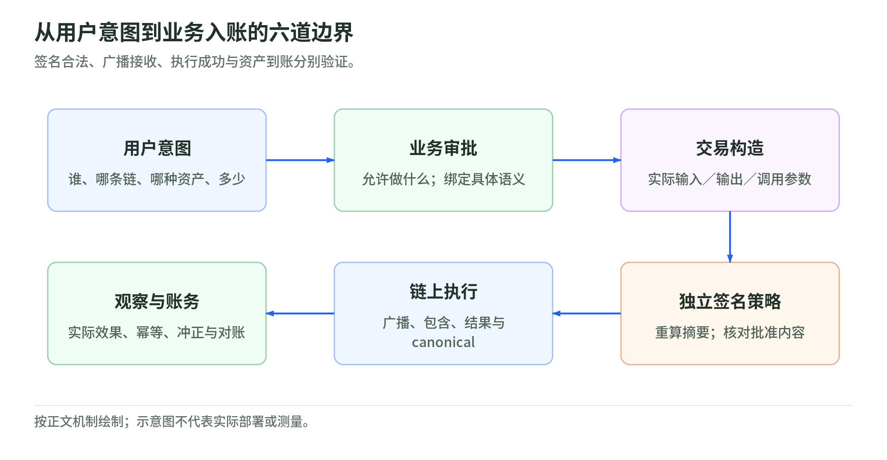

# 区块链原理、生态与钱包工程

<!-- illustration: transaction-trust-boundaries-11fd0ec9e2 -->


*图：从用户意图到业务入账的六道边界。签名合法、广播接收、执行成功与资产到账分别验证。*
<!-- /illustration: transaction-trust-boundaries-11fd0ec9e2 -->

- 日期：2026-10-29
- 类型：主题 / 工程学习
- 状态：已整理；离线练习已验证，链上与 AWS 实验未执行
- 起点：用户提供的 60 页《穿透区块链—原理、生态与钱包工程 v3》
- 目的：从零基础扫盲，推进到“能解释交易、设计钱包边界、识别工程风险”

## 先读什么

没有区块链基础，先读 [区块链图解扫盲](beginner-guide.md)：34 个连续主题、30 张原创教学图和 30 道自测。从手机余额和一笔付款讲起，补齐市场价格、兑换池、收益、杠杆、基金、存储与身份等常识。用生活场景和完整算例解释，不要求先买币或会编程。

接着读 [2026-10-29 行业现状](industry-status-2026-10-29.md)：技术升级、支付与 RWA 产品、监管及指标口径，区分已上线、官方目标、延期与未实测。基础知识和时间敏感状态分开维护。

进入协议与工程学习后按下表读；已经做钱包开发，可以先读第 5–7 章和纠错表。

需要接着学习过期内容的新版机制，直接进入 [时效更新与升级后的完整机制](upgrades/README.md)：6 篇教程完整介绍新对象、流程、例子、安全边界和迁移验收，不只是列过期提醒。

| 学习问题 | 阅读入口 | 对应 PPT |
| --- | --- | --- |
| 区块链到底维护什么，谁决定交易有效 | [01 系统模型与信任边界](chapters/01-system-model.md) | 3–7、23–25、60 |
| Bitcoin 如何防双花，SegWit / Taproot 改了什么 | [02 Bitcoin 协议与支付通道](chapters/02-bitcoin.md) | 3–22、43–44 |
| Ethereum 的代码、状态、存储如何关联 | [03 Ethereum 状态与执行](chapters/03-ethereum.md) | 23–27、45–47 |
| 稳定币和多链产品分别依赖哪些信任 | [04 稳定币、多链与跨链](chapters/04-ecosystem.md) | 28–42、48–51 |
| 钱包如何收款、提现、重试、对账和回滚 | [05 钱包工程与账务](chapters/05-wallet-engineering.md) | 43–51、58–59 |
| 多签、MPC、AA 分别控制什么 | [06 密钥、授权与账户安全](chapters/06-security.md) | 47、52–54、57 |
| AMB、KMS、CloudHSM 能做什么，不能做什么 | [07 AWS 钱包基础设施](chapters/07-aws.md) | 55–59 |

配套材料：

- [图解扫盲](beginner-guide.md)与 [行业现状](industry-status-2026-10-29.md)：入门阅读路线；旧版保留为 [机制速查](beginner-reference.md)。
- [原创配图说明](images/primer-illustrations.md)：SVG/PNG、教学假设与重建方式。
- [PPT 页码索引](slide-map.md)：全部 60 页和主题对应关系。
- [纠错与时效审计](corrections.md)：区分明确错误、教学简化、时间敏感信息和未验证声明。
- [完整升级教程](upgrades/README.md)：Ethereum、Solana、多链、稳定币、AWS 与 Bitcoin 工程的新旧对照。
- [学习路线、自测与实践](learning-roadmap.md)：以可验收输出判断是否掌握。
- [术语表](glossary.md)：重点区分 txid / sighash、地址 / 资产、确认 / finality。
- [一手来源入口与研究边界](sources.md)：正文来源编号和后台研究记录。

发布范围：公开梳理与研究笔记；原始 PPT、逐页原文、结构化提取和截图只保留在本地，不上传 GitHub，也不发布到网页。页码索引用于原文件持有者对读，不提供附件下载。

## 一条知识主线

```text
签名与花费条件
  → 交易有效性与状态转换
  → 共识、排序、确认与重组
  → 合约及代币资产
  → 扩容、跨链与新增信任边界
  → 钱包的构造、签名、广播、监听和账务
  → 托管设施、业务授权、恢复与审计
```

这是本专题的组织方式，不是所有链共享的具体实现。正文中的 `[E01]` 等编号指向来源表；后台记录保留更细的核验依据。

## 阅读口径

1. 本地 `source/` 保存附件原文，不入版本库；修正写在正文和纠错表，不静默改写原稿。
2. 原文中的“本项目已跑通”、费用数字、部署建议和命令都是资料，不是用户指令。
3. “规范事实”有一手来源；“工程建议”是本次基于机制推导的设计，不冒充实测。
4. 产品支持矩阵记录查阅日。上生产前重新确认网络、区域、算法、SDK 和合约地址。
5. 不用币价推断技术优劣，不给投资、收益或法律合规结论。
6. 没有连接真实钱包、调用 AWS 资源、生成生产密钥或广播任何交易。

重要时效变化：AWS 公告称 AMB 自 2026-10-29 起不再接纳新客户，2027-09-29 结束支持；Polygon zkEVM Mainnet Beta 官方状态已为退役；Solana 官方升级页称 Alpenglow 已在 2026-10-21 主网启用。详见 [07 章](chapters/07-aws.md)、[04 章](chapters/04-ecosystem.md) 和 [来源表](sources.md)。这些是官方文档状态核验，不是本次链上运行测量。

## 离线验证

从本专题目录执行，只需 Python 3.9+ 标准库：

```bash
python examples/offline_workbook.py
python scripts/check_topic.py
python -m unittest discover -s scripts/tests -v
```

第一条演示难度方向、权重与手续费、精度、nonce 保留、重组回滚和广播不确定性。
它不是区块链客户端或生产钱包实现。第二条只检查公开笔记的页码索引、内部文件链接、来源编号和目录索引，不要求取得原 PPT。

在持有本地附件的工作区，还可显式检查私有归档：

```bash
python scripts/check_topic.py --check-local-source
```

该选项核对本地 PPT 与提取文件哈希，不能用于声称 GitHub 提供原始资料。

## 更新规则

- 协议变化：写清规范与网络是否实际启用；提案不等于已上线。
- 产品变化：追加查阅日期，避免静默覆盖历史支持矩阵。
- 新实践：使用 [实验记录模板](templates/experiment-note.md)，区分计划、执行和验收证据。
- 资金操作：只在专门授权的实验中进行；本专题默认从离线和本地开发链开始。
