# 区块链图解扫盲：钱、账本、钱包，以及这个行业到底在做什么

你可能已经听过比特币、挖矿、钱包、智能合约，却仍然不知道它们怎么连起来。这很正常：认识“发动机、方向盘、变速箱”，也不等于知道一辆车怎么跑。

这篇从生活里的问题讲起。读完应该能解释一笔钱怎么从甲到乙，识别钱包和金融产品的区别，看出一个项目到底要求你相信谁。不需要先买币，也不用准备数学或编程基础。

贯穿全文的人是小林和小周。转账、报价和收益算例使用假设数字，不是当前行情或操作建议；协议参数、日期和具名状态另给来源。比喻只用来帮助理解，真正影响资产的地方会说明它哪里不适用。

资料核验日：2026-10-29（北京时间）。配图为本地原创 SVG/PNG；没有调用真实钱包或做资金交易。具名产品的当前状态另见 [行业现状](industry-status-2026-10-29.md)。不想看来源时可以先跳过每节末尾的链接。

## 先看路线，别试着一口气背完

| 阅读段落 | 你会弄懂什么 |
| --- | --- |
| 1–8 | 钱在哪里，区块链解决什么，钱包和币是什么 |
| 9–17 | BTC 怎样转账和挖矿，ETH 怎样执行程序，授权怎样生效 |
| 18–26 | 买币、交易、稳定币、DeFi（链上兑换/借贷等金融应用）、收益、杠杆、基金和治理 |
| 27–30 | 扩容、跨链、其他应用和当前行业 |
| 31–34 | 看懂交易、处理常见问题、防骗及自测 |

碰到不熟悉的英文，先记它在做什么。知道 UTXO 是“一份还没用过的收款记录”，比先背出它的英文全称有用。

## 1. 手机里显示的“钱”，到底放在哪里

<!-- illustration: primer-balance-61564465af -->
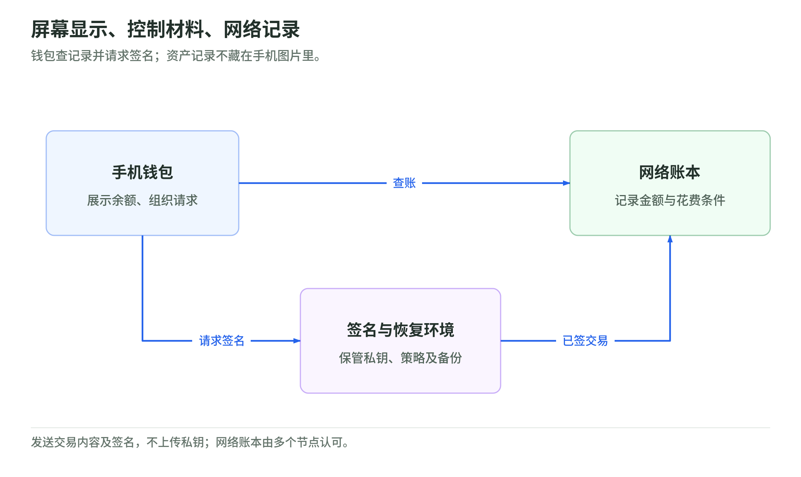

*图：屏幕显示、控制材料、网络记录。钱包查记录并请求签名；资产记录不藏在手机图片里。*
<!-- /illustration: primer-balance-61564465af -->

小林的银行 App 显示余额 1000 元。这不表示手机存着一千个“电子一元文件”。手机只是显示银行系统里的记录，转账时也主要是账务和清算发生变化。

换成自托管 BTC 钱包，手机还是显示工具。但后面的账不是由一家银行维护，而是由 Bitcoin 网络按规则维护。钱包里重要的东西是控制资产的材料，以及查账、签名和发交易的能力。

所以“手机丢了”和“钱消失了”是两件事。如果只是手机坏了，而你有完整可用的恢复材料，换一台设备仍可能恢复控制。如果手机和所有恢复材料一起丢了，账本里的记录还在，你却可能再也无法花它。

再换成交易所 App。它显示你有 0.1 BTC，通常表示平台的客户账上记了你的权益。平台控制链上资产，你通过账户登录、风控和提现流程请求它付款。这与自己持有私钥的关系不同。

三个画面可能都写“余额”，实际关系却是银行账户、平台客户权益和直接链上控制。后面讨论风险时，不能把它们混用。

这里也不把银行存款简化成“柜台替你放了等额纸币”。先理解一件事：屏幕上是记录，记录背后的责任、控制和兑现方式要另外查。

资料：[现代货币与银行存款的区别](https://www.bankofengland.co.uk/quarterly-bulletin/2014/q1/money-in-the-modern-economy-an-introduction)、[Bitcoin 钱包的程序/文件区别](https://developer.bitcoin.org/devguide/wallets.html)、[Ethereum 账户与钱包](https://ethereum.org/developers/docs/accounts/)、[平台余额与网络转账示例](https://help.coinbase.com/en/coinbase/trading-and-funding/pricing-and-fees/fees)。

## 2. 有银行和数据库了，为什么还要多人共同记账

<!-- illustration: primer-double-spend-f891bc72c6 -->
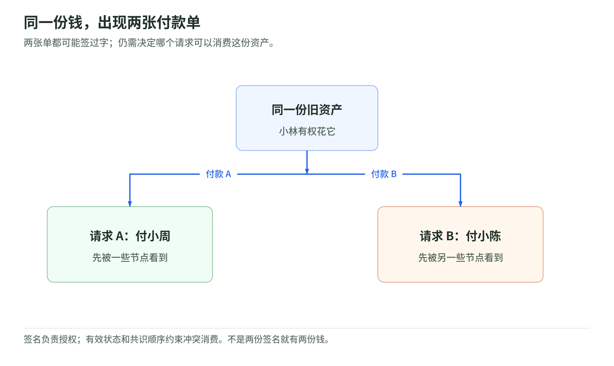

*图：同一份钱，出现两张付款单。两张单都可能签过字；仍需决定哪个请求可以消费这份资产。*
<!-- /illustration: primer-double-spend-f891bc72c6 -->

想象小区几户人合伙收停车费。大家最初把账交给物业：谁交过钱、还剩多少，都由物业记。只要大家信任它，这种方式简单，也容易纠错。

后来有人担心物业会改账，于是提出：每户都留一份副本。听上去问题解决了，其实刚开始。

小林只有一份可花的钱，却同时发出两张付款单：一张付给小周，一张付给小陈。有些人先看到前一张，有些人先看到后一张。两张都可能确实由小林签过。大家接下来认可哪张？

这叫双花。同一份可支配资产不能在同一份有效历史里被花两次。

再投票呢？一个人可以开一万台程序，装成一万个参与者。网络很难把“一个程序身份”当成“一个真实独立的人”。这类大量伪造身份的干扰，叫女巫攻击。

区块链系统于是需要一整套办法：检查谁有权付款，决定冲突请求的顺序，约束伪造身份的影响，并让愿意提供服务的人得到某种激励。

这不表示数据库过时了。如果是一家公司内部记库存，所有人都承认它有管理权，用数据库可能更合适。公链更关心的是：不同参与者不愿把最终账本完全交给同一个管理员时，怎样共同核对。

“去信任”在这里不能理解成谁都不用信。你仍然需要相信某些密码学假设、软件实现和协议条件；用钱包查账时还可能依赖节点供应商。区别在于，有些规则可以自己核验，不只听运营方说。

资料：[Bitcoin 白皮书的支付与双花问题](https://bitcoin.org/bitcoin.pdf)、[Fabric 对不同参与模型的解释](https://hyperledger-fabric.readthedocs.io/en/latest/whatis.html)。

## 3. 区块和链，就是一叠装订好的账页吗

<!-- illustration: primer-linked-pages-32b809fc90 -->
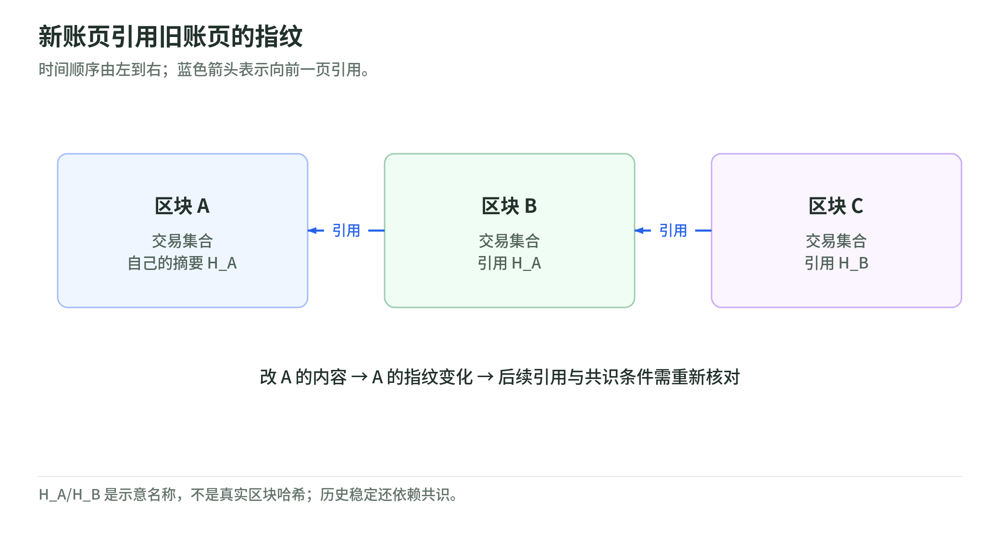

*图：新账页引用旧账页的指纹。时间顺序由左到右；蓝色箭头表示向前一页引用。*
<!-- /illustration: primer-linked-pages-32b809fc90 -->

这个比喻有用，但要加两处说明。

第一，每“页”不是单笔转账。一个区块把一批交易和必要的协议数据组织起来。Bitcoin 区块头还记录前一区块的哈希，像在新页上写上“上一页的指纹”。

第二，装订靠的不是订书钉。修改旧记录会改变相应摘要，后面引用它的内容也要变化，还要重新满足共识条件。因此，单独改数据库中的某一行和改一条已经累积工作量的链，是不同的成本问题。

账页里的很多交易还会被组织成 Merkle 树：两两组合、反复哈希，最终得到一个根摘要。暂时可以把它理解成“一整批内容的校验入口”。它帮助做包含证明，却不是压缩后还能直接展开的全部交易文件。

历史和当前余额也不同。历史说“小林收过 100、花过 30”；当前状态说“按认可的历史算下来，现在还可以支配什么”。节点常保存适合验证的状态，不是每次查余额都从创世重新手算。

“不可篡改”需要条件。短暂分支竞争、重组、漏洞和故障仍会影响结果。它不等于有人敲错收款地址后，协议替他撤销付款。

更不能把“上链”当真伪检测仪。有人写入“这批药是真的”，链可以保存这句话，却不会自己去仓库验药。谁采集现实信息，仍然重要。

资料：[Bitcoin 区块、Merkle 树和分支](https://developer.bitcoin.org/devguide/block_chain.html)、[Ethereum 状态结构](https://ethereum.org/developers/docs/data-structures-and-encoding/patricia-merkle-trie/)。

## 4. 币从哪来，为什么别人愿意用真钱买它

先把两个问题拆开。

币从哪来，是发行规则的问题。BTC 的新增发行来自协议允许的区块补贴；其他链可能用验证者奖励、初始分配等方式发行原生资产。代币则可能由合约权限控制铸造，也可能在部署时一次创建。不是所有币都靠挖矿。

为什么有人买，是市场和用途的问题。有人需要它支付网络费用，有人需要抵押物或某项产品权益，也有人只是在押注下一个买家愿意出更高价。不同资产的需求来源差别很大。

“开采成本高，所以价格不能低”不成立。花钱生产某个东西，不会强迫市场按成本收购。矿工可以亏损，项目也可能失败。

“只有有限数量，所以一定值钱”也不成立。一张限量发行却没人需要的卡片，同样可能卖不出去。供应约束是一个属性，不是价格保证。

“网络很成功，所以它的代币一定能分到收入”仍然要查。手续费可能归验证者，收入可能归公司，治理代币可能只是投票工具。技术使用、经营收入和代币持有人回报之间，没有自动相等的关系。

BTC 也不是某个公司承诺按固定美元价赎回的债券。用“数字黄金”描述某些需求时，不要顺手把保值、抵押价值或法律保护也当作已经证明的事实。

这篇解释这些关系，不替任何资产算“应该值多少”。价格如何形成、为什么市值不是一桶能随时取出的现金，第 19 节会具体算。

资料：[Bitcoin 发行与价值 FAQ](https://bitcoin.org/en/faq)、[BTC 补贴实现](https://github.com/bitcoin/bitcoin/blob/v32.1/src/validation.cpp)、[ERC-20 的接口范围](https://eips.ethereum.org/EIPS/eip-20)。价格与权利的区分是风险分析，不是估值建议。

## 5. 比特币、以太坊、稳定币、NFT：先分清“系统”和“资产”

<!-- illustration: primer-asset-types-e733ba7345 -->
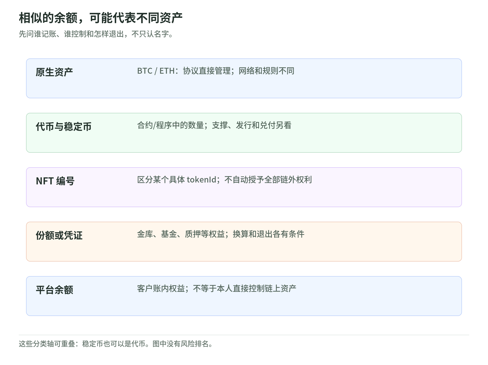

*图：相似的余额，可能代表不同资产。先问谁记账、谁控制和怎样退出，不只认名字。*
<!-- /illustration: primer-asset-types-e733ba7345 -->

Bitcoin 是一个具体网络和协议，BTC 是这个网络的原生资产。Ethereum 是另一个网络，ETH 是其原生资产。区块链则是这类系统采用的一组设计，不是第三种币。

原生资产由链协议直接管理。代币通常由合约或代币程序管理。例如一个 ERC-20 合约可以记“小林有 100，小周有 20”，普通转移就是按它的规则修改记录。

稳定币描述的是价格目标和支撑机制；“代币”描述的是实现方式。它们可以同时成立：USDC 可以是在某条链上运行的代币，又以美元为参照目标。代币不因为稳定目标就自动变成银行存款。

NFT 则要区分具体编号。某个 ERC-721 合约里的 1 号和 2 号可以代表不同对象，不能只合并成“我有两单位”。但那个编号实际带来什么权利，要看产品安排。

LP 凭证、质押凭证、金库份额又是另一层：它们代表对其他资产或策略的权益。钱包显示“100 份”，不保证能取回“100 个底层币”。

最容易踩坑的是看名字。谁都可能发一个名叫 USDT、BTC 或某项目简称的代币。名字和图标不够，至少要查网络以及合约地址或 Mint 标识。原生 BTC、包装 BTC 和平台显示的 BTC，也不是同一种控制关系。

不必记住所有项目名。先把眼前的东西问成一句完整的话：“它在哪条网络，由什么规则记账，我拿到的是哪种资产或权益？”

资料：[ERC-20](https://eips.ethereum.org/EIPS/eip-20)、[ERC-721](https://eips.ethereum.org/EIPS/eip-721)、[ERC-4626](https://eips.ethereum.org/EIPS/eip-4626)、[Solana Mint 与 Token Account](https://solana.com/docs/tokens)。

## 6. 哈希、加密和签名：指纹、保险箱和签字不是一回事

<!-- illustration: primer-crypto-jobs-f925d77a96 -->
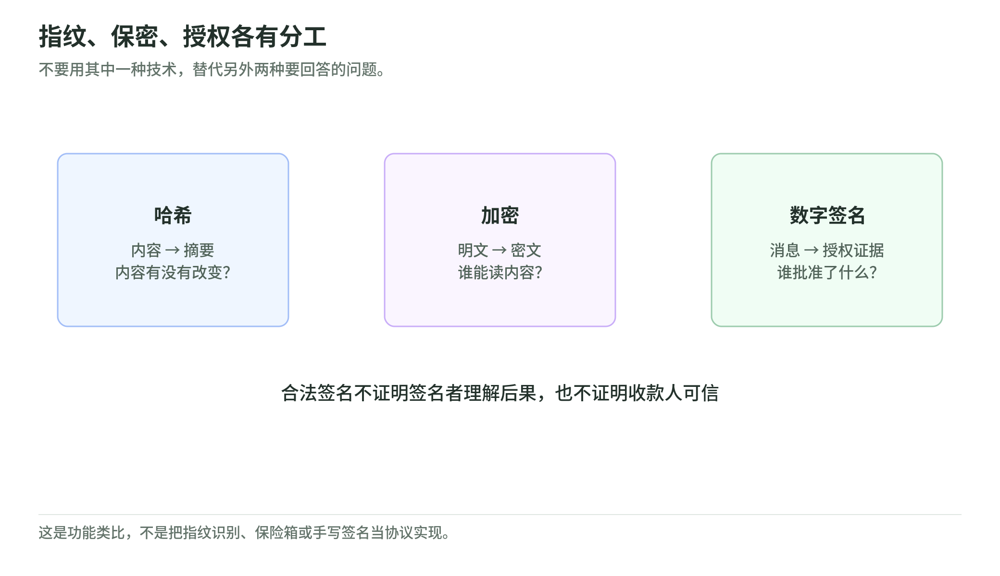

*图：指纹、保密、授权各有分工。不要用其中一种技术，替代另外两种要回答的问题。*
<!-- /illustration: primer-crypto-jobs-f925d77a96 -->

小林想告诉大家：“我同意把这份资产付给小周。”系统需要的是验证授权，并不需要把整个转账内容藏起来。

哈希像内容指纹。固定输入和固定算法，会得到固定摘要。修改内容通常会明显改变摘要。它不能用来解密原文；一个摘要也不把一份超长文件的全部信息变得可恢复。

加密像给内容加锁。持有适当密钥的人可以读懂。它回答“谁能看”，不是自动回答“谁批准”。

数字签名更像能够验证的签字。签名材料授权某条具体消息，验证者检查签名和规则。如果消息里的收款人或金额被改了，原签名通常就不再有效。

签名通过验证，说明消息、签名和对应公钥符合验证规则；不能单独证明是小林本人操作。如果私钥泄露，别人也可能生成有效签名。即使确实是小林亲手签的，也不证明他理解了后果。

私钥是需要保密的签名材料，公钥用来验证相应签名。地址是按网络和收款条件构造的编码，不是所有链都把公钥原样显示。不能因为都长得像一串字符，就把它们当同一个对象。

Bitcoin 挖矿算的是区块头哈希；花别人的币需要满足花费条件。这两个工作不同。算出一个很小的区块哈希，不会顺带获得小周的私钥。

本节用比喻帮助分工。实际签名算法、消息编码、地址类型都必须按协议实现，不能真的把“扫描手写签名”当链上签名。

资料：[Bitcoin 交易签名](https://developer.bitcoin.org/devguide/transactions.html)、[Taproot 的 Schnorr 规范](https://github.com/bitcoin/bips/blob/master/bip-0340.mediawiki)、[Ethereum 账户与密钥](https://ethereum.org/developers/docs/accounts/)。

## 7. 钱包、私钥、助记词：哪个能给别人，哪个不能丢

<!-- illustration: primer-wallet-recovery-429165832e -->
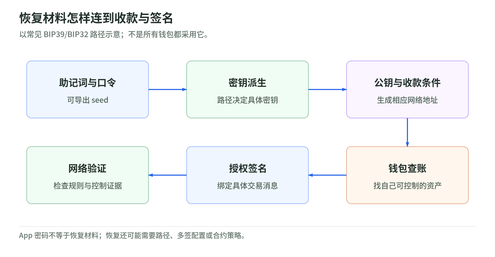

*图：恢复材料怎样连到收款与签名。以常见 BIP39/BIP32 路径示意；不是所有钱包都采用它。*
<!-- /illustration: primer-wallet-recovery-429165832e -->

钱包像一个带签字工具的查账终端。它帮你找到账本中自己能控制的资产，组织一笔请求，确认后生成签名。它不一定把全部工作放在同一台设备上。

地址通常可以用于收款。别人知道地址，一般不因此获得花费权；但可能观察你的交易关系。私钥则不能分享。拿到相应控制材料的人，可能直接满足付款条件。

助记词是很多钱包采用的恢复方式。在 BIP39 方案中，单词和可选 passphrase 会导出种子，再配合派生规则生成一组密钥。它更接近“一整套控制材料的恢复入口”，不只是一个 App 的密码。

### 为什么 App 密码不能代替助记词

小林把手机锁屏密码改了，不会因此改变链上的收款条件。钱包 App 的密码往往只是保护本地文件或操作。

如果原控制材料泄露，只改界面密码可能根本挡不住对方。相反，App 密码忘了但恢复材料完整，也可能还能重建控制。具体恢复仍取决于钱包和账户方案。

BIP39 passphrase 又是另一个东西。它参与生成种子，输入不同会得到不同钱包，而不只是解锁同一套钱包。忘记它时，同样的单词可能恢复出一个看似正常但没有原资产的钱包。

### 冷钱包、硬件钱包、多签又是什么

热钱包经常在线，方便但有在线攻击面；冷钱包尽量让签名材料离线。硬件钱包把签名放在专用设备里，但如果你在设备上确认了危险授权，隔离也不能替你撤销。

多签要求按规则凑够多个授权；MPC 通常把签名工作分给多个参与者，在链外协作。它们解决的不是所有同一个问题，也不会自动保证恢复成功。合约模块、管理员和备用路径仍要查。

没有任何正规学习步骤要求你把助记词贴进这篇文档、聊天或客服工单。这里不提供可实际使用的示例助记词，避免有人误拿公开控制材料存钱。

资料：[钱包角色](https://developer.bitcoin.org/devguide/wallets.html)、[BIP39](https://github.com/bitcoin/bips/blob/master/bip-0039.mediawiki)、[BIP32](https://github.com/bitcoin/bips/blob/master/bip-0032.mediawiki)、[Safe 模块与权限](https://docs.safe.global/advanced/smart-account-concepts)。深入读 [密钥安全](chapters/06-security.md)。

## 8. 为什么同一个钱包里有很多链，同一个地址也能出现在不同链

<!-- illustration: primer-network-identity-1d686fc145 -->
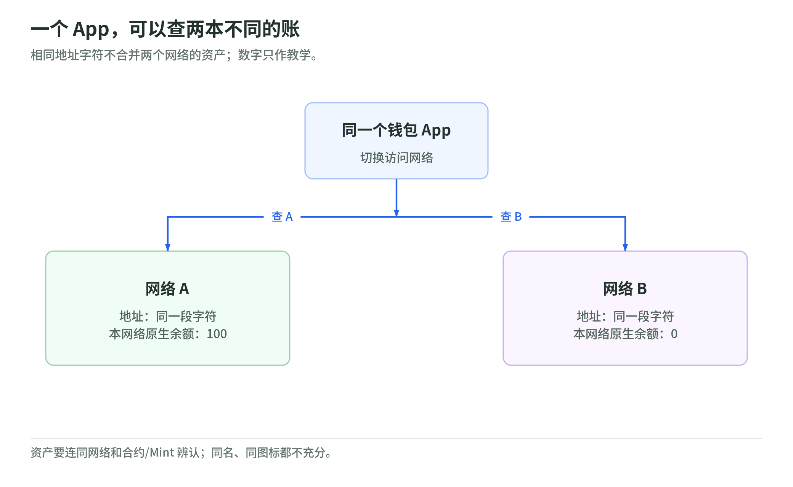

*图：一个 App，可以查两本不同的账。相同地址字符不合并两个网络的资产；数字只作教学。*
<!-- /illustration: primer-network-identity-1d686fc145 -->

一个 App 可以同时连接许多网络，就像一个邮件客户端可以添加多个邮箱。界面放在一起，后面的账本并没有合并。

小林在 Ethereum 上有 ETH，不等于在另一个 EVM 网络上的同字符地址也有同额资产。地址字符串可能相同，网络状态却不同。

EVM 兼容，主要指程序执行和接口等方面能复用某些设计；它不表示手续费、确认机制、合约部署和资金一定相同。BTC 地址、EVM 地址和 Solana 地址也不能一律用同一种推导、签名或验证方式处理。

资产身份最好读成一个组合：

```text
网络 + 原生资产/合约或 Mint + 必要的编号
```

同名 USDC 在不同网络上，可能是发行方支持的原生版本，也可能是桥接包装版本，甚至可能是假代币。显示相同的美元价格，不能替代这个检查。

主网、测试网和本地开发链也要分开。测试环境里的资产通常用于实验，不是主网资产；切换到主网，不会把测试余额兑换成真币。

有些平台充值还要求 memo/tag 一类附加标识，帮助它把共同地址上的收款分配给客户。是否需要由具体网络和平台决定，不是所有币通用的“备注可不填”。

发错网络之后，能否找回取决于目标地址的控制关系、平台支持、资产合约和实际网络。不能统一承诺能恢复，也不能统一判断已经烧毁。第 32 节再讲怎样识别这些情况。

资料：[Ethereum 网络](https://ethereum.org/developers/docs/networks/)、[USDC 原生与第三方包装的区别](https://www.circle.com/legal/usdc-terms)、[Solana 代币标识](https://solana.com/docs/tokens)。附加标识的具体要求要读对应平台资料。

## 9. 一笔 BTC 转账：像拆开整张钞票，再把找零写回来

<!-- illustration: primer-utxo-change-98dbfc51cd -->
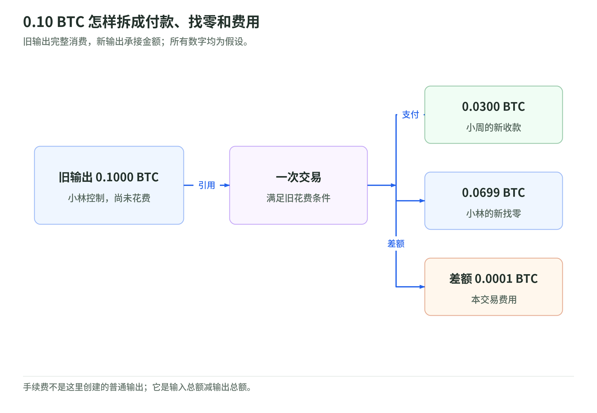

*图：0.10 BTC 怎样拆成付款、找零和费用。旧输出完整消费，新输出承接金额；所有数字均为假设。*
<!-- /illustration: primer-utxo-change-98dbfc51cd -->

现在让小林给小周付款。Bitcoin 常规转账使用 UTXO，也就是“还没被花掉的交易输出”。

可以先把它想成一张写着金额和花费条件的收款记录。小林有一张 0.10 BTC 的记录，想付出 0.03 BTC。新交易引用旧记录，把它完整消耗，再创建新记录：

```text
旧记录：0.1000 BTC
  → 小周新收款：0.0300 BTC
  → 小林新找零：0.0699 BTC
  → 手续费差额：0.0001 BTC
```

这张旧记录不会变成“里面还剩 0.07 BTC”。它已经被使用；找零是新输出。把两个输入凑起来付款，也同样可以。

金额关系是 `输入总额 = 输出总额 + 手续费`。如果构造时漏掉找零，剩余差额可能变成手续费。因此“钱包替我找零”不是可有可无的界面功能。

输入不是只写“小林地址”。它用旧交易的标识和输出编号，指出到底花哪一份记录，这叫 outpoint。对应解锁材料再证明满足花费条件。

假设小林又签另一笔花同一个 outpoint 的请求，两份签名可能都合法，但同一有效历史不能把旧记录消耗两次。节点既要检查授权，也要检查它现在是否还没被花掉。

1 BTC 等于 1 亿聪，聪是常规链上最小计量单位。0.03 BTC 不需要买到一整枚 BTC 才能支付。“一枚币很贵”与“最小可交易单位”不是同一个问题。

钞票比喻也有边界：这些输出不是各自带独立硬币序列号的实体钞票，脚本可以定义复杂花费条件。比喻只说明“旧输出完整消费、新输出承接金额”。

资料：[Bitcoin 输入、输出和找零](https://developer.bitcoin.org/devguide/transactions.html)、[支付费用](https://developer.bitcoin.org/devguide/payment_processing.html)。

## 10. 挖矿：反复试一个很难碰中的条件

<!-- illustration: primer-mining-search-947b745ac6 -->
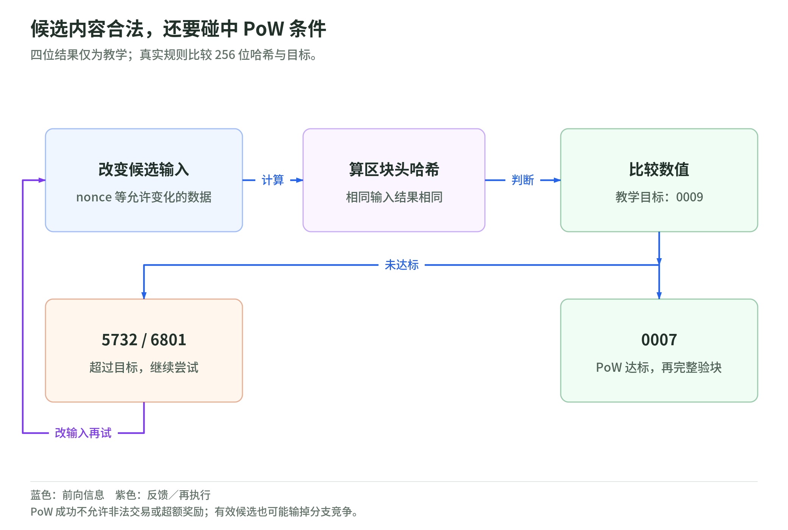

*图：候选内容合法，还要碰中 PoW 条件。四位结果仅为教学；真实规则比较 256 位哈希与目标。*
<!-- /illustration: primer-mining-search-947b745ac6 -->

“挖矿”容易让人以为电脑在土地里找币。实际工作更像不停准备新版本的候选区块，计算它的区块头指纹，看有没有碰中规定条件。

矿工先收集交易，安排自己的奖励交易，算出交易摘要，再构造区块头。区块头包含前一个区块的哈希、交易根、时间、目标编码和 nonce 等字段。

nonce 在这里是可以反复调整的尝试数据。改变它，输入就变了，结果通常也变。相同区块头重新算一遍，不会给你一个新的随机结果。

### 为什么交易都合法，哈希还会“不合格”

因为这是两项检查。第一项问“里面的交易和奖励有没有按规则来”；第二项问“区块头哈希的数值是不是足够小”。

为了看懂第二项，假设哈希只有四位，可能落在 0000 到 9999。规则要求结果不大于 0009：

| 尝试结果 | 判断 |
| --- | --- |
| 5732 | 超过目标，继续试 |
| 6801 | 超过目标，继续试 |
| 0007 | 满足 PoW 条件，可以提交完整候选供网络检查 |

这个例子刻意缩小了范围，不是真实 SHA-256 测试数据。如果结果近似均匀，10 个合格值占 1 万个结果，单次命中概率约千分之一。平均约试一千次，不表示第 1000 次一定中奖。

真实 Bitcoin 使用双 SHA-256，结果有 256 位。看到“前面很多个零”，只是小数值的一种外观。准确规则是：

```text
区块头哈希数值 ≤ target
```

nonce 不够用时，矿工还可以改变奖励交易中的额外数据等，进而改变交易根，得到新的区块头。这不是只在一个固定文件上按刷新。

### 找到之后为什么还可能失败

PoW 达标不代表可以塞进假付款或多领奖励，节点仍会拒绝违规内容。两个矿工也可能几乎同时找到有效块，之后某个分支没有成为活动链；它不等于“计算错误”，而是竞争结果。

矿池还有比主网容易的 share 目标，用来统计成员贡献。你提交了一份合格 share，不代表你已经挖出一个主网块。

资料：[挖矿全过程](https://developer.bitcoin.org/devguide/mining.html)、[区块头](https://developer.bitcoin.org/reference/block_chain.html)、[PoW 检查源码](https://github.com/bitcoin/bitcoin/blob/v32.1/src/pow.cpp)。

## 11. 目标值谁定，为什么矿工不能自己改成简单模式

<!-- illustration: primer-target-window-e6f08e662e -->
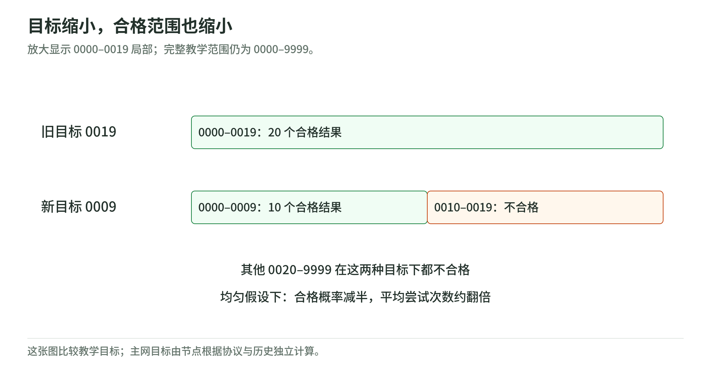

*图：目标缩小，合格范围也缩小。放大显示 0000–0019 局部；完整教学范围仍为 0000–9999。*
<!-- /illustration: primer-target-window-e6f08e662e -->

把“谁制定规则”与“谁算出此刻的结果”分开，就容易了。

算法和网络参数是共识规则。节点运行相应软件，结合历史数据，独立算出下一块应该使用的目标。没有一个中央难度服务器向全网发送每天的数字。

矿工在区块头里填写目标的压缩编码 nBits。节点不只是检查“这个哈希满足你写的目标”，还会检查“你写的目标是不是按规则应该得到的那个”。改成特别容易的目标，会被遵守原规则的节点拒绝。

Bitcoin 主网每 2016 块调整一次，目标平均间隔约 10 分钟。不是每块准点发生，也不是墙钟过了两周便触发一次。

教学上可以这样计算方向：

```text
新目标 ≈ 旧目标 × 实际时间跨度 / 预期时间跨度
```

如果上个周期大约只花了 7 天，而预期约 14 天，新目标大致减半。可接受的结果范围缩小，挖矿更难。算力增加先可能让出块加快，下一轮调整再把平均速度拉向设计目标。

难度和目标是反方向：目标越小，难度越高。算法还有限幅、目标上限和整数编码细节。上一周期首尾 2016 块只有 2015 个间隔，分母仍按 `2016 × 600`，不能自行“修正”。

这还回答了一个常见问题：矿工不能因为电费涨了，就自己提高发行补贴或降低有效性要求。赚钱困难不会自动改变节点认可的规则。

共识规则当然也会演进，但要通过具体提案、软件、激活和参与者选择。开发者有影响力，矿工也有影响力，都不是拿着一个总管理员密码的人。

资料：[目标计算与检查](https://github.com/bitcoin/bitcoin/blob/v32.1/src/pow.cpp)、[主网参数](https://github.com/bitcoin/bitcoin/blob/v32.1/src/kernel/chainparams.cpp)、[区块头目标一致性验证](https://github.com/bitcoin/bitcoin/blob/v32.1/src/validation.cpp)。

## 12. 新币、手续费、矿工收入：别把三个数字当一个

<!-- illustration: primer-reward-sources-361baf18da -->
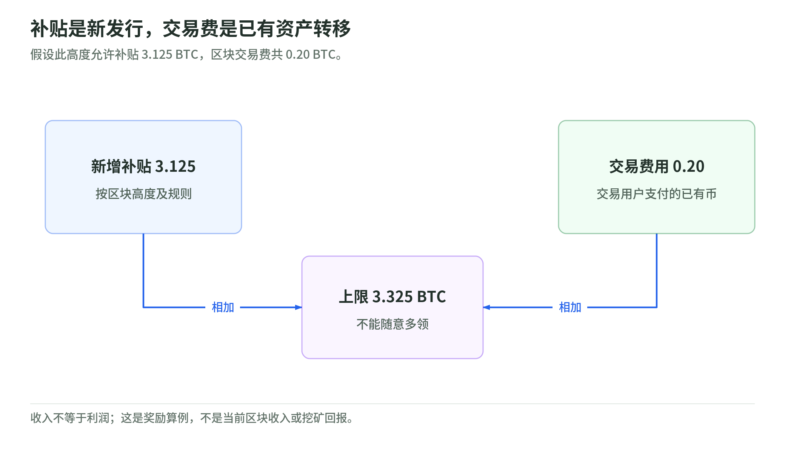

*图：补贴是新发行，交易费是已有资产转移。假设此高度允许补贴 3.125 BTC，区块交易费共 0.20 BTC。*
<!-- /illustration: primer-reward-sources-361baf18da -->

Bitcoin 每个区块的特殊首笔交易叫 coinbase transaction。这里只是协议术语，与同名公司不是一回事。

它允许在上限内领取两种来源的钱：

```text
允许的区块奖励 = 该高度的新发行补贴 + 区块内交易支付的手续费
```

补贴增加供应，手续费转移已有资产。假设某个区块允许补贴 3.125 BTC，交易费合计 0.20 BTC，可领取上限就是 3.325 BTC。这里是在演示计算，不报告当前区块的实际收入。

主网补贴从每块 50 BTC 开始，每 210,000 块减半。按高度，而不是按某个固定日历日。常说的约 2100 万 BTC 总量上限，来自这套递减发行规则和最小单位处理。

“币快挖完了，以后就不验证交易了吗？”不是这样。区块补贴逐渐减少，协议仍允许交易手续费作为激励。未来费用需求能否支持足够安全预算，是经济与安全讨论，不能在这里写成必然成功或必然失败。

矿工拿到收入也不等于利润。设备、电力、运维、矿池费用、停机和市场价格都可能影响它。全节点不会根据某个矿工的实际成本替它补齐利润。

BTC 转账费用通常更关注交易占多少空间，而不是转多少钱。一笔有很多输入的转账可能比另一笔金额更大的简单转账占更多资源。交易需求增加时，争取包含的费率也会变化。

在交易所看到的“提币费”，又不一定精确等于矿工最终收到的该笔链上费用。平台可以批量付款、采用估算和自己的收费规则。交易费、提币费、兑换价差和银行出入金费要分别看。

资料：[奖励上限与补贴](https://github.com/bitcoin/bitcoin/blob/v32.1/src/validation.cpp)、[BTC 费用机制](https://developer.bitcoin.org/devguide/payment_processing.html)、[平台费用与批量网络费示例](https://help.coinbase.com/en/coinbase/trading-and-funding/pricing-and-fees/fees)。

## 13. 不挖矿的链怎样记账：节点、验证者和质押

<!-- illustration: primer-consensus-roles-238aee4b15 -->
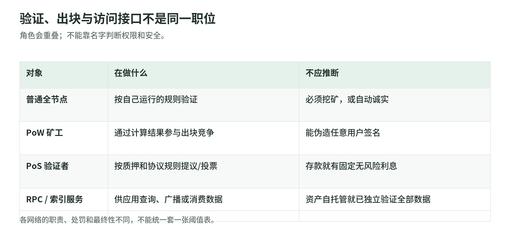

*图：验证、出块与访问接口不是同一职位。角色会重叠；不能靠名字判断权限和安全。*
<!-- /illustration: primer-consensus-roles-238aee4b15 -->

节点是运行协议软件的机器或服务。普通全节点可以独立验证自己认可的规则；它不必同时承担出块竞争。矿工和节点会重叠，但不是同一个职位。

钱包常通过 RPC 连接节点服务。RPC 可以先理解为提供给钱包的“查账、提交交易窗口”：它是访问接口，不是另一条链，也不意味着钱包自己已核验全部数据。

PoS 的全称是权益证明。以 Ethereum 为例，验证者质押 ETH，按协议参与提议和投票，并承担运行义务；违反特定规则可能被惩罚。它用质押和协议约束组织共识，不是用 Bitcoin 那种反复哈希的比赛。

可以粗略类比：PoW 把外部计算成本放到竞争中；PoS 把可受约束的质押和验证职责放到协议中。这个类比不是说“只要有钱就能改任何记录”，也不是说所有 PoS 都采用相同选人和处罚规则。

Ethereum 在 2022 年的 Merge 转向 PoS。今天再看到“用显卡挖 ETH”的旧教程，首先要区分 Ethereum 主网与其他网络，不要沿用旧教程的现状结论。

Solana 也不是“更快的 ETH 换个名字”。它有自己的账户、程序和资产表示方式：Mint 标识一种代币，Token Account 记录相应持有量，公共代币程序提供操作逻辑。不是每个代币都各自部署一个 ERC-20 合约。

许可网络则可以限定哪些组织参与，采用匹配的身份和共识方式。它不必用公开交易的原生币来奖励挖矿。无币不表示没有服务器、治理和运维成本。

质押奖励也不是无风险银行利息。要看运行故障、惩罚、退出等待、委托方、凭证和托管安排。网页写着“staking”，不证明它正在参与任何链的共识。

资料：[Ethereum PoS](https://ethereum.org/developers/docs/consensus-mechanisms/pos/)、[Merge](https://ethereum.org/roadmap/merge/)、[Solana 代币模型](https://solana.com/docs/tokens)、[Fabric](https://hyperledger-fabric.readthedocs.io/en/latest/whatis.html)。

## 14. 点了发送后，为什么还要等：从“收到请求”到“付款完成”

<!-- illustration: primer-payment-progress-6ef5ed75c0 -->
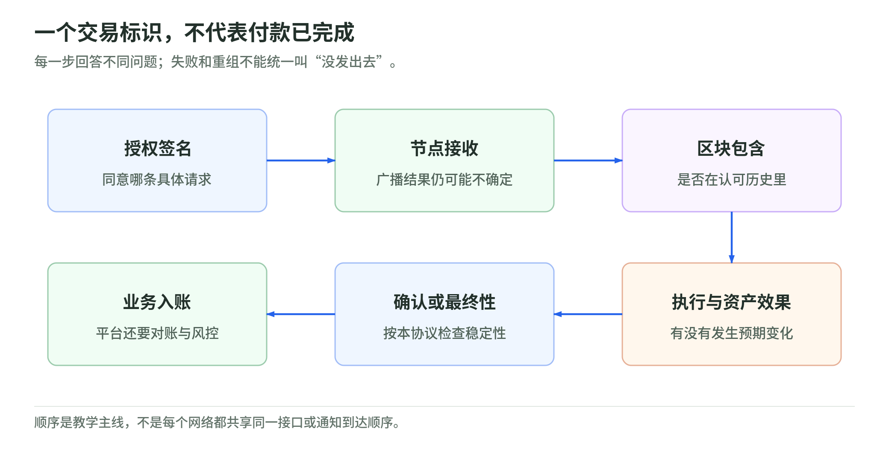

*图：一个交易标识，不代表付款已完成。每一步回答不同问题；失败和重组不能统一叫“没发出去”。*
<!-- /illustration: primer-payment-progress-6ef5ed75c0 -->

小林点发送，钱包立刻显示一串交易标识。这个标识很像快递单号：单号生成，不等于货已送达。

但也别把快递比喻用过头。交易标识与具体编码有关，并非物流公司随意分配；这里仅借它解释进度。

通常要分别看：请求是否被节点接收，有没有进入区块，执行有没有成功，这个区块是否在当前认可历史里，以及收款平台是否已经按自己的规则入账。

很多网络或发送路径有待处理交易池，常叫 mempool。它不是全网唯一、严格先到先服务的队列。不同节点收到的请求、采用的策略和私有提交路径可能不同。

BTC 的确认数会随着活动链后续区块增加。交易所在块算第 1 次确认。多个确认降低某些重组风险，但“6 确认”不是任何情况下都绝对安全的魔法数。

### 重组到底是什么，不是有人修改了屏幕数字

两个有效候选分支竞争，节点可能切换到累计工作量更高的有效链。切换会让旧分支中的某些观察不再属于活动历史，这叫重组。

其中的交易可能再次入链，也可能被冲突交易排除。平台因此需要保存区块身份、检查分支和必要时冲正账务，不能只看到一次通知就永久加余额。

### 多数算力能做什么，不能做什么

节点数量多，不等于算力占多数。持续算力优势可能帮助攻击者重组历史、撤回自己的付款后再作冲突支付，或审查交易；它不能凭算力伪造小周的签名，让遵守原规则的节点接受无效交易或超额发行。

少于一半也不表示攻击概率为零，多于一半也不表示有限时间内任何深度都保证重组成功。风险还与持续时间、网络条件和成本有关。“51% 攻击”这个名字，不是万能管理员权限。

其他协议可能通过投票证书定义最终性。最终性仍有协议条件；“失败结果已经最终确认”不等于“转账成功”。也不能把一种链的标签、确认数和等待时长照搬到另一条链。

### 广播超时，为什么不能马上再付一次

小林发出请求，RPC 没及时回应。网络可能已经接收了原交易，只是回包丢了。如果换数据再签第二笔，可能形成两次付款。

因此先查原标识和已保存的交易，再按相应网络的替换、重播或过期规则处理。没有回应不是“确定没付款”；这是常见的网络通信不确定性。

资料：[Bitcoin 分支与确认](https://developer.bitcoin.org/devguide/block_chain.html)、[累计工作量](https://github.com/bitcoin/bitcoin/blob/v32.1/src/chain.cpp)、[白皮书的攻击边界与概率假设](https://bitcoin.org/bitcoin.pdf)、[Ethereum PoS](https://ethereum.org/developers/docs/consensus-mechanisms/pos/)。恢复策略是工程建议，详见 [钱包账务](chapters/05-wallet-engineering.md)。

## 15. ETH 转账与 Gas：按资源计费，不是按金额抽税

<!-- illustration: primer-gas-bill-cace6ebe47 -->
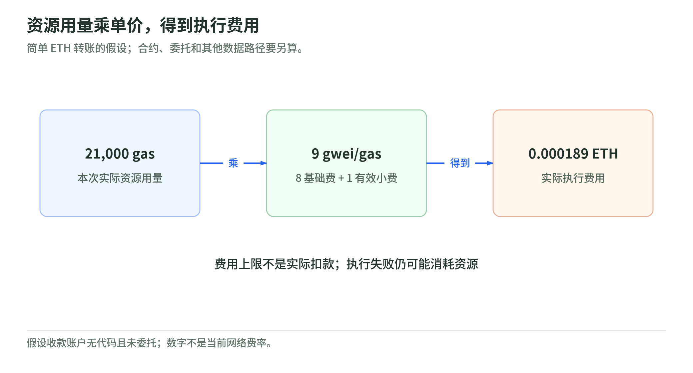

*图：资源用量乘单价，得到执行费用。简单 ETH 转账的假设；合约、委托和其他数据路径要另算。*
<!-- /illustration: primer-gas-bill-cace6ebe47 -->

Ethereum 更像一本带程序执行规则的共享账。账户有原生 ETH 余额，还有 nonce 等状态；合约可以保存自己的数据。

nonce 在这里是发送账户的交易序号，不是挖矿时反复尝试的那个同名字段。它帮助约束顺序。同一个发送账户的同一个 nonce 可以有竞争候选，但不能在同一有效历史里各当作一次独立发送执行。

Gas 是资源计量单位。程序做的计算和状态操作越多，所需资源可能越多；gas price 是每单位资源的价格，gas limit 是本次允许使用的上限。

假设小林给一个没有代码、没有委托的小周账户做简单 ETH 转账：

```text
实际用量：21,000 gas
基础费：8 gwei/gas
实际有效小费：1 gwei/gas
费用：21,000 × 9 = 189,000 gwei = 0.000189 ETH
```

gwei 是计量 ETH 的小单位，1 gwei 为十亿分之一 ETH。转多少 ETH 与执行多少工作不同，这不是“转账额的固定百分比”。

基础费按协议销毁，小费按协议给出块相关参与者。你设置的 maxFeePerGas 是上限的一部分，不是最终一定全部扣走的价格。调用合约、使用额外数据、委托账户或 blob 等路径也不能都套用这一个简单算例。

### 为什么有稳定币余额，钱包还说不够钱

普通 EVM 交易常需要 ETH 等本网络指定的原生资产支付费用。持有 100 USDC，不自动等于同时有付手续费的 ETH。某些产品提供代付或代币付费，需要查它的实际路径与条件。

### 失败了，钱怎么还扣了一点

如果请求根本没通过基本检查、没入区块，不能一律说“失败也收费”。如果已经执行到一半然后回退，网络确实消耗了资源，费用仍可能产生；普通业务状态回滚，发送方 nonce 和费用不因此一起回到原样。

所以“扣了 gas”不证明付款成功，“余额没按预期变化”也不证明请求从没执行。7702 授权还有单独的持续性问题，第 17 节会讲。

资料：[Gas](https://ethereum.org/developers/docs/gas/)、[EIP-1559](https://eips.ethereum.org/EIPS/eip-1559)、[交易](https://ethereum.org/developers/docs/transactions/)。

## 16. 智能合约：像自动售货机，但规则和管理员也要查

普通转账主要移动资产。合约调用还可以执行规则：兑换、借贷、发行票据，或者修改一组共享数据。

拿自动售货机作比喻：你提交请求，机器按写好的条件处理。它不会因为你觉得结果不公平就自动改规则。程序有漏洞时，也可能照着错误逻辑执行。

真正的合约通常在收到交易或被另一个合约调用时执行。不是时间到了就自己醒来。定时任务还需要有人或自动化服务触发相应操作。

“智能”不代表理解人类意图，“合约”也不自动决定法律权利。它先是一套程序与状态。

### DApp 不只是一个合约

你看到的网页负责展示和收集操作，钱包负责授权，节点或 RPC 提供查询/提交入口，合约按规则执行。有时还依赖后台、数据库、预言机或托管机构。

网页不能打开，不一定表示合约消失；网页看着很正常，也不证明合约安全。某一层去中心化，不能推导整套产品无管理者。

### 代码不是改不了吗，为什么产品还能升级

有些地址本身是代理入口，实际执行逻辑指向另一个实现。管理员或治理可以在规则允许的路径中换实现。

看安全性时，除了当前代码，还要看谁能升级、暂停、冻结或启用模块。入口地址一直相同，行为也可能变化。

开发者常说的 ABI，可以理解为“怎样给程序填参数、怎样读返回值”的接口说明。事件/日志则是程序执行时发出的记录。钱包和浏览器借它们解释交易，不是凭图标猜出来。

预言机是把外部信息交给程序的机制，例如提供某资产价格。程序能验证输入及执行关系，却不会凭空知道现实中的价格或天气。来源错误、过期或被操纵，自动执行也可能得到坏结果。

资料：[智能合约](https://ethereum.org/developers/docs/smart-contracts/)、[合约升级](https://ethereum.org/developers/docs/smart-contracts/upgrading/)、[ABI](https://docs.soliditylang.org/en/latest/abi-spec.html)、[预言机](https://ethereum.org/developers/docs/oracles/)。

## 17. “只是签一下”为什么可能把资产权限交出去

<!-- illustration: primer-allowance-de99b12d1d -->
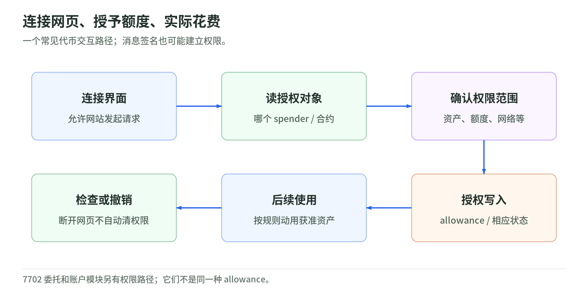

*图：连接网页、授予额度、实际花费。一个常见代币交互路径；消息签名也可能建立权限。*
<!-- /illustration: primer-allowance-de99b12d1d -->

小林想用兑换应用。第一次交互，钱包让他批准某个 spender 可以使用他的代币。这个 spender 可以理解成“获准代你从代币余额里取款的对象”，不一定就是网页运营者的普通地址。

Approve 通常设置 allowance，也就是额度。它本身不一定立刻转币，却为后续转移建立权限。把额度设为 100 与设为很大甚至无限额度，是不同授权后果。

之后小林关闭网页，不代表额度自动归零。网页连接是会话，链上授权是状态。要撤销哪种权限，要找到对应机制。

有些 permit 通过消息签名设置额度，用户不一定亲自发送那笔设置交易。于是“这次没有付 gas”“只是签消息”，都不能作为无风险判断。

### 钱包越来越方便，授权也越来越需要读清楚

智能账户可以支持批处理、代付、恢复和限额。账户抽象 AA 是这类可编程能力的统称之一，不是某一家公司发明的另一种币。

4337 使用 UserOperation、EntryPoint 等对象处理操作。7702 则允许外部控制账户设置代码委托。先用普通话理解：账户可以把部分执行能力交给指定程序，而这个授权可能持续存在。

特别是 7702：后续交易执行回退，不自动撤销已经处理的委托。把它看作“一次登录确认”，会低估权限。

断开连接、撤销代币额度、取消代码委托和更改多签模块，是不同动作。本文不提供针对真实账户的撤销指令；需要先知道你授予的究竟是什么，再在可信工具中核对。

资料：[ERC-20 额度](https://eips.ethereum.org/EIPS/eip-20)、[Permit](https://eips.ethereum.org/EIPS/eip-2612)、[ERC-4337](https://eips.ethereum.org/EIPS/eip-4337)、[EIP-7702](https://eips.ethereum.org/EIPS/eip-7702)。细流程见 [账户升级](upgrades/01-ethereum.md)。

## 18. 买币、充值、提币、提现：钱走的是不同通道

<!-- illustration: primer-buy-withdraw-4e46532825 -->
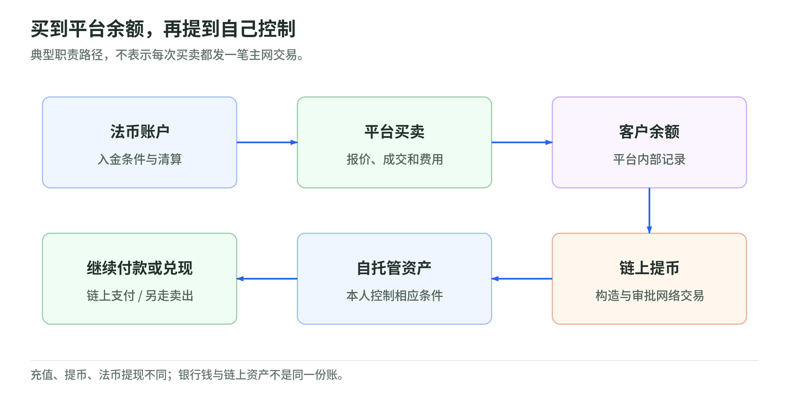

*图：买到平台余额，再提到自己控制。典型职责路径，不表示每次买卖都发一笔主网交易。*
<!-- /illustration: primer-buy-withdraw-4e46532825 -->

小林在平台里用法币买了一些 BTC。买完显示余额，只说明平台完成了相应成交和客户记账，不保证每笔买卖都在 Bitcoin 主网上发生一笔对应交易。

现在他把 BTC 提到自己控制的地址。这叫链上提币：平台需要按自己的审批和余额规则，构造并发送网络交易。等相应链上记录成立，小林才取得自己能够控制的那份资产。

反过来，从自托管地址转到平台充值地址，是充值。链上已收到，平台还可能等待确认、识别客户、检查资产版本，再增加内部余额。

法币提现则是另一条路径。把 BTC 卖成平台支持的法币，再按银行或支付渠道提款，涉及报价、费用、账户资格和清算。它不只是把钱包中的“BTC 文件”复制进银行。

### 用一个假设流程分清四本账

小林起初有 1000 个虚构计价单位 U。他用其中 200 U 在平台买资产 A，平台内完成成交；提到自托管账户之后，A 的控制关系改变。再向小周付款，小周收到的是链上 A；小周要换成银行钱，还需要另走卖出和出金流程。

这四个阶段分别是法币账户、平台客户账、链上控制、小周的后续兑现。它们可以在一个 App 里显示，却有不同服务时钟和责任方。

托管也不都是一种形式。有些服务只是提供界面，有些持有签名控制，有些提供合约恢复或机构保管。先看谁能在链上发起转移，不只看产品写“钱包”还是“交易所”。

平台公布一些储备地址，有助于观察资产，但单看地址余额不能知道全部客户负债、质押限制和链外承诺。这不是判断某个平台有问题，而是区分“资产可见”与“完整偿付能力已证明”。

本文不推荐开户、交易平台或具体出入金路径。各地业务资格与平台条件要另查。

资料：[平台余额、出入金和网络费示例](https://help.coinbase.com/en/coinbase/trading-and-funding/pricing-and-fees/fees)、[自托管控制](https://developer.bitcoin.org/devguide/wallets.html)、[金融产品与持有方式核验](notes/plain-language-finance-source-audit.md)。储备/负债区分是账务分析。

## 19. 价格、流动性、市值和 FDV：屏幕数字不等于能拿到的钱

<!-- illustration: primer-orderbook-ca3c62fa52 -->
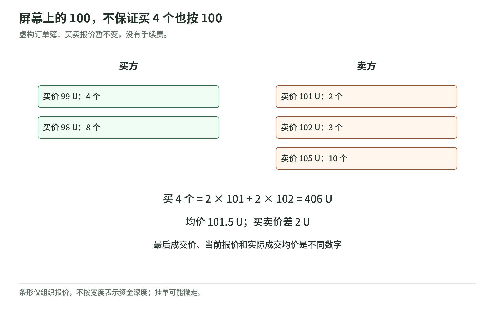

*图：屏幕上的 100，不保证买 4 个也按 100。虚构订单簿：买卖报价暂不变，没有手续费。*
<!-- /illustration: primer-orderbook-ca3c62fa52 -->

价格先来自买卖条件如何成交。订单簿是“有人愿意在哪个价格买多少、卖多少”的报价清单，不是一位管理员写下的统一真实价值。

假设上一笔成交价是 100 U，而眼前的卖家报价是：

| 卖出价格 | 这档有多少 |
| --- | --- |
| 101 U | 2 个 |
| 102 U | 3 个 |
| 105 U | 10 个 |

买方最高愿付 99 U。买卖价差是 `101 − 99 = 2 U`。

小林想立刻买 4 个，假设报价不变且不收手续费，就先买 2 个 × 101，再买 2 个 × 102，总共 406 U，均价 101.5 U。上一笔的 100 U 不是承诺下一笔也按它成交。

市价单是在请求尽快按可用报价执行，价格不保证；限价单是在限制接受的价格，成交不保证。限价单如果一提交便吃掉已有挂单，也不自动属于提供流动性的 maker。

流动性关心市场能承接多少交易，以及成交对价格的影响。第一档有 2 个与有 2 万个，即使标价相同，也很不一样。挂单还可能撤走。

### “市值蒸发一亿”是有一亿现金被搬走了吗

假设一个虚构代币流通 100 万个，参考价格 2 U，流通市值是 200 万 U。

若一个极简估值模型把新参考价改成 3 U，市值就变成 300 万 U。它只是用新价格乘全部数量，不证明有 100 万 U 新钱进入。现实数据提供方有价格聚合规则，本例不是说一笔交易必然改变它们的报价。

同样，全体持有人一起卖出，价格和可成交深度会变化。市值不是保险箱里的现金，不是融资额，也不是所有人能同时按当前价取走的钱。

### FDV 和解锁为什么要看分母

假设这枚币总供应 500 万个，最大供应 1000 万个，仍用 2 U：

- 按总供应给存量标价，是 1000 万 U。
- 按最大供应设想全部单位都存在，并仍按今天价格标价，是 2000 万 U。

FDV 通常用来表达完全稀释的估值情景，但数据页面的供应口径可能不同。看到数字要问用了总供应还是最大供应，不要把缩写当精确保证。

解锁表示原本受转让限制的资产可以按安排使用；不自动等于新铸币，不自动计入所有统计方的流通量，更不表示当天必然卖出。公开日程和实际资金行为不同。

这些例子教你读指标，不预测涨跌。“单价只有几分钱”也不是便宜的证据，供应量和权利结构还没看。

资料：[订单类型](https://help.coinbase.com/en/coinbase/trading-and-funding/advanced-trade/order-types)、[撮合机制示例](https://docs.cdp.coinbase.com/exchange/concepts/matching-engine)、[供应统计方法](https://support.coingecko.com/articles/6758974979-coingecko-supply-methodology)、[FDV 方法及口径限制](https://www.coingecko.com/learn/what-is-fully-diluted-valuation-fdv-in-crypto)。

## 20. 稳定币：转给你 100 个，为什么不等于银行到账 100 美元

<!-- illustration: primer-stablecoin-path-f76cd843fa -->
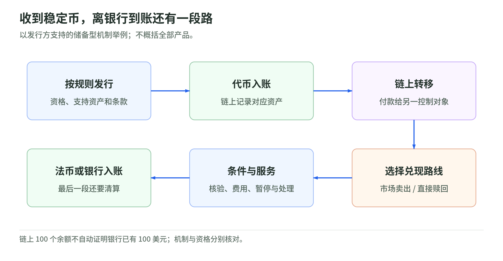

*图：收到稳定币，离银行到账还有一段路。以发行方支持的储备型机制举例；不概括全部产品。*
<!-- /illustration: primer-stablecoin-path-f76cd843fa -->

稳定币努力维持相对美元等参照物的价值。先区别市场上买卖的价格、发行方提供的赎回路径，以及背后的资产支持。三件事可以相关，但不相同。

假设小林把 100 个美元目标稳定币转给小周。链上记录成功，小周控制了 100 个代币。到这里并没有证明小周的银行账户增加了 100 美元。

他可能在交易平台卖给别人，也可能在满足资格的情况下走发行方赎回。前者取决于市场和平台，后者取决于发行方支持、账户资格、条款和银行路径。还可能有费用、时间或暂停。

### 四种支撑思路，别都理解成保险箱里放现金

法币储备型由发行方管理支持资产，可能包括现金、银行存款、短期国债或其他允许项目。不是名字里有“美元”，就证明每一份支持都用同一种现金保存。

抵押型用资产和清算机制支撑发行。价格下跌、预言机、清算深度和治理会影响它。

合成/对冲型结合资产与对冲头寸。保持某种风险敞口并不消除交易对手、基差、保证金和资金费风险。

反身性算法机制可能靠关联代币和激励维护锚定。如果信心下跌削弱支撑能力，规则本身不保证有足够链外资产兑现。真实产品也可能混合多种机制。

### USDC、USDT、USDS 和 USDe 可以互相套结论吗

不能。发行主体、支持资产、管理权、兑换和资格安排可能不同。名字里的 USD 不是共同保险合同。

USDS/DAI 要看抵押、治理及相关转换；USDe 要看支持和对冲安排；sUSDS、sUSDe 等还可能是带份额换算的另一种资产。完整机制放在 [稳定币升级章](upgrades/04-stablecoins.md)，不必现在背全部参数。

储备鉴证、公司财务审计和你亲自核验全部负债，也不是一件事。链上看到代币数量，不足以直接看见所有银行和托管资产。

脱锚是价格偏离目标，冻结是限制特定操作，赎回暂停影响兑现，桥故障影响某种包装版本的退出。遇到异常，先判断是哪条路径出了问题。

资料：[Circle 储备披露](https://www.circle.com/transparency)、[USDC 条款](https://www.circle.com/legal/usdc-terms)、[Tether 条款](https://tether.to/en/legal/)、[Ethena 机制](https://docs.ethena.fi/overview/how-usde-works.md)、[兑付与条款范围核验](notes/beginner-industry-source-audit.md)。

## 21. DEX 与兑换池：没挂单，价格是怎么算出来的

<!-- illustration: primer-amm-reserves-a42a676e31 -->
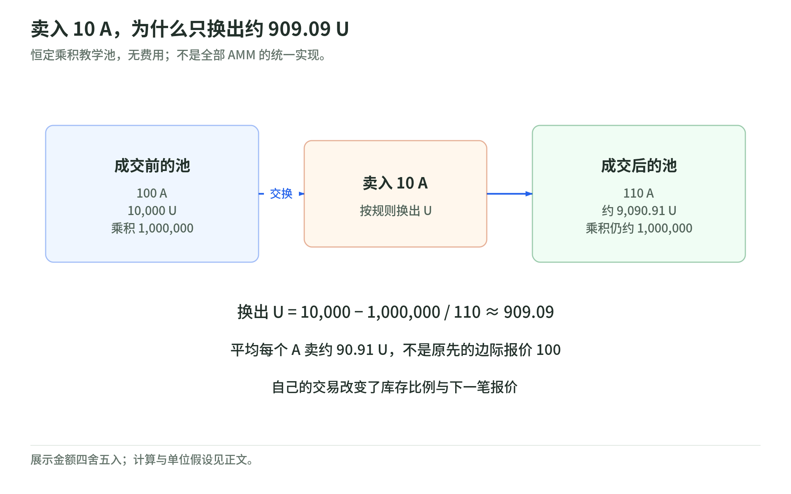

*图：卖入 10 A，为什么只换出约 909.09 U。恒定乘积教学池，无费用；不是全部 AMM 的统一实现。*
<!-- /illustration: primer-amm-reserves-a42a676e31 -->

中心化交易所常由平台撮合并记客户账，叫 CEX。DEX 则把一些交换规则交给链上协议。它是 DeFi 的一种应用；DeFi 是用链上程序提供兑换、借贷等金融功能的常用统称。DEX 不一定全用池子，也不表示网页、管理员和外部依赖全部去中心化。

常见的 AMM，是自动做市商。先用最简单的恒定乘积池理解，不把它当所有当前版本的统一算法。

假设池里有 100 个 A 和 10,000 个 U，忽略费用，要求：

```text
A 数量 × U 数量 = 1,000,000
```

小林把 10 个 A 卖进池里，池中 A 变成 110。按规则，U 应变成 `1,000,000 / 110 ≈ 9,090.91`。因此小林拿到约 909.09 U，每个 A 平均卖了 90.91 U。

为什么不是“原来 100 U 一个，10 个换 1000 U”？因为他的交易改变了池中比例。成交后池子的边际价格也变了，不能把边际价、平均成交价和上一笔价格混为一谈。

大交易相对小池子，价格影响会更明显。滑点保护限定可接受结果，不是单独一项固定手续费；你按实际均价算成本后，不要把同一段成交影响又扣一遍。

### 池里的钱是谁出的

LP，也就是流动性提供者，存入资产，取得相应份额或头寸，可能获得交易费。

它像共同提供兑换库存。但库存组合随交易变化，LP 可能在一种资产上涨时相对“单纯持有原资产”少赚，甚至承受其他损失。常说的“无常损失”不会因为名字就保证自动消失；退出后可以实现。

更复杂的版本有集中流动性、动态规则或 hooks，条件和权限要另读。把 v2 的公式背下来，不等于理解了全部真实池子。

MEV 指通过排序、插入或排除等机会取得的价值。套利、清算和夹击都可能涉及它。公开请求和很宽的成交约束，可能让用户承受不利排序；不只是“矿工多收了一点 gas”。

资料：[AMM](https://developers.uniswap.org/docs/get-started/concepts/how-uniswap-works)、[v2 收益与组合损失](https://developers.uniswap.org/docs/protocols/v2/concepts/understanding-returns)、[MEV](https://ethereum.org/developers/docs/mev/)。

## 22. 借贷与清算：抵押物还在，为什么别人能处置它

<!-- illustration: primer-liquidation-7719672144 -->
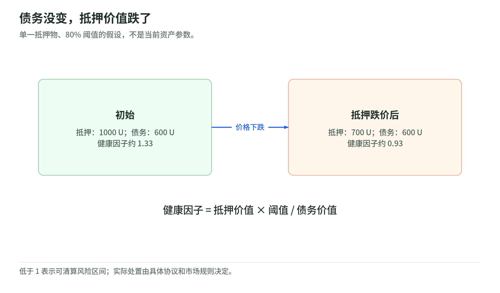

*图：债务没变，抵押价值跌了。单一抵押物、80% 阈值的假设，不是当前资产参数。*
<!-- /illustration: primer-liquidation-7719672144 -->

小林想借一些 U，先存入有波动的资产 A 作抵押。协议不是给他送了一笔钱，而是记了债务，并按条件限制抵押物的使用。

他可能暂时需要 U，却不想卖掉 A。此类借贷池的 U 通常由其他供款人提供，借款人按条件使用并付息；抵押物是担保，不是免费换钱。保留 A 的同时负债，也会同时承担它跌价和债务增长的风险。

借贷产品常设置可借比例和清算阈值。它们不是同一个数字。借到最大额度，不表示离危险最远，往往恰好相反。

用一个单抵押物假设模型：

```text
抵押价值：1000 U
债务价值：600 U
清算阈值：80%
健康因子 = 1000 × 80% / 600 ≈ 1.33
```

如果 A 下跌，让抵押只值 700 U，而债务仍为 600：

```text
健康因子 = 700 × 80% / 600 ≈ 0.93
```

按这个 Aave 式口径，低于 1 就进入可清算风险区间。清算者可以按协议规则还债并取得相关抵押及激励。它是小林最初同意的风险处置机制，不是临时发现有人“随便偷走抵押”。

债务利息增长、借出资产本身涨价、预言机异常和网络拥堵，也可能影响结果。实际清算比例、奖励和触发算法看具体市场与版本；这里没有给出任何真实资产的当前安全借款额度。

“我的本金没归零”不能保证不清算。协议关心债务覆盖和风险要求，而不只是你最初投入多少。

闪电贷又不同。它通常要求在同一交易中按条件归还借出金额及费用；未满足条件会回退。有些接口允许在满足抵押或信用授权等条件时转成债务头寸。它适合解释原子执行，但不是借钱后可以不还的漏洞。

资料：[借款与资金池](https://aave.com/help/borrowing/borrow-tokens)、[健康因子与清算](https://aave.com/help/borrowing/liquidations)、[闪电贷与可开债务路径](https://aave.com/docs/aave-v3/guides/flash-loans)。

## 23. 质押、理财、金库和年化：收益究竟谁在付

<!-- illustration: primer-yield-payers-a3be0e3068 -->
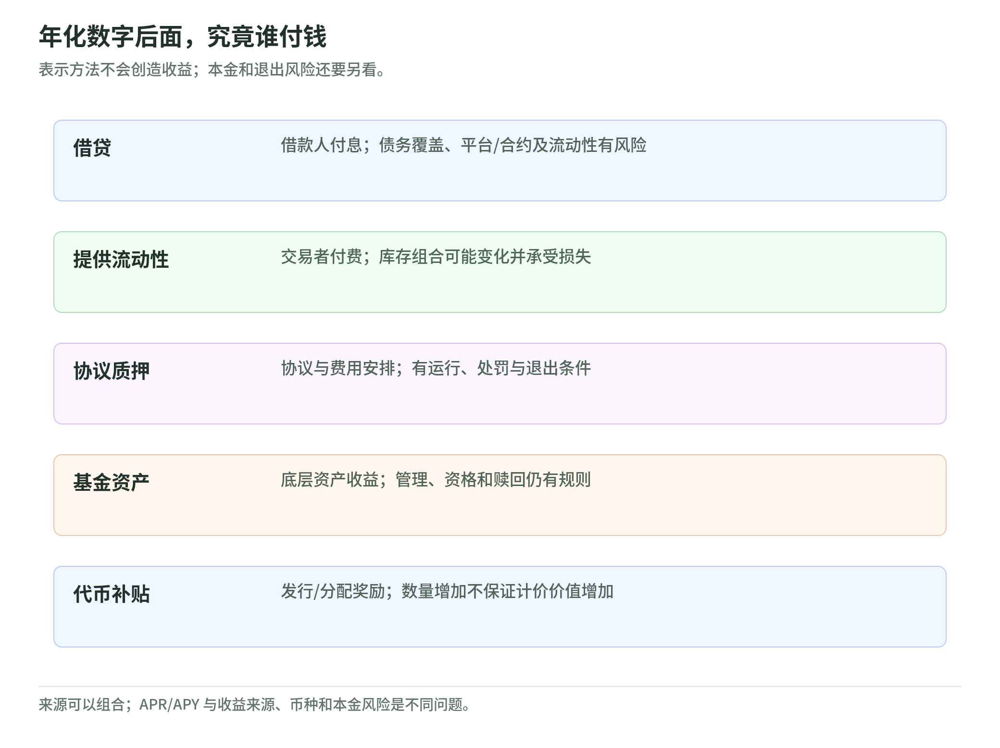

*图：年化数字后面，究竟谁付钱。表示方法不会创造收益；本金和退出风险还要另看。*
<!-- /illustration: primer-yield-payers-a3be0e3068 -->

一看到“年化”，先不要算自己一年能赚多少。先问这个产品让资金做了什么。

借贷利息可能由借款人支付；兑换池收入可能来自交易费；共识质押奖励来自协议及相关费用安排；基金收入可能来自链外资产；活动奖励可能只是新发行代币补贴。钱从哪里来，决定了要承担什么风险。

把资产交给托管平台做收益产品，也不等于在协议里直接做验证者。平台可能再把资金借给别人。叫法相似，债权、控制和退出关系却可能完全不同。

流动性质押会再发行表达质押权益的凭证。它提高某些使用便利，同时增加运营、合约、兑回等待和市场偏价等问题。再质押把安全承诺用于其他服务，还可能增加额外义务或惩罚，不是简单“把一份钱赚两遍”。

### 金库的 100 份为什么不等于 100 个币

金库把底层资产投入某个策略，用户持有 shares，也就是份额。假设整个金库有 1000 个底层资产、总份额 1000，一份对应 1 个资产。忽略费用、进出和舍入，底层升到 1100 时，一份对应 1.1；降到 800 时，一份对应 0.8。

标准可以规定怎样询价和兑换，不保证策略盈利或随时全部退出。有些凭证的展示方式还有其他模型，不要仅凭字母 s、a 或 st 推断换算关系。

### APR、APY 为什么能看起来很漂亮

在常见收益展示语境中，APR 往往表示不再投入奖励的年化口径，APY 纳入指定复利假设。借款法规中的 APR 还可能包含贷款费用，不能拿一个定义包办所有产品。

假设 1000 U 本金，整年固定名义年率 12%，每月给月初余额的 1%，不收费用：

- 每月取出奖励而不再投入，一年共取出 120 U，本金仍为 1000 U。
- 每月都把奖励投回去，一年末约 `1000 × 1.01^12 = 1126.83 U`，有效收益约 12.68%。

实际利率可能变化，奖励可能不能自动再投，退出和手续费也会影响结果。这是固定假设模型，不是收益承诺。

如果 7 天赚了 0.5%，把它线性年化约是 26.07%。你实际经历的仍只有 7 天、0.5%，没有已经收到全年收益。

最后还要看计价单位。100 个币每个 10 U，价值 1000 U；奖励增加到 110 个，但价格跌到 8 U，价值只剩 880 U。数量赚了 10%，按 U 计价却亏了 12%。

资料：[份额接口](https://eips.ethereum.org/EIPS/eip-4626)、[质押](https://ethereum.org/staking/)、[再质押追加责任的原始设计](https://docs.eigencloud.xyz/assets/files/EigenLayer_WhitePaper-88c47923ca0319870c611decd6e562ad.pdf)、[APY 计算中的假设](https://www.consumerfinance.gov/rules-policy/regulations/1030/a/)、[借贷 APR 的不同含义](https://www.consumerfinance.gov/ask-cfpb/what-is-the-difference-between-an-interest-rate-and-the-annual-percentage-rate-apr-in-an-auto-loan-en-733/)、[年化、托管收益与算例审计](notes/plain-language-finance-source-audit.md)。设计论文不用于声称今天某产品的处罚参数。

## 24. 现货、杠杆、期货和永续：不是都在“买一个币”

<!-- illustration: primer-leverage-41721fd863 -->
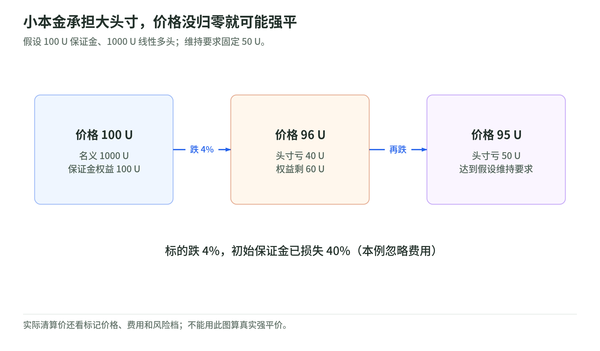

*图：小本金承担大头寸，价格没归零就可能强平。假设 100 U 保证金、1000 U 线性多头；维持要求固定 50 U。*
<!-- /illustration: primer-leverage-41721fd863 -->

全额付款且不借钱借币的现货，是买入资产。它仍有价格和托管风险，但与持有一个杠杆合约不同。

期货是按约定在未来交割或结算的合约头寸。放入保证金，不等于钱包里已经得到同额标的资产。

通常说的永续没有普通期货的固定到期日，使用资金费等机制联系现货市场。它不等于可以永远、安全、免费地持有。

### 用小本金承担大头寸，哪里会先出问题

设一个简化线性多头：每单位开仓参考价 100 U，头寸对应 10 个单位，名义金额 1000 U；小林放入 100 U 保证金，初始名义杠杆是 10 倍。

忽略费用，价格跌到 96 U，头寸损失 `10 × (96 − 100) = −40 U`，保证金权益约剩 60 U。标的只跌 4%，初始保证金却损失了 40%。

再人为假设维持保证金固定要求 50 U，价格到 95 U 时，权益约 50 U，就可能触发强平。这里的比例只是教学参数，不能据此算真实产品的强平价格。

现实还要看维持要求、标记价格、风险档、手续费、资金费、其他头寸和平台流程。有些杠杆损失可能超过初始投入，不能把“我只放了 100”当所有条款下的损失上限。

### 多头、空头和资金费

多头通常从价格上升获益，空头通常从下降获益。资金费为正时，常见机制是多方向空方支付；为负时反向。它是头寸之间的安排，不是因为持有一个现货币就获得利息。

假设 1000 U 的头寸在某完整计费周期适用 0.01%，费用是 0.10 U，而不是用 100 U 保证金计算。周期、连续累计和结算时点各平台可能不同，不能一律说“每八小时扣一次”。

收到资金费也不能抵消所有价格风险。费率可能翻转，价格损失和强平也可能远大于收入。

全仓与逐仓是保证金分配方式。全仓可能让多个头寸共享支持；逐仓按规则隔离相应支持，但具体责任和风险仍看条款。这里不提供开仓、方向或杠杆建议。

资料：[期货基础](https://www.cftc.gov/LearnAndProtect/AdvisoriesAndArticles/FuturesMarketBasics/index.htm)、[保证金与清算示例](https://help.coinbase.com/en-gb/coinbase/derivatives/global-derivatives-liquidation-mgmt)、[资金费规格](https://help.coinbase.com/en-gb/coinbase/derivatives/global-derivatives-funding)、[原始假设与适用限制](notes/plain-language-finance-source-audit.md)。

## 25. ETF、RWA、代币化存款：你拿到的是币，还是一份权益

<!-- illustration: primer-claims-0bd0819a83 -->
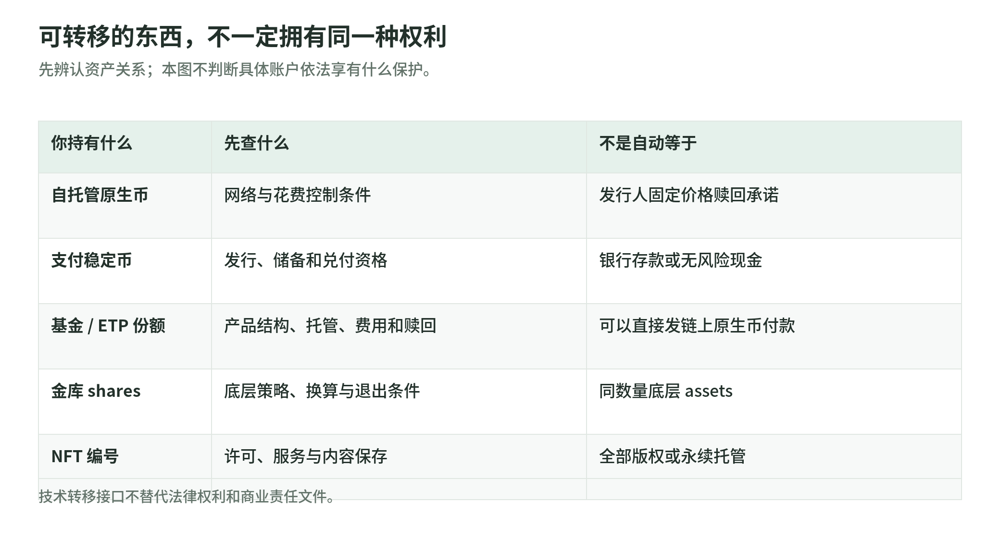

*图：可转移的东西，不一定拥有同一种权利。先辨认资产关系；本图不判断具体账户依法享有什么保护。*
<!-- /illustration: primer-claims-0bd0819a83 -->

小林不想自己管理密钥，买了一个跟踪 BTC 的交易所交易产品。账户里增加的是产品份额，不是可以直接发给小周的链上 BTC。

这类产品常被统称“ETF”，监管材料也使用更宽的 ETP 概念；具体信托、基金和证券结构不一定相同。底层托管、费用、跟踪偏离和申赎规则要读对应文件。

币涨了多少，不保证份额扣除全部费用后精确涨同样比例。也不能从一份历史教育公告推出所有当前产品都拥有相同申赎机制。

### RWA 上链，不是把一栋楼塞进数据库

RWA 是现实资产代币化的常用简称。它把与链外资产有关的记录或权利用代币和系统表达。到底是产权、基金份额、债务请求权还是其他凭证，要看安排。

例如代币化国债基金份额，可以让某些持有人在链上持有或转移相关权益。但基金管理、底层托管、持有人登记、资格和赎回仍有作用。你不因为持有一份基金，就直接拥有基金中某张国债。

同样，“1 美元目标净值”的基金份额不自动成为稳定币，也不等于保本存款。

代币化银行存款则仍需查银行账户和存款关系。支付稳定币、基金份额、银行存款和 DeFi 金库份额不能因为都能用程序转移，就享有同样权利和保护。

可以用四个问题读任何 RWA：谁发行或维护记录，代币代表什么，谁管底层资产，正常和异常时怎样兑现。拿不出答案，就还没理解它在“上”什么。

资料：[SEC 现货 Bitcoin/Ether ETP 教育材料及结构限制](https://www.investor.gov/introduction-investing/general-resources/news-alerts/alerts-bulletins/investor-bulletins/ETPBulletinSeptember2024)、[BUIDL 的份额性质与风险披露](https://investors.securitize.io/news/news-details/2026/Tempo-expands-onchain-yield-offering-with-BlackRocks-BUIDL-fund/default.aspx)、[BENJI/FOBXX](https://www.franklintempleton.com/about-us/digital-assets/digital-assets-technology)、[具名来源审计](notes/beginner-industry-source-audit.md)。

## 26. 分叉、发币和 DAO：没有总管理员，也有治理和权力

<!-- illustration: primer-governance-d6ab736014 -->
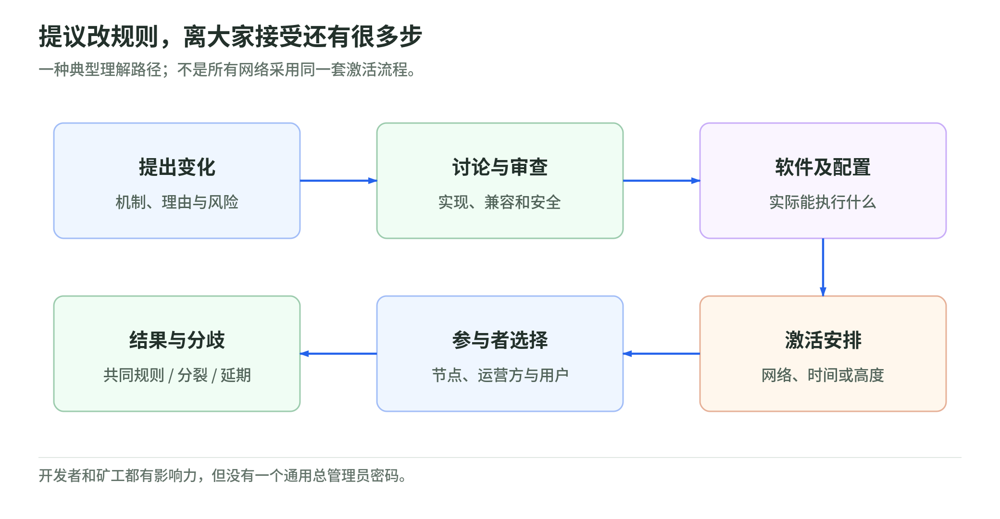

*图：提议改规则，离大家接受还有很多步。一种典型理解路径；不是所有网络采用同一套激活流程。*
<!-- /illustration: primer-governance-d6ab736014 -->

软件要修漏洞、改功能，协议也要演进。但“开发者发新版”与“所有参与者都接受新规则”不是同一个动作。

软分叉通常收紧有效集合，使符合新增规则的块仍能被旧规则接受；旧节点却不一定验证新增限制。硬分叉涉及不向后兼容变化，可能需要软件协调，也可能让网络分开。

这与第 14 节临时分支竞争不是同一件事。临时分支是在相同规则下选择历史；争议分裂还可能是参与者不再认可同一套规则。

如果两个网络从相同状态分开，记录被复制并不保证经济价值翻倍。两边价格、生态、重放保护、托管平台支持和实际控制都要分别看。别为了领所谓分叉币，就把原钱包恢复材料交给陌生工具。

### DAO 是真的没人管吗

DAO 通常把提案、投票或执行的一部分交给治理和合约。实际仍要问谁能提案，票权是否集中，多签由谁持有，投票后谁执行，管理员能否绕过。

治理代币可能给投票权，不自动给公司股权、利润分配或法律责任减免。标着 DAO 的产品，也可能有运营公司和集中权限。

### 项目发币，为什么团队解锁值得看

ICO、IEO、IDO 常分别描述项目发行、借助交易平台或借助链上平台进行发行/分配的方式；叫法本身不证明资产权利、真实性或合法性。空投则是一种分发方式，有些只是奖励或营销。

更有用的是查分配：团队和投资者拿多少，什么时候可转让，谁能再增发，谁能销毁或冻结，费用归谁。销毁减少某种供应，不保证涨价；解锁释放限制，不保证实际卖出。

合约的铸造、升级、暂停权限，往往比“总量宣传图”更影响持有者。技术上创建了一个代币，不证明经营需求存在。

资料：[Bitcoin 控制、升级及分叉](https://bitcoin.org/en/faq)、[Ethereum 治理](https://ethereum.org/governance/)、[DAO](https://ethereum.org/dao/)、[ERC-20](https://eips.ethereum.org/EIPS/eip-20)、[ICO 教育资料](https://www.investor.gov/introduction-investing/general-resources/news-alerts/alerts-bulletins/investor-bulletins-16)、[IEO 教育资料](https://www.investor.gov/introduction-investing/general-resources/news-alerts/alerts-bulletins/investor-alerts/initial)、[IDO 发行平台的术语例子](https://docs.polkastarter.com/)、[供应与解锁统计限制](notes/plain-language-finance-source-audit.md)。发行方式只作术语识别，旧教育资料不代替现行许可或合规判断，也不推荐示例平台。

## 27. L1、L2、侧链、Rollup：为什么不直接把主链做得无限快

<!-- illustration: primer-rollup-jobs-46d7b392c2 -->
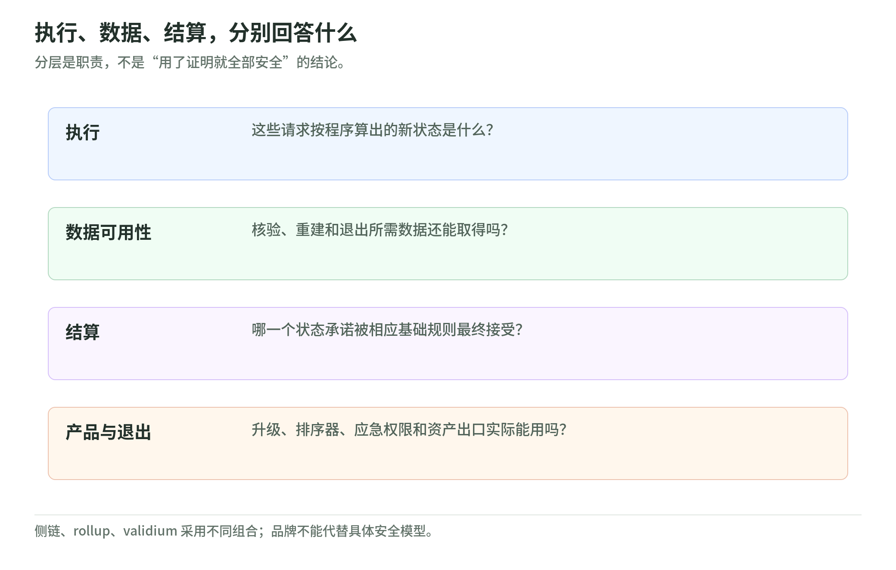

*图：执行、数据、结算，分别回答什么。分层是职责，不是“用了证明就全部安全”的结论。*
<!-- /illustration: primer-rollup-jobs-46d7b392c2 -->

如果更多普通参与者也能独立核对账本，网络就不能只按最豪华机房的硬件设计。交易多了，传输、存储、计算和状态增长也会给节点加负担。

这与普通网站多加一些互不信任的服务器，不是同一扩容问题：有些验证工作需要重复核对，而不是把业务拆分后相信别的机器处理正确。

L1 是提供基础共识的网络。L2 把某些工作移到其他系统，再利用设计中的基础层结算或验证能力。名字不是安全证书。

Rollup 把一批操作一起处理，再提交相关数据和状态承诺。你可以把它想成“外面先处理一批，再按基础层规则核账”，但具体核什么要继续拆开。

Optimistic 路线通过相应争议机制处理不正确的承诺；有效性/ZK 路线提交证明。Validium 将数据可用性放在基础链之外，又增加另一组依赖。

侧链有自己的共识。能桥到 Ethereum，不等于自动继承 Ethereum 全部安全。

### 最该分开的三个问题

执行问“算出的新状态是什么”；数据可用性 DA 问“核验和恢复所需数据能不能取得”；结算问“基础规则最终认可哪个承诺”。

证明运算正确，不代表数据永远能下载；数据能下载，也不保证业务规则对用户公平。排序器的快速回应还不自动等于基础层最终结算。

“去中心化、安全、性能的取舍”是帮助思考的框架，不应背成所有设计都永远无法改进的数学定理。具体系统还要看硬件要求、参与者集中、数据机制和退出路径。

新的 blob/PeerDAS 等机制与扩容数据有关，不表示无限文件永久保存在每个节点上，也不是每个 L2 都已获得同样费用和到账速度。

资料：[扩容](https://ethereum.org/developers/docs/scaling/)、[Optimistic rollup](https://ethereum.org/developers/docs/scaling/optimistic-rollups/)、[ZK 与 validium](https://ethereum.org/developers/docs/scaling/zk-rollups/)、[侧链](https://ethereum.org/developers/docs/scaling/sidechains/)、[PeerDAS 新机制](upgrades/01-ethereum.md)。

## 28. 跨链和闪电网络：都是扩展付款，但不是同一套办法

<!-- illustration: primer-bridge-stages-c8d054ce43 -->
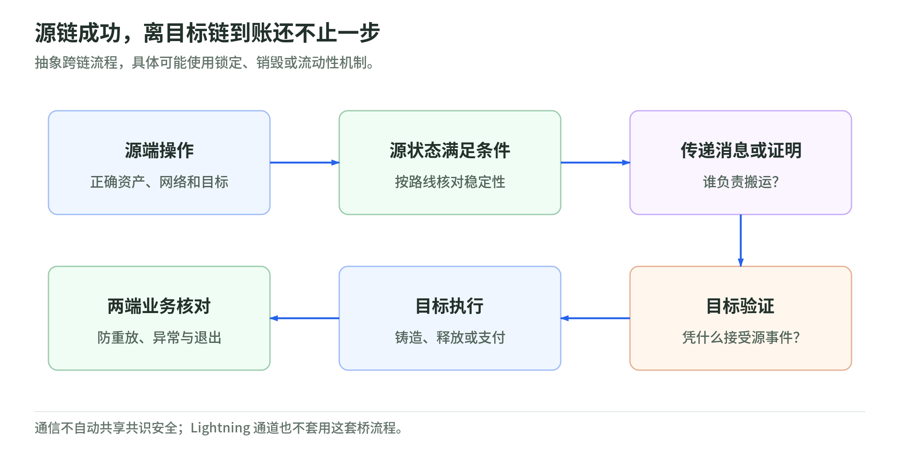

*图：源链成功，离目标链到账还不止一步。抽象跨链流程，具体可能使用锁定、销毁或流动性机制。*
<!-- /illustration: primer-bridge-stages-c8d054ce43 -->

小林在网络 A 有资产，想在 B 上使用。把钱包网络切换到 B，只是换了查账环境，没有把资产搬过去。

桥可能在 A 锁定资产，在 B 铸造包装凭证；也可能先销毁，再凭证明在另一边铸造原生版本；还有流动性提供者在两边协调支付的方式。它们的库存、托管和验证风险不同。

包装 BTC 也不等于在 Bitcoin 链上直接拥有同额 UTXO。包装币代表的兑付权要依赖对应机构、合约或桥，而不只是 BTC 名称。

### 为什么源链成功了，目标链还没到账

源事件需要达到相应条件，消息或证明要被传递，目标端要验证并执行，还可能需要目标链费用。源链看到一次 burn 或 lock，不自动表示两端业务都完成。

谁证明源状态、谁运送消息、谁掌握升级权，失败或超时怎样恢复，都是桥的一部分。“连接了两个网络”不等于共享同一验证者安全。

IBC 和 XCM 等用于不同互操作体系。通信、格式、传输和共享安全是不同职责，不要因为简称都出现在多链图里就混成一个功能。

### Lightning 为什么不是另一种必需的币

闪电网络是基于 Bitcoin 支付通道的链下付款协议。先用链上规则约束资金，再按通道协议更新支付状态，需要时回到链上处理。

教学上，假设初始分配是小林 0.10 BTC、小周 0，忽略费用和储备限制。小林支付 0.03 后，新分配为小林 0.07、小周 0.03；实际还有协作和协议条件，不能凭这个算例构造真实通道。

通道路由需要沿路流动性，旧状态处置和监测也有规则。它不是无限付款容量，更不是“先随便记账，最后链自动兜底”。它和 Rollup 都可能被归入扩展层，却不能互相套机制。

资料：[桥与信任边界](https://ethereum.org/developers/docs/bridges/)、[IBC](https://ibcprotocol.dev/about)、[Lightning 协议定位](https://github.com/lightning/bolts/blob/master/00-introduction.md)、[跨链与支付通道的分类核验](notes/plain-language-applications-source-audit.md)。深入见 [多链教程](upgrades/03-multichain.md)。

## 29. 除了金融，还能做什么：每种应用到底证明了什么

<!-- illustration: primer-content-storage-113d24061b -->
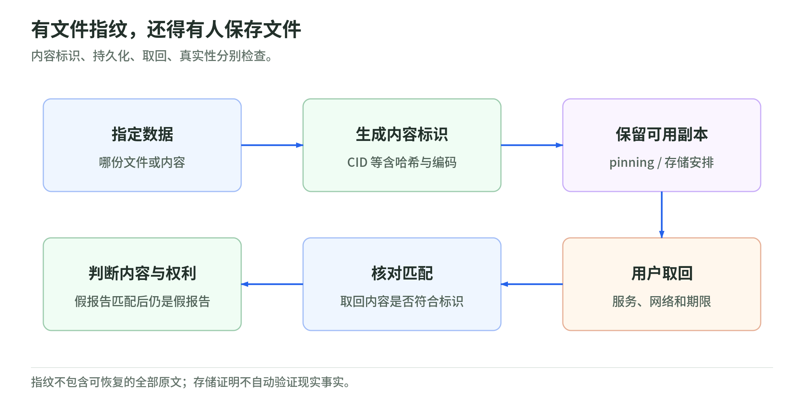

*图：有文件指纹，还得有人保存文件。内容标识、持久化、取回、真实性分别检查。*
<!-- /illustration: primer-content-storage-113d24061b -->

先别急着把每个应用贴成“真需求”或“骗局”。最有用的是补完整一句话：它把什么交给链记录、验证或协调，又把什么留在链外？

### NFT 和游戏物品

NFT 可以记录某个编号现在由谁控制，按规则转移。图片、音乐、模型或描述可能存于其他系统。

拥有编号，不表示自动取得作品版权、永久托管、游戏服务寿命或利润分配。一个游戏认同某个 NFT，也不让其他游戏自动认同它。各游戏的规则、内容和服务器仍有作用。

可以说“凭证转移规则能够公开核对”，不能直接说“所有数字财产问题都解决了”。产品的具体权利要看另外的许可和条款。

### 名字与身份：电话簿不是身份证

ENS 等名称服务把人能读的名字解析为地址，像给收款地址配一个名字。谁能配置记录、记录现在指向哪里、背后现实中的人是谁，是不同问题。

假设小林控制一个教学名字，却把它解析到另一收款地址。查到记录，不证明这就是小林本人，更不证明这个名字属于知名品牌。签名证明某种控制能力，也不自动证明现实身份。

DID 是去中心化标识的一类标准机制。它区分标识对象和控制者，也不要求全部建立在区块链上。再配合凭证时，仍要问谁签发声明、如何验证、是否已撤销或过期。

### IPFS 与 Filecoin：有指纹，为什么图片还是打不开

IPFS 用 CID 识别内容。它更像按内容指纹找文件，而不是按某台服务器的位置找文件。但 CID 含编码等信息，文件可能分块，所以不能把它简单等同于“整份文件的一个 SHA-256”。

内容匹配能帮助检查取到的字节，却不会从摘要里重新变出一个没人保存的文件。Pinning 是让某些节点保留内容；它不是命令全球永久保存。服务和成本仍要有人承担。

Filecoin 的特定存储协议用约定和证明来约束提供者保存数据。它可以证明相应存储承诺，不证明报告中写的事情是真的，也不保证任何用户从任意网关都立即下载成功。

假报告有合法内容指纹，仍是假报告。链、内容校验和现实事实要分开。

### DePIN：补贴安装设备，不等于设备已经盈利

DePIN 常指用网络和激励协调人们提供真实基础设施的应用思路，例如无线服务或存储资源。它不是一种统一共识算法。

设备数说的是供给；系统认可的服务量说的是使用；持续付费客户和收入说的是需求。补贴可以帮助建网络，但奖励金额不直接等于营业收入。

问谁为服务付钱、如何排除作弊、补贴取消后怎样运营，比只数地图上的设备更有用。本文没有替任何项目审计客户和利润。

### 隐私和零知识证明

很多公开链使用假名地址，不等于匿名。地址关系、平台身份记录和应用数据可能把行为联系起来。

零知识证明可以帮助证明某个命题而不披露额外信息，但隐私范围由具体系统决定。ZK Rollup 主要强调有效性证明，名称里有 ZK 不表示所有交易、余额或身份都隐蔽。

凭证、数据保密、公开链记录和谁有查看权限，仍是不同设计问题。

### AI 与机器支付

有的接口设计把付费放在请求流程里，例如请求数字服务、验证支付、提供结果。x402 是具名接口例子；买方可以是人，也可以是程序。

它不是机器突然获得无限提款资格。仍需限制预算、允许的商家、币种、网络、重试、退款和审计。技术接口存在，不证明整个 AI 商业市场都已这样付款。

资料：[ERC-721 的作用域](https://eips.ethereum.org/EIPS/eip-721)、[ENS 记录配置](https://docs.ens.domains/ensv2/tutorial-app-developers/)、[DID Core](https://www.w3.org/TR/2022/REC-did-core-20220719/)、[IPFS 内容与持久化](https://docs.ipfs.tech/concepts/persistence/)、[Filecoin 证明](https://docs.filecoin.io/basics/the-blockchain/proofs)、[Helium Mobile 机制例子](https://docs.helium.com/mobile/5g-on-helium)、[ZK Rollup](https://ethereum.org/developers/docs/scaling/zk-rollups/)、[x402](https://docs.cdp.coinbase.com/x402/welcome)。细节与类比边界见 [应用补课审计](notes/plain-language-applications-source-audit.md)。

## 30. 现在这个行业发展到了哪里：用几条真实进展理解，不按币价排座次

<!-- illustration: primer-industry-map-c2c0eb99c2 -->
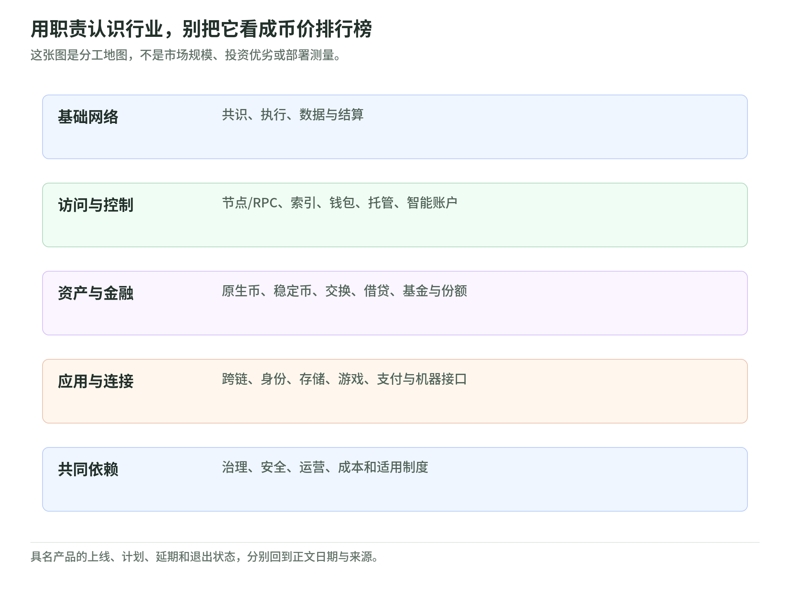

*图：用职责认识行业，别把它看成币价排行榜。这张图是分工地图，不是市场规模、投资优劣或部署测量。*
<!-- /illustration: primer-industry-map-c2c0eb99c2 -->

这里说的是 2026-10-29 核验的一手资料状态。不是日终市场统计，也没有实测全部产品。详细证据保留在 [行业现状](industry-status-2026-10-29.md)，先用普通话理解变化。

### 钱包开始像能设置权限的账户

Ethereum 的 Pectra 已上线，7702 和 4337 等机制让批处理、代付和恢复更可编程。方便不等于不用理解授权；持续委托、模块和恢复策略反而更值得看。

可以理解为：账户不再只有“拿一把钥匙直接签每个动作”这一种用户体验。但不同钱包采用不同实现，不能用同一个按钮名推断全部能力。[Pectra](https://ethereum.org/roadmap/pectra/)。

### 基础网络继续改性能和验证方式

Ethereum 已上线 Fusaka/PeerDAS，进一步处理扩容数据的可用性。Solana 官方页称 Alpenglow 于 2026-10-21 启用，调整共识和最终性路径，SVM 执行没有被替换。

这些是在改“怎样验证、传数据和形成稳定历史”，不是给所有用户发新币。官方目标速度也不是每笔付款的服务承诺。[Fusaka](https://ethereum.org/roadmap/fusaka/)、[Alpenglow](https://solana.com/upgrades/alpenglow)。

下一项升级不能按日历猜。Glamsterdam 的 Hoodi 原排期已由 2026-10-22 公告延期，替代日期未设；原计划日期过去，不证明升级已完成。[延期公告](https://blog.ethereum.org/2026/10/22/glamsterdam-hoodi-delay)。

### 支付里已经有稳定币，但不一定让每个人都持币

Stripe 当前文档提供稳定币收款集成，商户结算余额可以是本地货币。Visa Direct/Inyo 的 2026-10-15 公告则明确某项稳定币预充值进入商业生产。

对商户而言，它可能是换了一段资金轨道，而不是要求顾客和商户永久放弃银行账户。支付、机构结算、备资和最终收款要分开。[Stripe](https://docs.stripe.com/payments/stablecoin-payments)、[Visa/Inyo](https://investor.visa.com/news/news-details/2026/Visa-Direct-Launches-Stablecoin-Powered-Money-Movement-as-Pilots-Move-to-Production/default.aspx)。

### 基金份额也能在链上表达

BUIDL/Tempo、FOBXX/BENJI 有具名产品资料。这说明代币化基金不是只有概念图，但不说明所有人都能买，也不让基金份额变成无风险稳定币。底层管理和兑现仍由相应制度和机构安排。[基金与产品核验](notes/beginner-industry-source-audit.md)。

### 多链不是只剩“谁 TPS 最高”

Bitcoin、EVM 网络、Solana、应用链及共享资源体系的资产模型、执行和安全来源不同。Cosmos SDK 是建应用链的框架之一，IBC 是通信体系；Polkadot Coretime 关注验证资源调度。它们不能一律套用 Ethereum 的合约和 Rollup 模型。

项目会升级，也会退役。Polygon zkEVM Mainnet Beta 官方状态已退役，特殊回收路径不覆盖全部合约资产；AMB 公告记载从本核验日起停止接纳新客户，2027-09-29 结束支持。这些提醒你：买入或开发时，还要想退出与迁移。[多链升级](upgrades/03-multichain.md)、[AMB](https://docs.aws.amazon.com/managed-blockchain/latest/hyperledger-fabric-dev/managed-blockchain-end-of-support.html)。

### 法规更具体，但不等于全球通用资格

身份核验常叫 KYC，反洗钱常叫 AML；它们关系到服务方如何识别客户和履行义务，不是链自己判断个人身份的一套密码学。

欧盟 MiCA 已有适用规则。美国 GENIUS 已成法，OCC 2026-10 发布的最终规则说明将于 2027-01-18 生效。“法案通过”“规则发布”“规则生效”“主体获许可”是不同步骤。

这篇没有核验所有法域和个人资格，不给开户、经营、税务或交易是否合法的个体结论。技术接口能调用，不等于某地区可以提供该业务。[制度状态与范围](industry-status-2026-10-29.md)、[OCC](https://www.occ.gov/news-issuances/bulletins/2026/bulletin-2026-50.html)。

行业里同时有基础设施、具名生产应用、试验、投机和诈骗。看一个项目，需要找它自己的证据，不能用另一个成功项目替它作担保。

## 31. 怎样看懂一笔交易：先找事实，再看浏览器的解释

区块浏览器把数据整理成页面。交易标识、输入输出和执行结果来自相应链；图标、美元估价、地址名称和“疑似找零”等还可能是额外索引或推断。

能看网页，不等于亲自完成了全部共识验证。它仍然是很好的学习工具，只是需要分清数据显示了什么。

### 看 BTC，不要只盯着收款金额

对第 9 节例子，按这个顺序找：

1. 在哪个网络，交易标识是什么。
2. 输入花的是哪个旧交易的哪个输出。
3. 新输出有多少，分别用什么收款条件。
4. 输入总额减输出总额，差额是多少。
5. 所在块的哈希与当前确认状态。

浏览器可能帮你猜找零地址。那是推断，不是协议写着“这个输出就是找零”；真实经济目的也不能仅凭地址图断言。

### 看 EVM 代币转账，最外层收款地址可能不是小周

小林转稳定币，外层交易的 `to` 常是代币合约，`data` 填“给小周转多少”的调用参数。原生 ETH 的 `value` 可以是 0，代币却确实发生转移。

因此要同时看网络、发送账户、nonce、目标合约、调用函数、执行结果、日志和实际资产变化。

例如最小单位数量为 100,000,000，合约该资产按 6 位小数展示，才对应 100 个可读单位。不同资产可能不同；不能把所有代币都按 ETH 的 18 位处理。

`receipt.status = 1` 通常说明外层没有整体回退，不无条件保证每个内部操作都成功、目标实际收到预期数量。代币收费、可返回 false 的实现和聚合操作，都可能要求额外核对。

### 再看完整成本

实际 gas 用量、有效单价、平台手续费、兑换价差和资金费可能属于不同层。别把一个页面上的“预计总费用”当每个协议统一字段。

学习时可以从本文的离线假设开始，不需要输入个人地址、连接钱包或点击交易页面的推荐链接。

资料：[Bitcoin 交易参考](https://developer.bitcoin.org/reference/transactions.html)、[Ethereum JSON-RPC](https://ethereum.org/developers/docs/apis/json-rpc/)、[ERC-20](https://eips.ethereum.org/EIPS/eip-20)、[费用口径核验](notes/plain-language-finance-source-audit.md)。

## 32. 十个常见问题：先识别故障在哪一层

<!-- illustration: primer-danger-scenarios-dee0e7277c -->
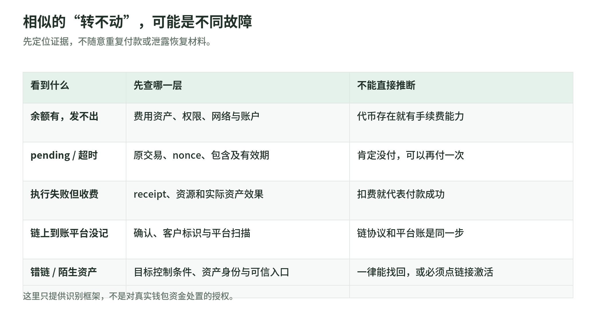

*图：相似的“转不动”，可能是不同故障。先定位证据，不随意重复付款或泄露恢复材料。*
<!-- /illustration: primer-danger-scenarios-dee0e7277c -->

### 钱包卸载了，余额为什么没有消失

App 是工具，不是链上记录本身。能否恢复控制看恢复材料、派生和账户配置。不要把“我还能在浏览器看到余额”当“我仍然能签名”。

### 有代币，却提示手续费不够

常规路径可能需要本网络的原生资产支付执行费。代币余额、手续费资产和代付安排分开查。

### 发完一直 pending，是否再发一笔就好

不一定。可能费率、nonce 顺序、网络状态或供应商查询有问题。先保存并核对原交易。重播同一已签数据、替换交易、过期后重新尝试，都有各自规则。

### 显示失败，却扣了费

已经入块执行后回退，可以产生资源费；根本没通过基本检查的请求又不同。看 receipt 和实际变化，别只根据界面文字猜。

### 链上查到充值，平台还没加余额

平台可能等待确认、查客户标识、审核资产/网络或排查扫描延迟。协议收款和平台入账是两步。核对网络、交易及充值要求，再通过可信服务渠道查询，不提供私钥。

### 用对地址却发错网络，是不是一定找不回

不是统一答案。相同字符在不同网络上可能由同一控制材料控制，也可能是没有相应部署的合约，或者平台不支持该资产。先判断目标网络的实际收款条件和控制关系；不承诺恢复，不轻易判定烧毁。

### 发到一个不想给的地址，能撤销吗

协议通常没有普通用户的退款按钮。是否能通过收款人或平台协作处理，要具体看。确认稳定后的误付款，不因为“我不是这个意思”就自动无效。

### 钱包突然收到陌生代币，要去领取吗

收到代币，不是邀请你打开它宣传的网站。有人借陌生资产、NFT、空投和假地址历史引导授权。仅看到一个余额，不代表需要签“激活”“同步”或“解锁”消息。

### 已断开网页，为什么权限还在

会话断开不自动改变 allowance、代码委托或账户模块。先查你授予的是哪种权限，再决定对应处理；别拿一个 revoke 按钮想当然地解决所有授权。

### 冷钱包也被转走，是不是冷钱包没用

可能是恢复材料泄露，也可能签了危险消息、使用了不同权限入口，或错误理解了托管关系。要查真实控制路径，不能只根据产品标签找原因。

这些是一般辨别方法，不是针对某个真实钱包的恢复或资金处置方案。没有可信证据时，不应重复付款、随意导入种子或找“保证追回”的陌生服务。

资料：[安全与骗局](https://ethereum.org/security/)、[钱包恢复](https://developer.bitcoin.org/devguide/wallets.html)、[Ethereum 交易](https://ethereum.org/developers/docs/transactions/)、[7702 持续授权](https://eips.ethereum.org/EIPS/eip-7702)、[钱包故障与幂等](chapters/05-wallet-engineering.md)。

## 33. 怎样判断“值得上链”，怎样看一个项目是否靠谱

<!-- illustration: primer-project-check-395a56c63a -->
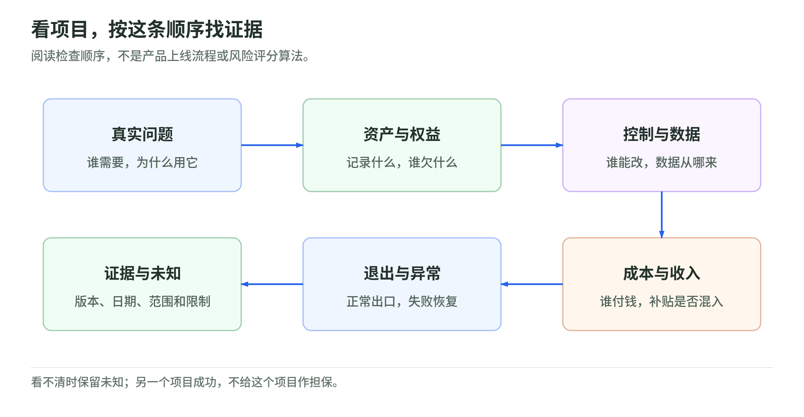

*图：看项目，按这条顺序找证据。阅读检查顺序，不是产品上线流程或风险评分算法。*
<!-- /illustration: primer-project-check-395a56c63a -->

先别问它有没有 token。问现在的问题是什么。

一个团队内部的普通业务系统，如果大家都接受一个管理者，数据库、权限和审计日志可能已经够用。把每次操作复制到许多节点，增加成本和协调问题，不会自动改善业务。

多个组织需要共同确认状态、希望降低对某一家记录提供者的依赖，可能更值得评估共享账本。但仍需解决成员资格、数据来源、争议、更正和责任。许可链也是一种具体模型，不必因为“不是完全公链”就否认它有自己的用途。

上链大文件时，完整性、保存、访问控制和取回能力还要分别设计。链上放哈希，不等于大文件有永久备份；公开写敏感信息也不会因为加了密码学术语就变成私密。

### 读项目，用具体问题代替口号

让项目说清楚：用户是谁、解决什么；为什么需要这套网络；代币代表什么；谁能升级、冻结和取走资金；价格或身份数据从哪来；正常和异常时怎样退出。

再把收入、补贴和用户分开。发出很多奖励，不等于赚到同额经营收入；地址多，不等于真实独立用户多；TVL 是按口径统计的资产量，不等于营业收入、净新增资金或风险准备金。

TPS 也需要方法：统计什么类型、哪个时间窗口、有没有投票和失败流量。最终性是目标、实验结果还是用户端分布？不能拿不同口径做漂亮排行榜。

源码公开可以检查部分实现；审计报告有覆盖版本和范围；多签有参与人及其他模块；品牌有其他产品。这些都是线索，不是无限担保。

对空投、meme、热点币也适用。娱乐、社区或投机需求可以存在，但不能把“有人谈论它”当成储备、兑付或持续收入证据。看不清楚的东西，可以先保留未知，不必硬选“未来”或“骗局”两个答案。

资料：[Fabric 模型与数据库组件](https://hyperledger-fabric.readthedocs.io/en/release-2.5/whatis.html)、[数据可用和持久化](https://docs.ipfs.tech/concepts/persistence/)、[指标与证据分级](industry-status-2026-10-29.md)、[应用与真实需求审查](notes/plain-language-applications-source-audit.md)。本节是分析方法，不是投资评级。

## 34. 到这里，怎样检查自己真的懂了

试着不看术语，给朋友讲一遍小林的故事：

小林在平台买资产，提到自己控制的账户，给小周付款；交易经过签名、包含和稳定性判断，小周再决定持有、换币或兑现。把每一步谁控制、谁记录、谁收费、失败时查什么讲清楚，就已经比只背词有用。

下面 30 题可以用来查缺漏。答案是要点，不要求照着背。

| 问题 | 能讲清的答案 |
| --- | --- |
| 1. 复制钱包文件，BTC 会变多吗？ | 控制材料可能被复制，账本金额不会翻倍。 |
| 2. 两张都签过字的付款单，能消费同一份旧资产吗？ | 授权合法不消除状态冲突；有效历史不能双花。 |
| 3. 哈希、加密、签名分别干什么？ | 摘要校验、保密、验证具体授权。 |
| 4. App 密码和助记词相同吗？ | 本地访问保护与恢复控制材料不同。 |
| 5. 同地址在两条链上，余额一定相同吗？ | 两本账独立，网络与资产身份要分开。 |
| 6. 0.1 BTC 支付 0.03，找零在哪里？ | 旧输出完整消费，创建付款和新找零，剩余差额是费。 |
| 7. 内容合法的候选块为什么还不能提交为成功块？ | PoW 哈希可能仍未达标。 |
| 8. 目标缩小，挖矿变难还是变容易？ | 合格范围缩小，通常更难。 |
| 9. 目标由中央服务器发吗？ | 节点按协议和历史独立计算，并核对 nBits。 |
| 10. 交易费也是新发行吗？ | 补贴是新增，费用是已有资产转移。 |
| 11. 普通全节点必须挖矿吗？ | 验证规则与争取出块权不是同一职责。 |
| 12. 六个确认意味着绝对不重组吗？ | 是风险阈值例子，不是无条件保证。 |
| 13. 挖矿 nonce 与账户交易 nonce 是同一个作用吗？ | 前者用于尝试，后者约束账户顺序。 |
| 14. 失败为什么可能收费？ | 已执行消耗资源；没入块请求另看。 |
| 15. 断开网页就撤销所有资产权限吗？ | 会话、额度、委托和模块是不同对象。 |
| 16. 平台 BTC 余额一定由自己私钥直接控制吗？ | 通常是平台客户权益，要看真实控制与提币路径。 |
| 17. 市值是一桶可让所有人同时取出的现金吗？ | 是参考价乘数量，成交还受价格和深度影响。 |
| 18. 解锁等于新铸币或当天卖出吗？ | 限制、统计流通和实际出售不同。 |
| 19. 100 个稳定币到账，就有 100 美元银行钱吗？ | 链上控制与市场卖出/发行方赎回分开。 |
| 20. 预言机把假报告签对了，会变真吗？ | 来源和传输验证不创造现实真实性。 |
| 21. 池里原报价 100，卖 10 个一定收到 1000 吗？ | 交易改变比例，实际均价会受影响。 |
| 22. 抵押价格下跌，债务不变会怎样？ | 覆盖可能下降，进入清算区间。 |
| 23. 100 份金库就是 100 个底层资产吗？ | 要按换算、费用、舍入和退出条件计算。 |
| 24. 币数量增加 10%，按法币一定赚 10% 吗？ | 价格和成本仍影响计价结果。 |
| 25. 杠杆产品要等标的跌到零才清算吗？ | 可能先触及维持保证金要求。 |
| 26. ETF/ETP 份额可以直接发一笔 BTC 付款吗？ | 份额是产品权益，不是自托管币余额。 |
| 27. 执行证明、数据可用性和结算一样吗？ | 分别检查计算、可取得的数据和认可的承诺。 |
| 28. 源链锁定成功，跨链业务就完成了吗？ | 还要传递、验证、执行与两端核对。 |
| 29. NFT 有 CID，图片一定永久可取吗？ | 内容标识不替代持续保存和可用副本。 |
| 30. ENS/DID 或有效签名自动证明现实身份吗？ | 名称、标识、控制和可信身份绑定不同。 |

### 不花钱的六个练习

1. 用第 9 节金额画自己的 BTC 付款图，尝试两个输入，核对总额。
2. 把挖矿教学目标从 0009 改为 0019，数合格值，解释概率和难度方向。
3. 用第 19 节订单簿买 4 个，算 406 U 与均价；再解释费用为零为何也可能有买卖成本。
4. 把 AMM 卖入 A 从 10 改成 1，比较单个均价，保持“不收费用”的假设。
5. 把抵押价格、债务或收益币价格分别改一次，观察哪个变量影响哪个结果。
6. 选一个公开产品，写资产身份、控制者、收入/奖励来源、数据、退出与未知项。只读资料，不连接钱包。

可选：运行 [图解算例检查](examples/primer_math.py)和原有 [离线状态练习](examples/offline_workbook.py)。它们不联网、不签名、不广播，只核对教学算术与模型。

```bash
python wiki/topics/blockchain/examples/primer_math.py
python wiki/topics/blockchain/examples/offline_workbook.py
```

### 后续阅读

想查名词，可用 [首版机制速查](beginner-reference.md)和 [术语表](glossary.md)。想做工程，再读 [七章工程基础](README.md)、[六篇完整升级教程](upgrades/README.md)，按 [学习路线](learning-roadmap.md)验收。

本文的经济与应用补课分别保留 [金融来源审计](notes/plain-language-finance-source-audit.md)和 [应用来源审计](notes/plain-language-applications-source-audit.md)。图片清单、原创说明和重建方式见 [配图说明](images/primer-illustrations.md)。

原始 PPT、全文提取和原图仍只在本地保存，不作为这篇公开读本的下载资源。
