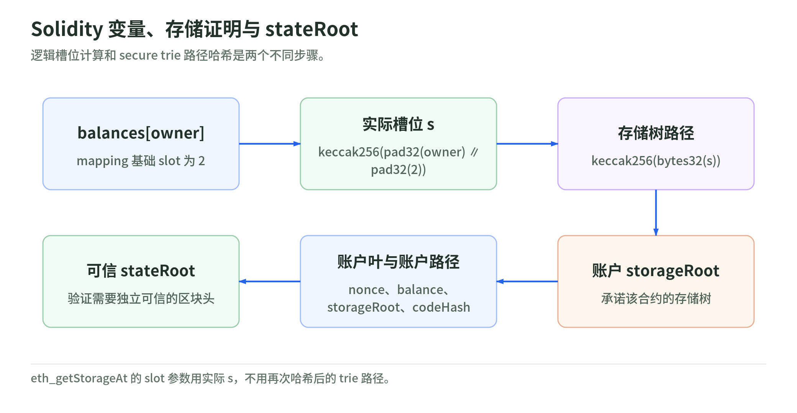

# 03｜Ethereum 状态、存储与执行

- 对应 PPT：23–27、45–47
- 学习目标：从 storage slot 追到 stateRoot；从 nonce / gas 追到最终业务效果
- 查阅日期：2026-10-29
- 来源编号见 [来源表](../sources.md)

## 1. 账户四字段与代码

以 MPT 状态承诺模型解释：账户记录为 `nonce、balance、storageRoot、codeHash`。代码字节由 `codeHash` 承诺，不是把源码直接塞进账户叶子；账户路径使用地址的 Keccak-256。状态承诺与节点实际数据库布局要分开理解。[E01]

PPT 说“EOA 没有代码”仅适合基础模型。Ethereum 主网 Pectra 已于 2025-05-07 启用 EIP-7702：EOA 可以保存指向委托实现的标记，并在自己的账户上下文执行委托逻辑。这不等于抛弃私钥，也不等于 ERC-4337 的 UserOperation。[E04][E05]

“代码不可变”也不能推导出“业务逻辑不可升级”。代理合约可以修改实现地址，通过 `DELEGATECALL` 在代理存储上下文运行新逻辑；固定代理字节码并不固定其所有行为。[E06]

## 2. 三层位置：变量、存储树、全局状态树

<!-- illustration: ethereum-state-proof-51ebf15d80 -->


*图：Solidity 变量、存储证明与 stateRoot。逻辑槽位计算和 secure trie 路径哈希是两个不同步骤。*
<!-- /illustration: ethereum-state-proof-51ebf15d80 -->

示例是独立教学合约，不对应任何真实代币：

```solidity
contract Demo {
    uint256 a;                 // slot 0
    uint256 b;                 // slot 1
    mapping(address => uint256) balances; // 基础 slot 2
}
```

对于地址 `owner`：

```text
实际槽位 s = keccak256(pad32(owner) || pad32(2))

storage trie 的路径 = keccak256(bytes32(s))
state trie 的路径   = keccak256(address 的 20 字节)
账户值             = RLP(nonce, balance, storageRoot, codeHash)
```

第一层哈希决定 Solidity mapping 的槽位；第二层把槽位映射到 secure trie 路径，不能混成一个哈希。存储树中的值还涉及整数与 RLP 编码，不是所有层都直接存固定 32 字节对象。小变量可以打包共享槽位；继承、代理和自定义布局还会改变基础位置。[E01][E07]

`eth_getStorageAt(address, slot, block)` 使用实际槽位 `s`，不用再次哈希后的 trie 路径。钱包一般通过 `balanceOf` 查代币余额，避免依赖特定实现布局。[E08][E09]

## 3. stateRoot 证明什么

某槽位发生改变，会影响该账户的 storageRoot，再影响 stateRoot。共识协议验证的是状态转换与最终承诺，哈希本身不会禁止合法更新。[E01]

```text
可信区块头的 stateRoot
  → accountProof：账户四字段
  → storageRoot
  → storageProof：特定 slot 的值或不存在性
```

`eth_getProof` 可提供账户和存储证明。验证者还需要独立信任区块头，并核对地址、槽位、区块及证明路径；不能把同一不可信 RPC 提供的根和证明互相验证后就当作可信。[E03]

## 4. 结构共享不等于所有客户端保存所有旧树

写时复制解释了为何逻辑上只需更新变化路径，不必逐块复制所有账户。[E01]

实际客户端可能采用哈希存储、路径存储、快照、增量和裁剪。Geth 官方资料区分 hash-based 与 path-based archive；path-based 的历史状态和历史 trie proof 保留也不同。v1.16.x 的历史状态查询不自动意味着支持历史 `eth_getProof`；v1.17.x 还需保留相应 trie node history。[E10]

所以 PPT 第 27 页的“全节点 1.2–2 TB、归档 15–20 TB”不能当通用配置。采购前明确客户端/版本、网络、同步起点、保留策略、索引和备份，再做容量与增长测量。本次未运行节点容量基准。

## 5. nonce：顺序与并发属于两个层次

普通 EOA 交易按账户 nonce 依序执行；较低 nonce 未处理时，后续交易无法越过它。已包含但 revert 的普通交易也消耗其 nonce。[E02][E08]

工程建议：

- 按 `(network, sender)` 维护本地 nonce 保留账本和原子分配。
- `pending` RPC 只反映该节点视角，不能代替本地并发控制。
- 每个逻辑提现记录 nonce、所有候选 hash、原始签名字节和广播结果。
- 同 nonce 替换是同一“交易槽位”的竞争；不能当新提现重复扣用户余额。
- 7702 授权也会影响账户 nonce；支持该类型时要使用其准确规则，不能只统计外发交易。
- ERC-4337 的 keyed nonce 是另一套语义，不能与普通 EOA nonce 混用。[E04][E11]

## 6. Gas：预算、实际消耗和资产效果

普通 EIP-1559 交易在可被包含的条件下：

```text
effectiveGasPrice
  = min(maxFeePerGas, baseFeePerGas + maxPriorityFeePerGas)

执行费 = gasUsed × effectiveGasPrice
```

`maxFeePerGas` 是单价上限，`gasLimit` 是计算预算，均不等于实际支出。base fee 被销毁，priority fee 支付给区块费用接收方。其他交易类型、blob 和 L2 额外费用要另算，不能把此式硬套全部链。[E02]

教学例：base fee 为 20 gwei、priority 上限为 2 gwei、max fee 为 30 gwei、gasUsed 为 21,000，则执行费为 `462,000 gwei = 0.000462 ETH`，不是 `21,000 × 30 gwei`。

对于普通交易，revert 回滚调用产生的状态效果，但不退回已经消耗的 gas。receipt 的 `status=1` 只证明顶层执行没有失败，不保证 ERC-20 真正转出目标数量。返回 `false`、收费代币、内部调用失败处理和 AA 内部执行都要分别检查。[E08][E09][E11]

7702 还有更重要的例外：授权委托在执行前处理，后续执行 revert 不会撤销已处理的委托标记。因此“revert 就什么也没变”在现代钱包里同样不成立。[E04]

## 7. ERC-20 的正确心智模型

`balanceOf`、`transfer`、`allowance` 等是接口标准，不强制内部一定使用名为 `balances` 的 mapping。`decimals`、`name`、`symbol` 都是可选元数据；资产标识不能用 symbol。[E09]

调用 `transfer(address,uint256)` 通常是：

```text
to    = 代币合约
value = 0（该调用不同时附带 ETH 时）
data  = selector || pad32(recipient) || pad32(amount)
```

selector 是规范函数签名的 Keccak-256 前 4 字节，不是 SHA3-256。事件按合约地址、topics 和 data 解码；不能仅凭看到同名 `Transfer` 就确认官方资产到账。[E12]

原生 ETH 的完整收款监听也不能只看顶层 `value`：合约内部调用可转移 ETH。如何追踪与核对这些变化取决于节点 trace 能力和账户架构，是钱包索引设计的一部分。[E06][E08]

## 自测与下一步

1. 能否从合约变量布局说明 mapping slot 和 trie 路径为何有两次哈希？
2. 为什么代理字节码固定而其逻辑可以改变？
3. 为什么成功 receipt 不能当成指定代币到账的唯一依据？
4. 为什么 7702 授权之后执行失败仍需检查委托状态？

实践见 [学习路线](../learning-roadmap.md)，安全解释见 [06 章](06-security.md)。

完整新版机制见 [Ethereum 升级篇](../upgrades/01-ethereum.md)：展开 7702/4337 的签名、nonce 和失败路径，path archive 的反向历史与证明保留，以及已上线 PeerDAS 和尚在研究的 binary-tree 路线。
