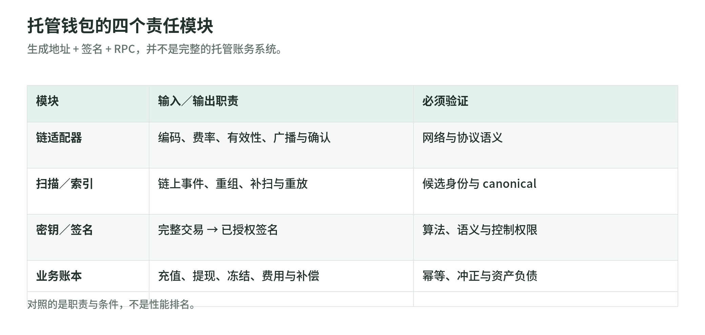
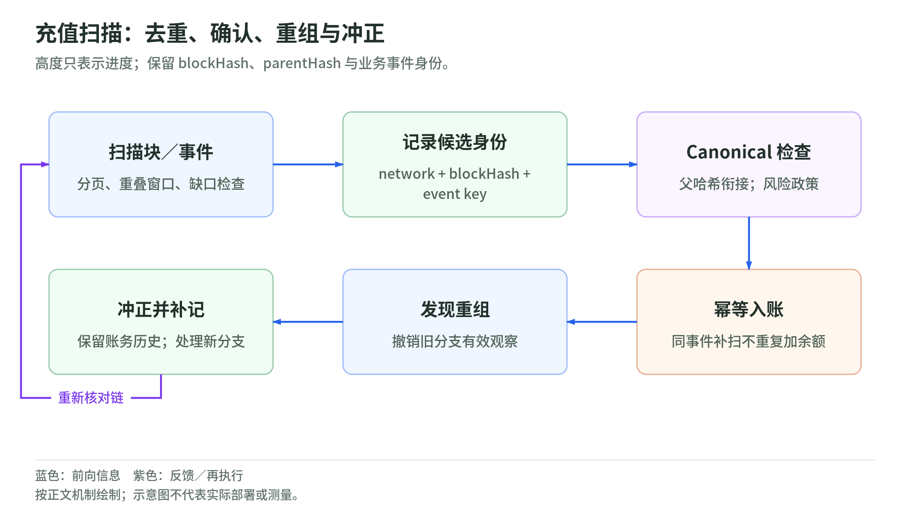
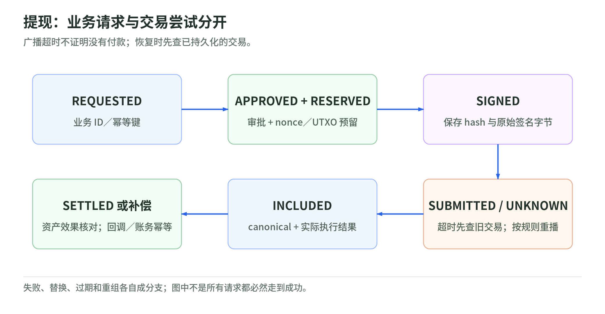

# 05｜钱包工程：从链上事件到可靠账务

- 对应 PPT：43–51、58–59
- 学习目标：定义资产身份、构造规则、状态机、幂等键和恢复策略
- 标记：协议接口有一手来源；架构、表结构和验收要求是本次工程建议

## 1. 先区分两种钱包

<!-- illustration: wallet-modules-54396cca02 -->


*图：托管钱包的四个责任模块。生成地址 + 签名 + RPC，并不是完整的托管账务系统。*
<!-- /illustration: wallet-modules-54396cca02 -->

**个人自托管钱包**关注密钥归属、备份恢复、用户可理解的签名和网络识别。
**交易所 / 托管钱包**还需用户内部账本、归集、提现审批、冷热调拨、监控及资产负债对账。

不能把“生成地址 + 签名 + RPC”当成完整托管钱包。

```text
账户与资产目录
  ├─ 链适配器：编码、费率、有效性、广播、确认
  ├─ 扫描与索引：链上事件、重组、重放
  ├─ 密钥与签名：授权、算法、硬件适配
  └─ 业务账本：充值、提现、手续费、冻结、补偿
```

这是模块划分建议，不要求所有系统采用微服务。

## 2. 资产身份不是名称或地址

推荐至少记录：

```text
NetworkId = 链族 + 网络 + chainId / genesis 指纹
AssetId   = NetworkId + 原生币标记 / 合约地址 / mint 地址
Amount    = 最小单位整数
Metadata  = decimals + symbol + 名称 + 来源 + 核验版本
```

`USDT`、`ETH` 和 `0x...` 不是完整资产标识。EVM 的同一私钥派生地址在多网络可相同，但余额、nonce、合约和控制条件各自独立。EIP-155 / typed transaction 的 chainId 提供交易级防重放，不能防止用户自己选错网络。[E02][W01]

精度元数据只负责显示与转换，不能用浮点数记账。教学例：`12.345678` 个 6 位精度代币等于 `12,345,678` 最小单位；多余小数必须拒绝或按明确规则处理，不能无声四舍五入。ERC-20 的 decimals 是可选字段，不应硬编码“所有币 18 位”。[E09]

PPT 第 51 页“错链必定永久丢失”过于绝对：若同一主体确实控制目标网络上的地址，可能恢复；托管平台不支持、地址是不同部署的合约或无法取得所需控制权时，可能不可恢复。产品应事前防错，不能事后承诺可追回。

## 3. Bitcoin 的输入、输出与手续费

规范概念见 [02 章](02-bitcoin.md)。钱包构造必须做：

1. 解析地址为目标网络的 scriptPubKey，而不是按前缀拼字符串。
2. 选择可花且满足业务确认策略的 UTXO。
3. 预留每个 outpoint，防止并发提现选中同一输出。
4. 创建收款和找零；核对找零确由自己的描述符或密钥控制。
5. 按输入类型计算 sighash，签名后验证并组装。
6. 以完整签名交易计算 weight、vsize 和实际手续费，再广播。

```text
fee  = sum(inputs) − sum(outputs)         单位 sat
vsize = ceil(weight / 4)                 单位 vB
feerate = fee / vsize                    单位 sat/vB
```

权重来自 BIP141，输入签名摘要随 Legacy / SegWit v0 / Taproot 不同，不能把 txid 当 sighash。[B03][B04][B06]

工程建议：显式处理 dust / 节点策略、找零过小、资金不足、coin selection 隐私、RBF 与 CPFP。中继策略与共识规则分开，某 RPC 拒绝不等于交易在所有节点无效。

PSBT 把交易构造、签名与最终化分开；v0、v2 和 Taproot 字段分别有规范，使用时必须确认库与硬件支持的版本。PSBT 不是加密容器，不应包含种子或私钥；签名器仍要核对输入、输出、找零和手续费。[W02][W03][W04]

“花历史地址类型”的责任还包括脚本、派生路径、描述符、备份范围和扫描起点，而不仅是保留某个地址前缀。[W05]

## 4. EVM 的交易槽位与执行结果

普通 EOA 提现按 `(network, sender, nonce)` 保留槽位。构造时分别核对：

- chainId、sender、to、value；
- 合约地址、函数 selector、参数、代币整数精度；
- gasLimit、费用上限、余额和网络特有费用；
- 若使用 7702 / AA，核对授权和 EntryPoint 版本及额外控制能力。

`eth_estimateGas` 是基于节点状态的估计，不是最终执行成功保证。模拟与签名到上链之间状态、预言机、流动性及授权都可改变。[E08]

广播成功后要拿 receipt、区块哈希、执行状态及实际资产效果。ERC-20 核对目标合约的事件与余额；AA 还需 UserOperation 的内部成功状态，不能只看外层 bundle receipt。[E09][E11]

## 5. Solana 适配器与 EVM 不同在哪里

Solana 交易包含 recent blockhash、有签名数组、账户列表和指令；普通 recent-blockhash 交易有有效期。超时后需要重新判断链上状态，再构造有效交易，不能拿过期消息一直重播。确认使用 blockhash 与 lastValidBlockHeight；commitment 标签必须按集群与升级时期解释。[S01][S02]

截至 2026-10-29，英文 Alpenglow 升级页称主网已切换，`confirmed` 与 `finalized` 描述同一状态，旧投票交易及索引语义也有变化。不能沿用传统文档的等待 32 slots 逻辑；新代码按官方迁移口径评估 `finalized`，仍检查交易实际执行结果。其他集群与供应商需分别验收，本次未进行 RPC 实测。[C16]

SPL Token 的余额保存在由 Token Program 管理的 token account，资产身份是 mint。钱包所有者地址不等于每种代币的 token account；ATA 是按确定规则派生的常用 token account。Token Program 和 Token-2022 的扩展能力也不能混用。[S03]

工程建议：链适配器独立负责消息编码、签名算法、费用、过期、token account 创建与实际执行状态。不用统一“0x 地址 + nonce”的抽象强行覆盖。

## 6. 充值扫描：块高是进度，不是唯一身份

<!-- illustration: deposit-reorg-87f94d0b44 -->


*图：充值扫描：去重、确认、重组与冲正。高度只表示进度；保留 blockHash、parentHash 与业务事件身份。*
<!-- /illustration: deposit-reorg-87f94d0b44 -->

推荐模型：

```text
ObservedBlock(network, height, hash, parentHash, canonical)
ChainEvent(network, blockHash, txid, eventIndex, asset, amount, recipient)
Credit(eventKey, user, amount, stage, reversalOf)
```

- Bitcoin 收款事件以 `(network, txid, vout)` 识别。
- EVM 日志以 `(network, txHash, logIndex)` 识别事件，并保留其 blockHash / canonical 状态。
- 记录扫描范围和父哈希；检查当前块是否衔接上个块。
- 日志查询分页、分段并做重叠窗口去重，避免供应商限制导致静默漏扫。
- 同一块或事件重复投递应为幂等；补扫不能重复加用户余额。
- 出现重组先撤销旧分支的有效观察，再处理新分支；不能只继续增加高度。

JSON-RPC 日志的 `removed` 是提示，不是唯一恢复手段；断开重连后还要主动重查 canonical 链。[E08]

对已记账事件，推荐保留冲正记录而不是删除历史。若已允许提现，还需冻结、风险处理和资产负债核对。确认阈值和风险例外应是配置，不把 PPT 的“6 确认”当所有金额、所有链的共识保证。

## 7. 提现状态机：广播不确定性最值得测试

<!-- illustration: withdrawal-states-e7a4605d67 -->


*图：提现：业务请求与交易尝试分开。广播超时不证明没有付款；恢复时先查已持久化的交易。*
<!-- /illustration: withdrawal-states-e7a4605d67 -->

以下为参考业务模型：

```text
REQUESTED → APPROVED → RESERVED → SIGNED → SUBMITTED
                                          ↓
                                 BROADCAST_UNKNOWN
                                          ↓
                               INCLUDED → SETTLED

执行失败 / 替换 / 过期 / 重组 → 分别记录分支和补偿
```

`BROADCAST_UNKNOWN` 表示 RPC 超时，而交易可能已被网络接收。安全恢复是用已保存的 hash、原始字节和相关 nonce / outpoint 查状态，必要时重播同一交易；不能直接另起 nonce 或重新选币支付同一提现。

建议分开：

| 记录 | 表示什么 |
| --- | --- |
| requestId / idempotencyKey | 用户的一次业务提现 |
| nonce slot / inputs reservation | 占用了哪些链上资源 |
| attemptId | 同一业务请求的某个候选交易 |
| txHash + raw bytes | 可查证、可幂等重播的签名交易 |
| blockHash + outcome | 当前 canonical 链上的实际效果 |
| ledger entries | 用户余额、手续费、冻结与冲正 |

多个候选交易可能属于同一请求，只有实际效果能决定最终账务。对账和回调各自幂等；RPC 返回 hash 不能触发“完成”回调。

## 8. EVM 兼容的复用边界

可复用：部分 ABI、地址派生、交易编码、JSON-RPC、ERC 接口。[E08][E09][E12]

仍需重新验收：chainId、交易类型、预编译、代币实现、区块标签、RPC / trace 能力、gas 与 L1 数据费、finality、排序器故障、桥资产、索引限制、版本升级。

PPT 第 49 页“一套合约几乎直接迁移”是迁移便利性，不是第 50 页托管钱包可靠性结论。Tron 等非 EVM 适配成本也不能单按语言或签名曲线判定。

## 9. 生产前验收矩阵

本次只执行离线模型，不宣称以下项目已通过：

| 故障 | 预期行为 |
| --- | --- |
| 请求和事件各重复 100 次 | 只创建一次有效业务入账 / 提现 |
| BTC 两个 worker 选同一 UTXO | 只有一个获得保留 |
| EVM 两个 worker 同时提现 | nonce 分配无冲突、能恢复持久化状态 |
| 广播返回前断网 | 不产生第二笔真实付款 |
| receipt 成功但代币效果不符 | 不盲目结算，进入人工 / 自动核查 |
| 扫描后发生重组 | 旧分支事件冲正，新分支补记 |
| 网络、合约或精度错误 | 在签名前拒绝 |
| Solana blockhash 过期 | 先核查旧签名，按规则重建 |
| 签名服务超时 / 多次返回 | 不误当广播；重新验签，维持请求幂等 |
| 钱包账与业务账不一致 | 阻止风险操作并产生可定位告警 |

离线演示见 [练习程序](../examples/offline_workbook.py)，后续计划见 [学习路线](../learning-roadmap.md)。

新版接口与迁移验收对读：[Solana bank / v1 消费](../upgrades/02-solana.md)、[稳定币份额 / CCTP 状态机](../upgrades/04-stablecoins.md)、[Bitcoin PSBT / cluster mempool](../upgrades/06-bitcoin-wallets.md)。即使旧格式仍可发送，读取与索引端也可能必须升级。
