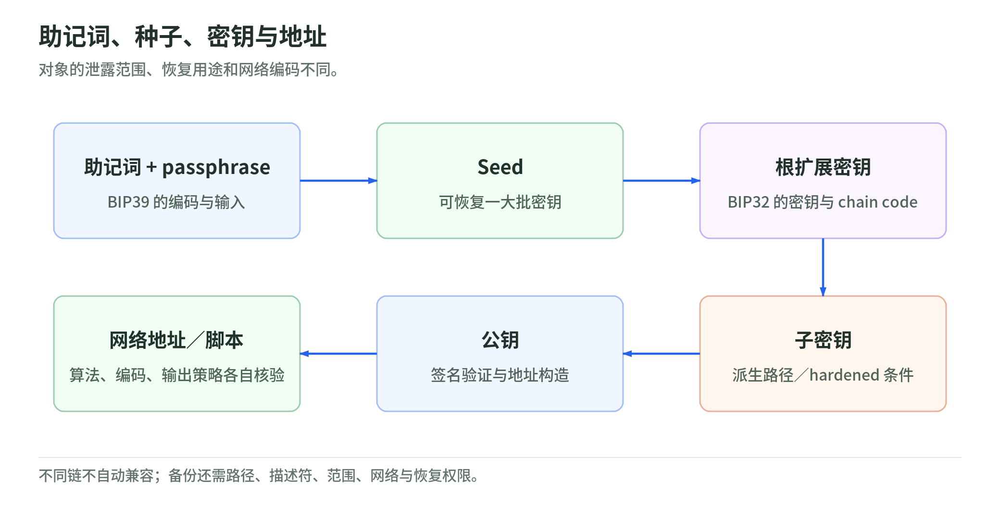
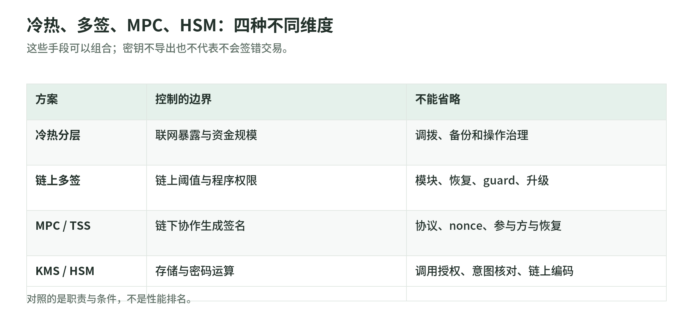

# 06｜密钥、授权与账户安全

- 对应 PPT：47、52–54、57
- 目标：区分密钥保护、签名批准、链上授权和恢复治理
- 来源编号见 [来源表](../sources.md)

## 1. 密钥、种子、助记词、地址不是同一对象

<!-- illustration: key-derivation-d1f02a4b8e -->


*图：助记词、种子、密钥与地址。对象的泄露范围、恢复用途和网络编码不同。*
<!-- /illustration: key-derivation-d1f02a4b8e -->

```text
助记词 + 可选 passphrase → seed
seed → 根扩展密钥 → 按路径派生子密钥 → 公钥 → 特定网络地址
```

BIP39 定义的是助记词编码和 seed 生成；BIP32 定义 secp256k1 的分层确定性派生。不同链和钱包的算法、路径、地址编码并不自动兼容。[W06][W07]

关键差别：

- **私钥**控制特定密钥对应的签名能力。
- **seed / xprv**可能恢复一大批地址；泄露范围通常更大。
- **xpub**不直接签名，但可能暴露派生地址和资金关系。
- BIP32 的非 hardened 派生下，父扩展公钥与对应子私钥同时泄露可危及父私钥；不能把 xpub 当成完全无风险公开信息。[W06]
- 助记词 passphrase 不同产生不同 seed，输错可能得到“空钱包”，不是能识别的密码错误。[W07]

工程建议：备份要记录网络、算法、派生路径、描述符、账户范围、恢复权限和验证结果。不要在 repo、日志、截图或测试 fixture 存真实助记词、xprv、MPC share 或 HSM 用户口令。

## 2. 冷热钱包、链上多签、MPC、HSM 是不同维度

<!-- illustration: security-dimensions-8e455e0d86 -->


*图：冷热、多签、MPC、HSM：四种不同维度。这些手段可以组合；密钥不导出也不代表不会签错交易。*
<!-- /illustration: security-dimensions-8e455e0d86 -->

| 方案 | 控制边界 | 主要收益 | 仍然需要治理 |
| --- | --- | --- | --- |
| 冷 / 热分层 | 联网暴露及资金规模 | 限制热端损失，离线审批 | 调拨、备份、操作人和恢复 |
| 链上多签 / 合约账户 | 链上验证规则 | 可见阈值与可编程控制 | 合约、模块、管理员和升级 |
| MPC / TSS | 链下协作产生签名 | 不集中持有完整私钥 | 协议安全、参与方隔离、恢复与活性 |
| KMS / HSM | 密钥存储与密码计算 | 限制导出和软件直接读取 | 调用授权、输入验证、算法适配 |

这是分类框架，不是产品排名。四类可以组合；MPC 不等于永远免备份，HSM 也不等于 MPC。

## 3. MPC：关注协议性质，不只关注“拆成几片”

PPT 的 DKG → TSS 描述抓住了无完整私钥集中生成的目标。但 Shamir 分享只能说明阈值恢复，不能自动实现无需重建私钥的门限签名。

MuSig2 提供 Schnorr 的多方聚合签名；通用 `t-of-n` 门限签名是另一种协议性质。线性签名仍需处理 nonce、安全聚合与恶意参与方，不能直接把各签名相加。[B08]

FROST 规范明确了多轮门限 Schnorr 协议和 nonce 管理。某套 Schnorr / ECDSA / Ed25519 算法实现是否与目标链兼容，应通过该链签名格式与测试向量验证，而不是写“任何链通用”。[W08]

本次建议的采购 / 验收问题：

1. 是否真正 DKG？有无导入过完整私钥？
2. 威胁模型允许几个参与方失陷，是否抗恶意参与方？
3. nonce / 预计算材料是否一次性使用，灾备会否重用？
4. 参与方能否拒签，是否独立验证交易语义？
5. share refresh、份额恢复、参与方更换和密钥迁移如何审计？
6. 恢复流程会不会降级成单方可签或重建明文？
7. 目标链与算法是否经过独立审计和互操作测试？

不在学习练习里自研生产门限密码。

## 4. Safe：阈值只是整套权限的一部分

Safe 常规交易通过 owners / threshold 验证；模块可以走另外的执行路径。官方文档明确，模块交易可以绕过常规 owner 签名验证。因此“2-of-3 所以一个 key 被盗永远无事”必须附上模块、guard、恢复路径、实现版本和初始化正确性的前提。[E16]

合约账户签名不能只用 ECDSA recover。ERC-1271 定义合约的签名有效性检查；检查还依赖当前链上状态，离线缓存的过去结论可能不适用。[E15]

工程建议：恢复演练至少覆盖丢失一个 owner、模块失陷、守护人不可用、链不可用以及 gas 来源中断。是否抗审查取决于完整部署和退出路径，不能只靠多签标签判断。

## 5. AA 与 EIP-7702：改善体验也扩大能力

ERC-4337 路径：

```text
用户的 UserOperation
  → Bundler 模拟与打包
  → EntryPoint 验证与执行
  → 智能账户规则
  → 可选 Paymaster 承担费用
```

这不是普通 EOA 交易，也不意味着“不需要 gas”。Paymaster 有预算、权限和失败处理；实现必须匹配网络、EntryPoint 版本及 UserOperation 编码。[E11]

EIP-7702 是协议级 EOA 代码委托：授权给谁，之后谁在账户上下文执行，权限与撤销怎样处理，才是安全问题。它能与 AA 组合，但两者不是同一标准。委托标记会持久存在，且后续执行失败不撤销已经处理的授权。[E04]

因此钱包要把“授权委托”和“一次支付”区别显示，不能用统一按钮遮住权限变化。

## 6. approve、permit、签名钓鱼

- `approve` 改变 allowance，并不立即转币；之后有权者可调用 `transferFrom`。[E09]
- ERC-2612 的 `permit` 用签名更改 allowance，交易可由别人提交；不需要受害者亲自支付 gas，不代表没有后续链上交易。[E14]
- EIP-712 改善结构化展示与 domain separation，但不是“安全认证”。标准不自动提供应用的完整防重放和授权边界。[E13]
- 一个可读签名仍可能授予不合理额度、期限或控制对象。不同代币的 permit 接口也可能不同。[E14]

推荐展示和策略：

```text
实际网络与域
合约 / verifyingContract
spender / 委托实现 / 资产 / 金额
deadline / nonce
可撤销方式与权限持续时间
模拟资产变化 + 明确的模拟限制
```

交易模拟不是保证：状态可能变化、代理可能升级、外部依赖可能改变。已签字节必须与已展示内容一致，并由独立签名边界复核。

## 7. 签名服务要防止变成 signing oracle

即使 KMS 私钥不可导出，有权请求 Sign 的人仍可要求它签恶意交易。[A04][A05]

参考控制要求：

- 不开放任意 hash 签名接口给业务调用者。
- 从完整交易重算摘要，核对 network、to、amount、calldata、inputs、change、fee。
- 把审批记录绑定交易版本、输出集合和重试规则。
- 资产 / 地址 allowlist、费用上限、速率与日限额独立执行。
- Sign 角色与审批、构造、广播权限尽量分离。
- 每次输出本地验签，记录关联请求而不记录秘密。
- 将恢复和 break-glass 流程纳入相同审批，而非永久绕过。

这是建议，不是声称 IAM / CloudTrail 自动实现这些控制。AWS 算法边界和签名编码见 [07 章](07-aws.md)。

## 自测

“完整私钥没有出现过，但攻击者拿走了钱”可能吗？

可能。足够参与方被控制、审批被绕过、恶意交易被正常签名、Safe 模块被利用或既有 allowance 被使用，都不要求提取完整私钥。要追问被攻破的是哪条授权路径，而不只问“密钥有没有泄露”。

新版详细流程见 [7702 / 4337组合](../upgrades/01-ethereum.md)、[MuSig2与离线签名](../upgrades/06-bitcoin-wallets.md)、[KMS Ed25519与新HSM](../upgrades/05-aws-infrastructure.md)。算法、消息类型、业务批准和协议成功仍分别验收。
