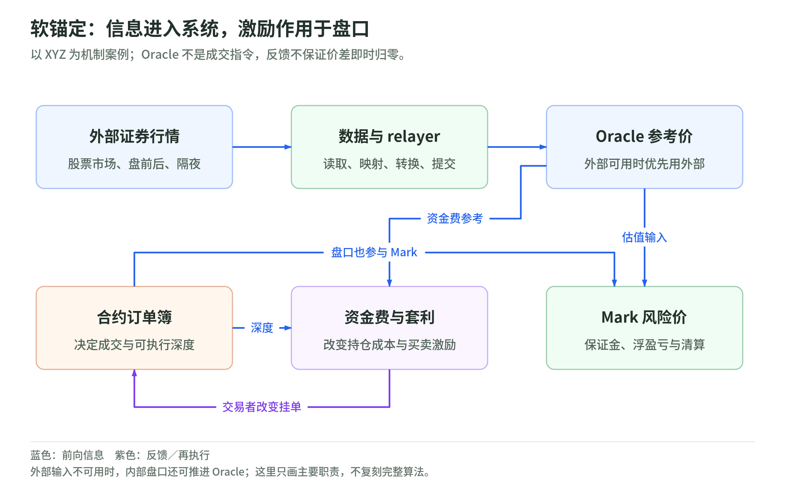

# 03 四类价格与锚定：行情输入不是成交指令

研究日期：2026-11-04。[上一章](02-market-and-positions.md) · [返回专题](README.md) · [下一章：资金费与套利](04-funding-and-arbitrage.md)

## 锚定是一组机制，不是一根绳子

<!-- illustration: eq-anchor-446c93a6cc -->


*图：软锚定：信息进入系统，激励作用于盘口。以 XYZ 为机制案例；Oracle 不是成交指令，反馈不保证价差即时归零。*
<!-- /illustration: eq-anchor-446c93a6cc -->

XYZ 股票永续的逻辑是：外部股价进入预言机；预言机参与资金费和标记价格计算；资金费与跨市场交易激励影响盘口。最终成交仍来自参与者的买卖订单，不是预言机替双方撮合在同一个价格。[Oracle](https://docs.trade.xyz/perpetuals/mechanics/oracle-price) [Mechanics](https://docs.trade.xyz/perpetuals/mechanics)

这叫经济激励上的“软锚定”。本专题用这个词描述机制，不是平台提供的法律保证。XYZ 没有赋予把合约兑换成真实股票的权利，因此不能用“低于 100 就买下来换股”当作无条件的硬底线。[权利与偏离风险](https://docs.trade.xyz/legal-and-disclaimers/perpetuals-risks-and-disclaimers)

## 先分清四类价格

| 名称 | 回答的问题 | 不能当成什么 |
| --- | --- | --- |
| 外部价格 External price | 所选外部市场 / 数据源现在给出什么参考 | 全球唯一且必然可执行的真实价值 |
| 预言机价格 Oracle price | 系统此刻用什么参考计算资金费等 | 系统强制成交价 |
| 标记价格 Mark price | 怎样估值仓位、判断保证金与触发风险动作 | 你必然能按这个价平仓 |
| 成交 / 盘口价格 | 最近有人怎样成交、现在挂单愿意怎样成交 | 必然等于 Oracle 或 Mark |

Oracle 与 Mark 是不同对象。XYZ 当前 Mark 取三项的中位数：

1. Oracle。
2. Oracle 加“合约中间价减 Oracle”的 150 秒平滑值。
3. 最优买价、最优卖价、最新成交价三者的中位数。

前两项由 relayer 提交，第三项由协议计算。这里并不是三个完全独立的行情源：Oracle 错误仍可能同时影响前两项。其他部署方必须单独读规格，不能把这个构造当成所有市场的通用公式。[Mark](https://docs.trade.xyz/perpetuals/mechanics/mark-price) [External price](https://docs.trade.xyz/perpetuals/mechanics/external-price)

## 假想的 100、102 和 101

设外部股票参考价 100，Oracle=100，最近合约成交价 102，Mark=101。数字只是教学设定，不是实际公式的输出。

这时可能同时成立：

1. 图表显示最后成交在 102。
2. 你卖出 10 单位的平均成交价不一定是 102，取决于买方深度。
3. 未实现盈亏和风险约束按 Mark 的相关规则处理。
4. 资金费的金额以 Oracle 对应的仓位名义价值计算，而不是用最后成交价替代。

把四类价格混在一起，容易误解“为什么我看到股票没跌那么多，却发生了清算”或“为什么市价卖出不是显示价格”。行情错误也可能影响 Mark 和资金费，并非必须发生一笔同价成交才会产生损失。[Funding](https://hyperliquid.gitbook.io/hyperliquid-docs/trading/funding) [风险披露](https://docs.trade.xyz/legal-and-disclaimers/perpetuals-risks-and-disclaimers)

## 外部参考怎样进入链上

XYZ 的 relayer 读取市场与数据提供方的价格，按标的规则处理，再提交 Oracle。对美股，当前文档覆盖正常交易、盘前、盘后与隔夜 ATS；不能只把纽约正常交易时段当成全部外部数据来源。[Oracle](https://docs.trade.xyz/perpetuals/mechanics/oracle-price) [US sessions](https://docs.trade.xyz/perpetuals/markets/stocks/us)

因此有两条信任链：

```text
经济 / 数据链：所选证券 → 市场与数据源 → 映射和转换 → relayer → Oracle
交易 / 风险链：挂单 → 深度与成交 → Mark / 资金费 → 保证金与清算
```

“输入被记在链上”证明不了原始数据没有延迟、错误代码映射或异常打印。可审计和数据正确性是两个问题。

## 外部数据没有时怎么办

XYZ 不是一直沿用最后收盘价不动。当前机制在外部输入不可用时，从最后的外部参考初始化，再以内部盘口的 impact price difference 驱动平滑更新。Impact price 指对规定名义金额模拟成交所得到的平均价格，不是随便一笔小成交。

所以周末内部需求仍可能推动 Oracle 和 Mark；外部数据恢复时，又回到外部定价。官方还设置 discovery bounds 等控制，但它们不是不爆仓或不偏离的保证。[内部 Oracle](https://docs.trade.xyz/perpetuals/mechanics/oracle-price) [Discovery bounds](https://docs.trade.xyz/perpetuals/mechanics/discovery-bounds)

## 自测与答案

1. Oracle=100 时能否保证卖出在 100？——不能，实际成交看盘口深度与订单条件。
2. Mark 是不是另一个外部证券交易所报价？——不一定，它是合约系统按规则计算的风险价格。
3. 链上记录是否保证行情来源正确？——否，外部来源、传输与转换仍可能出错。

下一章解释真正让参与者愿意纠偏的经济激励，而不是把“喂价”误当成自动追踪。来源组：[S08 Oracle](sources.md#s08)、[S09 外部价格](sources.md#s09)、[S10 Mark](sources.md#s10)、[S11 发现边界](sources.md#s11)。
