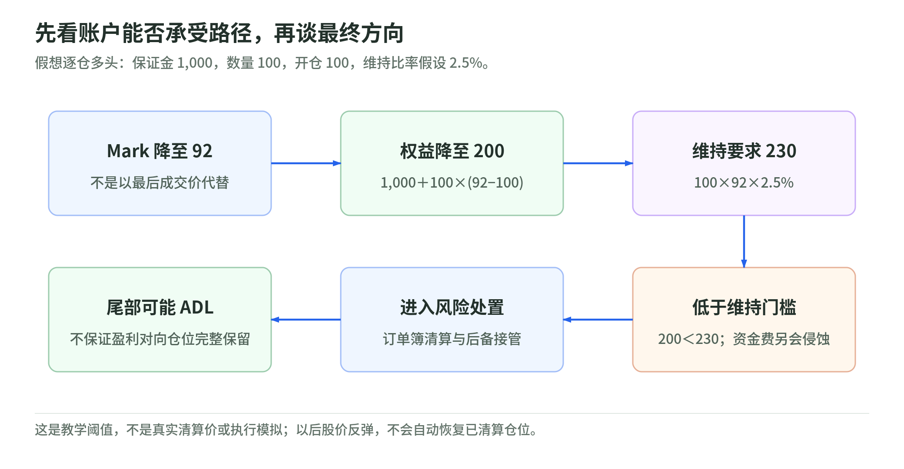

# 05 保证金、清算与 ADL：看对终点，不代表撑得到终点

研究日期：2026-11-04。[上一章](04-funding-and-arbitrage.md) · [返回专题](README.md) · [下一章：时段与公司行动](06-hours-and-corporate-actions.md)

## 保证金是损失缓冲，不是股票购买款

名义仓位为数量乘参考价格；保证金是账户用于支撑风险的资产。初始杠杆可以粗略理解为名义仓位 / 支撑它的保证金，但价格与账户权益变化后，实际风险比例也会变。界面里选择的杠杆不是始终不变的风险测量。

初始保证金决定能否开仓；维持保证金决定是否需要进入清算程序。每个市场的限额、档位、保证金模式和可用抵押都需读规格，不能套一个通用“跌 1 / 杠杆倍数就爆仓”的答案。[Margin modes](https://docs.trade.xyz/perpetuals/risk-and-margining/margin-modes) [Liquidations](https://hyperliquid.gitbook.io/hyperliquid-docs/trading/liquidations)

## 一组明确是假想的清算算术

<!-- illustration: eq-liquidation-6677da4510 -->

*图：先看账户能否承受路径，再谈最终方向。假想逐仓多头：保证金 1,000，数量 100，开仓 100，维持比率假设 2.5%。*
<!-- /illustration: eq-liquidation-6677da4510 -->

设单一逐仓多头：初始保证金 1,000，数量 100，开仓价 100。名义仓位 10,000，初始约 10 倍。本例**假定**维持保证金比例 2.5%，没有其他仓位、手续费或资金费。

$$
\mathrm{Equity}=1{,}000+100(M-100),\qquad
\mathrm{Maintenance}=100M\times2.5\%.
$$

| Mark | 账户权益 | 维持要求 | 教学状态 |
| --- | --- | --- | --- |
| 100 | 1,000 | 250 | 高于维持要求 |
| 93 | 300 | 232.5 | 仍高于维持要求 |
| 92 | 200 | 230 | 低于维持要求 |

这不是 XYZ 某个真实标的的清算价计算器。实际引擎还需档位、账户其他资产、模式和执行等输入；本例只是解释为什么跌不到 10% 就可能进入风险处置。[离线实验 C](lab.md#lab-c)

如果 Mark 仍为 93，但累计资金费支出 100，权益降到 200，也会低于本例维持要求。**即使价格不再下跌，持仓成本也能压缩安全垫。**

## 逐仓与全仓分别把哪里暴露出来

- **逐仓 Isolated**：按分配给该仓位的保证金与规则处理；不是保证不会亏掉该仓位的全部保证金。
- **全仓 Cross**：在适用的账户 / 市场范围内共享支撑；一个仓位的亏损可能影响其他仓位。

**还必须确认账户模式。** 当前 Standard / Manual 模式分开 DEX 余额；Unified 模式把同一抵押资产的余额用于跨 DEX 的适用全仓仓位，并与该资产现货余额统一；Portfolio Margin 则有自己的合资格资产与风险规则。因此不能一概说“XYZ 与原生市场永远各亏各的”，也不能从“Cross”标签推出所有币种都在同一个池里。[Account abstraction modes](https://hyperliquid.gitbook.io/hyperliquid-docs/trading/account-abstraction-modes) [XYZ margin modes](https://docs.trade.xyz/perpetuals/risk-and-margining/margin-modes)

## 清算不是一笔保证成交的止损单

系统先按 Mark 等规则判断风险，再按市场机制处置仓位。平仓订单可能部分成交或滑点很大；普通清算不足时，还有接管等后备机制。Mark 决定风险动作的相关触发，不保证你能按 Mark 退出。[XYZ liquidation](https://docs.trade.xyz/perpetuals/risk-and-margining/liquidation-mechanics)

止损也不能神奇地跨越盘口缺失：跳价、网络延迟、触发与清算先后、流动性不足，都可能使预想退出价无法实现。设置止损和获得最大损失保证是两件事。[订单与清算风险](https://docs.trade.xyz/legal-and-disclaimers/perpetuals-risks-and-disclaimers)

## ADL：盈利一方也可能被强制减仓

Auto-Deleveraging 是尾部风险处置机制之一。其他措施不足以维持市场偿付时，系统可对对向仓位进行自动减仓；“我方向看对且有浮盈”不一定意味着仓位能按自己的计划一直持有。

它不等于每次清算都会发生，也不能把所有 HIP-3 市场的后备资金都说成同一个 HLP 兜底池。HIP-3 有按部署市场区分的后备安排，资格与适用范围需看当前规则。[HIP-3 backstop](https://hyperliquid.gitbook.io/hyperliquid-docs/hyperliquid-improvement-proposals-hips/hip-3-builder-deployed-perpetuals) [XYZ ADL](https://docs.trade.xyz/perpetuals/risk-and-margining/auto-deleveraging)

## 1 倍不等于股票，也不等于一切风险归零

对简单线性多头，足额抵押通常大幅降低纯价格波动带来的清算风险；但长期资金费会消耗权益，USDC 与 USD 不完全同一资产，Mark 和成交可能偏离，技术与规则风险仍在。空头更不能套用“1 倍下跌最多损失本金”的多头直觉，因为参考股价上涨没有同样的零价格下限保护。

本章不提供“安全杠杆”建议。全款证券账户和融资证券账户也需区别；真实融资股票同样可能强平。[Investor.gov margin](https://www.investor.gov/introduction-investing/general-resources/news-alerts/alerts-bulletins/investor-bulletins-29)

来源组：[S15 账户与保证金](sources.md#s15)、[S16 清算](sources.md#s16)、[S17 ADL](sources.md#s17)、[S10 风险价格](sources.md#s10)。

## 自测与答案

1. 10 倍仓位是否一定跌满 10% 才清算？——否，维持要求与费用会更早消耗缓冲。
2. 用全仓是否意味着只损失该标的的保证金？——不一定，可能影响共享保证金范围内的其他仓位。
3. 盈利空头是否完全不受系统尾部风险影响？——否，极端情况下可能 ADL。
