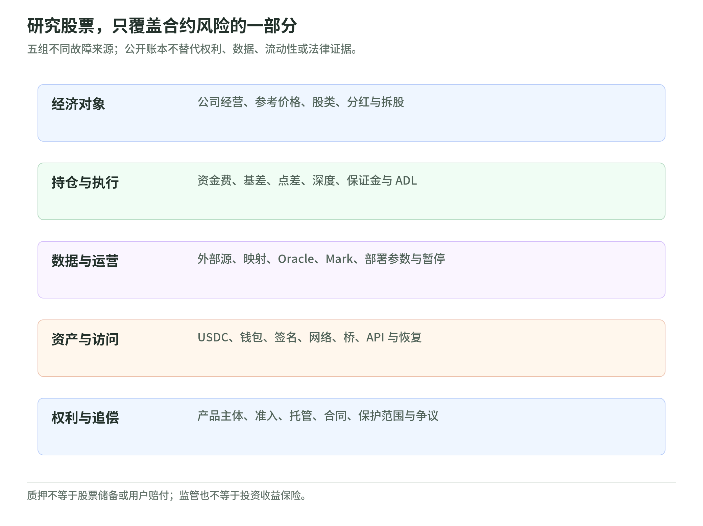

# 07 风险与保护：底层股价只是风险的一层

研究日期：2026-11-04。[上一章](06-hours-and-corporate-actions.md) · [返回专题](README.md) · [下一章：规格检查表](08-reading-a-contract.md)

## 把风险按故障来源拆开

<!-- illustration: eq-risk-a11f12c4b1 -->

*图：研究股票，只覆盖合约风险的一部分。五组不同故障来源；公开账本不替代权利、数据、流动性或法律证据。*
<!-- /illustration: eq-risk-a11f12c4b1 -->

同一家公司，真实股票和股价合约共享部分经济信息，却不共享全部故障模式。

| 风险层 | 假想失败 | 单看股票研究解决不了什么 |
| --- | --- | --- |
| 公司与价格 | 业绩下滑、估值下降 | 基本面损失本身 |
| 资金费与基差 | 看对股价，但成本或偏离吞掉收益 | 合约与股票总回报差异 |
| 盘口与杠杆 | 深度消失，滑点或清算 | 能否及时退出、是否撑得住路径 |
| 行情与部署规则 | 数据错、Oracle 延迟、规格变化 | Mark、资金费与仓位处理 |
| 抵押与结算 | USDC 脱锚或转移受限 | 美元计价收益的实际购买力 |
| 系统与访问 | 钱包、网络、接口、桥或签名问题 | 能否控制资产与提交操作 |
| 法律与追偿 | 主体、地区限制、责任或权利不清 | 谁有义务处理争议与赔偿 |

XYZ 的风险披露涵盖这些类别；表中的场景是教学归纳，不是对平台发生过某次故障的指控。[产品风险](https://docs.trade.xyz/legal-and-disclaimers/perpetuals-risks-and-disclaimers) [General disclaimer](https://docs.trade.xyz/legal-and-disclaimers/general-disclaimer)

## 链上透明不等于所有问题都可验证

链上订单与部署动作有助于审计，但不能独自证明：

- 数据提供方每个输入都准确且可成交。
- 托管证券或代币储备在法律上属于谁。
- 市场极端时仍有足够流动性。
- 境外主体的合同对自己可执行。
- 钱包所有者签名时看清了授权内容。

这些判断分别需要数据与运营证据、发行 / 托管合同、市场深度、当地法律与安全控制。透明账本不是其他证据的替代品。对合约而言，参考数据、转换和技术访问仍有官方披露的失败可能。[XYZ risks](https://docs.trade.xyz/legal-and-disclaimers/perpetuals-risks-and-disclaimers)

## 部署方质押不等于股票储备，更不等于赔付保险

HIP-3 要求部署方满足质押等条件，对特定违规可有 slashing。该质押约束的是部署行为，不是每一份合约背后对应一股证券的储备。

尤其不能把它说成“有一笔保证金专门赔给被错误行情清算的人”：当前 HIP-3 说明中，被罚没的质押被销毁，并非自动分配给受影响用户；罚没范围也并不是对所有经济上不公平结果的通用裁判。[HIP-3 slashing](https://hyperliquid.gitbook.io/hyperliquid-docs/hyperliquid-improvement-proposals-hips/hip-3-builder-deployed-perpetuals)

所以要区分**运营约束、市场偿付、用户赔偿、底层资产储备**四件事。

## 证券账户的保护也不是收益保险

真实证券交易涉及券商、托管和客户资产规则，但“经监管”不能推导为不亏钱。SIPC 的说明也明确区分成员证券经纪商失败时的合资格客户资产保护与市场价格损失，后者不在其保护目的内。[SIPC protects](https://www.sipc.org/for-investors/what-sipc-protects)

反过来，在 Hyperliquid 上操作一个名字像美股的仓位，不能仅凭标的名称套用自己熟悉的证券账户保护。适用主体、产品资格和地区规则必须核验；本专题没有提供“某链上产品一定受 / 不受某个法域保护”的个案法律意见。

## 三个容易过度放心的理由

**“我只开 1 倍。”** 这减少某些杠杆风险，却不改变股东权利、资金费、USDC 和技术依赖。

**“我有止损。”** 它表达退出条件，但不保证深度、执行价或在清算前完成。

**“我做了股票对冲。”** 两个账户的合计收益不等于每个账户都足够有钱；链上头寸可能先被清算，证券盈利未必来得及转移。

前两项有[披露](https://docs.trade.xyz/legal-and-disclaimers/perpetuals-risks-and-disclaimers)支持；第三项是[基差算例](04-funding-and-arbitrage.md)与独立保证金边界的推导，不是实际套利测试。

## 一张不需要充值的风险卡

读任何产品之前，写下：

1. 我的持有权利与退出方式。
2. 参考源、Mark 与实际成交的区别。
3. 单位、保证金范围、费用、清算与 ADL。
4. 周末、停牌、分红、拆股的处理办法。
5. 抵押资产、链、桥、钱包、签名和恢复路径。
6. 合同主体、所在地、自己的准入资格和争议路径。
7. 哪些资料缺失，哪些依然只是发行方声明。

这是一种信息整理方法，不会自动给出“值得买”的结论；看不懂或查不到，应该保留“未知”而不是假装风险为零。

来源组：[S03 证券托管与保护](sources.md#s03)、[S05 质押边界](sources.md#s05)、[S16–S17 尾部机制](sources.md#s16)、[S19 系统与法律风险](sources.md#s19)。

## 自测与答案

1. 质押可罚没是否等于有股价脱锚赔偿基金？——否，约束、触发范围和资金去向都不同。
2. SIPC 是否保证持有股票不会亏损？——否，市场损失不等于经纪商失败下的客户资产保护。
3. 链上公开交易是否消除了预言机风险？——否，原始行情、映射、传输和使用规则仍有风险。
