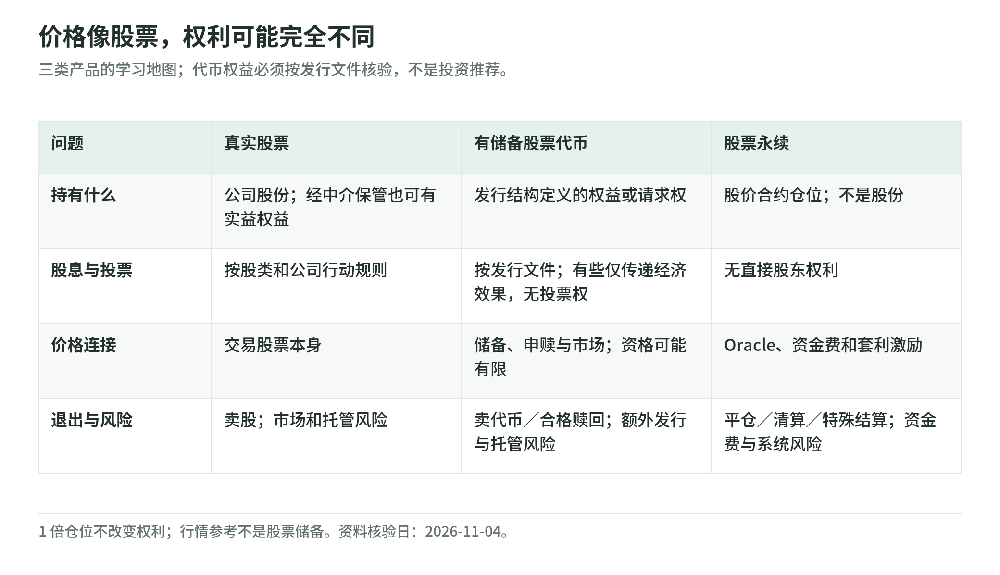

# 链上美股与股票永续：从零理解产品、锚定与风险

研究日期：2026-11-04。类型：金融机制扫盲 / 区块链专题。面向“认识美股和加密货币，但分不清链上股票产品”的读者。以 Hyperliquid 的 HIP-3 与 trade[XYZ] 股票永续为机制案例，不推广交易平台，不提供收益承诺、买卖建议或地区合规结论。

[返回区块链专题](../README.md) · [学习路线](learning-roadmap.md) · [术语表](glossary.md) · [来源与版本边界](sources.md)

## 先建立一张产品地图

<!-- illustration: eq-products-5658f97e85 -->

*图：价格像股票，权利可能完全不同。三类产品的学习地图；代币权益必须按发行文件核验，不是投资推荐。*
<!-- /illustration: eq-products-5658f97e85 -->

同样写着某家公司的股票代码，可能代表三种完全不同的东西：

1. **真实股票**：你通过证券账户持有公司的股份，通常由券商等中介登记和保管；股票不是公司欠你本金的借条。
2. **有底层储备的股票代币**：链上代币背后可能有证券储备，但你拥有哪一种权利、谁能赎回、能否收到现金分红，必须读发行文件。
3. **股票永续合约**：持有以股价为参考的衍生品仓位；它不自动给你股份、股息、投票权或股票交付权。

“代币化”“RWA”“链上美股”只是描述词，不是统一的权利合同。真实股票权利见 [Investor.gov](https://www.investor.gov/introduction-investing/investing-basics/investment-products/stocks)；XYZ 永续的无底层资产权利声明见[产品风险披露](https://docs.trade.xyz/legal-and-disclaimers/perpetuals-risks-and-disclaimers)。第二种是结构分类，不是对任何具体发行人的背书。

股价永续的连接机制可理解为**软锚定**：行情提供参考，资金费与套利提供纠偏激励，但没有无条件兑股来保证一比一价格。先读[第 03 章](03-prices-and-anchoring.md)，再用[第 04 章](04-funding-and-arbitrage.md)的算例看清激励与失败条件。

## 用八章回答八个问题

| 章 | 读完能回答的问题 | 阅读入口 |
| --- | --- | --- |
| 01 | 我买到的是股份、发行人请求权，还是合约敞口？ | [产品与法律权利](01-products-and-rights.md) |
| 02 | 谁上架、谁撮合、谁做市，盈亏从哪里来？ | [市场角色与仓位生命周期](02-market-and-positions.md) |
| 03 | 股票价格怎样进入链上，为什么合约仍会偏离？ | [四类价格与锚定机制](03-prices-and-anchoring.md) |
| 04 | 资金费怎样算，为什么套利不是稳赚？ | [资金费、基差与跨市场套利](04-funding-and-arbitrage.md) |
| 05 | 为什么看对最终方向也可能被强平？ | [保证金、清算与 ADL](05-margin-and-liquidation.md) |
| 06 | 周末、财报、分红和拆股分别发生什么？ | [交易时段与公司行动](06-hours-and-corporate-actions.md) |
| 07 | 比持有股票多了哪些风险，谁承担损失？ | [风险与保护边界](07-risk-and-protection.md) |
| 08 | 面对一个陌生“链上美股”，应该检查什么？ | [读懂一份合约规格](08-reading-a-contract.md) |

配套：[45 分钟 / 七天学习路线与自测](learning-roadmap.md)、[五组离线算例](lab.md)、[中英术语速查](glossary.md)、[一手来源与时效说明](sources.md)。

## 这次对话里最需要校准的五句话

- **“有真实股价参考”不等于“有真实股票储备”。** 前者是数据问题，后者是资产与权利问题。
- **“预言机报 100”不等于“我能按 100 成交”。** 成交看订单簿；保证金与清算主要看标记价格。
- **“偏贵就多头付费”只是方向直觉。** 实际费率还有利息、平滑和部署参数；轻微溢价或折价不能直接决定费率符号。
- **“套利能纠偏”不等于“价差一定及时归零”。** 资金费、借券、流动性、保证金和休市都可能阻止套利者执行或撑到收敛。
- **“美股休市”不等于“合约价格冻结”。** 外部时段可能包含隔夜 ATS；外部行情不可用时，XYZ 会用内部盘口信息推进预言机。

对应依据：[Oracle](https://docs.trade.xyz/perpetuals/mechanics/oracle-price)、[Mark](https://docs.trade.xyz/perpetuals/mechanics/mark-price)、[Funding](https://hyperliquid.gitbook.io/hyperliquid-docs/trading/funding)、[US sessions](https://docs.trade.xyz/perpetuals/markets/stocks/us)、[风险披露](https://docs.trade.xyz/legal-and-disclaimers/perpetuals-risks-and-disclaimers)。本专题把这些机制分别解释，不把一般永续规则套成所有部署方的统一参数。

## 学习的终点不是“会点买入”

你应当能独立写出一页产品说明：

> 这个产品的法律对象是什么，参考什么价格，用什么抵押和结算，怎样产生资金费与清算风险，休市与公司行动怎样处理，出问题时向谁主张什么权利，哪些事实尚未查清。

能背出“去中心化、24/7、锚定、套利”却填不出这段话，仍然没有理解产品。看不懂合约规格本身就是信息缺口，不需要通过一次真实交易来“试试看”。

## 核验与实践范围

正文区分三类内容：有一手文档支持的机制事实、明确标注的数学推导、假想输入的教学算例。价格、费率、保证金、时段、产品可用性和规则都可能变化；查阅日期不是永久有效的保证。

本次没有连接钱包、读取账户、充值、借券、下单或做真实套利；没有验证平台实时流动性、储备、法律资格或实际可追偿性。离线脚本只核对加减乘除和方向，不复制完整清算引擎，详见[实验边界](lab.md)。
