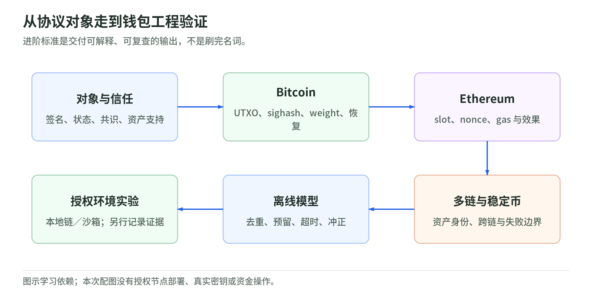

# 学习路线：以能交付什么判断掌握程度

<!-- illustration: blockchain-roadmap-85ffc7d94e -->


*图：从协议对象走到钱包工程验证。进阶标准是交付可解释、可复查的输出，不是刷完名词。*
<!-- /illustration: blockchain-roadmap-85ffc7d94e -->

- 日期：2026-10-29
- 状态：路线与离线练习已整理；本地链 / 公共测试网 / AWS 实验均未执行
- 时间不是强制进度；通过每阶段验收后再进入下一阶段

## 阶段 1：分清对象和边界

读 [01](chapters/01-system-model.md)、[术语表](glossary.md) 和 PPT 3–7、23–25。

交付：一张自己的解释表，覆盖签名、UTXO、账户、交易、区块、状态根、共识、确认、finality。

验收：

- 能解释为什么两笔冲突交易的签名都合法。
- 能说明最多累计工作量不等于最多块。
- 能区分私钥控制、合约权限和链外资产兑现。

## 阶段 2：能读懂 Bitcoin 交易

读 [02](chapters/02-bitcoin.md)，对照 PPT 8–22、43–44 和纠错表。

交付：标出输入 outpoint、scriptSig、witness、输出 scriptPubKey、txid、wtxid 和 sighash；解释一笔 P2WPKH 支出为什么需要找零。

验收：

- 10 天完成一轮区块，下一轮难度应升高，不是降低。
- 解释为什么 witness 不计入 txid，却仍被区块承诺。
- 知道 `bc1q` 不止 P2WPKH，知道 P2TR 不是旧 ECDSA 地址换个前缀。
- 能说明 HTLC 的超时需要链上执行或协议处理，不会自动转账。

## 阶段 3：能追踪 Ethereum 的状态与执行

读 [03](chapters/03-ethereum.md)，对照 PPT 23–27、45–47。

交付：从教学 `balances[address]` 变量计算路径的文字推导，以及一次交易的 nonce / gas / receipt / 日志解释。

验收：

- 区分 mapping 槽位、trie 路径和账户路径。
- 区分字节码固定与代理可升级。
- 会计算 EIP-1559 实际执行费。
- 知道 receipt 成功不等于 ERC-20 的目标数量已到达。
- 能解释 EIP-7702 和 ERC-4337 的区别。

## 阶段 4：比较生态，而不是背产品口号

读 [04](chapters/04-ecosystem.md)，对照 PPT 28–42。

交付：为 USDT / USDC / DAI-USDS / USDe 各做一张风险卡；为 sidechain / rollup / 跨链消息各做一张信任边界卡。

验收：

- 不把储备鉴证写成全面公司审计。
- 能解释为什么链上可查不等于链外资产完全可验证。
- 能区分 Polygon PoS 与 Polygon zkEVM，产品计划与实际停运状态分开。
- 知道 XCM 是消息格式、IBC 是互操作协议，不用币价推断安全。

## 阶段 5：离线工程练习

先读 [05](chapters/05-wallet-engineering.md)，从本专题目录运行：

```bash
python examples/offline_workbook.py
```

包含 17 个测试方法：难度方向与限幅、权重取整、最小单位精度、1559 费用、幂等 nonce、UTXO 排他预留、重复充值、重组冲正、重新包含、广播超时重播。

交付：自己新增一个“先广播成功、后 RPC 超时、再 worker 重启”的状态机测试设计。

限制：此程序没有真实交易编码、密码签名、Merkle proof、数据库事务或分布式并发；通过测试只证明教学模型的给定行为，不能证明生产钱包安全。

## 阶段 6：本地开发链实验（计划）

使用单独环境、只用无价值实验资产。具体客户端与依赖版本在执行时重新确认并锁定。

| 实验 | 要观察什么 | 验收输出 |
| --- | --- | --- |
| Bitcoin regtest：收款、找零、PSBT | outpoint、脚本、weight、sighash、费用 | 字段解释 + 测试向量 |
| Bitcoin regtest：冲突交易和替换 | 同 UTXO、不同候选交易、当前链 | 请求到 attempts 的追踪表 |
| EVM 本地链：普通转账与 revert | nonce 消耗、gas、状态回滚 | receipt 和前后状态比较 |
| 教学 ERC-20：成功、返回 false、收费 | receipt 与实际数量差异 | 不盲目信任 status 的监听测试 |
| 两类链：模拟重组与重复事件 | blockHash、canonical、冲正 | 幂等账务和恢复报告 |
| Safe / AA / 7702 单独实验 | 阈值、模块、委托、内部执行结果 | 权限路径及撤销验证 |

本次未下载或启动上述客户端，也没有把这些实验标成已完成。

## 阶段 7：AWS 沙箱验证（计划，需要明确授权）

读 [06](chapters/06-security.md)、[07](chapters/07-aws.md) 和 AWS 核验记录。

先决定签名路线：

```text
需要 ECDSA 且地址模式可适配 → 评估 KMS
需要 Taproot / HD / 其他算法 → 单独评估适配方案，不能默认 KMS 可用
有 HSM 要求 → 核验具体 SDK、硬件、曲线、机制和备份权限
```

访问路线另行决定：AMB 自 2026-10-29 起不接纳新客户，现有客户也需在 2027-09-29 服务终止前迁移。因此新实验优先设计可替换 RPC / 索引接口，不能假定可以创建 AMB 资源。签名设施的选型不随 AMB 生命周期自动失效。

计划验收：

1. 支持的 network / region / methods 与版本快照。
2. KMS DIGEST 输出经本地验签、low-S、正确编码，与软件测试向量一致。
3. 任意 hash、未审批输出、错网络和超限费用全部被签名边界拒绝。
4. 广播超时、查询滞后和扫描重组不重复付款或入账。
5. 禁用 key / HSM 不可用时有安全停机和恢复流程。
6. 恢复演练保留原控制能力，不把“新建密钥”误当旧地址恢复。

KMS / HSM 资源有成本，真实密钥及链上交易有安全责任。资料整理不授权创建资源或资金操作。

## 综合自测与答案要点

| 问题 | 答案要点 |
| --- | --- |
| 为什么不能对 txid 调 KMS Sign 就完成 Bitcoin 支出 | 签名消息是依输入类型构造的 sighash，txid 是交易标识 |
| 为什么 51% 算力不能偷别人任意 UTXO | 全节点仍验证花费脚本与签名 |
| 已签交易 RPC 超时，能否另发一笔 | 先核对保存的原交易，超时不证明没广播 |
| USDT 为什么必须标网络和合约 | 同名资产可有原生、桥接和伪造版本 |
| EVM 是否只靠 value 就能监听全部充值 | 代币用事件/状态，合约内部 ETH 转移另需索引 |
| 6 确认意味着什么 | 业务风险政策示例，不是所有场景风险为零 |
| MPC 是否消除全部单点故障 | 降低密钥集中风险，不消除审批、协调、恢复与协议风险 |
| KMS 曲线支持是否代表支持 Taproot | 不代表；Taproot 需要 BIP340 Schnorr，而不是 ECDSA |
| AMB Query 是否等于同步全节点 | 不等于；是支持范围内的索引数据查询服务 |

## 下一步记录

使用 [实验模板](templates/experiment-note.md)。每次追加：问题、版本、假设、执行证据、失败案例和理解变化，不直接把新结果混进附件原文。

## 阶段 8：理解并迁移升级后的新机制

完整读 [升级教程](upgrades/README.md)，按任务选择篇章，不要求一次背完所有版本：

| 学习对象 | 应交付的输出 |
| --- | --- |
| 7702 + 4337 | 外层sender / authority / UserOperation三层签名与nonce图；revert后委托状态检查 |
| path archive / PeerDAS | 历史值与proof能力矩阵；DA、执行与finality分层解释 |
| Alpenglow / v1 | bank-aware事件消费规则；v1解析和有效高度重试测试设计 |
| Coretime / CDK / IBC | 资源、安全、执行、证明、传输的责任表；具体部署模式 |
| USDS / sUSDS / CCTP | 资产与shares换算、库存边界、burn→attestation→mint状态机 |
| AMB替代 / HSM / Ed25519 | RPC与索引能力契约；保留key vs更换key迁移；RAW/DIGEST适配 |
| Bitcoin新版工程 | PSBT交叉兼容矩阵；cluster/RBF依赖图；Testnet4网络身份 |

验收问题：能否解释“新在哪里”、旧逻辑哪些还能保留、哪个操作需要新授权、失败时怎样恢复？协议或产品没有唯一替代物时，不强行填写一个新产品名。

本阶段是学习与测试计划，尚未实施网络 / 节点 / 合约 / AWS / 资产迁移。
