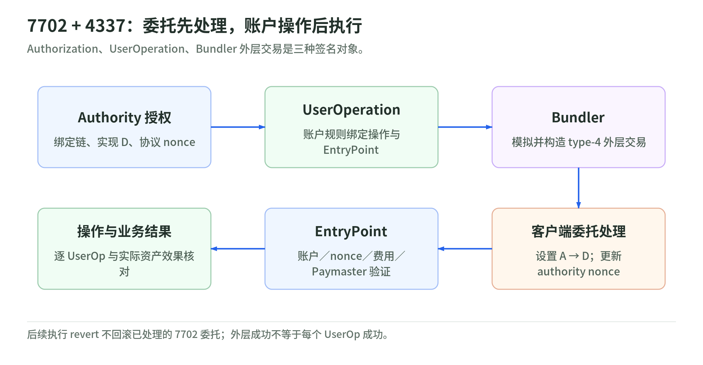
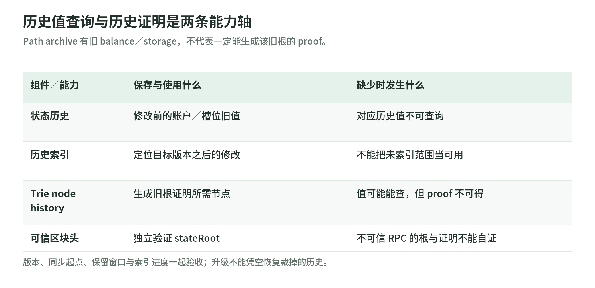
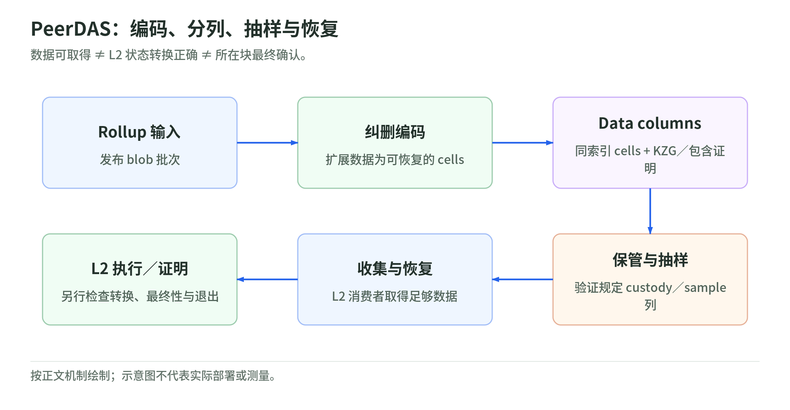

# Ethereum 升级学习章：账户委托、历史状态与 Rollup 数据可用性

- 核查截止：2026-10-29（北京时间）。对应旧 PPT 的账户、状态存储、钱包授权及扩容内容。
- 前置阅读：[03｜状态、存储与执行](../chapters/03-ethereum.md)、[06｜密钥与账户安全](../chapters/06-security.md)。本章介绍替代旧假设的新机制，不重复基础纠错。
- 证据边界：查阅官方公告、规范、发布说明和源码；没有运行主网节点、发送交易、签署授权或测量容量。下文“验收”均是待执行的工程建议；示例全部是假设数据。

先把三种“升级”分开：**主网协议启用**改变交易与共识规则；**客户端接口支持**改变某版本节点能保存、查询什么；**未来研究方案**不能当作今天的钱包行为。

| 对象 | 截止查阅日的新旧更替状态 | 状态依据 |
| --- | --- | --- |
| EOA → 可委托 EOA | Pectra 于 2025-05-07 主网启用，包含 EIP-7702；普通 EOA 仍可继续使用 | [Pectra 官方升级页](https://ethereum.org/en/roadmap/pectra/) |
| 7702 + ERC-4337 | 协议委托与上层合约基础设施可组合；EntryPoint v0.8 引入相应支持，v0.9 已发布，但不能推断每条链或服务都支持 | [v0.8 发布说明](https://github.com/eth-infinitism/account-abstraction/releases/tag/v0.8.0)、[v0.9 发布说明](https://github.com/eth-infinitism/account-abstraction/releases/tag/v0.9.0) |
| Geth path archive | v1.16 支持历史状态值；v1.17 增加历史 trie node 与历史证明能力，均受配置、同步及索引范围约束 | [Archive 文档](https://geth.ethereum.org/docs/fundamentals/archive)、[v1.17 发布说明](https://github.com/ethereum/go-ethereum/releases/tag/v1.17.0) |
| Verkle → binary-tree 路线 | Geth v1.17 已将 Verkle 开发替换为 binary-tree 开发；EIP-7864 仍为 Draft，不能说主网已换树 | [v1.17 发布说明](https://github.com/ethereum/go-ethereum/releases/tag/v1.17.0)、[EIP-7864](https://eips.ethereum.org/EIPS/eip-7864) |
| 全量 blob 下载 → PeerDAS | Fusaka 于 2025-12-03（UTC；北京时间 12-04）主网启用；BPO1、BPO2 随后分阶段扩容，核查主网配置为目标 14、上限 21 blobs/块 | [Fusaka 官方升级页](https://ethereum.org/en/roadmap/fusaka/)、[固定主网配置](https://github.com/ethereum/go-ethereum/blob/7d0a3d848b82959eb14d5eb4b65cc0c26ae97418/params/chainspecs/mainnet.json) |

## 1. 从“私钥发交易”到 EIP-7702 持久委托

### 旧假设与升级动机

旧模型中，EOA 用私钥签协议交易，没有账户代码；批量操作、代付、限额或会话权限通常要另建合约账户。7702 让既有地址委托代码，在不先搬迁资产的情况下获得这些能力。但它没有消灭原始私钥，也没有强制所有 EOA 升级。[EIP-7702：Motivation、Security Considerations](https://eips.ethereum.org/EIPS/eip-7702)

### 新结构：外层交易和授权不是同一个签名

实际 set-code 交易类型是 `0x04`，不是普通转账附一个任意签名，也不是在交易里部署完整钱包代码：

```text
0x04 || rlp([
  chain_id, nonce, max_priority_fee_per_gas, max_fee_per_gas,
  gas_limit, destination, value, data, access_list, authorization_list,
  y_parity, r, s
])

authorization_list 中每项：
[chain_id, address, nonce, y_parity, r, s]

authority 签名摘要：
keccak256(0x05 || rlp([chain_id, address, nonce]))
```

外层签名恢复出 **outer sender**，由它承担协议层交易费；tuple 的签名恢复出 **authority**，即将被改写委托的 EOA。tuple 的 `address` 是委托实现地址，不是 authority，也不一定是外层 `destination`。列表必须非空，`destination` 不能是创建合约用的空地址。[EIP-7702：Set code transaction、Authorization list](https://eips.ethereum.org/EIPS/eip-7702)

客户端先增加 outer sender 的 nonce，再逐项校验授权：链 ID、签名、authority 当前代码及 nonce 等。有效项把 authority 的代码设为 `0xef0100 || address`，随后增加 authority 的 nonce；不满足条件的项跳过，并不必然使整笔交易失败。最后才执行外层 `destination/value/data`。[EIP-7702：Behavior](https://eips.ethereum.org/EIPS/eip-7702)

这是 **persistent delegation**：标记不会在交易结束时自动消失。调用 authority 时，客户端取实现地址的代码，在 authority 的地址、余额和存储上下文中执行；`msg.sender` 仍是当前调用者。实现合约自己的余额、存储并不会因此搬过来。初始化、谁能调用 `execute`、如何验签和限制权限，都必须由钱包实现处理。[EIP-7702：Delegation designation、Initialization、Security Considerations](https://eips.ethereum.org/EIPS/eip-7702)

### nonce、跨链与撤销

1. **两种协议 nonce**：代付者 S 发交易，外层 nonce 属于 S；授权 nonce 属于 A。若 S=A，外层先增 nonce，因此授权应使用增加后的值。不能沿用“nonce 只数外发交易”的旧账本。
2. **`chain_id=0`**：该授权可在不同链使用，但每条链仍要分别满足 nonce、代码等条件。同一个实现地址在另一条链未必有相同代码；这不是“自动安全的多链授权”。
3. **撤销**：签一份指向零地址的有效授权，经包含后清除委托代码并增加 nonce。它不清空存储、余额，也不撤销其他合约中的 allowance。只删除本地授权记录，不能撤回已经外流、仍有效的签名字节。[EIP-7702：Behavior、Replay Protection、Clearing delegation](https://eips.ethereum.org/EIPS/eip-7702)

授权摘要只绑定链、实现地址和 nonce，**不绑定本次支付的收款人、金额、calldata 或截止时间**。所以必须另有操作级验签；不能把“同意委托 D”展示成“只支付一笔钱”。原始私钥仍能直接发交易或重新委托，不能宣称会话密钥、多签或恢复模块已在协议层限制了这把根钥匙。[EIP-7702：Security Considerations](https://eips.ethereum.org/EIPS/eip-7702)

### 教学例：代付失败，委托仍生效

假设 A 的 nonce 为 5，S 的 nonce 为 20。A 签 `[1,D,5,…]`；S 签外层 nonce=20、`destination=A` 的 type-4 交易。执行前 S 变为 21，A 的授权通过后变为 6，代码变为指向 D 的标记。随后支付调用 revert：支付状态回滚、gas 已消耗，**A 的委托与授权 nonce 不回滚**。若 A 自己代替 S 发外层 nonce=5，授权 nonce 应是 6，通过后 A 为 7。[EIP-7702：Behavior，特别是执行失败不回滚授权](https://eips.ethereum.org/EIPS/eip-7702)

### 钱包迁移验收、收益与剩余风险

建议验收：分开记录 outer sender 与 authority；覆盖自发/代付、错误链、nonce 竞争、无效 tuple、重复授权、执行 revert 和零地址撤销；在明确区块读取 `eth_getCode(A)` 并解析委托标记，不能仅检查 receipt。首次初始化必须防抢跑，换实现必须检查存储布局；审批还应审查 D 的完整调用与升级路径，因为授权签的是地址而不是实现 code hash。[EIP-7702：Security Considerations](https://eips.ethereum.org/EIPS/eip-7702)

收益是原地址可获得批处理、代付、权限细分；风险是一个恶意实现可以在 A 的上下文支配资产。必须保留根钥匙失陷、代付中断及撤销失败的应急路径。批处理是否原子成功取决于实现，协议没有替钱包保证。[EIP-7702：Motivation、Security Considerations](https://eips.ethereum.org/EIPS/eip-7702)

**自测**：授权有效但 receipt 为失败，A 是否仍可能已升级？可以。授权中有“只准转 10 个代币”的字段吗？没有；该限制应由另一个操作签名及钱包代码落实。

## 2. 与 ERC-4337 组合：三种签名、三层成功

<!-- illustration: eip7702-aa-8e62034b01 -->


*图：7702 + 4337：委托先处理，账户操作后执行。Authorization、UserOperation、Bundler 外层交易是三种签名对象。*
<!-- /illustration: eip7702-aa-8e62034b01 -->

### 旧假设与为什么组合

7702 解决“旧 EOA 如何执行钱包代码”，ERC-4337 解决“可编程账户操作如何由 Bundler 打包、经 EntryPoint 验证和收费”。4337 是上层协议和合约机制，不是 EVM 新增的 UserOperation 交易类型；7702 单独使用也不强制经过 EntryPoint。[ERC-4337：Abstract、Support for EIP-7702 authorizations](https://eips.ethereum.org/EIPS/eip-4337)

| 签名对象 | 谁验证、主要绑定什么 | 不应混同什么 |
| --- | --- | --- |
| 7702 authorization | 客户端恢复 authority；绑定实现、链域、协议 nonce | 不表示本次业务支付同意 |
| UserOperation 的 `signature` | 账户 `validateUserOp` 按自身规则验证；使用所选 EntryPoint 的 `userOpHash` | 不等于固定 ECDSA 外层交易签名 |
| Bundler 外层交易 | 客户端验证 outer sender，支付协议交易费 | Bundler 不因此获得用户资产权限 |

UserOperation 包含 `sender、nonce、callData`、gas/fee 参数和可选初始化、Paymaster 数据等。EntryPoint 的 keyed nonce 使用高 192 位 key、低 64 位序号，独立于 EOA 协议 nonce；摘要还绑定 chain ID 和 EntryPoint 地址。签名格式由账户决定，不能跨 EntryPoint 版本照搬旧序列化或哈希代码。[ERC-4337：UserOperation、Semi-abstracted Nonce Support、UserOperation hash](https://eips.ethereum.org/EIPS/eip-4337)

### 新流程：委托先发生，AA 再验证执行

```text
A 选择 D、签授权，并按 D 的规则签 UserOperation
  → Bundler 模拟、检查操作与赞助条件
  → type-4 外层交易：
      authorization_list 放 A 的授权
      destination = EntryPoint，data = handleOps(...)
  → 客户端先设置 A→D
  → EntryPoint 验证账户、nonce、资金及可选 Paymaster
  → 调用 A 的委托代码执行操作，结算实际费用与事件
```

4337 RPC 可携带 `eip7702Auth`，Bundler 将有效授权放入外层列表。`initCode` 的前 20 字节可以是 `0x7702` 后补 18 个零的特殊标记；相关 hash 计算会绑定实际委托地址，剩余字节可用于初始化。这与“7702 委托标记”不同，也与普通工厂部署路径不同。已有委托后不必每笔操作都重签授权。[ERC-4337：Support for EIP-7702 authorizations](https://eips.ethereum.org/EIPS/eip-4337)、[v0.9 Eip7702Support 源码](https://github.com/eth-infinitism/account-abstraction/blob/v0.9.0/contracts/core/Eip7702Support.sol)

Paymaster 从其 EntryPoint deposit 支付费用，可有额度、签名和结算条件；Bundler 先承担外层链上费用，再由 EntryPoint 补偿。用户“没有 ETH 也能操作”不是无人支付 gas。涉及新授权时还须把授权处理成本纳入 `preVerificationGas`；当前规范要求相关预算考虑每个授权 25,000 gas，不能只按 `handleOps` 内部执行估算。[ERC-4337：Paymasters、Support for EIP-7702 authorizations](https://eips.ethereum.org/EIPS/eip-4337)

### 教学例与三层成功

假设 Bundler 打包 A、B 两个操作，A 的付款成功，B 因余额不足而执行 revert。EntryPoint 可以隔离执行失败并继续结算，所以外层 receipt `status=1`，B 对应的 `UserOperationEvent.success=false`。A 的事件为 true，也只证明账户执行没有失败；若钱包忽略代币返回的 `false`，仍须核对业务资产效果。[v0.9 EntryPoint：innerHandleOp、_postExecution](https://github.com/eth-infinitism/account-abstraction/blob/v0.9.0/contracts/core/EntryPoint.sol)、[ERC-20：transfer 返回值](https://eips.ethereum.org/EIPS/eip-20)

应分别确认：①外层交易包含与状态；②准确 EntryPoint 发出的、匹配 `userOpHash` 的内部成功状态；③指定资产、数量、收款方的实际效果。验证阶段失败也可能令整个 bundle revert；若该 type-4 外层已处理授权，不能据此假定委托被撤回。[ERC-4337：Required EntryPoint contract functionality](https://eips.ethereum.org/EIPS/eip-4337)、[EIP-7702：Behavior](https://eips.ethereum.org/EIPS/eip-7702)

### 钱包迁移验收、收益与剩余风险

建议固定 `(network, EntryPoint address, code hash, ABI/version, D)`，检查 Bundler 的支持列表、7702 RPC、模拟行为及 Paymaster 预算；账本分别追踪外层 tx hash、userOpHash 和业务 ID。覆盖错误 domain、委托被替换、初始化被抢先、执行失败、赞助撤回、服务不可用和重组。v0.8 有 7702 支持不等于所有旧服务已支持；v0.9 还有初始化及 Paymaster 签名规则变化，须按选定版本验收。[v0.8 发布说明](https://github.com/eth-infinitism/account-abstraction/releases/tag/v0.8.0)、[v0.9 发布说明](https://github.com/eth-infinitism/account-abstraction/releases/tag/v0.9.0)

组合的收益是地址连续性加可编程验证、赞助和更灵活 nonce；剩余风险包括账户代码、EntryPoint、Paymaster、Bundler 活性及根钥匙，既不能把模拟当最终保证，也不能把会话权限当根钥匙消失。[ERC-4337：Security Considerations](https://eips.ethereum.org/EIPS/eip-4337)、[EIP-7702：Security Considerations](https://eips.ethereum.org/EIPS/eip-7702)

**自测**：同一 bundle 的两个 UserOperation 可以一成一败吗？可以，外层成功不能替代逐项检查。UserOperation nonce 加一是否必然增加 A 的 EOA nonce？不是；它们属于不同层。

## 3. Geth path-based archive：保存旧值，不等于保存旧证明

<!-- illustration: archive-value-proof-9905c6b2b5 -->


*图：历史值查询与历史证明是两条能力轴。Path archive 有旧 balance／storage，不代表一定能生成该旧根的 proof。*
<!-- /illustration: archive-value-proof-9905c6b2b5 -->

### 旧假设与升级动机

PPT 的“旧树结构共享，所以节点保留全部历史树”混淆了状态承诺与数据库。hash-based archive 以内容哈希寻址并保留历史 trie；path-based 以账户/路径定位可覆盖的 trie 数据，另保存状态历史。后者目标是减少冗余和历史查询成本，不改变主网 stateRoot 的共识含义，也没有通用“归档节点必须占多少 TB”的采购数字。[Geth Archive：Hash-based、Path-based Archive Node](https://geth.ethereum.org/docs/fundamentals/archive)

### 新核心结构与查询流程

可以把 path archive 拆成四部分：

1. **可变基准层**：磁盘保持一个持久 trie 版本，以及扁平账户/槽位数据；最近状态变化由内存层衔接。文档描述持久层落后最新头约 128 块，不能直接把磁盘层称为实时链头。
2. **反向历史**：记录每块修改前的账户与槽位值，追加到 ancient/freezer 历史；未修改元素不用逐块复制。
3. **历史索引**：把账户或槽位关联到其修改发生的状态版本；查旧值时定位历史记录，不必每次从创世执行所有区块。
4. **可选 trie node history**：保存生成旧根证明所需的历史 trie 节点，不能用“有旧 balance 值”替代。[Geth Archive：How It Works](https://geth.ethereum.org/docs/fundamentals/archive)、[v1.17 history_reader.go](https://github.com/ethereum/go-ethereum/blob/v1.17.0/triedb/pathdb/history_reader.go)

“增量回放”要分用途：初次 full sync 正向执行历史区块以生成状态与增量；回退可按反向增量恢复旧版本；查询某个旧槽位则可经索引直达目标记录。v1.17 的 trie 历史还可把完整节点检查点与后续节点差分组合，按需重建节点，并非保存每块整棵树的完整副本。[Geth Archive：How It Works、Usage](https://geth.ethereum.org/docs/fundamentals/archive)、[v1.17 history_reader.go：assembleNode](https://github.com/ethereum/go-ethereum/blob/v1.17.0/triedb/pathdb/history_reader.go)

### 接口支持与 retention 是两条轴

| 项目 | v1.16.x | v1.17.x 与配置边界 |
| --- | --- | --- |
| 历史余额、storage、状态调用 | path archive 可支持，前提是相应历史存在且已索引 | 仍受可用历史与索引约束，不是升级即补齐 |
| 历史 `eth_getProof` | path archive 不支持一般历史 trie 证明 | 增加支持；须启用并保留对应 trie node history |
| `--history.state` | 控制状态值历史范围 | `0` 保留全部已生成历史；正值为最近 N 块 |
| `--history.trienode` | 不能把新版本能力套到旧版 | 默认负值表示禁用；`0` 保留全部，正值为最近 N 块 |

依据：[Geth Archive 文档](https://geth.ethereum.org/docs/fundamentals/archive)、[v1.17 flags.go](https://github.com/ethereum/go-ethereum/blob/v1.17.0/cmd/utils/flags.go)。`0` 在这里是“全部”，不是“关闭”。状态、trie、区块历史及交易哈希索引的保留分别控制；例如 `--history.transactions=0` 与 `--history.chain=all` 不能由 `--history.state=0` 推导。[v1.17 flags.go：History flags](https://github.com/ethereum/go-ethereum/blob/v1.17.0/cmd/utils/flags.go)

供理解的配置组合是 `--state.scheme=path --syncmode=full --gcmode=archive --history.state=0`；需要全部可得历史证明时，再在 v1.17+ 设置 `--history.trienode=0`。这不是本次执行过的命令。归档查询还要等待索引完成；从 snap 起点或已裁剪数据库开开关，不能凭空补回之前缺失的历史，须有历史输入并重新执行或采用完整数据源。[Geth Archive：Usage](https://geth.ethereum.org/docs/fundamentals/archive)

### 教学例：查值与查 proof 为什么不同

教学性地设持久层为块 103：槽位在块 100 为 10，101 改为 12，102 不变，103 改为 7。反向历史在 101 记录旧值 10，在 103 记录旧值 12。查块 102，索引寻找 **102 之后第一次修改**，读 103 的旧值即 12；查块 100 则取 101 的旧值 10。这对应 Geth reader 的 `readGreaterThan`，而非正向重放所有交易。[v1.17 history_reader.go：stateHistoryReader.read](https://github.com/ethereum/go-ethereum/blob/v1.17.0/triedb/pathdb/history_reader.go)

即便已经读到 12，要证明它属于块 102 的 stateRoot，还须账户与槽位路径上的历史 trie 节点。若 state history 保留全部、trie history 只保留最近 N 块，窗口外的值查询可成功而 proof 失败。验证 proof 还须独立可信区块头。[Geth Archive：Historical Trie Node Retention](https://geth.ethereum.org/docs/fundamentals/archive)、[EIP-1186](https://eips.ethereum.org/EIPS/eip-1186)

### 钱包迁移验收、收益与剩余风险

建议用同一个确定区块分别验收 `eth_getBalance`、`eth_getStorageAt`、`eth_call`、`eth_getProof`，覆盖保留边界、未索引范围及重组；对 proof 做本地根验证。服务能力表应记录同步起点、最早可查询块、状态/trie retention、索引进度、备份恢复与查询延迟。RPC 厂商声称“archive”不是这些测试的替代品。

收益是更紧凑的历史组织、可调保留和直接旧值读取；风险仍有磁盘与索引增长、I/O、缺失历史、恢复耗时。启用 trie history 会增加存储，不能拿仅状态值的容量当“全证明归档”预算。[Geth Archive](https://geth.ethereum.org/docs/fundamentals/archive)、[v1.17 发布说明](https://github.com/ethereum/go-ethereum/releases/tag/v1.17.0)

**自测**：`history.state=0` 足以保证创世以来任意 proof 吗？不够；还要版本、同步覆盖、索引和 trie history。v1.17 能否自动恢复此前被裁掉的 trie 历史？不能靠升级或开关本身恢复。

## 4. 未来状态结构：Verkle 不再是可以照抄的唯一方向

### 旧假设、动机与核查状态

旧 PPT 将 Verkle 当作下一步：用向量承诺压缩状态 witness，使验证者不必持有全部状态。这个动机仍有意义，但实现路线不能照搬。Ethereum.org 的 Verkle 页仍把它称为关键路线；Geth 2026-02-17 发布说明却明确记录，用 binary tree 实现替换 Verkle 开发。[Verkle 页面](https://ethereum.org/en/roadmap/verkle-trees/)、[Geth v1.17 发布说明：Fork Implementation](https://github.com/ethereum/go-ethereum/releases/tag/v1.17.0)

当前一手替代方案是 **EIP-7864 unified binary tree**，查阅时为 Draft；哈希函数尚未定案。固定主网配置没有启用 UBT 的时间字段。因此本章仍按 MPT 学习主网状态承诺；这是规范/配置核对，不是运行节点的独立实测。binary-tree 开发进入客户端，不等于主网已切换，更不等于已完成抗量子升级。[EIP-7864：Abstract](https://eips.ethereum.org/EIPS/eip-7864)、[固定主网配置](https://github.com/ethereum/go-ethereum/blob/7d0a3d848b82959eb14d5eb4b65cc0c26ae97418/params/chainspecs/mainnet.json)

### 新核心结构与拟议流程

MPT 模型是账户树、账户内的 storageRoot，以及由 codeHash 承诺的代码。7864 草案将账户头、分块代码和 storage 放入一个逻辑树；使用 stem/suffix 将相关叶子分组，并区分数据类型以保持局部性。树的内部节点通过左右子节点哈希合成，目标包括缩小 witness、降低证明电路成本，而不只追求普通 RPC 更快。[EIP-7864：Specification、Rationale](https://eips.ethereum.org/EIPS/eip-7864)

拟议无状态验证流程是：生产者提供本块访问数据及连接到旧根的 witness，验证者验证旧根、执行操作并计算新根，不必自行保存全部状态。草案还讨论旧 MPT 与新树的过渡、数据迁移及逐步完成转换；这些只是迁移设计，不能当已运行的双树机制。[EIP-7864：Transition](https://eips.ethereum.org/EIPS/eip-7864)

其安全方向涉及用哈希承诺避开 Verkle 椭圆曲线承诺的量子脆弱性，但 EIP 中当前实验使用的 BLAKE3 **不是最终选择**，Keccak、Poseidon2 等仍在评估。状态树哈希方案不自动替换 EOA 的 ECDSA、验证者签名或 blob 的 KZG，不能概括成“Ethereum 已抗量子”。[EIP-7864：Abstract、Security Considerations](https://eips.ethereum.org/EIPS/eip-7864)、[EF 2026 研究方向](https://blog.ethereum.org/2026/02/18/protocol-priorities-update-2026)

### 教学例、钱包验收与剩余风险

只为理解分叉度，假设一棵不压缩路径的满树有 16 个叶子：二叉证明经过 4 层，每层提供一个兄弟哈希；16 叉单层朴素证明可能要提供其余 15 个哈希。这解释“分叉度改变 witness 成本”的直觉，不是现实 MPT、Verkle 或 binary-tree 的容量/性能基准；真实结果还涉及路径压缩、组块、多重证明和编码。[EIP-7864：Motivation、Rationale](https://eips.ethereum.org/EIPS/eip-7864)

钱包现在不应提前改变 Solidity mapping 槽位算法或默认 proof 解码器。建议把逻辑槽位、RPC 查询、状态承诺验证分层；未来按网络、区块/激活点及证明格式选择验证器，验收旧新根过渡、代码分块、缺失 witness 和独立可信头。**path 数据库升级不能充当 binary-tree 共识升级证据。**

潜在收益是 witness 和证明成本下降，以及新的无状态验证路线；风险包括哈希选择、迁移一致性、证明实现和客户端互操作。当前只能称研究/开发计划，不承诺上线日期或性能数字。[EIP-7864](https://eips.ethereum.org/EIPS/eip-7864)

**自测**：Geth 有 binary-tree 代码，能否推出主网 stateRoot 已是二叉根？不能。换哈希树能否使旧 EOA 私钥自动抗量子？不能。

## 5. Fusaka / PeerDAS：扩的是 Rollup 数据可用性

<!-- illustration: peerdas-dcbe19acc3 -->


*图：PeerDAS：编码、分列、抽样与恢复。数据可取得 ≠ L2 状态转换正确 ≠ 所在块最终确认。*
<!-- /illustration: peerdas-dcbe19acc3 -->

### 旧假设与为什么升级

Dencun 已引入 blob 交易：执行层持有承诺/版本化哈希等，blob 内容不供 EVM 直接读取，也不是永久链上文件存储。Fusaka 前的 blob 网络要求节点取得全部 blobs，扩容越来越受带宽制约；PeerDAS 用分片保管和抽样降低单节点数据负担。[EIP-4844：Blob transaction、Networking](https://eips.ethereum.org/EIPS/eip-4844)、[EIP-7594：Motivation](https://eips.ethereum.org/EIPS/eip-7594)

Fusaka 已上线，不是仅仅“EIP 为 Final”。官方升级页与共识配置共同指向 2025-12-03 21:49:11 UTC，即北京时间 12-04 05:49:11。随后 BPO 分叉单独调整 blob 参数，避免每次扩容都捆绑整套执行层升级。[Fusaka 官方升级页](https://ethereum.org/en/roadmap/fusaka/)、[consensus-specs v1.6.0 主网配置](https://github.com/ethereum/consensus-specs/blob/v1.6.0/configs/mainnet.yaml)、[EIP-7892](https://eips.ethereum.org/EIPS/eip-7892)

### 新核心结构：编码、列、证明、抽样与重建

1. **纠删编码**：每个 blob 的 4,096 个域元素扩展为 8,192 个，形成 128 个 cell，每个 cell 含 64 个元素。拿到足够正确数据可重建原 blob，不是简单复制两份。
2. **按列传播**：一个块中所有 blobs 的相同 cell 索引组成 data column sidecar；附带 cell 的 KZG 证明及承诺的区块包含证明。
3. **保管与抽样**：节点保存规定的 custody 列，并对抽样列请求、验证；通过概率性可用性检查获得信心，不要求每个节点下载所有列。
4. **恢复原始数据**：需要执行 Rollup 的节点/数据消费者仍须收集足够列、重建完整输入；抽样通过不是已经执行了 L2。[EIP-7594：Specification](https://eips.ethereum.org/EIPS/eip-7594)、[v1.6.0 Fulu preset](https://github.com/ethereum/consensus-specs/blob/v1.6.0/presets/mainnet/fulu.yaml)

**数据可用性、有效性和终局性是不同问题**：PeerDAS 检查数据可取得；Rollup 的欺诈证明或有效性证明检查状态转换；L1 共识决定相应数据所在块的最终性。它不会代替桥安全、挑战期限、排序器治理或退出机制。[EIP-7594](https://eips.ethereum.org/EIPS/eip-7594)、[Optimistic Rollups 文档](https://ethereum.org/en/developers/docs/scaling/optimistic-rollups/)

### 已上线扩容与当前应用范围

| 主网阶段 | 生效时间（北京时间，UTC+8）[^bpo-time] | 每块 blob 目标 / 上限 |
| --- | --- | --- |
| Pectra / Fusaka 初始沿用 | Pectra 起为 6/9；Fusaka 首次激活没有立即加倍 | 6 / 9 |
| BPO1 | 2025-12-09 22:21:11 | 10 / 15 |
| BPO2 | 2026-01-07 09:01:11 | 14 / 21 |

[^bpo-time]: [固定 Geth 主网配置](https://github.com/ethereum/go-ethereum/blob/7d0a3d848b82959eb14d5eb4b65cc0c26ae97418/params/chainspecs/mainnet.json)的 `bpo1Time=1765290071`、`bpo2Time=1767747671` 对应 UTC 2025-12-09 14:21:11、2026-01-07 01:01:11；表内统一加 8 小时。来源文档的发布日期不作时区换算。

依据：[EIP-7892](https://eips.ethereum.org/EIPS/eip-7892)、[固定 Geth 主网配置](https://github.com/ethereum/go-ethereum/blob/7d0a3d848b82959eb14d5eb4b65cc0c26ae97418/params/chainspecs/mainnet.json)、[v1.6.0 共识主网配置](https://github.com/ethereum/consensus-specs/blob/v1.6.0/configs/mainnet.yaml)。目标是 blob 费率调节的容量目标，上限是单块合法性限制，不是实际每块使用量；当前配置没有列出 BPO3 的主网激活，不能拿客户端中的候选常量当新容量已经上线的证据。

**单笔 blob 交易还有 6 个 blobs 的上限**，因此 21/块不等于一笔交易可带 21 个；该限制由 Fusaka 的 **EIP-7594** 引入，其 Specification 明确要求客户端在交易提交、网络接收及区块生产/处理时强制执行。EIP-7691 则调整 Prague/Electra 的每块目标/上限为 6/9，不是这个单笔限制的来源。[EIP-7594：Specification](https://eips.ethereum.org/EIPS/eip-7594)、[EIP-7691：Parameters](https://eips.ethereum.org/EIPS/eip-7691)

当前直接受益者是向 Ethereum 投稿 blobs 的 Rollup 批次发布者。OP Stack 官方文档已描述 batcher 将压缩批次写入 L1 blobs；它也区分排序器软确认与 L1 数据支持的确认。但并非所有 L2 使用 blobs，calldata 或外部 DA 路径不会自动变为 PeerDAS 数据。普通用户钱包通常不亲自抽样，影响通过 L1 数据费和 L2 服务体现；本次没有实测具体 Rollup 的费率或采用比例。[OP Stack Transaction Flow：Batching](https://docs.optimism.io/stack/transactions/transaction-flow)

### 教学例、钱包迁移验收与剩余风险

假设某 Rollup 批次需 8 个 blobs：发布者至少分为两笔合法 blob 交易；二者若与其他投稿合计不超过 21，可在同一块出现，但仍受其他区块约束。PeerDAS 将这些输入编码、按列传播；L2 节点取得数据后重放批次。用户看到的排序器“成功”不证明批次已经获得 L1 数据支持，更不证明提现挑战已经结束。[EIP-7594：Specification](https://eips.ethereum.org/EIPS/eip-7594)、[OP Stack Transaction Flow](https://docs.optimism.io/stack/transactions/transaction-flow)

建议普通钱包验收 L2 chain ID、该链费用模型、软确认/安全/最终状态、充值提现条件和数据服务失联；不要直接把 L1 blob base fee 当用户最终手续费。运营 batcher 或 L1 节点者还须验收 Fusaka 客户端兼容、分列传播与恢复、逐阶段 blob 上限、单笔限制，以及旧 blob 获取失败时的处理。

收益是为 blob 扩容提供较低的单节点带宽成本，可能降低 Rollup 的 DA 费用；不能保证所有时期或所有 L2 必然降价。风险仍有数据隐匿、抽样与网络假设、KZG、服务可用性和长期数据留存。v1.6.0 配置的 data-column 请求窗口为 4,096 epochs（约 18 天），这是有限网络服务窗口，不是永久历史保证；长期开票、审计或灾备须另外保存输入。[EIP-7594：Security Considerations](https://eips.ethereum.org/EIPS/eip-7594)、[v1.6.0 主网配置](https://github.com/ethereum/consensus-specs/blob/v1.6.0/configs/mainnet.yaml)

**自测**：抽样通过就证明 L2 转账执行正确吗？不证明。主网每块上限 21，能否发一笔含 8 blobs 的交易？不能；须遵守单笔上限 6。

## 6. 官方文档矛盾与本章取舍

1. **Verkle 路线页与实现发布说明不同步**：Verkle 页仍称其为关键升级路线；Geth v1.17 的 Fork Implementation 明确记录替换为 binary-tree 开发。本章以该版本发布正文及 Draft EIP-7864 表述研究方向，不把任一页推成主网上线公告。[Verkle 页](https://ethereum.org/en/roadmap/verkle-trees/)、[Geth v1.17](https://github.com/ethereum/go-ethereum/releases/tag/v1.17.0)
2. **Fusaka 页的 BPO2 数字自相矛盾**：该页 Summary 写目标/上限 14/21，后面的参数段落却写 15/21。本章采用 EIP-7892 与固定 Geth 主网配置共同支持的 **14/21**，没有测量实际出块使用量。[Fusaka 页](https://ethereum.org/en/roadmap/fusaka/)、[EIP-7892](https://eips.ethereum.org/EIPS/eip-7892)、[固定配置](https://github.com/ethereum/go-ethereum/blob/7d0a3d848b82959eb14d5eb4b65cc0c26ae97418/params/chainspecs/mainnet.json)
3. **ERC-4337 当前正文存在版本规则残留**：EntryPoint 章节允许已存在账户忽略 `initCode`，但 Bundler sanity checks 仍有“代码与 initCode 二选一”的旧表述。v0.9 发布说明明确新增“已存在账户忽略 initCode”，并警告旧账户不能再据非空 initCode 推断首次操作。本章不把冲突正文拼成统一验收规则，要求按已部署版本、源码和 Bundler 实现锁定行为。[ERC-4337 当前正文](https://eips.ethereum.org/EIPS/eip-4337)、[v0.9 发布说明](https://github.com/eth-infinitism/account-abstraction/releases/tag/v0.9.0)

## 一手来源表与查阅版本

下表均于 **2026-10-29（北京时间）**查阅。ETH-U 编号只在本章使用；正文已经直接近处链接，不依赖全局来源编号。动态正文没有完整离线快照；固定 tag/commit 便于复核，但不声称该版本是查阅日最新。表中“源码核对”只是阅读实现，不是链上实测。

| 本章编号 | 一手来源 | 文档版本 / 日期 | 支撑内容与证据性质 |
| --- | --- | --- | --- |
| ETH-U1 | [Pectra 官方升级页](https://ethereum.org/en/roadmap/pectra/) | 查阅日动态正文 | 2025-05-07 已激活、包含 7702；官方上线声明，未独立测链 |
| ETH-U2 | [EIP-7702](https://eips.ethereum.org/EIPS/eip-7702) | 查阅版 Final；创建于 2024-05-07 | set-code、tuple、nonce、持久委托、撤销和风险；规范，不单独证明启用 |
| ETH-U3 | [ERC-4337](https://eips.ethereum.org/EIPS/eip-4337) | 查阅版 Final；创建于 2021-09-29 | UserOperation、签名域、keyed nonce、Paymaster、7702 组合；规范，含本文记录的残留矛盾 |
| ETH-U4 | [EntryPoint v0.8](https://github.com/eth-infinitism/account-abstraction/releases/tag/v0.8.0)、[v0.9](https://github.com/eth-infinitism/account-abstraction/releases/tag/v0.9.0) | v0.8.0：2025-03-26；v0.9.0：2025-11-16 | 功能与部署声明，非逐网络部署或 RPC 实测 |
| ETH-U5 | [v0.9 EntryPoint](https://github.com/eth-infinitism/account-abstraction/blob/v0.9.0/contracts/core/EntryPoint.sol)、[Eip7702Support](https://github.com/eth-infinitism/account-abstraction/blob/v0.9.0/contracts/core/Eip7702Support.sol) | 固定 tag v0.9.0 | 操作失败隔离、事件、委托地址哈希；源码核对 |
| ETH-U6 | [Geth Archive](https://geth.ethereum.org/docs/fundamentals/archive) | 查阅日动态正文，覆盖 v1.16 / v1.17 | 数据组织、同步、索引、retention、proof；官方接口/配置说明，未跑节点 |
| ETH-U7 | [Geth v1.16 发布说明](https://github.com/ethereum/go-ethereum/releases/tag/v1.16.0)、[v1.17](https://github.com/ethereum/go-ethereum/releases/tag/v1.17.0) | 固定 tag v1.16.0 / v1.17.0；发布页原日期 2025-06-26 / 2026-02-17 | path archive 演进与 binary 替换 Verkle；官方版本声明，容量没有沿用为本次实测 |
| ETH-U8 | [history_reader.go](https://github.com/ethereum/go-ethereum/blob/v1.17.0/triedb/pathdb/history_reader.go)、[flags.go](https://github.com/ethereum/go-ethereum/blob/v1.17.0/cmd/utils/flags.go) | 固定 tag v1.17.0 | 历史定位、节点差分、参数边界；源码核对 |
| ETH-U9 | [EIP-1186](https://eips.ethereum.org/EIPS/eip-1186)、[ERC-20](https://eips.ethereum.org/EIPS/eip-20) | 查阅日规范正文 | proof 结构与 transfer false；接口规范，非服务验收 |
| ETH-U10 | [Verkle 路线页](https://ethereum.org/en/roadmap/verkle-trees/)、[EIP-7864](https://eips.ethereum.org/EIPS/eip-7864) | 路线页动态正文；7864 为 Draft，创建于 2025-01-20 | 旧路线与 binary 提案、未定哈希、过渡设计；研究/计划，不是主网启用 |
| ETH-U11 | [EF Protocol Priorities Update for 2026](https://blog.ethereum.org/2026/02/18/protocol-priorities-update-2026) | 2026-02-18，使用页面 canonical 地址 | 状态结构与 post-quantum 研究方向；官方研发计划，非已实现安全承诺 |
| ETH-U12 | [Fusaka 官方升级页](https://ethereum.org/en/roadmap/fusaka/) | 查阅日动态正文 | 已上线声明及 BPO 页面数字矛盾；未独立测链 |
| ETH-U13 | [EIP-4844](https://eips.ethereum.org/EIPS/eip-4844)、[7594](https://eips.ethereum.org/EIPS/eip-7594)、[7691](https://eips.ethereum.org/EIPS/eip-7691)、[7892](https://eips.ethereum.org/EIPS/eip-7892) | 查阅版规范正文；7594 / 7691 / 7892 均为 Final | 4844：blob；7594：PeerDAS 及单笔 6 上限；7691：Prague/Electra 每块目标/上限 6/9；7892：BPO 机制与参数。不据 Final 独自判启用 |
| ETH-U14 | [Geth 主网配置](https://github.com/ethereum/go-ethereum/blob/7d0a3d848b82959eb14d5eb4b65cc0c26ae97418/params/chainspecs/mainnet.json) | commit `7d0a3d848b82959eb14d5eb4b65cc0c26ae97418`，2026-10-28 | 激活时间及当前配置 14/21、无 UBT/BPO3 启用时间；源码配置核对，非实际区块观测 |
| ETH-U15 | [共识主网配置](https://github.com/ethereum/consensus-specs/blob/v1.6.0/configs/mainnet.yaml)、[Fulu preset](https://github.com/ethereum/consensus-specs/blob/v1.6.0/presets/mainnet/fulu.yaml) | 固定 tag v1.6.0 | Fusaka/BPO 时间、cell/column 结构、请求窗口；规范配置，未运行客户端 |
| ETH-U16 | [OP Stack Transaction Flow](https://docs.optimism.io/stack/transactions/transaction-flow)、[Optimistic Rollups](https://ethereum.org/en/developers/docs/scaling/optimistic-rollups/) | 查阅日动态正文 | blob 批次用途、确认层次、DA 与执行/退出区别；官方架构说明，未测采用率或费用 |

学习收束：读到“升级”时先问是哪一层，再沿 **授权对象 → 实际执行上下文 → 状态保留/证明能力 → 数据可用性 → 业务最终效果**检查，避免用一个“成功”“归档”或“已支持”替代整条验证链。
