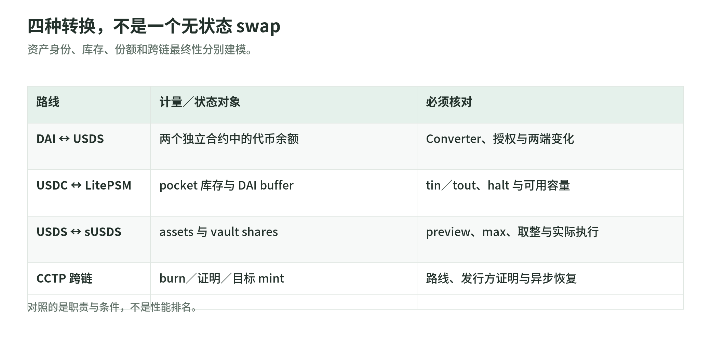
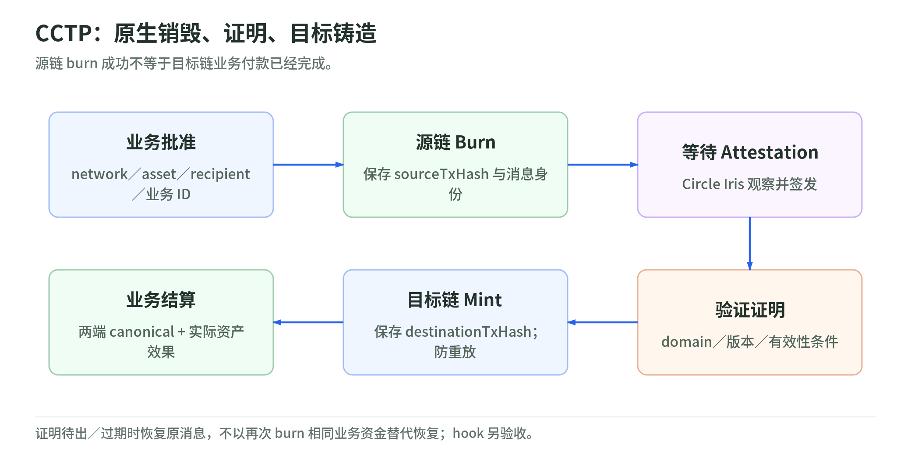

# 04｜稳定币新版机制：Sky、组合支持型 USDe 与原生跨链

- 查阅日：2026-10-29（北京时间）
- 旧内容定位：PPT 28–35、41、46、51；[基础篇 04](../chapters/04-ecosystem.md)
- 目标：读懂新资产和转换路径，而不是仅记住“Maker 改名 Sky”
- 边界：机制与接口研究，不提供收益、购买或个体赎回资格建议

## 1. 新旧关系先分清

<!-- illustration: stablecoin-conversions-c64ced5c56 -->


*图：四种转换，不是一个无状态 swap。资产身份、库存、份额和跨链最终性分别建模。*
<!-- /illustration: stablecoin-conversions-c64ced5c56 -->

| 旧讲法 | 新的准确拆法 | 属于什么变化 |
| --- | --- | --- |
| DAI就是用ETH借出的稳定币 | 抵押借贷仍是基础，另有PSM、链外资产路径、USDS及其转换接口 | 资产 / 协议机制扩展 |
| MKR治理照旧 | 官方公布SKY治理迁移与新Chief路径，旧治理集成需升级 | 控制与治理迁移 |
| DAI / USDS / sUSDS都当美元余额 | USDS是代币，sUSDS是ERC-4626份额，计量对象不同 | 接口与会计模型变化 |
| USDe固定是stETH+ETH空单 | 官方现有文档描述多类别支持与动态配置；不能猜实际比例 | 支持组合与风险管理扩展 |
| 跨链稳定币都先锁后铸包装币 | CCTP是原生burn-and-mint，但仍依赖发行方证明服务 | 跨链资产模型变化 |
| Omni版本仍与受支持USDT同等兑付 | 旧链发行 / 直接赎回支持停止，转账能力与支持状态分开 | 产品支持退役 |

这些关系来自下文的一手资料。新机制没有把发行方、治理、抵押品、托管或链上执行风险一并消除。

## 2. DAI → USDS：资产转换，不是给旧余额换个名称

官方文档将 USDS 定义为 ERC-20，增加 permit 与 ERC-1271 合约签名支持，采用可升级 UUPS / ERC-1967 设计。DAI-USDS Converter 提供两个方向的 1:1 转换；这是**特定转换合约的能力**，不能外推到任意代币、网络或兑换路径。[USDS 文档](https://developers.skyeco.com/protocol/tokens/usds/)

```text
DAI合约中的余额
  → 通过官方Converter执行转换
  → USDS合约中的余额

不是：客户端把symbol从DAI改为USDS
```

工程推论：代币合约、allowance、事件、余额和签名域不能因“升级”自动共享。钱包资产目录应保留 DAI 和 USDS 的独立身份、转换路径及部署版本。

### 一次转换应解释哪些步骤

以 Ethereum 上官方支持路径为学习对象：

1. 识别网络、DAI、USDS 和 Converter 的准确部署。
2. 查询转换接口、所需授权、当前用户余额。
3. 将输入金额按 DAI 精度转整数，显示预期 USDS 输出。
4. 按实际接口完成授权 / permit 及转换。
5. 验证 canonical receipt 和两端资产变化，再记业务完成。

这是集成流程建议，不是本次交易操作。官方该 Converter 文档说明其无协议费用；不能据此省略 network gas，或说所有 USDC / USDS 路径都永远免费。[Converter 说明](https://developers.skyeco.com/protocol/tokens/usds/)

## 3. USDS → sUSDS：从代币余额到 vault 份额

sUSDS 是 USDS 的 ERC-4626 savings vault 份额，支持存入 USDS 获得 shares、用 shares 赎回 USDS；实现也有可升级设计。[sUSDS 官方文档](https://developers.skyeco.com/protocol/tokens/susds/)

ERC-4626 的两种数量：

```text
assets：底层USDS数量
shares：vault份额数量，即sUSDS余额
```

`balanceOf` 读取的是 shares。`convertToAssets` 是标准定义的理想化转换视图；交易预览、限额、费用和取整应分别使用对应 `preview*` / `max*` / deposit / redeem 语义，不能把一个换算值当成交承诺。[ERC-4626 规范](https://eips.ethereum.org/EIPS/eip-4626)

### 教学例：余额不变，资产等价量可以变化

假设某时点教学汇率 `1 share = 1.05 USDS`，暂忽略取整和费用：

```text
存入1050 USDS → 获得1000 shares
之后汇率为1.06 → 1000 shares对应1060 USDS
```

示例不是当前汇率、收益预测或实际可成交数量。它说明 wallets 不能把 `1000 sUSDS` 无条件显示成 `1000 USD`。

建议分别展示：

- 原始 share 数量；
- 参考区块下的 underlying assets 换算；
- 提现路径、当前限额和模拟输出；
- 二级市场价格与 protocol conversion，不合并成一个“必兑美元”。

USDS、sUSDS、stUSDS 等不同产品也不能因相似名称自动合并。

## 4. LitePSM：新增的是固定报价的库存与会计机制

传统 ETH Vault 示例是“抵押波动资产后形成债务”；LitePSM 则是在 USDC 与 DAI / USDS 之间提供固定比例路线，不要求每个兑换用户先开 ETH Vault。

当前架构：

```text
USDS-facing wrapper：面向USDS的入口
  ↔ DssLitePsm：核心USDC / DAI交换
  ↔ pocket：USDC库存
  ↔ 核心PSM中预铸的DAI buffer
```

预铸 DAI buffer 减少逐次用户交换触碰核心 Vat 会计的 gas 开销。输入 / 输出费用 `tin` / `tout`、halt 状态、buffer 与 pocket 余额都影响可用性；固定报价不是无限流动性。[Spark LitePSM 结构](https://docs.spark.finance/dev/integration-guides/litepsm/)

Sky 的维护操作包括 refill / fill buffer 等路径。用户交换失败可能是库存或暂停问题，而不是 stablecoin 价格机制“完全失效”；是否重试、补充库存或走另一批准路径应分别处理。[Sky LitePSM 指南](https://developers.skyeco.com/guides/psm/litepsm/)

### 教学例：报价固定，但不能全部换出

假设核心可提供 500 单位的 DAI buffer，而用户要交换 800 单位对应 USDC。即使页面显示固定 1:1，当前库存也不能支持整笔；不能因为报价不变就忽略容量。

这是库存模型示例，不是实际部署余额。集成建议：

```text
获取参数与库存 → 计算单位与限额 → 预览 / 模拟
  → 授权 → 调用 → 核对实际事件和余额
```

不得把当前公开费用为零写成 `tin/tout` 永远不能变。DAI-USDS Converter 的费用性质与 LitePSM 的治理参数不是同一机制。

## 5. 治理迁移：MKR → SKY 不是稳定币转换

Sky 官方时间线将 **2025-05-19** governance migration go-live 标为 Done；官方集成指引说明 SKY 成为新 Chief 路径的治理代币，MKR 不再用于这套新治理投票。稳定币资产、vault shares、治理 token 是不同角色。[升级时间线](https://developers.skyeco.com/guides/sky/token-governance-upgrade/timeline/)、[集成指引](https://developers.skyeco.com/guides/sky/token-governance-upgrade/integrators/)

核心变化包括新 Chief 合约、投票 / 委托 / staking 集成，以及 MKR-SKY converter 的新方向与时效参数。不能把早期双向转换说明当成现在所有 converter 的共同规则。[治理升级概述](https://developers.skyeco.com/guides/sky/token-governance-upgrade/overview/)

工程建议：治理看板和 keeper 固定以下版本化对象：

```text
governance token
Chief / Pause / Spell
delegate / staking modules
converter版本和方向
参数来源与适用区块
```

本次没有读用户持仓、发起转换或测算当前延迟升级费用。时间线本身包含可被治理改变的参数，不按历史时间公式计算今天费率。

## 6. USDe：从单一 basis trade 到组合支持的风险管理

PPT 的 stETH + ETH perpetual short 是入门例子。当前官方 backing overview 已描述：

- 波动资产配相应空头对冲；
- 稳定资产直接持有；
- non-crypto basis、DeFi / institutional lending、RWA、liquid stablecoins 等扩展类别；
- 新策略通过风险委员会 / 治理审查，限额与分配动态变化。

这是**文档所述类别与机制**，不代表所有类别已经有敞口，也不代表本次核验了实时配置。[Backing overview](https://docs.ethena.fi/backing-assets/overview.md)

### Delta-neutral 到底抵消什么

理想化教学例，忽略费用、基差、滑点、抵押与清算：

```text
持有现货价值10000
建立匹配空头

现货涨500，空头亏500 → 组合方向性损益约0
现货跌500，空头赚500 → 组合方向性损益约0
```

这仅解释匹配价格风险。它不证明每枚稳定币能按 1 美元成交或及时赎回，也没有处理 funding、托管、交易所、流动性和运营损失。[USDe 机制](https://docs.ethena.fi/overview/how-usde-works.md)

### 对冲头寸为何需要 OES

Off Exchange Settlement 将支持资产托管与交易所保证金暴露分开：资产可由托管服务持有，交易所按安排获得保证金用途。托管不直接等于资金已完全转入交易所，但仍需要执行与结算对手方。[USDe minting / OES 流程](https://docs.ethena.fi/overview/how-usde-works.md)

由此应分别跟踪：

```text
资产托管状态
头寸名义金额 / delta偏差
保证金与结算
资金成本 / 收入
赎回资产与执行容量
```

这些是风险卡字段建议，不是本次得到的持仓报表。

### Funding 转负时发生什么

空头可能从收取 funding 变为支付。官方说明 reserve fund 与动态分配用于缓冲；这不是所有损失都能无限补足的保险。资金费率页面的旧统计样本也不能拿来预测 2026 之后收益。[Funding risk](https://docs.ethena.fi/protocol-overview/risks/funding-risk.md)

sUSDe 是另一个份额 / 奖励承载对象；没有某期奖励下降的传导，不等于 underlying USDe 没有支持资产风险。USDtb 同样不是 USDe 的新名称，应单独识别。[USDe / sUSDe](https://docs.ethena.fi/overview/how-usde-works.md)、[USDtb 当前定义](https://docs.ethena.fi/overview/usdtb.md)

## 7. CCTP：新跨链路线是原生销毁—铸造

传统 lock-and-mint 桥常锁住源资产，在另一链发包装表示。CCTP 对受支持原生 USDC 使用 burn-and-mint；当前产品页还列 EURC 与注册的第三方资产扩展，但各资产 / 路线 / 版本仍须逐项核验。[CCTP 当前范围](https://developers.circle.com/cctp)

原生 USDC 的基本三步：

```text
源链：burn native USDC，发出跨链消息
  → Circle Iris：观察并签发attestation
  → 目标链：验证消息与attestation，mint目标原生USDC
```

EVM 文档把 TokenMessengerV2 / TokenMinterV2 的资产操作与 MessageTransmitterV2 的消息操作分开。Attestation 不是普通“看到一条 Transfer”就自发生成的信任根，而是发行方维护的链外证明服务。[技术指南](https://developers.circle.com/cctp/references/technical-guide)

### 解决了什么，没解决什么

解决：无需在目标链长期依赖某个独立包装资产来表示同一原生 USDC，省去传统池式桥的某些库存需求。

仍需：发行方与 attester 控制、源 / 目标网络、合约实现、提交者、网络 gas、路径支持和故障恢复。源链销毁成功不等于目标链已经完成付款。

以上收益与风险是根据原生铸销和消息分工推导，不是“无桥风险”的产品承诺。

## 8. Fast / Standard、Hooks 与过期恢复

CCTP V2 的 `minFinalityThreshold` 是跨链协议级类别：

- `1000` 表示 confirmed 类别，用于可被 Fast attestation 处理的消息；
- `2000` 表示 finalized 类别，用于 Standard；
- **不是**1000 / 2000 个区块，也不是用户可自由填写任意确认数形成新类别。[Finality 规则](https://developers.circle.com/cctp/references/technical-guide)

Fast 不会让源链物理最终性突然提前。它依赖协议对更早证明的安排，还应核对具体路线额度、费用、实际 `finalityThresholdExecuted` 和接收处理规则。[CCTP V2 设计说明](https://www.circle.com/blog/cctp-v2-the-future-of-cross-chain)

Hooks 也要纠正营销化理解：技术文档明确，core protocol 携带 opaque metadata，**不自动执行应用 hook**。应用自行定义接收侧执行、mint 前后顺序和失败恢复。不能因 burn 消息带 hookData 就承诺 approve / swap / deposit 一定原子完成。[Hooks 边界](https://developers.circle.com/cctp/references/technical-guide)

Fast message 的 attestation 带有效性边界；过期不等于源 burn 永久失效。官方提供重新 attestation 流程，在源 burn 仍存在的条件下取得更新证明；不能重新 burn 相同业务资金来代替恢复。[过期与重新证明](https://developers.circle.com/cctp/references/technical-guide)

本次不复制整套 ABI，也不硬编码路线、合约地址、费用或时限。接入时匹配目标版本的官方 API / 部署表。

## 9. 钱包需要一条跨链业务状态机

<!-- illustration: cctp-states-875446dbfc -->


*图：CCTP：原生销毁、证明、目标铸造。源链 burn 成功不等于目标链业务付款已经完成。*
<!-- /illustration: cctp-states-875446dbfc -->

建议模型：

```text
APPROVED
  → SOURCE_BURN_SUBMITTED
  → SOURCE_BURN_OBSERVED
  → ATTESTATION_PENDING
  → ATTESTED
  → DESTINATION_MINT_SUBMITTED
  → DESTINATION_MINT_CONFIRMED
  → BUSINESS_SETTLED
```

单独分支：未知广播、源重组、attestation 待更新、目标提交失败、hook 失败、目标重组。

建议保存：

```text
businessRequestId
sourceNetwork + sourceTxHash
协议domain与版本
message nonce / message hash
目标recipient和asset
fee上限与实际值
attestation与其适用状态
destinationTxHash
两端canonical区块与业务账务
```

CCTP message nonce 用于跨链消息身份 / 重放控制，不是 EVM sender nonce。多源观察和重复事件不能重复创建目标付款；attestation 查询失败不授权再次销毁。状态机是本次工程设计，未调用 Iris 或链上合约。

## 10. Tether 旧链退役：新版本不是自动接管旧余额

2025-08-29 更新明确，对 Omni、BCH SLP、Kusama、EOS、Algorand 不再提供原先直接发行 / 赎回支持，但撤回冻结计划，用户之间仍可转账。由此不能说“所有余额被冻结”，也不能说“转得动就与现行受支持资产同等兑付”。[Tether 更新](https://tether.io/news/tether-provides-update-on-transition-plan-for-legacy-blockchains/)

当前网络和资产依据发行方支持表。BSC / Polygon 任意同名 USDT 要查具体主体与表示，不因它采用 ERC 接口就自动成为官方原生 USD₮。[支持协议](https://tether.to/en/supported-protocols/)

建议资产目录把能力拆成：

```text
链上可转移？
本平台支持充值 / 提现？
发行方支持mint / direct redemption？
是native、wrapped还是第三方表示？
旧版本是否只读历史 / 限定清退？
```

从旧链到受支持网络是独立转换 / 兑现任务，不能在后台把余额链名改掉。用户具体是否能恢复或通过特定渠道迁移，本次没有查验。

## 11. 验收与自测

| 测试对象 | 必须检查的负例 |
| --- | --- |
| DAI-USDS转换 | 错合约 / 错网络 / 旧allowance，转换完成但仅检查一个symbol |
| sUSDS份额 | 把shares当assets、错误取整、max / preview与执行不一致 |
| LitePSM | 库存不足、halt、fees变化、buffer refill与重复请求 |
| SKY治理集成 | 对旧Chief投票、混淆旧converter、按旧时间线计算当前参数 |
| USDe显示 | 固定stETH敞口、把收益样本当保证、合并USDe/sUSDe/USDtb |
| CCTP | 源burn成功但证明未出、重复mint、过期证明、hook失败与二次burn |
| 旧Tether版本 | 可转账却已不受直接赎回支持、名称相同误归native |

自测：为什么 DAI-USDS converter、USDC-LitePSM、sUSDS vault 和 CCTP 的“转换”不能共用一种无状态 `swap()` 心智模型？

答案要点：分别涉及不同资产转换、库存交换、份额记账和跨链异步最终性；控制权、失败边界、恢复步骤和费率参数不同。

## 来源与状态说明

全部近处链接来自协议维护者、发行方或规范作者，按 2026-10-29 查阅。Sky 时间线提供已完成治理迁移声明；产品部署页提供当前接口与设计，不是本次验证的合约运行；Ethena扩展类别不是实时敞口；CCTP技术页不是用户跨链的完成证据。

没有查询用户资产、批准spender、转换token、存入vault、调用证明API或发送链上交易。没有给出实时抵押比例、收益率、费用数字、支持网络全量保证或法律资格判断。
