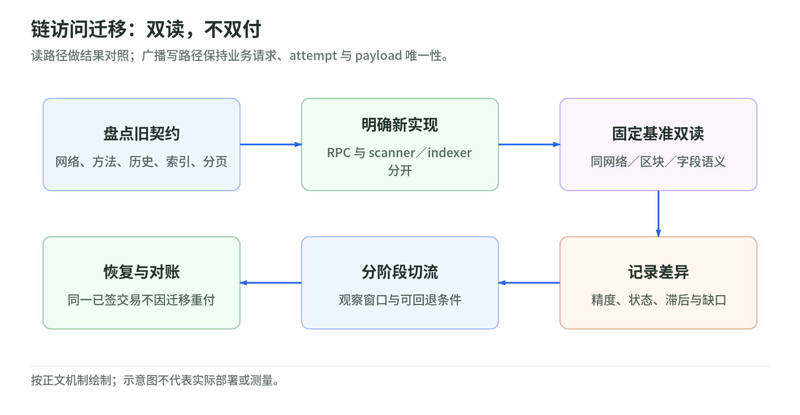
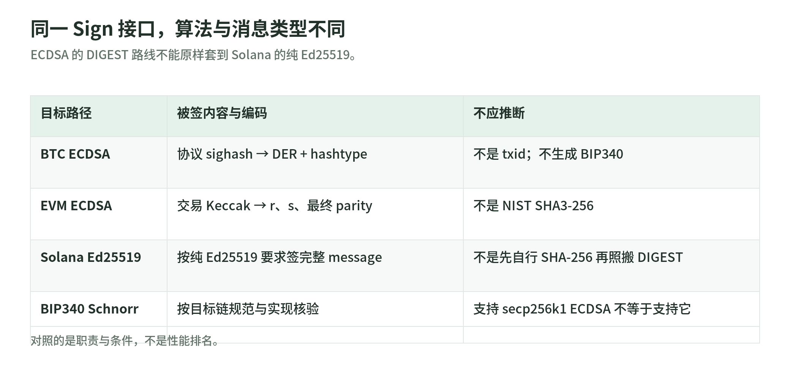

# 05｜AMB 之后的架构、CloudHSM 新世代与 Ed25519 签名

- 查阅日：2026-10-29（北京时间）
- 旧内容定位：PPT 55–59；[基础篇 07](../chapters/07-aws.md)
- 学习目标：能设计替代访问与索引层，解释新版 HSM / KMS 的输入输出及迁移边界
- 状态：官方文档支持与参考设计；没有部署、账号核验或真实签名交易

## 1. 这不是“AMB 升级成另一个 AWS 产品”

AMB 的 Access 与 Query 均在服务终止范围：2026-10-29 起不接纳新客户，2027-09-29 结束支持。AWS 给出两类方向：自管区块链节点或第三方基础设施；Query 则需要索引数据提供者。没有公告说 KMS、CloudHSM 或 Nitro Enclaves 随 AMB 一起终止。[AMB 公告](https://docs.aws.amazon.com/managed-blockchain/latest/hyperledger-fabric-dev/managed-blockchain-end-of-support.html)

升级后的理解应是**重建可替换的基础设施边界**，而不是把一个旧服务名机械改成一个新名字。

| 原依赖 | 新系统必须提供的能力 | 迁移是否要求转移链上资产 |
| --- | --- | --- |
| Access RPC | 同网络的读块、状态、fee、广播、订阅等能力 | 通常不要求；换观测 / 广播入口不是换签名密钥 |
| Query API | 地址历史、资产余额、事件索引和分页语义 | 通常不要求；需要重建索引与数据模型 |
| 旧 HSM / Client SDK | 原密钥的签名、属性、用户与可用性 | 若保留同一密钥通常不要求；先核对公钥 |
| 真正更换 signing key | 新地址 / 权限与旧地址资产清退 | 需要独立链上 / 业务迁移计划 |

最后一列是机制推论，适用于密钥控制未改变的情形，不保证所有系统都能无停机迁移。

## 2. 自管路线：Node Runners 到底是什么

AWS Blockchain Node Runners 是开源部署框架，不是托管服务。AWS 的迁移文档明确，客户承担同步、备份、监控、扩容、安全和客户端升级责任。[迁移指南](https://docs.aws.amazon.com/managed-blockchain/latest/ethereum-dev/migrating-node-rpc-workloads.html)

查阅日的维护者 README 已采用统一 CDK 应用与可插拔 blueprint。内置列表包含 Ethereum、Solana、Base、BNB Chain、Bitcoin 及 Dummy；single-node 与 HA 是两种部署模式。不能因为 README 演示安装外部 Polygon blueprint，就说 Polygon 已是内置且已由本次验证的方案。[Node Runners README](https://github.com/aws-samples/aws-blockchain-node-runners)

参考职责划分：

```text
部署框架：生成基础设施与启动配置
链客户端：同步、执行、验证、提供 RPC
读写网关：认证、方法白名单、限流、审计
索引器：从区块 / receipt / trace 派生地址与资产视图
钱包系统：审批、预留、签名、幂等、账务与对账
```

这五项不能互相冒充。部署模板可以启动节点，不会自动产生正确的钱包账本。

### 一条自管 Ethereum 读取链路

```text
执行层客户端 EL + 共识层客户端 CL
  → 同步到可信区块与 finalized 状态
  → 内网 JSON-RPC / 受控网关
  → scanner 记录区块哈希、receipt 和事件
  → 自有索引、余额视图与业务账本
```

AWS 文档提供 Geth / Lighthouse 等组合，并区分普通与 archive-capable 配置。历史 `eth_call`、storage 和 proof 需求应按具体版本与保留策略验证，不能只看“archive”标签。[Ethereum 迁移说明](https://docs.aws.amazon.com/managed-blockchain/latest/ethereum-dev/migrating-node-rpc-workloads.html)、[Geth archive](https://geth.ethereum.org/docs/fundamentals/archive)

### 自管 Bitcoin 的额外边界

私有 RPC endpoint、认证、wallet 是否启用、历史交易索引和裁剪策略要显式配置。广播器只需广播已签交易，不应为了方便接入而把节点钱包及签名能力暴露给所有读调用者。[AWS Bitcoin 迁移说明](https://docs.aws.amazon.com/managed-blockchain/latest/ethereum-dev/migrating-node-rpc-workloads.html)

设计建议：读角色 / 广播角色分开；就绪检查不只看进程 alive，还看同步状态、当前链及与第二观测源的可信高度差。不要公开未加防护的节点 RPC。

## 3. 第三方路线：先定义能力契约，再比较供应商

AWS 列出第三方托管 RPC 作为方向；这不是对某家供应商全部网络、方法、版本、可靠性或价格的担保。[官方迁移方向](https://docs.aws.amazon.com/managed-blockchain/latest/ethereum-dev/migrating-node-rpc-workloads.html)

建议业务代码依赖下列抽象，而不直接依赖某家的 JSON 结构：

```text
getNetworkIdentity()
getBlockByHash / getCanonicalBlock
getTransactionOutcome
estimateFees
submitSignedPayload
getIndexedEvents(cursor, boundedRange)
getIndexerWatermark
```

这是接口设计草案，不是任何一家服务的原生 API。适配器负责认证、限额、编码和状态映射；核心账务只消费统一对象。

| 核对维度 | 为什么不能只改 URL |
| --- | --- |
| 网络身份 | 同名 testnet 可能不是同一代网络 |
| 历史能力 | 有区块历史不等于任意历史 state / proof / trace |
| 方法与参数 | batch、压缩、日志范围、payload 大小可能不同 |
| 认证 | SigV4、API key、mTLS、私网身份不是同一种权限 |
| 数据完整性 | 索引 watermark 和 finalized 口径可能不同 |
| 广播 | 返回 hash、重复交易、超时、拒绝的响应不能混为一类 |
| 故障 | 重连后订阅可能丢失，需要可重放扫描 |

## 4. 替代 Query：钱包索引器怎样工作

<!-- illustration: deposit-reorg-131299322a -->


*图：充值扫描：去重、确认、重组与冲正。高度只表示进度；保留 blockHash、parentHash 与业务事件身份。*
<!-- /illustration: deposit-reorg-131299322a -->

节点主要按块和交易提供数据；地址历史和多资产查询通常需要派生索引。AWS 明确，Query 迁移不只是 endpoint 变化，应规范化供应商字段并验证代表性原响应。[Query 迁移说明](https://docs.aws.amazon.com/managed-blockchain/latest/hyperledger-fabric-dev/managed-blockchain-end-of-support.html)

参考自管索引流程：

1. 按 canonical 区块顺序读取；保存 height、hash、parentHash。
2. 抽取交易 / 输出 / receipt / 日志；原生币内部转移另明确 trace 或状态核对方案。
3. 映射到 `network + asset + eventKey`；金额使用最小单位整数。
4. 保存原始观察与可回滚的有效状态。
5. 派生地址历史和余额视图；维护已索引高度 / 区块哈希。
6. 遇到重组撤销旧分支，按新分支重放；对账保留冲正记录。

这些步骤是建议，不是此次实现的生产索引器。

### 教学例：同名“balance”为什么会不同

旧 Query 返回的是服务已 final 的余额；新 RPC 的 `latest` 在链头更近，新索引器可能又比节点落后若干块。三者数字不同，并不必然谁错。

对账前固定：

```text
network identity
block hash / 同一历史截止点
资产合约与精度
确认策略
indexer watermark
```

若参考点还不同，就不能用差值直接触发资金冲正。Near-tip 结果可能因传播和重组合法分歧，AWS 同样要求按 fixed blocks 或可信深度比较。[迁移比较说明](https://docs.aws.amazon.com/managed-blockchain/latest/ethereum-dev/migrating-node-rpc-workloads.html)

## 5. 实际迁移：双读，不双付

<!-- illustration: rpc-migration-5e6847698c -->


*图：链访问迁移：双读，不双付。读路径做结果对照；广播写路径保持业务请求、attempt 与 payload 唯一性。*
<!-- /illustration: rpc-migration-5e6847698c -->

下面是建议的迁移状态，不是已执行 runbook：

```text
盘点 → 建立新入口 → 同步 / 回填
  → 影子双读 → 固定参考点核对 → 逐步切读
  → 单一受控广播路由切换 → 观察与回退窗口
  → 验收后清退旧依赖
```

“双读”用来验证，“双写”必须谨慎：同一已签 payload 向多 RPC 重播与重新构造第二笔提现不同。后者可能造成重复付款。对 `BROADCAST_UNKNOWN` 继续使用原请求、nonce / outpoint 和签名字节恢复状态。

待验收：

- 原扫描 checkpoint 在新服务上仍能定位同一块。
- BTC txid / wtxid、EVM receipt / logs、token units 的映射一致。
- API 空页带 cursor、重复页、超时、429、节点落后、重连都能恢复。
- 已签交易和正在审批的请求不因切换重新扣账。
- 回滚配置不会丢失新系统已生成的请求记录。

业务审批及 KMS 的 key ARN 不必因 RPC endpoint 改变而变更；这是隔离访问层和签名层的价值。

## 6. CloudHSM 的“新”包含硬件与 Client SDK 两层

hsm1.medium 已在 2026-03-31 到达官方 end-of-support 日期；新世代 hsm2m.medium 支持文档列出的 FIPS / non-FIPS cluster modes，硬件页面列 FIPS 140-3。hsm2m 的 SDK 兼容下限为 5.9.0，不等于永远推荐该版本。[退役通知](https://docs.aws.amazon.com/cloudhsm/latest/userguide/compliance-dep-notif.html)、[硬件类型](https://docs.aws.amazon.com/cloudhsm/latest/userguide/hsm-types.html)

SDK 5 将旧 CMU / KMU 的管理职责整合到 CloudHSM CLI，不代表应用的 PKCS#11 / JCE 接口调用全部原样兼容。查阅日最新下载页列 5.18.0，但迁移概览仍写 5.16，属于文档版本漂移；选版本时以发布页、OS / 架构兼容和已知问题为准。[SDK 迁移概览](https://docs.aws.amazon.com/cloudhsm/latest/userguide/client-sdk-migration.html)、[最新发布页](https://docs.aws.amazon.com/cloudhsm/latest/userguide/latest-releases.html)

### 硬件迁移内部发生什么

官方托管迁移流程逐台备份并替换 HSM，保持对应 IP，整个集群进入 limited-write mode；签名应用仍需满足 HA 与当前 SDK 条件。另一路径是从备份建立新集群并切应用入口。[HSM 迁移流程](https://docs.aws.amazon.com/cloudhsm/latest/userguide/hsm1-to-hsm2-migration.html)

迁移文档描述的回滚窗口不能当成任何时间都能重建旧硬件的保证，尤其旧世代已退役。用户实际集群是否已自动迁移，本次没有查询。

### 钱包如何证明保留了原控制权

设计建议至少验证：

1. 用同一 key 的公钥指纹 / 地址核对恢复前后。
2. 在无价值测试向量上签名并用独立软件验签。
3. 重新读取 sensitive / extractable / 用户权限等属性。
4. 覆盖单台不可用、会话断开、CU 认证失败和并发重试。
5. 区分新生成钥匙、从备份恢复旧钥匙和真正转移资产。

若公钥变了，“HSM 可签名”不证明它仍控制原钱包。

## 7. KMS 新增 Ed25519：Solana 签名可重新评估

<!-- illustration: signing-algorithm-boundaries-b7bc1c698f -->


*图：同一 Sign 接口，算法与消息类型不同。ECDSA 的 DIGEST 路线不能原样套到 Solana 的纯 Ed25519。*
<!-- /illustration: signing-algorithm-boundaries-b7bc1c698f -->

AWS 于 **2025-11-07** 公告支持 EdDSA / Ed25519；当前 key spec 列 `ECC_NIST_EDWARDS25519`。因此不能沿用“Solana ed25519，所以 AWS KMS 一定不支持”的旧判断。支持算法也不等于本次已完成 Solana 互操作验收。[发布公告](https://aws.amazon.com/about-aws/whats-new/2025/11/aws-kms-edwards-curve-digital-signature-algorithm/)、[当前 key spec](https://docs.aws.amazon.com/kms/latest/developerguide/symm-asymm-choose-key-spec.html)

两个模式必须分清：

| 目标语义 | KMS 算法 / MessageType | 输入 |
| --- | --- | --- |
| 纯 Ed25519 | `ED25519_SHA_512` / `RAW` | 原始消息字节 |
| Ed25519ph | `ED25519_PH_SHA_512` / `DIGEST` | 对应预哈希模式的输入 |
| Bitcoin / EVM ECDSA | `ECDSA_SHA_256` / `DIGEST` | 按链计算的 32 字节摘要 |

表中前两行来自 key-spec 明确规则。后缀 `SHA_512` 不代表应用应先对普通 Solana message 做 SHA-512 再用 RAW；纯模式与 prehash 模式不可互换。[KMS 模式规则](https://docs.aws.amazon.com/kms/latest/developerguide/symm-asymm-choose-key-spec.html)

### Solana 的参考接入流程

Solana 规范要求签名为对 serialized Message 的 Ed25519 签名，而不是整笔“签名数组 + message”交易的哈希。[Solana transaction structure](https://solana.com/docs/core/transactions/transaction-structure)

由两份规范组合推导的接入设计：

```text
建立 KMS Ed25519 key 的公钥目录
  → 解析 GetPublicKey 返回的 SPKI，取得正确 32 字节公钥
  → builder 序列化目标交易版本的 Message
  → 独立 signer 解码核验账户、指令、金额、费用与 blockhash
  → KMS：纯 Ed25519 + RAW，签同一组消息字节
  → 本地 Ed25519 验签
  → 按 required signer 顺序组装签名数组
  → 持久化 → 广播 → 检查执行与当前 finality
```

GetPublicKey 返回的是 DER X.509 / SPKI，不是直接可显示为 Solana 地址的整个 blob；应用应解析而非任意截最后一段。[GetPublicKey](https://docs.aws.amazon.com/kms/latest/APIReference/API_GetPublicKey.html)

仍要验收：

- 目标 SDK 的枚举与服务端支持；某旧 Sign 页面 / SDK schema 没列新算法，不代表发布能力不存在。
- 支持的消息长度、交易版本、签名顺序与多签输入。
- blockhash 有效期是否覆盖远程签名与审批延迟。
- KMS 超时不等于交易已广播，也不等于必须改消息重付。
- IAM 最小权限与业务批准绑定，不能开放任意 RAW 字节签名接口。

## 8. Ed25519 没有顺带解决 HD、MPC 或 Taproot

KMS key spec 创建后不可原地换曲线。新增一个 Ed25519 key 通常代表另一个控制身份；不能把旧 secp256k1 key “升级”而保留同一地址。[key spec 属性](https://docs.aws.amazon.com/kms/latest/developerguide/symm-asymm-choose-key-spec.html)

当前 KMS / CloudHSM 支持列表并未因 Ed25519 增加而提供 BIP340 Schnorr 或 BIP32 / 链特定 HD 派生。CloudHSM SDK5 也列 PureEdDSA，具体硬件、mode、机制与参数要分开验证。[CloudHSM mechanisms](https://docs.aws.amazon.com/cloudhsm/latest/userguide/pkcs11-mechanisms.html)

因此新版选择仍是分层的：

```text
普通 ECDSA / Ed25519 单钥远程签名 → 评估 KMS 或 HSM
特定 HD / Taproot / 链专用签名      → 单独验证隔离软件 / 协同方案
门限批准或 MPC                     → 另定义业务与密码协议
RPC 与资产索引                     → 不依赖所选签名器名称
```

这不是生产产品推荐，也不涉及报价或合规认定。

## 9. 自测

1. 为什么 AMB Query 不能只改 URL 就迁入普通全节点？
2. 为什么保留同一 HSM key 的硬件迁移与更换 signing key 是不同操作？
3. 为什么 Solana 的 KMS 参考流程用 RAW，不照搬 Bitcoin 的 DIGEST？
4. 为什么 key spec 新增 Ed25519 不能推导出 Taproot 支持？
5. 为什么迁移验收要按 fixed block，而不是比较两个服务各自 latest？

答案线索分别在第 4、6、7、8、4–5 节。实践记录用 [实验模板](../templates/experiment-note.md)；本次只完成文档补充。

## 一手证据状态

| 资料组 | 本次确认 | 未确认 |
| --- | --- | --- |
| AMB 公告 / 迁移指南 | 官方生命周期、迁移职责、能力分类 | 用户资格、连接成功、迁移实际完成 |
| Node Runners 仓库 | 查阅日维护者公布的框架 / blueprint | 模板在目标网络的实际同步与生产可用性 |
| CloudHSM 类型 / 发布 / 迁移文档 | 新硬件与SDK条件、发布页5.18.0 | 具体密钥、属性、集群状态与算法认证结论 |
| KMS公告 / key spec / GetPublicKey | 已发布Ed25519、RAW/ph区分、SPKI | 与用户SDK、Solana消息版本的实际互操作 |
| Solana transaction structure | 消息与签名对象 | 当前交易上链效果、真实性能 |

全部链接按 2026-10-29 查阅，`latest` / `main` 可变化；本页的流程和验收矩阵是基于一手机制提出的设计。
