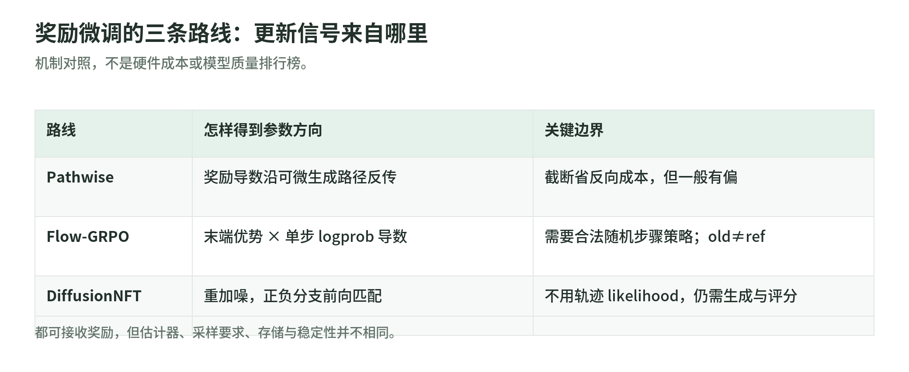
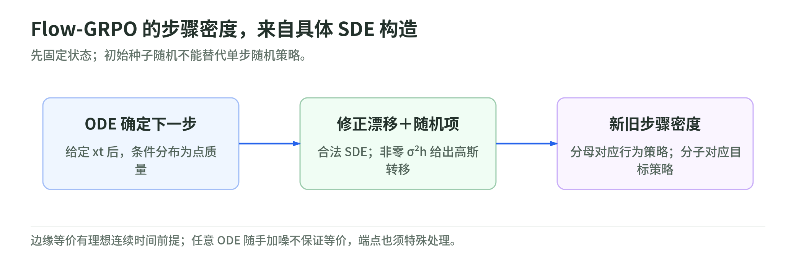

# 02 扩散模型 RL：奖励怎样穿过去噪轨迹

研究读取日：2026-11-03。[专题](README.md) · [公开来源与边界](#public-sources)

生成器收到的奖励往往只有一个数字，问题却是：这个数字怎样改变此前几十步的去噪？本文沿 Andrei Filatov 的博客梳理机制，再用一手论文与代码校正边界。博客原文日期为 2026-10-26；下文案例与手算是教学构造，不是训练复现。[博客全文][B]

## 01 从噪声到末端奖励：先看清优化对象

<!-- illustration: dif-rl-routes-8e13c2b8c6 -->

*图：奖励微调的三条路线：更新信号来自哪里。机制对照，不是硬件成本或模型质量排行榜。*
<!-- /illustration: dif-rl-routes-8e13c2b8c6 -->

提示词 $c$ 是“四只杯子”，初始噪声 $x_T\sim\mathcal N(0,I)$，去噪轨迹为 $\tau=(x_T,\ldots,x_0)$；若使用潜空间模型，还需解码 $x_0$ 才得到供评分的图像。计数器检查最终杯子数量，返回 $R(x_0,c)$。目标不是让这一次噪声碰巧成功，而是更新参数 $\theta$，使未来生成的平均奖励提高：

$$
J(\theta)=\mathbb E_{c,\tau\sim p_\theta}[R(x_0,c)].
$$

把去噪当成决策过程时，状态是 $(x_t,t,c)$，动作可以定义为下一步样本 $x_{t-1}$，奖励只在末端出现。难点在于信用分配：哪个参数变化能提高终点得分？两条主路分别利用“奖励对图像的导数”和“轨迹的概率”。前者也属于奖励微调，但不应与 score-function 策略梯度混称同一种估计器。[DRaFT §4][D] [Flow-GRPO §3–4][F]

早期偏向布局、晚期偏向细节，是有用直觉，不是固定分工；时间参数、采样器与共享权重都会影响这种划分。“第四只杯子只能在某一步加入”不是本文建立的定律。[ShortFT §3.3][S] [DRaFT 附录 B.7][D]

## 02 可微奖励：沿计算路径反传，截断换来什么

若评分网络及解码、采样运算可微，将随机性写成固定分布的噪声 $\xi$，最终图像记为 $g_\theta(\xi,c)$，就能用 pathwise／重参数化梯度：

$$
\nabla_\theta J
=\mathbb E_\xi\!\left[
(\partial_\theta g_\theta)^\top\nabla_x R(g_\theta,c)
\right].
$$

白话说，评分器不仅告诉你“杯子不好看”，还给出像素变化方向；链式法则将方向送回去噪器。这里假定奖励没有额外的显式参数依赖，并满足交换求导与期望所需条件。[DRaFT §4][D]

DRaFT 全链反传；DRaFT-$K$ 则先完成前面的采样，在最后 $K$ 步入口使用 stop-gradient。前向仍生成完整图像，少的是反向保存与计算，不是自动少做全部采样。它丢弃被截断前缀的参数依赖，因此一般是完整目标梯度的有偏近似。长链中的局部导数会相乘：

$$
\frac{\partial x_0}{\partial x_t}
=\frac{\partial x_0}{\partial x_1}\cdots
\frac{\partial x_{t-1}}{\partial x_t}.
$$

这些 Jacobian 的乘积可能放大或压低梯度；不是“步数长就必然爆炸”。论文报告的梯度范数与 $K$ 消融支持其特定实验中小 $K$ 更有效，不能外推为通用最优值。[DRaFT §5.2、附录 B.7][D]

尤其不能把截断写成“构图绝不改变”：同一参数跨时间步使用，DRaFT 附录 B.7 明确观察到，最后几步训练出的 LoRA 会影响整条链。准确说法是缺少早期直接信用信号，既不保证改好计数，也不保证早期行为不变。[DRaFT 附录 B.7][D]

ShortFT 用保留原轨迹的少步模型构造捷径，并配合分时 LoRA、渐进训练，减少长链负担。但正式方案仍包含截断；对捷径完整求导，不等于原始长链的精确梯度。训练与推理的路径差异正是它需要处理的误差来源。[ShortFT §3.2–3.3、§4.5][S]

## 03 黑盒奖励：用概率承担信用分配

硬计数、OCR 字符比较或人工评分未必提供可用导数。此时让每一步存在可计算密度的策略 $\pi_\theta$，可用 score-function／REINFORCE：

$$
\nabla_\theta J
=\mathbb E_\tau\!\left[
(R-b(c))\sum_t
\nabla_\theta\log\pi_\theta(x_{t-1}\mid x_t,c)
\right].
$$

这不需要 $\nabla_xR$：比基线好的完整轨迹，其各步概率受到正向鼓励；差的轨迹受到反向调整。更新时将采集的状态和动作当作固定数据，分别对条件概率求导，不沿整条生成链反传。[Flow-GRPO §3–4][F]

代价是信号粗：四杯成功不代表每一步都“做对”，末端奖励一起分给各步，因此可能有较高方差。与当前动作无关的基线可降方差；组内归一化另属代理构造，不是无偏性的自动保证。策略梯度避免了长链 Jacobian 乘积，但仍可能因奖励尺度、学习率或概率比而不稳定。

## 04 ODE 转 SDE：高斯 logprob 必须有合法出处

<!-- illustration: dif-rl-sde-32eb744418 -->

*图：Flow-GRPO 的步骤密度，来自具体 SDE 构造。先固定状态；初始种子随机不能替代单步随机策略。*
<!-- /illustration: dif-rl-sde-32eb744418 -->

固定当前样本后，ODE 求解器确定地产生下一步；其条件分布是 Dirac 点质量，而不是具有非零方差的普通高斯。初始噪声能使最终图像多样，但不能据此给每个确定步骤套上 Gaussian logprob。ODE 最终样本密度也不是绝对不可估计，只是那不等于这里需要的单步策略密度。[Flow-GRPO §4][F]

Flow-GRPO 给出具体的反向 SDE 构造。采用连续时间 $t\in[0,1]$、$x_t=(1-t)x_0+t\epsilon$，从噪声端向下走 $h>0$，Euler–Maruyama 的教学写法是：

$$
\begin{aligned}
d_\theta(x_t,t)
&=v_\theta(x_t,t,c)
+\frac{\sigma_t^2}{2t}
\big[x_t+(1-t)v_\theta(x_t,t,c)\big],\\
x_{t-h}
&=x_t-hd_\theta(x_t,t)+\sigma_t\sqrt h\,z,
\quad z\sim\mathcal N(0,I).
\end{aligned}
$$

于是 $\pi_\theta=\mathcal N(x_t-hd_\theta,\sigma_t^2hI)$，在方差非零的步骤上才可计算普通高斯 logprob。修正漂移项不能省略。论文取 $\sigma_t=a\sqrt{t/(1-t)}$；代码以负的 `dt` 配合 `sqrt(-dt)`，并对噪声端点作处理，不能将端点直接代入奇异式。[Flow-GRPO §4][F] [SDE 实现][FC]

“相同边缘分布”是连续时间理想构造的性质；学习误差和离散步长存在时，不代表任何 ODE 随手加噪后仍等价。转换的目的首先是探索与可计算策略，不是必然提速。论文另用训练采样 10 步、评估 40 步的 denoising reduction 降低成本，这是独立设计及限定实验结果。[Flow-GRPO §4、§5.3][F]

## 05 GRPO：组优势、概率比和约束各管一件事

同一提示生成 $G$ 个样本，组优势可写为：

$$
A_i=\frac{R_i-\bar R}{s_R+\varepsilon_{\rm num}},
\qquad
\rho_{i,t}=
\frac{\pi_\theta(x_{t-1}^{(i)}\mid x_t^{(i)},c)}
{\pi_{\rm old}(x_{t-1}^{(i)}\mid x_t^{(i)},c)}.
$$

其中 $s_R$ 为组内奖励标准差，$\varepsilon_{\rm num}$ 用来防止除零。教学例：四个奖励为 $(1,0,1,0)$，采用总体标准差并忽略微小分母保护值，优势为 $(1,-1,1,-1)$。若全组都失败，中心化优势全为零，缺少相对奖励信号；正则项仍可能产生更新。相对评分无法替代充分探索。[Flow-GRPO §4][F]

最大化的单步代理项形如：

$$
\min\!\left(\rho A,\,
\operatorname{clip}(\rho,1-\epsilon,1+\epsilon)A\right)
-\lambda D_{\rm KL}(\pi_\theta\Vert\pi_{\rm ref}).
$$

组优势回答“谁比同组好”；ratio 对照生成数据的旧策略；clipping 限制代理目标中过大的有利变化，但不是将真实策略硬锁在概率区间内。KL 则相对参考模型抑制漂移，通常是软惩罚，不保证奖励不被钻空子，也不保证末端图像分布的 KL 达到硬上限。`old` 与通常冻结的 `ref` 不应混为一谈。[Flow-GRPO §4、§5.3][F]

代码还需要细读：所核快照按潜变量维度平均 logprob，因而实现中的 ratio 不等于联合密度求和所得的严格概率比；KL 项也有缩放约定。以上公式解释标准机制，不是逐行代码复刻。[概率计算][FC] [更新实现][FU]

## 06 DiffusionNFT：奖励进入前向匹配，不是 GRPO 改名

Flow-GRPO 保存反向轨迹，再优化步骤概率。DiffusionNFT 收集干净样本与奖励，重新加噪 $x_t=(1-t)x_0+t\epsilon$，以 $v^*=\epsilon-x_0$ 为匹配目标；无需生成轨迹的 likelihood，也不要求把采样器写成上述高斯策略。[DiffusionNFT §2–3][N]

将奖励归一化成 $q\in[0,1]$，令 $\delta=v_\theta-v_{\rm old}$，并固定旧模型，核心目标为：

$$
v_\theta^\pm=v_{\rm old}\pm\beta\delta,\qquad
L=\mathbb E\!\left[
q\|v_\theta^+-v^*\|^2+
(1-q)\|v_\theta^--v^*\|^2
\right].
$$

本文用 $q$ 区分最优性权重与原始奖励；$\beta>0$ 是 NFT 分支强度，不是上节 KL 系数。忽略实际自适应权重，在 $\delta=0$ 时手算得到：

$$
\nabla_\delta L=2\beta(2q-1)(v_{\rm old}-v^*).
$$

梯度下降使好样本靠近匹配目标、坏样本远离它。这是同一个训练模型构成的正负隐式分支，不是独立训练两套生成器，也不是只留下赢家做 SFT。[DiffusionNFT §3.2][N] [分支与损失代码][NC]

区别在估计器与训练对象，不在是否都分组打分。NFT 论文给出前向过程的负样本感知优化；其理想解论证有无限数据、模型容量等条件，并非实际训练必然单调改善。软更新旧策略、自适应加权、负分支均影响稳定性。它与采样解耦，但仍要生成图像；“不用保存轨迹”不等于“没有 rollout”。[DiffusionNFT §3.2–3.3、§4.4][N]

## 07 CFG 与选型：一致性重要，性能没有统一排序

CFG 的速度组合可写为 $v_{\rm cfg}=v_u+s(v_c-v_u)$。在本章固定 guidance、噪声调度和 transition 定义的 Flow-GRPO 配方中，更新重建 guided 预测。一般 importance ratio 并不要求新旧策略的 guidance 完全相同；必要的是分母对应实际生成动作的行为策略，分子对应明确定义的目标策略。把 guided 行为策略的分母误算成 conditional 密度是错误；改用 conditional 目标策略则要明确这是目标变化，不能冒充原配方。[更新实现][FU]

博客把 CFG 开销概括为“双倍”，并报告自己常用噪声强度约 0.7。这分别是成本简化和作者经验，不是跨硬件定律。Flow-GRPO 论文确有噪声消融，但对应具体模型与奖励任务；显存还取决于批处理、分支梯度、缓存与重计算。[博客][B] [Flow-GRPO §5.3][F]

NFT 的正式实验主动不用 CFG，所核配置也将 guidance 设为 1。它不是在 guided 概率比中漏掉无条件分支，而是采用不同训练目标。论文显示 RL 可学到或替代部分 CFG 功能，不能推成任何模型都无需 CFG。[DiffusionNFT §3.3][N] [配置][NF]

| 路线 | 能利用什么 | 主要成本与风险 |
| --- | --- | --- |
| Pathwise／DRaFT／ShortFT | 可微奖励的密集方向 | 激活及奖励反传；截断或捷径误差；奖励漏洞 |
| Flow-GRPO | 黑盒评分、显式步骤策略 | 多样本生成与轨迹保存；概率比方差；采样约束 |
| DiffusionNFT | 黑盒评分、前向匹配 | 图像生成仍贵；正负权重、旧策略更新及数据质量 |

这个机制表不是算力排名。NFT 报告的最高 25 倍效率来自 SD3.5-M、指定奖励与配置下的 wall-clock 对照；ShortFT 对照则使用不同基础模型、预算与评分。不能拼成统一排行榜，也不能将可微方法视为必然落后。检测器漏检、奖励偏好单一风格、任务提升损害其他能力，三条路线都需独立评测。[DiffusionNFT §4.1、§4.3][N] [ShortFT §4.1][S] [DRaFT §5.1、附录 B.8][D]

## 08 三道自测：把机制和保证分开

1. **四杯奖励全组都是零，还能靠扩大 clipping 范围学会计数吗？**

   答：不能凭此制造相对奖励信号。需改善探索、提示分布或奖励分辨率；有正则更新也不等于有计数学习信号。

2. **ODE 各步没有额外随机性，但初始种子随机，能直接套高斯 logprob 吗？**

   答：不能。给定当前状态的确定步骤仍是点质量；需合法的随机策略／SDE 构造，或换用不依赖这类步骤 likelihood 的目标。

3. **DRaFT 只反传最后一步，所以早期构图绝不会变；NFT 不存轨迹，所以一定最快。哪句正确？**

   答：都不正确。共享参数影响整链；NFT 仍有生成、评分和匹配开销。梯度路径与行为影响不同，存储优势也不是总耗时保证。

### 公开来源与阅读边界

以下均于 **2026-11-03** 读取。论文以公开 arXiv HTML 核对方法、公式与相关实验，不声称逐篇读完全部附录或独立确认实验数值。博客正文六章、方法选择表、脚注及来源段已完整读取；AWM 未另作一手深核，故不展开其算法与速度主张。未下载权重、运行训练或调用付费模型。

| 来源／作者 | 首版日期；本次版本 | 实际读取范围 | 证据边界 |
| --- | --- | --- | --- |
| [博客：Andrei Filatov][B] | 2026-10-26；读取日页面 | 全文及公式 | 作者解释与经验，不是独立比较实验 |
| [DRaFT：Clark 等，2309.17400][D] | 2023-09-29；v2，2024-06-21 | §4、§5 相关段落；附录 B.7、B.8 | 核验截断与跨时间步影响；未重跑 |
| [ShortFT：Guo 等，2507.22604][S] | 2025-07-30；v1 | 正文 §1–5，重点 §3.3、§4.1、§4.5 | 捷径并非原长链精确梯度；未读全部补充材料 |
| [Flow-GRPO：Liu 等，2505.05470][F] | 2025-05-08；v5，2025-10-27 | 正文 §1–6，重点 §3–4、§5.3 | 构造及实验核对；未逐项审计附录证明 |
| [DiffusionNFT：Zheng 等，2509.16117][N] | 2025-09-19；v2，2026-02-16 | §2–4、算法 1；其余正文相关段落 | 理想容量假设与有限实验需区分 |
| [Flow-GRPO 官方代码][FC] | 快照 `879042c`；历史首版未追溯 | `sd3_sde_with_logprob.py` 全文件；[训练脚本关键段][FU] | 核验 SDE、ratio、clipping、CFG、KL；不是全库审计 |
| [DiffusionNFT 官方代码][NC] | 快照 `cbb14f8`；历史首版未追溯 | 训练脚本的加噪、分支、损失、软更新；[配置][NF]、README | 代码含自适应加权与额外正则，不止核心示意式 |
| [ShortFT 官方 README][SC] | 快照 `f386d11`；历史首版未追溯 | README 全文 | 当前示例为 FLUX，不能当作论文 SD1.5 实验版本已复现 |

[B]: https://anvilarth.github.io/rl-for-diffusion-part-1.html
[D]: https://arxiv.org/html/2309.17400v2
[S]: https://arxiv.org/html/2507.22604v1
[F]: https://arxiv.org/html/2505.05470v5
[N]: https://arxiv.org/html/2509.16117v2
[FC]: https://github.com/yifan123/flow_grpo/blob/879042cf5707f8b90daa98d147d7deac2317c5da/flow_grpo/diffusers_patch/sd3_sde_with_logprob.py
[FU]: https://github.com/yifan123/flow_grpo/blob/879042cf5707f8b90daa98d147d7deac2317c5da/scripts/train_sd3.py
[NC]: https://github.com/NVlabs/DiffusionNFT/blob/cbb14f84b8312b620390dfcbe2fab69c1383b104/scripts/train_nft_sd3.py
[NF]: https://github.com/NVlabs/DiffusionNFT/blob/cbb14f84b8312b620390dfcbe2fab69c1383b104/config/nft.py
[SC]: https://github.com/xiefan-guo/shortft/blob/f386d1190a9918a20705837a963380c1a21d9960/README.md
