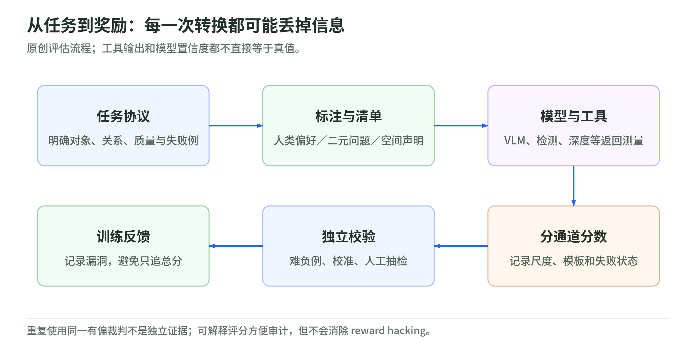
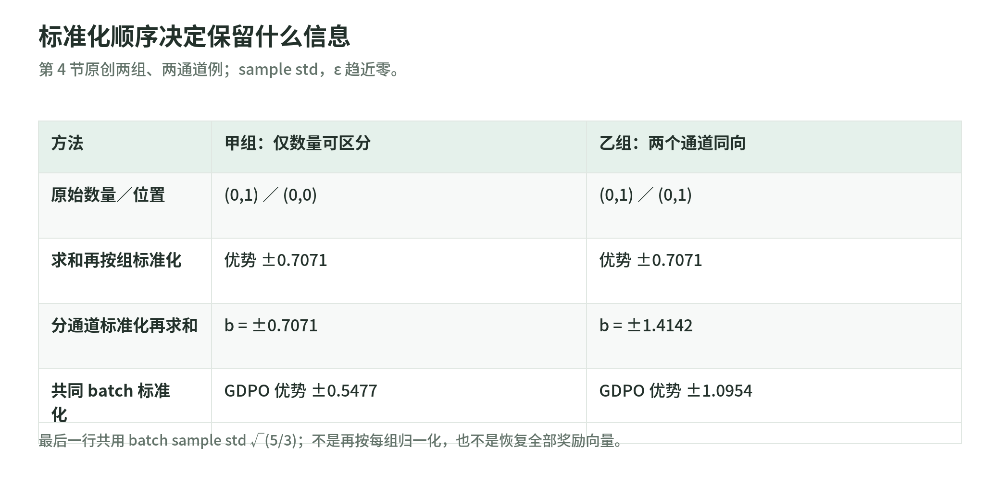

# 03 奖励设计：谁来评分，多目标怎样合并

[专题](README.md) · 核验日期：2026-11-03

奖励不是“真实质量”的别名，而是标注协议、判断模型与合并规则共同构成的代理目标。本章从博客 [RL for Diffusion models: Part 2](https://anvilarth.github.io/rl-for-diffusion-part-2.html) 出发，回查论文与评分代码；论文观察、博客建议和下文教学推导分别归属，不把 LLM 实验自动升级为扩散模型定律。

## 1. 先把“好”写成一致的标注协议

ImageReward 的顺序是先检查提示词，再逐图评分，最后对同一提示词的图片排序，且排序须与评分一致。三项七级量表实际是总体质量、图文对齐和保真度；无害性通过总体判断及问题标记进入协议，不能误写成第三个七级量表。遇到失真、缺失对象或有害内容怎样取舍，也须先说明规则。[1，§2.1、附录 A.3/B](https://arxiv.org/html/2304.05977v4#S2.SS1)

协议一致不等于所有人具有同一种审美。实践中应先用具体正反例对齐规则，保留难分优劣时的平局，并检查同一人的分项评分与最终排序是否矛盾。若只追求一个总体一致率，某类提示词上的系统性分歧可能被平均值掩盖；这是本章的标注审计建议。

偏好对训练的 Bradley–Terry 损失为

$$
\mathcal L=-\log\sigma\!\left(r_\theta(I^+,c)-r_\theta(I^-,c)\right).
$$

它学习的是协议下的相对偏好；同时给两个分数加常数，差值不变，故不能把单图分数直接解释为绝对质量概率。官方评分路径是 BLIP 特征经 MLP 输出标量，再做固定均值/标准差变换，也不是概率校准。[1，§2.2](https://arxiv.org/html/2304.05977v4#S2.SS2) [C1](https://github.com/THUDM/ImageReward/blob/78f8051059b34fef8e0032ccb40561c23a2ddbbb/ImageReward/ImageReward.py#L103)

一致性也要交代分母：ImageReward 表 2 的标注者间一致率为 65.3%±5.6%，来自另外 40 个提示词、778 对图片；VisionReward 报告图片/视频二元标注一致率为 89.29%/89.33%。数据、问题粒度与协议不同，不能据此声称“checklist 在同控实验中提高了 24 个百分点”。[1，表 2](https://arxiv.org/html/2304.05977v4#S4.SS1) [3，§3.1](https://arxiv.org/html/2412.21059v4#S3.SS1)

## 2. 从 P(yes) 到 checklist：可解释不等于可信

VQAScore 将提示词变成图像问答，概念上取 $P_\theta(\mathrm{Yes}\mid I,q(c))$，评估图文对齐而非总体质量。附录 C 讨论回答序列和 EOS；所读 CLIP-FlanT5 代码用 `exp(-平均 token 交叉熵)`，多 token 时是概率的几何平均，不是序列概率乘积。比较分数必须固定模板、分词与聚合版本。[2，§3、附录 C](https://arxiv.org/html/2404.01291v2#S3) [C2](https://github.com/linzhiqiu/t2v_metrics/blob/335e4c2c3452df52e32fe3c583d9458235e7d9e1/t2v_metrics/models/vqascore_models/clip_t5_model.py#L280)

误区是把“模型回答 yes 的概率”当作“图片确实合格的校准概率”。模型确信、对齐正确、审美优秀是不同事件。工程上应另用留出的人类标签检查校准，并测试问句改写、否定关系与难负例；这是核验建议，不是论文已给出的全面保证。

VisionReward 将多维质量拆成二元问题，论文写作 $R=\sum_k w_kx_k$、$x_k\in\{0,1\}$，用偏好对的特征差训练 logistic regression，并迭代屏蔽负权重。[3，§3.2、附录 7](https://arxiv.org/html/2412.21059v4#S3.SS2)

非负权重只保证对输入特征的单调性，不保证特征真实、覆盖完整：只查“有杯、有盘”，摆反位置仍可能满分；生成器也可能利用判别器盲点。可解释性方便定位漏洞，不会消除 hacking。代码还采用 ±1 回答、适用性 mask、截距及独立 VQAScore 通道，不能直接照搬论文的 0/1 编码和系数。[C3](https://github.com/THUDM/VisionReward/blob/511960d61a777b2008cd486a85a090ba96792a32/inference-image.py#L27)

还要区分“怎样评分”和“怎样挑训练对”。VisionReward 的 MPO 只选在每个维度都不差于另一张图的支配对，再进行 DPO；这与给所有图算加权总分不同，也与后文筛选组内相对优势的 SNR 不是同一个操作。[3，§3.3](https://arxiv.org/html/2412.21059v4#S3.SS3)

## 3. 大模型和工具：证据链也有误差

<!-- illustration: dif-reward-evidence-06959eac1b -->

*图：从任务到奖励：每一次转换都可能丢掉信息。原创评估流程；工具输出和模型置信度都不直接等于真值。*
<!-- /illustration: dif-reward-evidence-06959eac1b -->

RewardDance 的主要形式是带任务指令、参考图和推理训练的比较式生成裁判，奖励仍取 yes 概率；它另有 pointwise 变体。推理训练不意味着每次反馈都先生成完整推理：论文为效率采用“判断在前”的格式。[4，§3.2](https://arxiv.org/html/2509.08826v1#S3.SS2)

其图 5 的方差统计来自跨 1,000 次训练迭代的滑动窗口，不能换称同一提示词内的 rollout 方差。论文将大裁判保持较大波动解释为抗 hacking 证据；本章保留这一观察，不把它当独立证明。低方差还可能来自真实收敛、评分饱和或生成模式坍缩，高方差也可能来自裁判噪声；须结合独立人评与多样性检查。[4，§4.4](https://arxiv.org/html/2509.08826v1#S4.SS4)

SpatialCritic 则拆解空间声明，规划并执行检测、分割、深度等工具，再整合证据；其 RLVR 标签经过反事实构造、模型检查和人工检查。工具输出仍是测量，不自动是真值：对象错配、空间测量误差会沿证据链传播。论文也明确未测试换工具、临时失败或缺失输出的鲁棒性。[5，§3、Limitations](https://arxiv.org/html/2610.14852v1#S3)

风险判断：工具证据至少应保留对象身份、坐标参考系、输出版本和失败状态，让人能够复核“左侧”究竟相对谁。重复调用同一有偏工具，不等于获得独立证据；把错误输出交给更大的语言模型总结，也不会自动纠正测量。

Qwen 的 pointwise 奖励取离散评分分布的期望 $\sum_s sP_\theta(s\mid I,c)$。它在所述视觉质量实验中优于 pairwise，不等于绝对评分天然校准、或近似图片总能产生非零优势。[8，§3.1](https://arxiv.org/html/2606.27608v1#S3.SS1)

## 4. GRPO 与 GDPO：标准化的顺序会改变信号

<!-- illustration: dif-reward-composition-e6830efc6f -->

*图：标准化顺序决定保留什么信息。第 4 节原创两组、两通道例；sample std，ε 趋近零。*
<!-- /illustration: dif-reward-composition-e6830efc6f -->

对一个提示词采样 $G$ 张图，$r_{jk}$ 是第 $j$ 张图的第 $k$ 通道奖励。本文权重非负；$Z_g(v)=(v-\bar v_g)/(s_g(v)+\epsilon)$。GRPO 的多奖励直接用法先加权求和再算组内 std；GDPO 先逐通道算组内 std，再加权，最后对整个 batch 统一标准化：[6，式 1–7](https://arxiv.org/html/2601.05242v1#S3)

$$
R_j=\sum_k w_kr_{jk},\qquad A_j^{\rm GRPO}=Z_g(R)_j;
$$

$$
a_{jk}=Z_g(r_{\cdot k})_j,\quad b_j=\sum_k w_ka_{jk},
\qquad A_j^{\rm GDPO}=\frac{b_j-\bar b_B}{s_B(b)+\epsilon}.
$$

不能省略 std 约定：

$$
s_{\rm pop}(v)=\sqrt{\frac{\sum_j(v_j-\bar v)^2}{G}},\qquad
s_{\rm sample}(v)=\sqrt{\frac{\sum_j(v_j-\bar v)^2}{G-1}}.
$$

sample 要求 $G\ge2$。所核 TRL 实现组内与 batch 都调用默认 `torch.std`，即 sample std，并在两个分母加 $10^{-4}$；论文式 4 省略组内 epsilon，而式 6 明示 batch epsilon。不要把稳定常数和 PPO clipping 的 epsilon 混为一谈。[C4](https://github.com/NVlabs/GDPO/blob/4ad86b4fbfc5db594f3a2750ff9c39fdc8ee6115/trl-GDPO/trl-0.18.0-gdpo/trl/trainer/grpo_trainer.py#L1217) [PyTorch 2.7](https://docs.pytorch.org/docs/2.7/generated/torch.std.html)

自构例：甲提示词要求“两只红杯位于蓝盘左侧”，乙要求“两只绿杯位于白盘左侧”，均只演示数量和位置两个奖励通道。取等权、sample std，为便于手算令 $\epsilon\to0$，零方差通道的优势定义为 0；两个提示词组放进同一个 batch：

| 组 | 两张图的数量奖励 | 位置奖励 | 求和后 GRPO 优势 | GDPO 的 batch 标准化前 $b$ |
| --- | --- | --- | --- | --- |
| 甲 | (0,1) | (0,0) | (−0.7071,+0.7071) | (−0.7071,+0.7071) |
| 乙 | (0,1) | (0,1) | (−0.7071,+0.7071) | (−1.4142,+1.4142) |

四个 $b$ 的均值为 0，sample std 为 $\sqrt{5/3}$，故最终甲为 ±0.5477、乙为 ±1.0954。若用 population std，组内先得到 ±1/±2，最终为 ±0.6325/±1.2649。共同 batch 缩放保留本例的差别；若各组分别再标准化，差别又被抹平。有限 epsilon 时数字会略变，不能冒充精确实测。

这解决部分尺度与信息压缩问题，不会恢复完整奖励向量，也不会自动决定价值优先级；方差极小的噪声通道仍须警惕。

标准化后的“正”只表示优于当前组平均，不表示过了绝对合格线。对正比例缩放的去单位效果，在 std 远大于 epsilon 时才近似成立；缩放到与 epsilon 同量级就会改变优势。所读代码先 gather 再统计，亦提醒复现者不要误用各设备自己的局部 batch。[C4](https://github.com/NVlabs/GDPO/blob/4ad86b4fbfc5db594f3a2750ff9c39fdc8ee6115/trl-GDPO/trl-0.18.0-gdpo/trl/trainer/grpo_trainer.py#L1217)

## 5. 用 gating 保住前提，而不把门槛当真值

GDPO 的条件奖励让次要目标只在主要目标过线后计入：

$$
\tilde r_{\rm aesthetic}
=\mathbf1[r_{\rm alignment}\ge t]\,r_{\rm aesthetic}.
$$

应先门控原始奖励，再进入标准化。自构反例：合格性 $h\in\{0,1\}$，美学 $a\in[0,1]$。直接用 $h+2a$，失败但漂亮的 $(0,1)$ 得 2，合格的 $(1,0.1)$ 只得 1.2；改成 $h+2ha$，前者为 0，后者仍为 1.2。[6，式 8、§4.2.1](https://arxiv.org/html/2601.05242v1#S3.SS2)

门控阻止次要原始奖励补偿前提失败；它不是“所有合格样本都得到正优势”的保证，也不能修复错误的合格裁判。失败样本标准化后仍可能得到负优势；阈值误判会同时阻断次要学习。论文实验主要是 LLM 正确性与长度等目标，“对齐通过才奖美学”是本章迁移设计，不是已复现的扩散实验。

## 6. 冲突过滤与动态采样：丢弃不等于解决

GD²PO 对逐通道优势定义

$$
\mathrm{SNR}_j=
\frac{|\sum_k w_ka_{jk}|}{\sum_k|w_ka_{jk}|+\epsilon_{\rm snr}},
\qquad \delta_j=\mathbf1[\mathrm{SNR}_j>\tau].
$$

它是抵消程度指标，不是对外部测量噪声的直接估计。同向非零信号趋近 1，不因 epsilon 而精确等于 1；硬过滤把零优势视为中性。论文还用保留比例 $q_g=G^{-1}\sum_j\delta_j$ 调整该提示词的更新强度，而非仅删样本。[7，§3.1–3.3](https://arxiv.org/html/2606.16771v1#S3)

自构 $(a_1,a_2)=(2,-2)$ 的合并优势为零、SNR 为零，但“对齐好而结构坏”的向量仍有诊断和权衡信息。过滤只是选择训练信号，会改变训练分布；“冲突样本没有信息”是误区。所读脚本默认 $\tau=0.8$，不是通用最优值；代码只对混合正负号且比值低于阈值者过滤，等号/全零边界并不完全等同上述论文式。[C5](https://github.com/Qwen-Applications/GD2PO/blob/f1ad765bc9a330e6cf387f95e9c1e5a6c4bb2d02/tool-calling/verl/trainer/ppo/ray_trainer.py#L323)

保留比例也不是校准置信度：论文的可靠性分析依赖保留更新近似独立等简化假设。代码把这个比例乘在 masked whitening 之前，因此这里只核验其机制，不宣称它与论文最终目标逐点等价。[7，§3.2](https://arxiv.org/html/2606.16771v1#S3.SS2) [C5](https://github.com/Qwen-Applications/GD2PO/blob/f1ad765bc9a330e6cf387f95e9c1e5a6c4bb2d02/tool-calling/verl/trainer/ppo/ray_trainer.py#L354)

DAPO 动态采样的二元正确性约束是 $0<N_{\mathrm{correct}}<G$，其中 $N_{\mathrm{correct}}$ 是组内正确样本数：全对与全错的组都丢掉，并补采到有效 batch。零方差只说明当前评分没有相对信号；全错、评分失灵或探索不足都可能如此。小而非零 std 会放大细微差异；真正全等时，在有限 epsilon 下优势为零，不是除法必然爆炸。[9，§3.2、算法 1](https://arxiv.org/html/2503.14476v2#S3.SS2) [C6](https://github.com/verl-project/verl/blob/8b33abd84f360473f05e5a750aef36e974340cce/recipe/dapo/dapo_ray_trainer.py#L179)

其 Clip-Higher 将比率裁剪写成 $[1-\epsilon_{\rm low},1+\epsilon_{\rm high}]$，实验取 0.2/0.28；这是 clipped surrogate 的参数，不是模型概率更新的硬约束。GDPO/GD²PO/DAPO 的这些实验均在 LLM 上。[9，§3.1、§4.1](https://arxiv.org/html/2503.14476v2#S3.SS1)

监控建议是分别保存每通道的均值、组内 std、合并前后的优势和丢组原因。总奖励零方差也可能只是多目标抵消，并非每个通道都没有区分力；动态补采还会增加生成成本，应设预算和停止条件，不能把有效 batch 填满视为任务完全解决。

Qwen 报告确有分通道 std、按提示词类别赋权、组内 reward range 预筛，但式 13 未完整规定 batch scale、epsilon 或权重数值。因此它支持这些机制在该扩散系统的使用，不能代替完整 GDPO 复现配方。[8，§4.1–4.2](https://arxiv.org/html/2606.27608v1#S4)

博客接受收敛的建议以“奖励达上限、图像确实好”为前提，不能简化成“低 std 就收敛”，这些前提仍须独立核验。其“无 KL 必然发散”的经验说法也不是通用定理：DAPO 在其长推理设置移除了 KL，不能据此反向断言视觉偏好训练总不需要 KL。[博客，Chapter 5](https://anvilarth.github.io/rl-for-diffusion-part-2.html#reward-advantage) [9，§2.3](https://arxiv.org/html/2503.14476v2#S2.SS3)

## 7. 三道自测与答案

1. 裁判的 $P(\mathrm{Yes})=0.98$，可以报告“98% 概率图片高质量”吗？

   答案：不可以。须先明确问句对应的事件，固定评分实现，再用独立标签检验校准；对齐和总体质量也不同。

2. 第 4 节乙组为什么不是“最终优势 ±1.4142”？

   答案：那只是分通道标准化后求和的 $b$。同 batch 还要除以 $\sqrt{5/3}$，得到 ±1.0954；单独再按组标准化会抹掉组间差别。

3. 一组奖励全为 0，另一组有正负通道互相抵消。丢弃它们是否证明任务解决？

   答案：前者可能全失败或裁判无分辨力；后者仍含冲突信息。应保留失败/冲突诊断，并用独立评分检查，而非凭丢组比例宣布成功。

## 8. 一手来源、版本与核验边界

全部读取日期为 2026-11-03。日期“首发”按 arXiv v1，而非会议日期；代码日期为所读 commit 快照日期，不冒称首次发布。正文只引用下列实读范围，未逐项审核所有 benchmark、下载权重、训练或调用付费模型。

| 编号与来源 | 首发／所读版本日期 | 实读范围与边界 |
| --- | --- | --- |
| 博客：Filatov，[RL for Diffusion models: Part 2](https://anvilarth.github.io/rl-for-diffusion-part-2.html) | 2026-10-28；无版本号，读取当日页面 | 全文；作为线索与经验建议，不是实验一手证据 |
| 1：Xu 等，[ImageReward](https://arxiv.org/abs/2304.05977v4) | 2023-04-12；v4：2023-12-28 | §2.1–2.2、表 2、附录 A.3/B；未重跑 ReFL |
| 2：Lin 等，[Evaluating Text-to-Visual Generation with Image-to-Text Generation](https://arxiv.org/abs/2404.01291v2) | 2024-04-01；v2：2024-06-18 | §3、图 1、附录 C；不展开全部评测 |
| 3：Xu 等，[VisionReward](https://arxiv.org/abs/2412.21059v4) | 2024-12-30；v4：2026-01-05 | §3.1–3.3、附录 7 的权重算法及部分 checklist；也对照 v1 相关方法，非全量 bench 审计 |
| 4：Wu 等，[RewardDance: Reward Scaling in Visual Generation](https://arxiv.org/abs/2509.08826v1) | 2025-09-10；v1，同日 | §3.2、§4.4 方差定义及图 5/6 说明；未核训练代码或复现 scaling |
| 5：Tan 等，[Getting Space Right: Agentic Rewards for Image Generation](https://arxiv.org/abs/2610.14852v1) | 2026-10-10；v1，同日 | §3.1–3.3、Limitations/伦理说明；不把相关工作的 SpatialReward 仓库误认成本论文实现，未核其代码 |
| 6：Liu 等，[GDPO](https://arxiv.org/abs/2601.05242v1) | 2026-01-08；v1，同日 | §2–3、式 1–8、实验设置及 §4.2.1；实读公式，未重跑 LLM 实验 |
| 7：Liu 等，[GD²PO](https://arxiv.org/abs/2606.16771v1) | 2026-06-15；v1，同日 | §2–3、式 7–20、§4.1/4.4、附录 A.3；未独立复现阈值最优性 |
| 8：Xu 等，[Qwen-Image-2.0-RL Technical Report](https://arxiv.org/abs/2606.27608v1) | 2026-06-25；v1，同日 | §3.1–3.3、§4.1–4.2 与式 13；不扩展完整榜单、未核训练代码 |
| 9：Yu 等，[DAPO: An Open-Source LLM Reinforcement Learning System at Scale](https://arxiv.org/abs/2503.14476v2) | 2025-03-18；v2：2025-05-20 | §2.3、§3.1–3.3、算法 1、§4.1；真实读取裁剪及动态采样公式 |
| C1：[ImageReward 评分代码](https://github.com/THUDM/ImageReward/blob/78f8051059b34fef8e0032ccb40561c23a2ddbbb/ImageReward/ImageReward.py) | `78f8051`：2025-10-29 | `score`/`inference_rank`、固定归一化；仅静态阅读 |
| C2：[VQAScore CLIP-FlanT5 代码](https://github.com/linzhiqiu/t2v_metrics/blob/335e4c2c3452df52e32fe3c583d9458235e7d9e1/t2v_metrics/models/vqascore_models/clip_t5_model.py) | `335e4c2`：2025-05-26 | 模板与 `forward`；刻意固定旧实现，不混同后续模型接口 |
| C3：[VisionReward 图像推理代码](https://github.com/THUDM/VisionReward/blob/511960d61a777b2008cd486a85a090ba96792a32/inference-image.py) | `511960d`：2025-03-26 | `cal_score` 的编码、mask、合并；未审核权重拟合训练实现 |
| C4：[GDPO TRL 实现](https://github.com/NVlabs/GDPO/blob/4ad86b4fbfc5db594f3a2750ff9c39fdc8ee6115/trl-GDPO/trl-0.18.0-gdpo/trl/trainer/grpo_trainer.py#L1217) | `4ad86b4`：2026-05-20 | gather→逐通道 std→加权→batch std；不代表所有后端数值约定相同 |
| C5：[GD²PO 过滤实现](https://github.com/Qwen-Applications/GD2PO/blob/f1ad765bc9a330e6cf387f95e9c1e5a6c4bb2d02/tool-calling/verl/trainer/ppo/ray_trainer.py#L243) 与 [SNR 脚本](https://github.com/Qwen-Applications/GD2PO/blob/f1ad765bc9a330e6cf387f95e9c1e5a6c4bb2d02/tool-calling/scripts/correctness_length/train_gd2po_snr.sh) | `f1ad765`：2026-06-16 | 通道优势、mixed-sign、阈值、保留比例和 masked whitening；脚本默认 0.8，helper 默认 0.2，不能脱离入口比较 |
| C6：[verl DAPO 动态采样](https://github.com/verl-project/verl/blob/8b33abd84f360473f05e5a750aef36e974340cce/recipe/dapo/dapo_ray_trainer.py#L179) | `8b33abd`：2025-06-30 | 按 uid 统计 `np.std`、保留及补采循环；这是固定历史版本，不是最新版维护保证 |
| 数值约定：[PyTorch `torch.std`](https://docs.pytorch.org/docs/2.7/generated/torch.std.html) | 2.7 文档；页面未标独立发布日期 | 核验默认 `correction=1`；没有运行上述模型代码 |

本章数学例为原创手算与纯算术核对，不是论文实验；gating 的美学迁移、校准与误差诊断属于工程判断。
