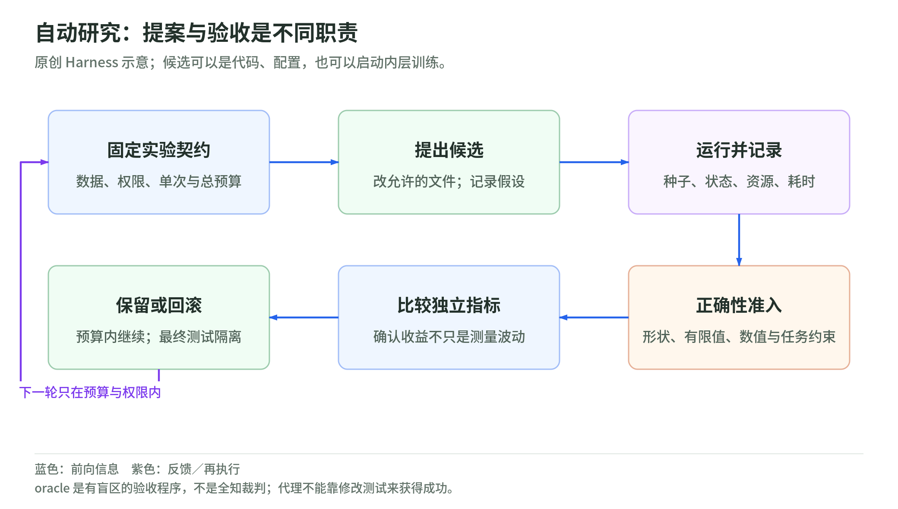
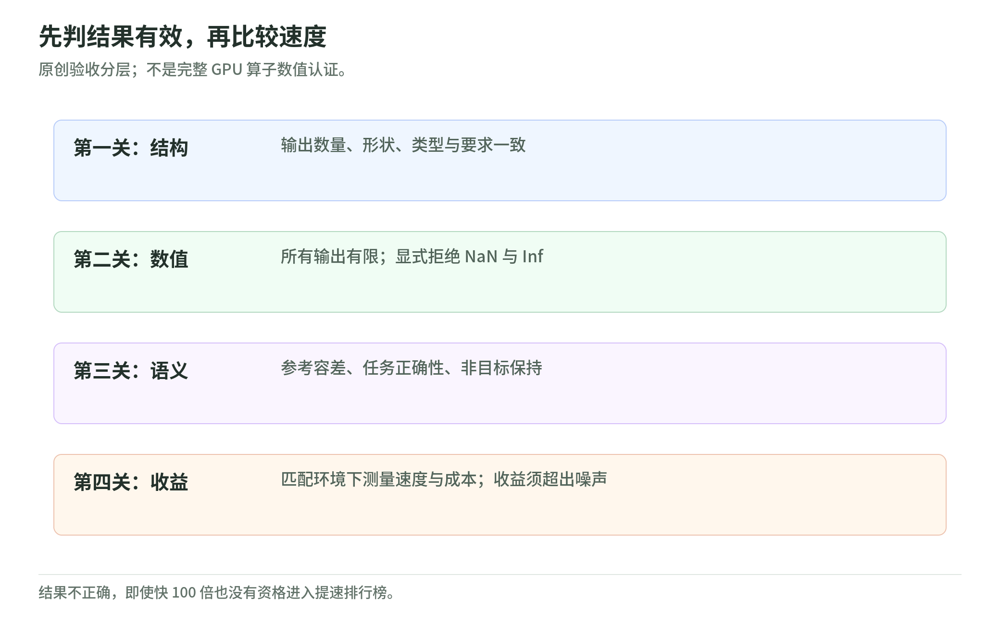

# 04 Autoresearch：自动研究首先是评估器设计

研究日期：2026-11-03。[返回专题](README.md)。

对应原文：[Age of Autoresearch](https://anvilarth.github.io/autoresearch.html)。作者讲述自己把假设测试交给代理后的经验。本章保留“谁判断成功，比谁提出方案更关键”的启发，但不把个人提速、模型排名或数学发现的归因当成已复现实验。

## 1. 它自动化的是搜索闭环，不一定是权重更新

<!-- illustration: dif-autoresearch-cycle-c0eb59e3b4 -->

*图：自动研究：提案与验收是不同职责。原创 Harness 示意；候选可以是代码、配置，也可以启动内层训练。*
<!-- /illustration: dif-autoresearch-cycle-c0eb59e3b4 -->

设想要优化一段图像去字流水线。代理可以换检测器、调整裁剪、改修补代码；每次产出的是程序或配置，而不是必然得到一组经过 RL 更新的模型权重。

自动研究可以分成四个角色：**提案者**提出候选，**执行器**运行候选，**评估器／oracle**判断结果，**选择器**保留候选并安排下一轮。“Oracle”在这里不是全知的神谕，只是我们实现的验收机制。评估器看不见的小字残留，搜索也不会主动为它负责。

[AlphaEvolve 的官方说明](https://deepmind.google/blog/alphaevolve-a-gemini-powered-coding-agent-for-designing-advanced-algorithms/)描述了语言模型提出程序、自动评估器执行并评分、演化搜索管理候选的机制。它说明这种闭环有具体实现，不证明任何领域都能得到同样收益。

与前面的[扩散 RL](02-rl-through-denoising.md)对照：RL 的优化对象是生成策略的参数；自动研究的外层可以优化代码、采样器、奖励清单，也可以启动内层训练。两层都可能对自己的评分器过拟合。

## 2. 五分钟预算，怎样变成实验契约

[Karpathy 的 autoresearch 仓库](https://github.com/karpathy/autoresearch)把修改面分开：`train.py` 是代理的研究对象；`prepare.py` 包含固定的数据准备与评估机制，不属于随意修改范围；`program.md` 给代理规定研究流程。README 的单次训练预算为五分钟，启动和编译不算在内，主要比较越低越好的 `val_bpb`。

这是**这份实现的协议**，不是所有 Autoresearch 的定义。固定墙钟时间回答“在这些机器与环境下，同样时间能得到什么”，不等于固定训练 token 数或固定 FLOPs。更快的实现可能处理更多数据；换硬件不能仅凭相同五分钟就宣布公平胜出。

原创教学实验卡可以这样写：

| 固定项 | 修改项 | 必须记录 |
| --- | --- | --- |
| 数据划分、分词与评估口径 | 允许范围内的模型／优化器／实现 | 代码差异、种子、运行状态 |
| 单次预算与总预算 | 明确允许的数据采样策略 | 已处理 token、耗时与显存 |
| 验收阈值、硬件与软件 | 不允许改评估器来“改善成绩” | 数值正确性、指标与失败原因 |

五分钟只是内层实验时间。外层推理、候选数量、失败运行、编译以及最终复核都要计费。只展示最好一轮会隐藏搜索成本。

## 3. 先通过正确性，再谈速度

<!-- illustration: dif-oracle-gates-321841c83a -->

*图：先判结果有效，再比较速度。原创验收分层；不是完整 GPU 算子数值认证。*
<!-- /illustration: dif-oracle-gates-321841c83a -->

原文报告过一个失败：程序变快了，但训练损失成了 NaN；另一个失败是整图评分遗漏了局部去字残留。这是作者经验，不是我们重新运行得到的结果。[原文第四章](https://anvilarth.github.io/autoresearch.html)

教学验收采用词典序：先检查硬约束，再比较目标分数。输出尺寸不对、出现 NaN／Inf、偏离规定的数值容差，或者超过资源上限，就没有资格进入“更快”的排名。

例如参考输出为 `(0.2, 0.4)`，新输出为 `(0.2, NaN)`，哪怕耗时从 100 ms 降到 1 ms 也必须拒绝。若新输出正确且只快 2%，则需要检查测量波动后再决定是否保留。NaN 不能通过普通大小比较侥幸逃脱，要显式检查所有数值有限。

“Loss parity”也应具体化：比较哪些输入、哪些张量、前向还是梯度、绝对还是相对误差？浮点计算改变归约顺序后，位级完全相等不一定合理；反过来，单个 loss 接近也不证明每个中间步骤等价。应使用匹配精度、覆盖边界的测试与预先设定的容差。

本课的[标准库实验](lab.md)只演示有限值、形状与输出容差的验收，不模拟完整 GPU 训练正确性。

## 4. 检查区域、评分器和最终测试都要隔离

把检查从整图缩到文字区域，能让评估器更敏感；但若只看这个裁剪，模型也可能破坏外围。一个合理的检查组合包括目标局部、非目标保持、整体质量，而不是把某个裁剪分数无限增大。

这是原创工程建议：把数据分为探索集、用于确认候选的保留集、最后一次使用的最终测试。搜索可以反复用探索集；最终测试不应在每轮失败后反馈给代理。最终集一旦反复用于挑选方案，就已变成另一份验证集。

模型裁判能评审开放式结果，却可能受呈现顺序、语气、长度与提示诱导影响。能确定计算的部分尽量用程序检查；其余部分用盲测、随机顺序、多种检查与人工抽检补充。它与[奖励设计](03-rewards-judges-and-advantages.md)中的 reward hacking 是同一个问题：评分能升，真实任务却未必改善。

## 5. 自治范围必须比能力描述更具体

下面是教学 Harness 的边界，不是让代理无条件照抄外部仓库的执行指令：

- 文件权限：允许改哪里；评测代码和持出数据只读。
- 资源权限：最长运行、最大并发、内存与计算总预算；不无限重试。
- 外部权限：不能把私有数据上传到评分服务；不能自行购买算力或发布结果。
- 保留机制：每个候选有快照；超时、失败、错误结果都有可追溯记录。
- 停止机制：耗尽预算、收益低于噪声、正确性回归或需要新授权时停止。

把十个代理并行启动，不会自动得到十倍有效实验。共享 GPU、相互覆盖文件、冷热缓存差异都会污染测量。能并行的独立任务与争用同一资源的训练任务，应分别调度。

这些约束既影响安全，也影响研究可信度：别人能否在相同协议下判断这个候选为什么被接受。

## 6. 原文哪些可以带走，哪些暂时不能

**可以带走的机制判断**：提案、运行、评分、选择、回滚可以形成自动闭环；验收器的盲区会改变搜索结果；人仍需要决定任务、资源和证据标准。

**不能直接带走的结论**：一个作者在一个任务上得到的提速，不构成通用模型排行榜；数学候选的真伪、形式化检查、发现归因是不同问题。即使某个精确定义的反例可以计算验证，也不能推成“数学领域永远不存在可钻空子的 oracle”。检查器也会漏条件、用错数域或检验错命题。

本章不展开原文的数学突破与职业替代叙述，因为它们不是构建实验闭环所需的证据；也没有下载模型、训练模型、调用评分 API 或重跑作者的研究。

## 7. 三道自测与参考答案

1. 程序快十倍，但一半输入产生 Inf，应保留吗？
2. 两张不同型号 GPU 都跑五分钟，能直接比较谁的模型架构更好吗？
3. 每次调参都把最终测试失败题交给代理，还能称为未见测试吗？

参考答案：①拒绝，正确性是准入条件。②不能，先明确比较的是硬件预算下的结果还是固定计算量下的架构，记录实际数据量和环境。③不能，最终测试已经参与搜索，需另设隔离测试并披露此前的反馈。

## 一手来源与阅读边界

以下均于 2026-11-03 阅读；动态页面为当日版本。

| 来源 | 已读范围 | 支持什么／不支持什么 |
| --- | --- | --- |
| [Filatov：Age of Autoresearch](https://anvilarth.github.io/autoresearch.html) | 英文全文，重点失败与闭环 | 作者的经验与观点；无独立复跑，不据此排名模型 |
| [karpathy/autoresearch](https://github.com/karpathy/autoresearch) | `master` README 的流程、文件分工、预算与指标 | 特定实现契约；未执行安装、下载与训练 |
| [AlphaEvolve 官方介绍，2025-05-14](https://deepmind.google/blog/alphaevolve-a-gemini-powered-coding-agent-for-designing-advanced-algorithms/) | 架构与自动评估／演化选择说明 | 机制背景；不将展示案例提速外推到任意任务 |

下一章：[GPU 的执行与内存](05-gpu-and-memory-roofline.md)。
