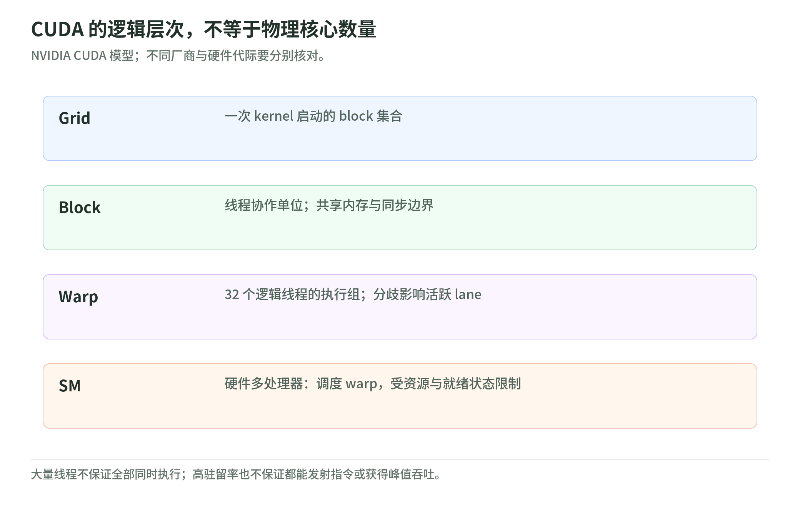
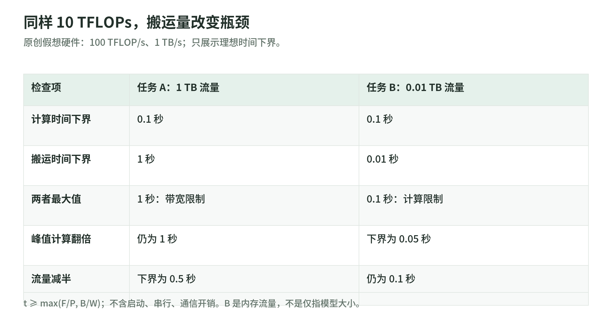

# 05 GPU：并行之外，还要理解内存和 Roofline

研究日期：2026-11-03。[返回专题](README.md)。

对应原文：[GPU Story](https://anvilarth.github.io/gpu-story.html)。它用图形渲染解释并行、着色器、CUDA 与矩阵专用单元。本章沿这条直觉路线学习，但不逐年复述产品规格、价格与未来路线图，重点是能帮助你诊断深度学习性能的计算模型。

## 1. 同一种操作，处理许多不同的数据

给一百万个向量做同一种变换，是容易分解的任务：每个输出可以由对应输入独立计算。与此相反，沿着很长的依赖链逐步决策，后一步必须等前一步。可并行工作量和依赖结构，比“GPU 核心多”更能解释为什么某项任务适合加速。

原文用大量顶点、像素执行相似计算来建立直觉。这不是说整幅图的所有计算都独立；深度、混合、同步与数据依赖仍存在。也不是说 CPU 没有并行：CPU 同样具有多核、向量指令、乱序执行与缓存；只是对不同工作负载有不同的吞吐／延迟取舍。

[CUDA Programming Model](https://docs.nvidia.com/cuda/cuda-programming-guide/01-introduction/programming-model.html)把线程组织为 block 与 grid。程序员描述工作划分，硬件调度运行；抽象线程数不能直接等同于同一时刻工作的物理算术单元数。

## 2. Thread、Block、Warp、SM 不是四种“核心”

<!-- illustration: dif-gpu-execution-7ea6925f0b -->

*图：CUDA 的逻辑层次，不等于物理核心数量。NVIDIA CUDA 模型；不同厂商与硬件代际要分别核对。*
<!-- /illustration: dif-gpu-execution-7ea6925f0b -->

以 NVIDIA 的 CUDA 模型为例：thread 是一个逻辑执行实例；block 内线程可以通过共享内存与同步协作；grid 是这次启动的 block 集合；SM 是实际执行 block／warp 的硬件多处理器。一个 block 可以包含多个 warp。

[Writing SIMT Kernels](https://docs.nvidia.com/cuda/cuda-programming-guide/02-basics/writing-cuda-kernels.html)说明 warp 为 32 个线程的执行组。SIMT 保留每线程的逻辑状态，但组内共同执行指令的效率受到活跃线程和分支路径的影响。它不意味着“32 个线程永远只在一个时钟内完成一条任意指令”，也不能用一个简化图推出芯片的精确单元配比。

原创直觉例：32 个线程中有 16 个走慢分支，另外 16 个走另一分支，分歧可能让部分 lane 在相应路径上不活跃。能把数据分组减少分歧，可能改善效率；但先要看实际代码与剖析结果。现代独立线程调度和谓词化意味着不能机械宣称每次 `if` 都把耗时翻倍。

## 3. 内存层级：GPU 也有缓存

最容易误读的说法是“CPU 靠缓存，GPU 不靠缓存”。更准确的是，GPU 同时利用存储层级和许多可运行 warp 来隐藏延迟。[Nsight Compute 的 Memory Chart](https://docs.nvidia.com/nsight-compute/ProfilingGuide/index.html#memory-chart)明确区分寄存器相关资源、L1／共享内存、L2 与设备内存等路径。

把 HBM 想成大仓库，把片上缓存和共享内存想成近处工作台，是有用的比喻，但要记住：共享内存是程序管理的，cache 是硬件管理的；二者可能共享部分物理资源，却不是同一种程序语义。局部变量也不保证永远在寄存器里，寄存器不足可能产生 spill。

延迟隐藏的条件是存在其他就绪 warp。当所有 warp 都在等同一类访存，或寄存器／共享内存占用限制了驻留数量，调度器不能凭空创造有用计算。[Nsight 的 SchedulerStats 与 Occupancy 说明](https://docs.nvidia.com/nsight-compute/ProfilingGuide/index.html#sections-and-rules)支持这个判断；高 occupancy 也不保证最短耗时。

## 4. Tensor Core：加速的是受约束的矩阵计算

深度学习里大量工作可以写成矩阵乘加。Tensor Core 为这种模式提供专用指令；算法仍需处理索引、激活、归一化、采样、数据移动等其他工作。CUDA 并未因专用单元出现而失去意义。

[Writing Tile Kernels](https://docs.nvidia.com/cuda/cuda-programming-guide/02-basics/writing-tile-kernels.html)把 tile 计算、数据搬运和矩阵运算组合起来。要获得专用吞吐，需要匹配形状、布局、对齐、数据类型和指令路径。低精度计算还涉及缩放、溢出、误差与累加精度；不能简单推出“精度减半，整个模型速度翻倍且质量不变”。

同样不要把 GPU 写成“每做一次乘加就回 HBM”，把 TPU 写成“整个模型只读一次权重”。两者都考虑数据复用。[第一代 TPU 论文](https://arxiv.org/abs/1704.04760v1)讨论特定矩阵计算与片上存储设计，它不能当作今天所有加速器的普遍性能排名。本章只用它说明：算术单元、近端存储和数据流可以共同设计。

## 5. Roofline：算得快，还是搬得快

<!-- illustration: dif-gpu-roofline-0f03fe5e66 -->

*图：同样 10 TFLOPs，搬运量改变瓶颈。原创假想硬件：100 TFLOP/s、1 TB/s；只展示理想时间下界。*
<!-- /illustration: dif-gpu-roofline-0f03fe5e66 -->

先忽略启动、通信与串行部分。设算术工作为 $F$ FLOPs，跨所分析内存层级的流量为 $B$ bytes，可用峰值为 $P$ FLOP/s，带宽为 $W$ bytes/s。理想时间下界为：

$$
t_{\min}=\max\left(\frac{F}{P},\frac{B}{W}\right),
\qquad I=\frac{F}{B},
\qquad P_{\mathrm{attainable}}\leq\min(P,WI).
$$

这里的 $B$ 是搬运量，不是“模型文件有多大”；缓存复用、批量与中间读写都会改变它。下界不是实际延迟预测。[Nsight Compute 的 Roofline 章节](https://docs.nvidia.com/nsight-compute/ProfilingGuide/index.html#roofline-charts)将算术强度、计算峰值、带宽放在同一张图中分析。

原创假想硬件：$P=100$ TFLOP/s，$W=1$ TB/s，转折点为 100 FLOP/byte。

| 教学任务 | 工作量 | 搬运量 | 计算下界 | 搬运下界 | 最终下界 |
| --- | --- | --- | --- | --- | --- |
| A | 10 TFLOPs | 1 TB | 0.1 s | 1 s | 1 s，带宽限制 |
| B | 10 TFLOPs | 0.01 TB | 0.1 s | 0.01 s | 0.1 s，计算限制 |

A 换成两倍计算峰值，理想下界仍为 1 s；若把搬运减半，则为 0.5 s。B 则更可能从增加计算吞吐中获益。这些数字有[本地测试](lab.md)，不对应某张真实 GPU 的实测。

## 6. FlashAttention 为什么快，而不必少算平方项

普通密集注意力包含随 token 数 $N$ 二次增长的匹配工作。若实现把大的中间矩阵反复写出、读回 HBM，就会额外承担昂贵的数据流量。

[原始 FlashAttention 论文的 arXiv v2](https://arxiv.org/abs/2205.14135v2)描述 IO-aware 分块：利用片上存储减少 HBM 访问，计算精确注意力。这里的 v2 指论文修订号，不是 FlashAttention-2 算法。这不是“删除大部分注意力连接”的稀疏算法。密集注意力的二次数学工作仍在，实际速度却可能因更少搬运和更合理执行改善。

因此三个问题要分开问：算术 FLOPs 减少了吗？跨 HBM 的 bytes 减少了吗？在指定序列长度、精度、设备和实现下，墙钟时间减少了吗？论文里某个任务的提速不能自动移植到你的任务。

这也解释了为何[下一章的视频计算器](06-realtime-video-estimates.md)只用 FLOPs／固定利用率还不够：它遗漏的 IO 可能正是瓶颈。

## 7. 三道自测与参考答案

1. 100 TFLOP/s、1 TB/s 的假想硬件上，任务强度是 10 FLOP/byte，理想吞吐上限是什么？
2. FlashAttention 是不是一定把密集注意力的二次算术复杂度变成线性？
3. occupancy 100% 但 warp 大多在等访存，能推出 GPU 完全利用了吗？

参考答案：①$\min(100,1\times10)=10$ TFLOP/s。②不是，精确分块主要减少 IO 与中间存储，不能与稀疏算法混淆。③不能，驻留不等于就绪与发射，更不等于目标计算路径满载；需检查瓶颈和实际耗时。

## 一手来源与阅读边界

以下均于 2026-11-03 阅读；动态文档为当日版。

| 来源 | 已读范围 | 本章的边界 |
| --- | --- | --- |
| [Filatov：GPU Story](https://anvilarth.github.io/gpu-story.html) | 英文全文 | 使用问题链；不转载历史规格、价格与芯片预测 |
| [CUDA Programming Guide](https://docs.nvidia.com/cuda/cuda-programming-guide/) | 新版编程模型、SIMT 与 tile 相关章节 | NVIDIA CUDA 体系，不冒充全部 GPU 厂商通则 |
| [Nsight Compute Profiling Guide](https://docs.nvidia.com/nsight-compute/ProfilingGuide/index.html) | sections、scheduler、occupancy、Roofline 与 Memory Chart | 性能分析方法；没有执行 GPU profiling |
| [Jouppi 等，TPU，arXiv:1704.04760v1](https://arxiv.org/abs/1704.04760v1) | 摘要与硬件设计背景 | 第一代 TPU 的背景，不外推其对照成绩 |
| [Dao 等，FlashAttention，arXiv:2205.14135v2](https://arxiv.org/abs/2205.14135v2) | 摘要、IO-aware 分块主张 | 未复现内核，也没有通用加速倍数承诺 |

下一章：[实时视频的成本模型](06-realtime-video-estimates.md)。
