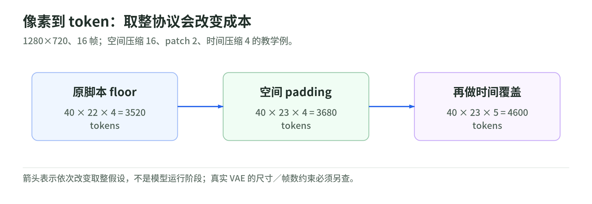

# 06 实时视频：把估算器拆成可以检查的公式

研究日期：2026-11-03。[返回专题](README.md)。

对应原文：[Real-Time Video Generation Calculator](https://anvilarth.github.io/realtime-video-calculator.html)。本章检查当日页面说明及内嵌 `compute()` 脚本。**它是工程估算器，不是实测基准，更不是产品发布时间承诺。**下面的简化实验有独立测试，不照搬其硬件表。

## 1. “实时”至少有三个不同指标

<!-- illustration: dif-video-latencies-3ca53c936c -->

*图：吞吐达标，首帧与交互仍可能很慢。实时体验的三个不同问题；示意不代表任何模型实测。*
<!-- /illustration: dif-video-latencies-3ca53c936c -->

吞吐达到 16 FPS，意味着在测量条件下单位时间能产出这些帧；它不自动说明第一帧在 1/16 秒内出现。一个系统可能先等两秒，再快速输出整段。

要分开记录：**首帧／首块延迟**，**稳态生成吞吐**，**用户输入变化到可见响应的延迟**。端到端还包括文本编码、VAE、排队、传输与显示。播放缓存可以让观感平稳，却不能消除交互延迟。

原计算器比较“生成一秒视频需要几秒”。若计算耗时为 $t_g$，视频时长为 $t_v$，则实时因子为 $t_g/t_v$；小于 1 表示平均生成速度够快。它不单独给出上述首帧和交互指标。[原页面的结果显示与计算脚本](https://anvilarth.github.io/realtime-video-calculator.html)

## 2. 先数 latent token，别把像素当作 Transformer 序列

<!-- illustration: dif-video-tokens-b3d7a7d556 -->

*图：像素到 token：取整协议会改变成本。1280×720、16 帧；空间压缩 16、patch 2、时间压缩 4 的教学例。*
<!-- /illustration: dif-video-tokens-b3d7a7d556 -->

设视频宽高为 $w,h$，帧数为 $f$，VAE 空间压缩为 $s$，空间 patch 为 $p$，时间压缩为 $c$。原脚本采用：

$$
n_w=\left\lfloor\frac{w}{sp}\right\rfloor,\quad
n_h=\left\lfloor\frac{h}{sp}\right\rfloor,\quad
n_t=1+\left\lfloor\frac{f-1}{c}\right\rfloor,\quad
N=n_wn_hn_t.
$$

代入 1280×720、16 帧、$s=16,p=2,c=4$：$n_w=40,n_h=22,n_t=4$，得到 **3520 tokens**。这是复核原计算器的向下取整口径，不是所有视频模型的统一序列长度。

原创 padding 对照：若宽高用向上取整，则 $n_h=23$，得到 **3680 tokens**。时间采用覆盖口径 $n_t=1+\lceil(f-1)/c\rceil$，则 $n_t=5$，得到 **4600 tokens**。若约定首帧单独编码、后续每组四帧对应一个 latent，四个 latent 只覆盖 $1+4(4-1)=13$ 帧；覆盖 16 帧需补到 17 帧，解码后再裁剪。这是明确的教学约定，不声称任意 VAE 都按此处理。真实选择取决于输入尺寸约束、裁剪、补齐与 VAE／patch 实现。不能先随意丢掉像素，再宣布达到了原分辨率。

[Wan2.1 的实现](https://github.com/Wan-Video/Wan2.1)与[LongLive 论文的实验设置](https://arxiv.org/html/2509.22622v1#S4)可帮助核查具体模型；本课不宣称上述三种口径都是它们的实际输入协议。

## 3. 每一层究竟算了什么

<!-- illustration: dif-video-cost-f8aaca03ca -->

*图：视频成本：二次项只是总账的一部分。每次乘加计两 FLOPs；简化两映射 FFN，略去若干算子与 VAE。*
<!-- /illustration: dif-video-cost-f8aaca03ca -->

采用矩阵一次乘加计作两 FLOPs 的教学约定，隐藏维度为 $d$，FFN 中间维度为 $d_{\rm ff}$。简化全连接 self-attention：

$$
F_{\rm self}\approx8Nd^2+4N^2d,\qquad
F_{\rm ffn}\approx4Ndd_{\rm ff}.
$$

前项来自 Q、K、V 和输出投影；二次项来自匹配与按权重汇总。FFN 式子假定两次线性映射，不概括所有门控 FFN。这里忽略 softmax、归一化、激活、偏置等；text cross-attention 也要另计。

如果有 $L$ 层、$S$ 次去噪调用，常规双分支 CFG 倍数为 $G=2$，可写：

$$
F_{\rm total}\approx L S G
\left(F_{\rm self}+F_{\rm ffn}+F_{\rm cross}\right).
$$

这是算术工作近似。CFG 的条件与无条件分支可能拼成一个 batch，并不要求两个独立启动；也有蒸馏 guidance 的单分支方法。少步模型更快不能仅凭公式推出质量保持，而端到端耗时也不必严格按步数线性变化。

原计算器根据参数量缩放 $d,d_{\rm ff}$，用经验表决定层数，且给 cross-attention 一个固定校准项。这是模型族近似：两套相同参数量、不同层宽和结构的模型，计算量未必相同。

## 4. 稀疏项：页面说明与代码存在差异

当日页面说明称 sparsity 除掉二次 attention 项；但实际 `compute()` 中的 `selfAttn` 把 $8Nd^2+4N^2d$ **整体**除以 `sparse`。这是读脚本得到的差异，不是 GPU 运行发现的性能问题。[原页面内嵌 JavaScript](https://anvilarth.github.io/realtime-video-calculator.html)

若只减少注意力连接，通常应保留投影工作；教学公式为：

$$
F_{\rm sparse}\approx8Nd^2+\frac{4N^2d}{q},
$$

其中 $q\geq1$ 是对二次项的理想减少倍数，不代表内核能达到同样墙钟加速。

原创小例：$N=100,d=10,q=4$。投影 80,000 FLOPs，二次项 400,000 FLOPs；只减二次项得到 **180,000**，整体除以四则是 **120,000**。后者在这个例子中低估 60,000，即正确简化值的三分之一。两者的 FFN 和其他开销仍须另算。

本课脚本实现前者，提供测试验证，不修改作者的网站。还有一处 UI 口径：AR 分支的精度倍数只进入 mobile 计算，server 路径始终用 GPU `fp8`；因此不能将服务端 AR 下拉选择解释为已完整模拟了所有精度选项。

## 5. 利用率、显存、带宽：分别建模

原计算器使用 GPU 峰值×0.4、多 GPU 额外×0.7、mobile NPU 的 TOPS×0.15。这些是**当日脚本常数**，不是硬件定律。TOPS 必须说明整数精度、稀疏口径、算子覆盖与数据搬运，不能无条件转换成任意模型的 FP16 FLOP/s。

参考[上一章 Roofline](05-gpu-and-memory-roofline.md)，要同时考虑 FLOPs 和内存流量：

$$
t_{\rm bound}\geq\max(F/P,\ B/W).
$$

此外还存在容量约束。假设 14 billion 个权重，BF16 每权重两 bytes，仅原始权重就有 **28 GB，约 26.08 GiB**。这不含激活、KV cache、VAE、临时工作区，也不包括训练的梯度和优化器状态。减少精度还可能增加缩放元数据；不能把权重能装入显存当成完整模型能运行的证明。

原脚本定义了显存与带宽字段，但核心 `compute()` 的扩散时间没有使用它们来检查容量或 Roofline。这限制了“能实时”的结论。[原计算器限制说明与脚本](https://anvilarth.github.io/realtime-video-calculator.html)

实用做法是报告利用率敏感性而非单点答案：例如假设 20%、40%、60% 可用吞吐，分别算时间；再补上容量检查与实测。原文“约 ±2×”没有在页面提供逐项验证表，不能当作置信区间或认证误差界。

## 6. AR 和 Diffusion 不一定是互斥分类

可以在时间上自回归地产生帧块，同时在每个帧块内部做少步扩散。标签应该写清**时间依赖、块内生成算法、缓存方式**，而不是见到 AR 就假定“一帧只有一次前向”。

[LongLive v1 论文](https://arxiv.org/html/2509.22622v1)使用 frame-level AR、短窗口、frame sink 与 KV-recache；论文报告单 H100 上 20.7 FPS。[官方仓库 v1.0 README](https://github.com/NVlabs/LongLive/tree/v1.0)还报告 FP8 下 24.8 FPS。论文 v1 的量化附录使用 INT8 术语，与 README 表述需要分别归属，不能混写成同一已复测配置。我们没有重跑这些成绩。

固定时间窗口有助于避免历史长度无限增加，但扩大帧内 token 数仍可能增加窗口内的 attention 工作。原计算器用 480p 基准按像素比例外推 AR 成本，这不是所有 AR 视频模型复杂度恒为线性的证明。换 prompt 的 KV-recache、首块等待和长程一致性也需要单独评价。

## 7. 三道自测与参考答案

1. 一秒视频生成要 0.8 秒，能否断言首帧延迟是 50 ms？
2. 注意力连接减少四倍，QKV 投影、FFN、VAE 一定都快四倍吗？
3. 14B 模型的 BF16 权重占 28 GB，32 GB 显存一定能运行吗？

参考答案：①不能，平均吞吐没有给出首帧时序。②不能，应分别建模，实际内核还有额外开销。③不能，还有激活、缓存、辅助模型和工作区；实际架构与运行设置必须检查。

## 一手来源与阅读边界

以下均于 2026-11-03 阅读。

| 来源与版本 | 已读范围 | 支持与限制 |
| --- | --- | --- |
| [Filatov：视频计算器](https://anvilarth.github.io/realtime-video-calculator.html) | 页面公式、限制、完整内嵌计算脚本；当日版 | 原估算逻辑及说明／代码差异；不是性能实测 |
| [Wan2.1 官方仓库](https://github.com/Wan-Video/Wan2.1) | README 与模型／输入背景；当日版 | 具体模型背景；未下载权重和执行推理 |
| [LongLive，arXiv:2509.22622v1](https://arxiv.org/html/2509.22622v1) | 架构、实验设置、短窗口与量化附录 | 作者报告的吞吐；未复跑，不泛化到任意分辨率 |
| [LongLive v1.0](https://github.com/NVlabs/LongLive/tree/v1.0) | README highlights | 20.7／24.8 FPS 及 FP8 归属，不与论文 INT8 表述合并 |
| [Nsight Compute：Roofline](https://docs.nvidia.com/nsight-compute/ProfilingGuide/index.html#roofline-charts) | 算术强度／带宽模型 | 下界分析；不能替代端到端测量 |

下一步：[在标准库实验里验算](lab.md)，再回到[全专题地图](README.md)。
