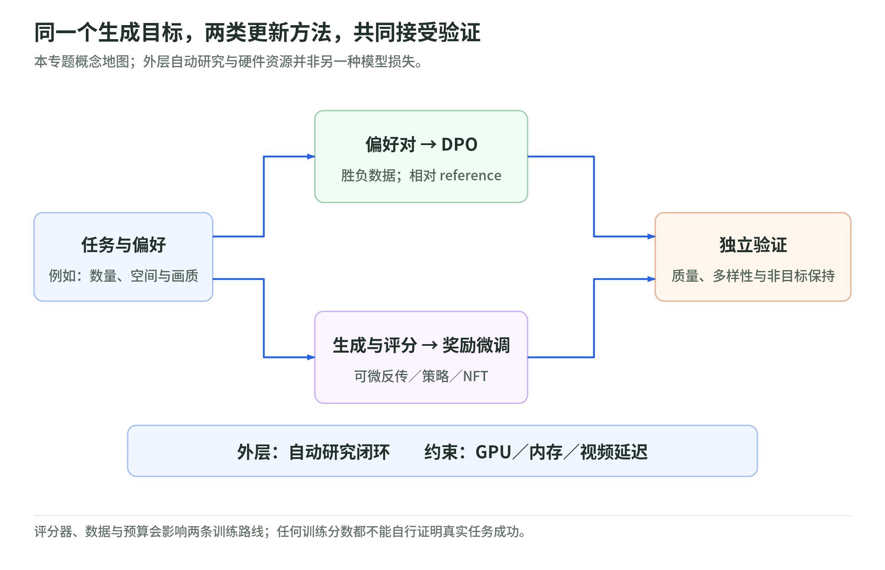

# 扩散后训练与推理工程 101：从偏好到可验证的生成

<a id="diffusion-overview"></a>

研究日期：2026-11-03。[深度学习专题首页](../README.md)。

你提供的链接是 [Andrei Filatov 的博客目录](https://anvilarth.github.io/blog.html)，不是单篇论文。本读本覆盖当日目录的六篇文章：三篇讲扩散模型的偏好／奖励训练，另外三篇讲自动研究、GPU 与实时视频估算。它们组成一条问题链：**想让模型生成什么 → 怎样把评分变成更新 → 怎样知道更新有效 → 怎样承担计算成本**。

这是一套针对上述主题的 101，不冒充全部深度学习或全部扩散理论。图像／视频生成、数据、优化、评估与计算资源都涉及，但生成模型预训练、完整随机微分方程理论、分布式训练和 CUDA 内核编写不在本次课程范围。

## 一张图看懂本专题

<!-- illustration: dif-system-map-a40aa5d930 -->


*图：同一个生成目标，两类更新方法，共同接受验证。本专题概念地图；外层自动研究与硬件资源并非另一种模型损失。*
<!-- /illustration: dif-system-map-a40aa5d930 -->

偏好对与奖励分数都表达目标，但提供不同监督：DPO 用预先标注的相对胜负；在线奖励微调用当前模型产生的样本。它们都需要核查评分器与数据，最后还需要独立验证，不能让同一个训练分数既当目标又当成功证明。

Autoresearch 是外层的实验搜索方式，不等同于一种模型训练算法。GPU 与视频成本模型则约束能试多少次、一次能生成多长、多快，和第一帧需要等待多久。

## 六篇原文，对应六个章节

| 原文及当日目录标注 | 本 Wiki 的重点 | 需要防止的误读 |
| --- | --- | --- |
| [DPO for Diffusion，2026-10](https://anvilarth.github.io/preference-optimization.html) | [01 偏好对与四项误差](01-dpo-and-preference-pairs.md) | 相对目标不是绝对质量；大 gap 不等于标签可信 |
| [RL Part 1，2026-10](https://anvilarth.github.io/rl-for-diffusion-part-1.html) | [02 奖励怎样穿过去噪轨迹](02-rl-through-denoising.md) | 截断梯度、SDE 策略与 NFT 不是同一种估计器 |
| [RL Part 2，2026-10](https://anvilarth.github.io/rl-for-diffusion-part-2.html) | [03 谁评分、多目标如何组合](03-rewards-judges-and-advantages.md) | 会打分不等于会可靠判断；归一化不自动解决冲突 |
| [Age of Autoresearch，2026-07](https://anvilarth.github.io/autoresearch.html) | [04 自动研究与 oracle](04-autoresearch-and-oracles.md) | 代理自行迭代不证明评分器没有漏洞 |
| [GPU Story，2026-03](https://anvilarth.github.io/gpu-story.html) | [05 并行、内存与 Roofline](05-gpu-and-memory-roofline.md) | 多核心不等于任意任务快；GPU 也依赖缓存与 IO |
| [Video Calculator，2026-03](https://anvilarth.github.io/realtime-video-calculator.html) | [06 实时视频的可检查估算](06-realtime-video-estimates.md) | 峰值和预测硬件表不是实测；吞吐不是首帧延迟 |

章节内回到相关一手论文、作者实现与官方文档，记录读取范围和版本。原文涉及但本课未深核的支线，明确不展开：例如 02 章的 AWM；不能把它们算成本课已完整覆盖的算法。

## 先具备哪些直觉

**扩散／flow 生成**：从噪声开始，通过多步变换得到样本。噪声预测、速度预测与采样时间定义不能随意互换。本文在使用公式时说明参数化，完整推导请看一手来源。

**后训练**：在已有生成模型上调整目标和参数，可能改善特定偏好、计数、文字或构图；也可能损害多样性及非目标能力。它不是凭空获得所有能力的保证。

**前向与反向**：前向产生样本，反向计算参数更新方向。有的路线沿采样链反传，有的对步骤概率求导，有的重新加噪后做匹配；不要因为都收到奖励就混称一种方法。

**数据与评分器**：胜负或奖励可能来自人、视觉模型、VLM、程序工具；每一种都有任务覆盖与偏差。评分器的错误会变成模型学习的目标。

已有矩阵乘法、概率、期望与导数直觉即可开始；没有 GPU 也能完成本课实验。不熟悉基础词汇，可先看[深度学习术语](../glossary.md)。

## 阅读路线

**30 分钟路线**：每章开头和三道自测，重点读 01 的“相对改善”、03 的评分盲区、06 的实时定义，先形成判断框架。

**90 分钟机制路线**：01 → 02 → 03，手算 DPO 符号、组优势和 NFT 分支；再读 05 → 06，把 FLOPs、bytes 与时延分开。

**半天实践路线**：读完六章并跑[标准库实验](lab.md)，完成 18 道章节自测及实验页 6 道练习；写一页固定预算、保留集、正确性与停止条件的复现方案。半天不包括真实模型训练。

## 最值得动手核验的四个问题

1. 为什么 reference 不变、当前模型两幅图的误差都增大，DPO loss 仍可能下降？
2. 为什么所有样本奖励相同，组内优势会消失，但正则项仍可能更新参数？
3. 为什么把 GPU 的计算峰值翻倍，带宽受限任务的时间下界可以不变？
4. 为什么同一张视频图像的 floor、padding 与时间覆盖口径会产生不同 token 数？

这些是可手算、可用单元测试检查的机制问题，不要求相信作者的个人体验或购买硬件。

## 证据、配图与执行边界

**作者报告**单独归属。文章中的模型提速、生成质量和硬件吞吐没有在本 Wiki 独立复现。原文模型排名、职业预测、数学突破归因和未来芯片时间表没有被转录成通用结论。

**论文机制**来自明确版本和已读章节。检查过公式或代码不等于审计整个仓库，更不等于验证所有 benchmark。

**原创教学**包括小数组奖励、假想硬件、token 取整与注意力 FLOPs 对照；它们有标准库测试。代码不是完整 DPO／RL trainer，也不重建作者所有交互计算器选项。

**图解**是 13 张原创机制图，提供本地 SVG 与 2× PNG。没有复制原站照片或截图，不靠外部图床；网页支持放大，Markdown 有 PNG 后备。

本次没有运行真实模型训练、下载权重、调用目标模型或支付评分服务费用。计算器的说明与脚本差异是源码核查，不能描述为 GPU profiling。

重建图解：

```bash
python scripts/render_figures.py --embed --id-prefix dif-
python scripts/render_figures.py --check --id-prefix dif-
```

<a id="public-sources"></a>

## 来源入口

目录来源为[作者博客](https://anvilarth.github.io/blog.html)，当日六条。每章末尾有一手来源与阅读范围，所有检查日期为 2026-11-03；动态网页会更新，本文不是它们永久不变的快照。

[01 来源](01-dpo-and-preference-pairs.md#public-sources) · [02 来源](02-rl-through-denoising.md#public-sources) · [03 来源](03-rewards-judges-and-advantages.md#public-sources) · [04 来源](04-autoresearch-and-oracles.md#public-sources) · [05 来源](05-gpu-and-memory-roofline.md#public-sources) · [06 来源](06-realtime-video-estimates.md#public-sources) · [实验边界](lab.md#public-sources)。

继续比较：[权重空间编程](../weight-space-programming.md)。直接编辑参数、对奖励求梯度、让代理搜索程序，是三种需要分别规定信息权限与评测标准的工作流。
