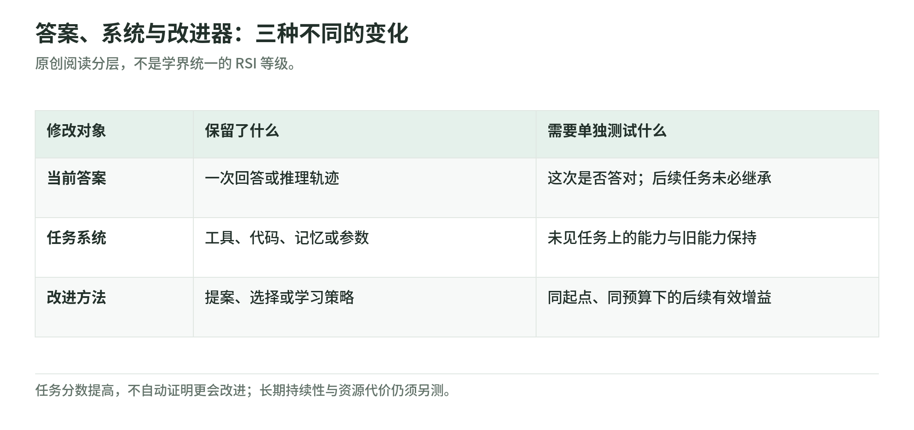

# AI 自我改进与自动科研：先分清谁变强了

资料核验截止：2026-10-17。Wiki 整理日期：2026-11-04。

一个 AI 重新检查答案后答对了，一个编码智能体改写自己的工具后更好用了，一个研究系统更会发现下一次有效修改。这些都有价值，却不是同一种进步。这个专题沿着“改进对象 → 反馈 → 选择 → 后续能力”解释递归自我改进（Recursive Self-Improvement，RSI），也把自动科研与工业研发放回各自的证据范围。

这里将既有长篇研究拆成八章，保留机制、实验条件、负面结果和行业案例。整理日期不是新的核验日期：本轮没有补查 10 月 18 日之后的全部进展，没有重跑论文系统，也没有把公司自报升级成独立验证。[来源台账](sources.md)记录这层边界。

## 先看三个问题

<!-- illustration: rsi-objects-17c05d51db -->


*图：答案、系统与改进器：三种不同的变化。原创阅读分层，不是学界统一的 RSI 等级。*
<!-- /illustration: rsi-objects-17c05d51db -->

1. **任务变好了吗？** 新版本解决了更多题，还是仅多尝试了几次？
2. **改进方法变好了吗？** 从同一个起点、用相同预算，它是否更容易找到有效修改？
3. **收益能持续吗？** 换任务、保留旧能力并计入失败后，优势还在不在？

只有第一项上涨，可以支持局部优化。第二项需要单独的元改进测试，第三项还需要长期与迁移证据。本文的区分是阅读和研究框架，不宣称学界已经统一了严格 RSI 的验收标准。

## 八章阅读地图

| 章节 | 先回答一个问题 | 代表材料 |
| --- | --- | --- |
| [01 概念、理论与元学习](concepts-and-foundations.md) | 答案、系统和改进器的变化怎样区分？ | Good、Gödel machine、AIXI、MAML、RL² |
| [02 智能体与改进器](agent-evolution.md) | 改写自己的代码，何时能支持元改进？ | STOP、DGM、Hyperagents、AIDE²、演化分支 |
| [03 学习与权重](learning-and-weights.md) | 提示、数据、纠错和参数更新各改了什么？ | Promptbreeder、STaR、SCoRe、R1、SEAL、AZR |
| [04 算法与基础设施](algorithms-and-infrastructure.md) | 可执行发现怎样走到实际应用？ | AlphaTensor、AlphaDev、FunSearch、AlphaEvolve |
| [05 科学家智能体](ai-scientists.md) | 自动研究之后，谁完成验证？ | AI Scientist、Co-Scientist、Robin、Kosmos |
| [06 工业研发与自动实验](industry-and-autoresearch.md) | 自报研发参与和公开实验流程怎样读？ | GPT-5.3-Codex、MiniMax M2.7、autoresearch |
| [07 评测与安全](evaluation-and-safety.md) | 分数、预算、污染和权限如何影响结论？ | MLE-bench、RE-Bench、PostTrainBench、失效研究 |
| [08 研究路线](research-roadmap.md) | 怎样设计能归因的下一项实验？ | 同预算迁移、四格对照、验证器与旧能力 |

长章可按本页目录选择小节。特别是[智能体章](agent-evolution.md)，可以先读 [DGM](agent-evolution.md#rsi-dgm)，再比较 [Hyperagents](agent-evolution.md#rsi-hyperagents) 的改进能力测量和 [AIDE²](agent-evolution.md#rsi-aide) 的 ignition test。

## 哪些路线不要混成一个排行榜

| 路线 | 主要被改进对象 | 外部仍提供什么 | 适合带走的判断 |
| --- | --- | --- | --- |
| 纠错、提示和训练 | 回答、提示、数据或参数 | 任务、奖励与训练规则 | 学习可以改善行为，不等于训练者自行升级 |
| 智能体演化 | 工具、控制程序和部分改进策略 | 基础模型、评价与资源合同 | 自修改有实证，改进器增益仍需单测 |
| 自动科研 | 假说、分析、实验代码和报告 | 研究目标、实验室操作与评审 | 研究闭环延长了，人的验证责任仍在 |
| 工业内部研发 | 研发工作流与运行框架 | 人的方向、基础设施和决策 | 第一方记录应与独立实证分开 |

正式发表、公开代码、实际应用和独立复现是不同证据。49 组引用不是 49 个已成功实现 RSI 的系统；一组还可能包含多篇互相限定的论文。[来源身份与指标分母](sources.md)比单看项目名称更重要。

## 选择一条学习路线

**第一次接触**：01 → 04 → 05 → 07。先理解对象与验证，再看算法和科学研究为何有不同检查条件。

**关心真正的改进器**：01 → 02 的 DGM／Hyperagents／AIDE² → 08 → [四格离线练习](lab.md#rsi-lab-transfer)。不要只比较最后的任务分数。

**关心训练**：03 → [Agentic RL 的优化目标](../training/agentic-rl-lab/policy-objectives.md) → 07。固定外层训练、任务内适应和自修改不是同一层。

**关心行业**：04 → 05 → 06 → [来源台账](sources.md)。核对实际应用、人的职责、开放范围和公司自报。

**想动手但不跑模型**：直接做[三个标准库小实验](lab.md)。它们说明测量混淆，不模拟大语言模型，也不证明真实 RSI。

## 本专题提供什么

- 八篇解释性正文与原有公开引文，避免把研究变成缩写清单。
- 六张中文机制图，保留本地 SVG 与 PNG；图是原创教学，不冒充作者部署图或性能复现。
- [术语表](glossary.md)、[49 组来源](sources.md)和不联网的[练习](lab.md)。
- [研究问题和实验合同](research-roadmap.md)，区分建议、作者报告与可复现代码。

## 与已有读本怎样衔接

[Autoresearch 与 oracle](../diffusion/04-autoresearch-and-oracles.md)已经详细讨论正确性准入和五分钟预算；这里增加 RSI 的改进器归因与行业脉络。[权重空间编程](../weight-space-programming.md)讨论权重访问和计算契约，不能仅因都修改权重就把两套证据混在一起。

[Agentic-RL Lab](../training/agentic-rl-lab/README.md)帮助理解优化目标、工具环境和长轨迹；[AI 与 Agent 安全](../../security/security-101/09-ai-and-agent-security.md)帮助设计权限边界。理解机制不等于已获执行模型、购买算力或发布结果的许可。

图文使用仓库原有的 Markdown/Jekyll 阅读能力，没有另建一套独立 HTML。维护图件时，从仓库根目录执行：

图件维护需要当前 Python 能导入 CairoSVG 和 Pillow、系统 Cairo 及中文字体；这些仅用于重建图，不是运行离线练习的依赖。

```bash
python3 scripts/render_figures.py --embed --id-prefix rsi-
python3 scripts/render_figures.py --check --id-prefix rsi-
```

这两条只处理本专题的图组。真实模型训练、系统重评、付费服务和湿实验均未执行。
