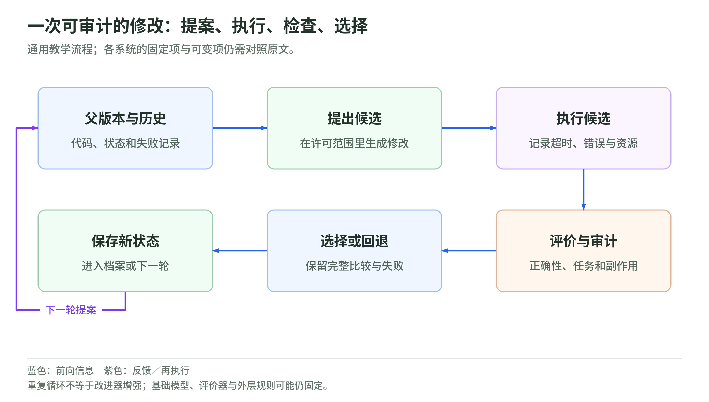

# 02 智能体与改进器：从工具修改到元改进测试

资料核验截止：2026-10-17。Wiki 整理日期：2026-11-04。[返回专题](README.md)。

怎样知道新 agent 的收益来自更好的改进方法，而不只是工具、记忆或更多尝试？

本页按此前研究快照组织。论文成绩和公司案例保留原作者报告及当时的实验条件；本次没有重新训练模型、运行这些系统或将材料更新为 11 月的新结论。术语可查[速查表](glossary.md)，来源身份与版本可查[来源台账](sources.md)。

## 怎样读懂一个自改进循环

<!-- illustration: rsi-cycle-a01cc854f4 -->

*图：一次可审计的修改：提案、执行、检查、选择。通用教学流程；各系统的固定项与可变项仍需对照原文。*
<!-- /illustration: rsi-cycle-a01cc854f4 -->

### 提案、执行和选择分别做什么

典型程序级改进循环先选择一个父版本，读取它的代码和历史表现，生成修改，再执行候选版本。候选能运行，只通过了第一层检查；它还需要在任务上表现足够好，才会被保留或接受。

其中至少有几个可以独立变化的设计点：选择哪个父版本，给提案器看什么失败信息，允许它改多少代码，如何评价候选，以及怎样决定继续搜索还是停止。本文用它们作为分析框架，具体论文不一定都实现全部部件。

提案器可以是 LLM，也可以是调用 LLM 的程序。评价器可能是单元测试、数学检查、性能测量、任务评分，或者另一个语言模型。选择规则可以保留一个版本，也可以保留候选档案。它们的不同组合解释了为什么很多工作都叫自改进，实际机制却差别很大。

### 为什么要保留失败和分支

只沿当前最佳版本走，搜索很清楚，却可能过早失去其他路线。一个修改暂时没有提高分数，但可能为后续工具或控制流程提供条件。档案式搜索给这类分支留下机会。

代价是评测与存储更多候选。分支越多，越需要知道哪个变化真正有效，不能把所有历史文本都塞给提案器，假设它会自然提炼出经验。候选代码、任务失败轨迹和修改效果，是不同种类的信息。

失败经验也不是永远成立的规则。某个工具在一个底模、预算和任务分布上失败，换条件后可能有效。后面会看到，GEA、MetaShare 和 Meta-Harness 分别用不同方式处理共享经验与历史执行信息。

### 内层和外层的边界

在权重适应里，内层可能是一次微调，外层学习怎样生成微调数据。在研究 agent 中，内层可能是解决一个训练任务，外层修改研究 agent 的搜索方法。

看到内层表现提高之后，应继续追问外层有没有变化。外层如果一直由同一个人工程序安排，它支持的是这一固定机制下的自动优化。若外层机制也更新，仍需检查更新后是否更有效，而不能只确认代码文本变了。

边界应明确写出来。一个固定终审评价器并不自动否定递归改进，它可能是保证实验可信的必要条件。真正的问题是，哪些部分承担能力增长，哪些部分提供固定的比较标准。

### 资源是循环的一部分

不应只统计最终版本解一题用了多少 token。生成失败候选、安装环境、运行测试、读取历史、模型微调和选择检查点，都可能消耗资源。它们决定了系统是更高效，还是只是更昂贵。

美元成本、GPU 时间、模型调用量与墙钟时间不能完全互换。并行搜索可以减少等待，却未必减少总计算；长上下文可能减少调用次数，却增加每次调用成本。研究者应明示主要约束，并同时报告无法严格匹配的资源。

## 编码智能体怎样改写自己的系统

### ADAS：先把 agent 设计变成可搜索对象

ADAS 在 2024 年公开，正式发表于 ICLR 2025。它的 Meta Agent Search 用代码表示候选 agent。元智能体提出设计，评价后加入档案，再根据已有设计继续探索。它报告多个任务上的收益，也研究跨模型和跨领域迁移。[^9]

这种表示的价值是，设计空间可以超出人工预先枚举的几个模板。工具使用、控制流和执行结构都可以成为候选差异。

自动寻找更好 agent，和新 agent 更善于产生后续设计，是两个命题。如果元搜索方法始终固定，实验主要支持自动设计的效果。它仍然是重要基础，没有必要为是否属于最强意义的 RSI 而否认工程贡献。

### SICA：工具、定位和上下文都有改进空间

SICA 的外层循环选择较好版本，让编码 agent 结合历史表现修改自身源码。修改包括工具、错误定位和上下文管理，不只是为某道题生成补丁。[^10]

它主要使用 Claude Sonnet 3.5，另外有 o3-mini 推理子 agent。把它理解成一个孤立小模型靠自己变强，会遗漏外部能力来源。

论文报告 SWE-bench Verified 子集成绩从 17% 到 53%。这里有 50 题，另外还用 LiveCodeBench 子集和合成工具任务。15 次迭代的运行成本约 7,000 美元；不同版本的 token、时间和成本也在变化。

这类系统适合研究具体工程机制。一个更好的定位工具到底减少了哪种失败？上下文管理降低了无用信息，还是让模型错过关键线索？可以把最终工具插回旧版本，或从新版本移除工具，观察贡献。

SICA 还报告，在底模已经擅长的推理任务上，scaffold 的增益较有限。这是有用的负面信息：工具层的改进空间受任务与底模共同影响，不能期待每种任务都从更复杂的外围程序获益。

### Gödel Agent：开放修改带来归因问题

Gödel Agent 把目标、自身代码和反馈交给 LLM，允许动态修改行为。正式论文区分受约束与不受约束设置。[^11]

不受约束版本可以修改 API 调用，改用更强模型。论文指出，部分额外收益来自这种能力升级。所以“程序自行决定换模型”和“产生修改的方法变强”，应分别描述。

这个例子说明，允许修改范围越大，因果归因越需要小心。工具、模型、预算和任务信息一起改变时，一个总分很难回答哪种机制有效。

名字中的 Gödel 也不能替代形式证明。它是一套经验自修改框架，而不是每次变更都证明最优的理论机器。

### DGM 的候选档案有什么作用

DGM 让编码 agent 生成自身修改，通过编码任务检验候选，把可运行版本加入档案，再选择父版本继续改进。多分支搜索使它不必每轮都只从最高分候选出发。[^12]

保留分支的研究动机很好理解：有些修改暂时没提高分数，却可能提供后续能力的组成部件。档案给这种探索保留机会。但并非所有暂时较差分支都值得留，选择和评价规则仍决定资源分配。

本篇采用 v3。SWE-bench 部分先做小规模功能检查，再追加评价，较强候选扩展到 200 题。报告的 20.0% 到 50.0% 不应当作完整 500 题排行榜成绩。Polyglot 的 14.2% 到 30.7% 是最终候选在完整基准上的比较，演化内仍使用较小集合。

要同时看修改边界。基础模型权重不更新，外层演化循环不改写，诊断还有固定模型提供。它支持限定设计空间里的软件自改进，却没有把全部改进流程一起变成自主演化对象。

### DGM 的证据为什么需要分层读

论文的改进诊断提示词包含私有测试补丁信息。作者报告人工检查没有发现硬编码答案，并提供跨模型、跨基准和跨语言迁移结果。这不是可以直接判定作弊的证据，却说明演化内成绩与未参与演化的迁移成绩应分别解释。[^12]

资源比较同样重要。一个 SWE-bench 演化运行的估计成本约 22,000 美元，两个消融基线各约 10,000 美元。不同预算不证明算法无效，但无法自动排除更多搜索机会的贡献。

如果我复现 DGM，会先记录全部候选、失败和成本，而不只追最终曲线。随后分别冻结分支选择、修改策略和任务执行程序，检查哪些变化提供了可迁移收益。它的档案设计值得研究，但档案里最好的一条分支不能代表所有运行都成功。

## 2026 年更直接的元改进证据

### Hyperagents 同时暴露 task agent 与 meta agent

Hyperagents 把任务执行逻辑和产生修改的逻辑放进一个可编辑程序。task agent 执行任务，meta agent 根据历史和反馈产生后代，两者都可以被修改。相比只更新执行程序的路线，它把后续改进方法更明确地纳入修改空间。[^20]

这个设计不意味着全部外层规则都可变。主实验的父代选择、评价和档案协议仍有固定部分。可以把它理解为递归修改面扩大，而不是系统从此没有外部约束。

它覆盖编码、论文评审、机器人奖励设计和数学解答评分等领域。多个领域的目的，是检查改进机制是否只适用于编码，或者能转移到不同任务。

### imp@k 为什么比最后一个分数更有信息

improvement@k，通常写作 imp@k，先固定一个待测 meta agent，给它 k 次生成后代的机会，再用验证集选择候选，测独立测试集上的增益。这样，研究者可以比较不同代的改进器，在给定机会数里能带来多大改进。

这里每个部件都有意义。固定待测改进器，是为了把它当作一个可比较对象；控制机会数，是为了减少候选数量混淆；验证集负责选择，测试集负责最终评价，避免直接用最终答案挑候选。

但 k 次机会不等于所有资源完全相同。候选产生、代码执行和每次反馈的成本仍应报告。如果一个策略每次都调用昂贵工具，imp@k 较高不一定表示美元或时间效率更好。

所以，这个指标给出了更直接的元改进量尺，却不是一项万能认证。

### 迁移实验的正面结果和混淆

论文报告，评审或机器人领域形成的机制迁入数学评分后，五次运行的中位 imp@50 为 0.630，初始机制为 0，相应比较有正面统计结果。[^20]

但初始数学评分 agent 有输出格式和解析问题。把零分修复到可正常运行，确实是系统改进；不能把全部增益解释成数学理解能力增长。

迁移还同时带入 task agent 与 meta agent 的实现。两部分都变时，较强改进效果可能来自目标系统更容易改进，也可能来自改进方法更好。用交叉组合进一步拆开贡献，是一个自然的后续实验。

继续演化 200 次后，迁移初始化与原始初始化为 0.640 对 0.610，差异不显著。这不推翻前面的迁移结果，却限制了“这种优势会一直复合”的说法。

我的读法是，Hyperagents 提供了值得认真对待的跨域元改进证据，同时把下一步该如何强化因果对照暴露得比较清楚。

### AIDE² 把研究效率与自加速分开测试

AIDE² 的内层研究 agent 在固定美元预算里改任务代码，外层修改研究 agent 本身的搜索、候选选择和记忆组织方法。外层用 private grading 决定是否接受修改，内层不能直接看到这些最终标准。[^21]

一条轨迹持续八天，有 100 个搜索树节点，包括初始版本和 99 次改写提案，接受七次修改。selection grade 从 0.703 到 0.778，人工工程基线是 0.749。它另用四个未参与选择的基准检查迁移，最终版本匹配或超过该人工基线，但中间版本的迁移并不单调。

selection grade 是论文的任务聚合评价，不是通用智能刻度；一条长轨迹也不能代表所有独立运行都会产生相同改进。

它还有一个值得单独看的结果：独立任务族的 reward-hacking 比例从 55% 降到 32%，人工基线为 39%。在这个设置里，研究效率和某种违规行为同时改善，但这不能替代所有安全维度的审计。

### ignition test 到底检验什么

更强的命题是：改进后的研究 agent，不只会更好地优化研究任务，还会更好地驱动外层自改进。

AIDE² 因此把演化后的 agent 提升为外层改进器，和原有强基线做 ignition test。两组各三次独立运行、每次 50 步。作者明确说，噪声和成本使其尚不能得到确定的自加速优势。[^21]

这类实验比只延长任务曲线更贴近问题。若真的出现正反馈，应看到改进后的研究者更有效地产生后续研究者，而不是只看到一个更好的任务求解器。

“尚不确定”应保留为结论的一部分。它不表示 RSI 不可能，也不允许把系统写成已经点火的实例。

## 探索策略和群体经验怎样参与改进

### EvoX：不只进化解，也进化搜索策略

EvoX 的内层生成和评价候选解，外层根据种群、进展和停滞改写搜索策略，包括父代选择、参考候选和变异偏好。新策略运行后，以带来的下游进展评价。[^22]

这与固定变异规则的进化搜索不同。一个策略在当前阶段有效，种群变化后可能不再合适，外层可以尝试调整。

它在一个信号处理案例里，以同样 100 次解演化预算报告比固定随机采样高 34.1% 的综合得分。这是该案例的结果，不是所有任务平均提高 34.1%。

广泛实验还有不同搜索框架比较，但部分外部系统数字来自文献，并非在统一条件下全部重跑。更上层策略生成和切换协议仍固定，因此它比较适合称为局部元进化，而不是所有层级持续自增强。

### Dream-RSI：用发现历史降低策略试验成本

Dream-RSI 在线生成发现树，记录尝试与评价结果；离线把历史作为 replay world，测试和修改探索策略，再部署到下一轮发现。基础 agent、评价器和执行接口固定，变化主要在如何分配探索。[^23]

这个设计的动机是，完整跑一次发现可能昂贵，但可以先在已有历史里检验策略。如果有效，再投入真实执行。

边界也由此而来。replay 只能覆盖已观察历史，新策略可能在未见区域表现不同；负责开发探索策略的 agent 本身，也没有因此被证明持续变强。

结果有收益，也有反例。VGG16 和 LayerNorm 达到可比质量所需 generations 分别少 2.43 倍和 1.79 倍。Lasso 六个留出数据集的平均运行时下降，但改善由 RCV1 主导，其余五个反而更慢；Autocorrelation 的一项指标也略差于固定探索。

因此，“探索策略更有效”应按任务和指标判断。平均值改善不代表每个任务都改善；更少 generations 也需要与实际调用和总成本一起读。原调研核验时，官方仓库仍表示实现代码准备发布，不能把发布计划当成完整可复现实现。

### GEA：避免每个分支单独重复失败

GEA 选择父群体，分享修改补丁、失败任务轨迹和结果，让多个 agent 反思后分别修改框架并归档。共享单位不只是一个最终答案，而是关于改动成败的经验。[^24]

它的研究价值在于减少独立分支之间的信息损失。一个分支找到的有效工具或失败原因，可以帮助另一个分支安排修改。

论文报告 SWE-bench Verified 71.0% 对比 DGM 56.7%，Polyglot 88.3% 对比 68.3%。要特别保留协议：Polyglot 在小集合演化、50 题 medium set 上测，88.3% 不是完整 225 题成绩。模型和协议差异也限制了直接横向排名。

群体经验提高任务表现，不等于负责群体选择、经验反思和提案的整个元程序自身增强。可以继续研究共享机制怎样迁移，以及固定共享规则和可变共享规则的差别。

### MetaShare：失败不只是删除掉的候选

MetaShare 保存修改产生的正负性能变化，从不同谱系检索成功机制和高置信失败，用 task-blind auditor 提示欠探索的机制类型，再并行产生补丁并通过适用性、范围、编译与大小检查。[^25]

它把经验复用做得更细，尤其关注失败。失败记录可能阻止重复尝试，也可能帮助识别某种机制只在特定条件下成立。

作者报告最佳检查点出现的代数减少 1.7–2.9 倍，但这不是达到统一目标质量的 time-to-target。三项成本核算里，论文评审总 tokens 为基线 0.6 倍，Polyglot 1.2 倍，IMO 2.4 倍。更少代数可以伴随更多计算。

部分基线数字直接引用旧实验或重实现，财务任务资料还没有完整公开，并有统计描述需要协调。因此我不会用某个最高分来宣称它全面更高效；经验共享机制值得研究，计算与数据边界仍应保留。

## 其他新作应放在哪一层理解

### Meta-Harness：利用执行轨迹设计外围程序

Meta-Harness 的固定外层 proposer 访问历代 harness 代码、分数与原始执行轨迹，修改检索、记忆和控制程序。它将具体运行历史作为设计信息，而不只给提案器一个最终分数。[^26]

文本分类测试准确率为 48.6%，比 ACE 高 7.7 个百分点，上下文用量更少；数学检索也有未见题上的收益。但 TerminalBench-2 部分，搜索和最终评价使用同一组 89 题，不能把该部分称为独立泛化测试。

外层 proposer 没有演化，所以更准确的证据是 harness 搜索与迁移，而非完整改进器递归增长。这种边界说明不影响它作为工程基线的价值。

### AREX：研究状态细化不等于训练算法自改写

AREX 的内层搜证据并生成答案，外层根据约束与置信度决定接受、补查或重启。自主上下文更新保留已核实证据和未解决条件，帮助长任务继续开展。[^27]

BrowseComp 消融中，无上下文更新也无外环为 59.6，有外环为 69.8，有上下文更新但无外环为 71.4，两者都有为 82.5。这支持两个部件在相应设置里的作用。

但其权重能力来自作者设计的训练，而不是部署时自行改写训练算法。每个 episode 还有明确的内层和外层预算。标题中的递归，主要对应答案与研究状态循环。

附录的简化轨迹自蒸馏提供探索性结果，作者明确没有证明与完整系统结合后保持收益。不能把几个局部实验自行拼成已完成的长期自训练闭环。

### AIRA₂：先把评测噪声控制住

AIRA₂ 用异步进化式 orchestrator 驱动多个研究 worker，修改候选解。Hidden Consistent Evaluation 固定外部划分，并分离搜索和最终选择信号。[^29]

论文发现，去掉这种稳定评价会出现停滞或退化。在该设置下，评测噪声可以是长循环失效的重要原因，不必先把所有问题归因于数据记忆。

主实验用了多个 GPU worker，更强 backbone 的版本在 MLE-bench-30 上也有优势，但不能当成完全同底模、同 GPU-hours 的纯算法比较。编排器由人设计，没有因为研究成果提高就被证明更会自我修改。

这里有一个很实际的启发：在把自改进机制堆得更深之前，先检查评价是否稳定。否则系统可能把噪声当进步，把真正的改进当失败。

### MARS 与 POLARIS 提供怎样的对照

MARS 按失败类型和主题组织诊断，生成原则与过程提示，再选择增强方式。它的基本方法是一轮离线增强，不是改进自身增强器。其成本比较有历史配置与模型差异，不能读成严格统一条件的倍数优势。[^30]

它提醒我们，结构化利用反馈可以比无组织的多轮反思更有用。递归轮数不应成为目标本身。

POLARIS 则把失败经验抽象成策略，生成受限补丁并检查执行，用于小语言模型。正式实验保留了失败与无改善运行，而成功曲线只展示一部分。若只看那些曲线，会高估稳定性。[^31]

补丁能执行，不意味着性能提高；上下文增长、工具调用和资源不足，也可能使循环失败。这些结果限定的是具体小模型设置，不是 RSI 普遍不可能的证明。

## 继续学习

下一页：[继续这条路线](learning-and-weights.md)。想检验预算和评分归因，可做[三个离线小实验](lab.md)。

相关材料：[自动研究与 oracle](../diffusion/04-autoresearch-and-oracles.md)、[Agentic RL 的优化目标](../training/agentic-rl-lab/policy-objectives.md)、[权重空间编程](../weight-space-programming.md)。这些相邻读本不替代本页的证据条件。

[^9]: Hu 等，[Automated Design of Agentic Systems，2024 预印本 / ICLR 2025](https://arxiv.org/abs/2408.08435)；[ICLR 正式论文记录](https://iclr.cc/virtual/2025/poster/28073)。
[^10]: Robeyns、Szummer、Aitchison，[A Self-Improving Coding Agent，2025](https://arxiv.org/html/2504.15228)。子集、运行成本与模型来源采用原调研核验设置。
[^11]: Yin 等，[Gödel Agent，ACL 2025 正式论文](https://aclanthology.org/2025.acl-long.1354/)。特别参看受约束与不受约束设置的模型使用差异。
[^12]: Zhang 等，[Darwin Gödel Machine，2025 首发；本文采用 v3](https://arxiv.org/html/2505.22954v3)。演化内分阶段评测、迁移和成本属于不同证据，不混写成全量排行榜。
[^20]: Zhang 等，[Hyperagents，2026，原始 PDF v1](https://arxiv.org/pdf/2603.19461v1)。原调研记录了 HTML/PDF 日期呈现差异，关键实验以 PDF 核验。
[^21]: Srikanth 等，[Recursive self-improvement of AI research agents（AIDE²），2026](https://arxiv.org/html/2609.26457v1)。研究效率与 ignition test 结论分别解读。
[^22]: Liu 等，[EvoX: Meta-Evolution for Automated Discovery，2026；v2](https://arxiv.org/html/2602.23413v2)。
[^23]: Zheng 等，[Dream-RSI: Recursive Self-Improvement through Evolving Worlds，2026；v2](https://arxiv.org/html/2609.14858v2)。代码状态属于原调研核验时的记录。
[^24]: Weng 等，[Group-Evolving Agents: Open-Ended Self-Improvement via Experience Sharing，2026](https://arxiv.org/html/2602.04837v1)。
[^25]: Bhutani 等，[MetaShare: Failure-Aware Collective Self-Improvement for Open-Ended Agents，2026](https://arxiv.org/html/2610.21887v1)。成本、基线来源与数据描述差异详见近期专题。
[^26]: Lee 等，[Meta-Harness: End-to-End Optimization of Model Harnesses，2026](https://arxiv.org/html/2603.28052v1)。
[^27]: Lu 等，[AREX: Towards a Recursively Self-Improving Agent for Deep Research，2026；v3](https://arxiv.org/html/2607.21461v3)。
[^29]: Hambardzumyan 等，[AIRA_2: Overcoming Bottlenecks in AI Research Agents，2026；v2](https://arxiv.org/html/2603.26499v2)。
[^30]: Hou 等，[Learn Like Humans: Use Meta-cognitive Reflection for Efficient Self-Improvement（MARS），ACL 2026](https://aclanthology.org/2026.acl-long.1329/)。
[^31]: Kakade 等，[POLARIS: A Gödel Agent Framework for Small Language Models through Experience-Abstracted Policy Repair，Findings of ACL 2026](https://aclanthology.org/2026.findings-acl.1969/)。
