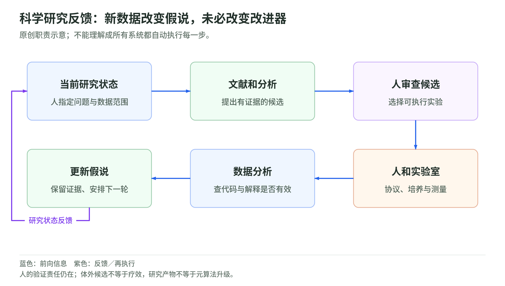

# 05 科学家智能体：研究循环与人的验证责任

资料核验截止：2026-10-17。Wiki 整理日期：2026-11-04。[返回专题](README.md)。

AI 生成假说、运行分析甚至写论文以后，谁完成实验和最终验证？

本页按此前研究快照组织。论文成绩和公司案例保留原作者报告及当时的实验条件；本次没有重新训练模型、运行这些系统或将材料更新为 11 月的新结论。术语可查[速查表](glossary.md)，来源身份与版本可查[来源台账](sources.md)。

## 科学家智能体把研究循环延伸到哪里

### 自动研究比程序搜索多了哪些环节

<!-- illustration: rsi-science-feedback-60346cbcb1 -->

*图：科学研究反馈：新数据改变假说，未必改变改进器。原创职责示意；不能理解成所有系统都自动执行每一步。*
<!-- /illustration: rsi-science-feedback-60346cbcb1 -->

一个排序程序可以用正确性和运行时间检查。科学研究则需要处理文献、证据、假说、实验、解释和表达，很多判断没有即时答案。这也是“AI 科学家”值得放进 RSI 版图的原因：它们尝试把反馈接到更长的研究过程里。

阅读时仍要问，系统迭代的是研究产物，还是产生研究的方法。假说越来越具体、论文写得更完整，说明工作流有用；要证明改进器增强，还需要把新旧研究系统放到相同条件下，比较它们继续产生有效改进的能力。

### Sakana AI Scientist：完整研究表达开始接受人类评审

Sakana 的首版 AI Scientist 在 2024 年公开，连接文献检索、想法生成、代码修改、计算实验、作图、论文写作和模拟评审。v1 需要人提供起始代码模板；v2 用实验管理器和树搜索探索多条方案，继续调参、排错和做消融。2026 年 3 月 25 日的 Nature 正式论文报告两种系统设置，不只是把旧预印本换了刊名。[^43]

这项工作的实际推进，是让自动运行实验和完整研究表达接在一起，再拿到真实人类评审中检验。作者报告，人类筛选送审的三篇稿件中，一篇达到 workshop 首轮评审门槛，平均分 6.33。这是筛选后的小样本，不是所有运行的成功率。

人的参与要写清。研究人员设定范围、选择送审稿件并检查实现，但没有人工改写选中稿件。依预定协议，稿件在评审后撤回，没有完成最终 meta-review，不能写成 ICLR 主会正式录用。

Nature 刊登的是人类作者对系统的研究，不是 AI 自己写出了一篇 Nature 论文。公开代码、评审材料和多随机种子实验便于检查，但不等于整个系统已经由无关联团队完整复现。它迭代了研究想法和实验产物，尚未证明研究改进器能连续升级自己。

### Google AI co-scientist：假说进化需要科学家的验证

Google 在 2025 年公布 AI co-scientist，2026 年 5 月 19 日正式发表于 Nature。科学家设定目标后，多种 agent 生成、反思、排名和演化假说，候选参加成对比较，反馈进入后续提示。原研究明确不依赖反向传播、微调或强化学习来驱动这个循环；主要变化在假说和研究上下文。[^44]

计算分析覆盖 203 个研究目标，人类偏好评价覆盖其中 11 个，真实验证落在三类生物医学问题上。这几种分母不能混在一起。内部 Elo 上升，只表示候选在相应比较规则里得到更高评价，还不是科学结论被证实。

更有意义的是合作科学家筛选候选、完成细胞或类器官实验，并检查系统是否重现当时尚未公开的细菌基因转移机制。后者的实验发现早于 AI 使用，不能把整个发现与验证过程都归给系统。

2026 年它进入 Gemini for Science 的 Hypothesis Generation 实验工具。8 月另一篇扩展研究加入代码执行、实验日志核验和部分仪器控制，但人仍负责装样、调整与测量；那个原型也不等于所有功能已作为产品全面开放。

这个项目把研究候选的生成和筛选做成更系统的工作流。它没有证明临床疗效，也没有证明自己的假说生成器或元评价机制在持续递归增长。

### Robin：新实验数据确实回到了下一轮推理

FutureHouse 的 Robin 将文献搜索和数据分析 agent 连接起来。它提出机制、候选与实验概要，研究人员执行实验并上传结果，数据分析 agent 写代码分析，再由 Robin 依据新结果安排后续研究。2025 年预印本之后，正式论文在 2026 年 5 月 19 日发表于 Nature。[^45]

它与只列出研究建议的工具有一个具体区别：实验结果能改变下一轮假说。作者报告，一个阶段约半小时分析 551 篇论文，但那不包括细胞培养等等待时间，不能解释成全研究周期的统一加速倍数。

正式版也保留了人的责任。人筛选候选、把实验概要写成可执行协议，完成培养和测序，并进行部分数据预处理与复核。候选在原代细胞中的验证是体外机制与功能证据，不是治疗效果。

Robin 和 Finch 有公开代码与样例，完整工作流仍依赖 Edison 平台服务。公开仓库不意味着全部过程能够离线复现。更准确的结论是，有实验室参与的半自主发现循环已经能开展有价值的工作，而不是无人系统已自行升级研究能力。

### Kosmos：长程研究需要一份可追踪的共同记忆

Edison 的 Kosmos 在 2025 年 11 月公开预印本并上线。它用结构化“世界模型”保存假说、分析结论和出处，让文献搜索与数据分析 agent 共享进展，持续探索一个目标。这里的世界模型可以先理解成可更新的研究账本，不是系统已经掌握完整自然规律。[^46]

报告中的陈述链接到文献或分析 notebook，研究者可以追查证据。作者请专家检查 102 条陈述，总体 79.4% 得到支持，但需要综合解释的陈述只有 57.9% 正确。统计单位是抽样陈述，不是项目成功率；这个差异说明，计算输出和解释判断应分别检验。

“一次运行相当于六个月研究”来自合作科学家的时间估计，不能当成所有任务的实测加速倍数。人仍提供和预处理数据，判断结论重要性；公开的主要是分析与验证脚本，不是完整核心引擎。

2026 年 9 月，Kosmos 增加 Nature 系列期刊的授权内容接入。这是产品与证据来源的进展，不是 Kosmos 技术论文被 Nature 接收。截至本篇核验，主系统证据仍按预印本处理。

这类系统改善了研究状态的保存、共享和产物形成。若要讨论 RSI，还应证明负责组织这些分析的编排器变得更有效，而不是只展示它又完成了一份长报告。

### 从这些行业进展中能得到什么判断

AI 已经能组织一段可检查的研究过程，有些系统还能接回真实实验数据。这比单次问答多了任务管理、证据保存和失败恢复，应该纳入行业进展。

但外部评审、独立数据和实验室测量仍承担着重要责任。同行评审说明工作接受过公开研究审查，不自动等于整个系统已被外部团队复现。公司产品接入和论文发表也应分开记录。

对 RSI 而言，这些项目提供了有用的研究任务与工作流，但还没有直接证明长期自主改进器的增长。这里保留它们的工程和科学价值，同时限定递归结论的范围。

## 继续学习

下一页：[继续这条路线](industry-and-autoresearch.md)。想检验预算和评分归因，可做[三个离线小实验](lab.md)。

相关材料：[自动研究与 oracle](../diffusion/04-autoresearch-and-oracles.md)、[Agentic RL 的优化目标](../training/agentic-rl-lab/policy-objectives.md)、[权重空间编程](../weight-space-programming.md)。这些相邻读本不替代本页的证据条件。

[^43]: Lu 等，[Towards end-to-end automation of AI research，Nature，2026-03-25](https://www.nature.com/articles/s41586-026-10265-5)；[AI Scientist v1，2024](https://arxiv.org/abs/2408.06292)；[AI Scientist v2，2025](https://arxiv.org/abs/2504.08066)；[Sakana 关于首轮评审与撤稿的官方说明](https://sakana.ai/ai-scientist-first-publication/)。本文称公开代码，不未经核对统一断言宽松开源许可。
[^44]: Gottweis 等，[Accelerating scientific discovery with Co-Scientist，Nature，2026-05-19 首次在线](https://www.nature.com/articles/s41586-026-10644-y)；[2025 年原始预印本](https://arxiv.org/abs/2502.18864v1)；[2026 年 Hypothesis Generation 产品说明](https://www.research.google/blog/a-new-era-of-innovation-google-research-at-io-2026/)；[2026 年实验执行扩展的独立预印本](https://arxiv.org/abs/2608.26701)。首次在线、正式卷期与扩展稿不是同一个日期。
[^45]: Ghareeb 等，[A multi-agent system for automating scientific discovery（Robin），Nature，2026-05-19 首次在线](https://www.nature.com/articles/s41586-026-10652-y)；[2025 年原始预印本](https://arxiv.org/abs/2505.13400)；[FutureHouse 官方流程说明](https://www.futurehouse.org/research/demonstrating-end-to-end-scientific-discovery-with-robin-a-multi-agent-system)。公司介绍页更新日期不当成项目首次发布日。
[^46]: Mitchener 等，[Kosmos: An AI Scientist for Autonomous Discovery，2025；本文采用 v2](https://arxiv.org/html/2511.02824v2)；[Edison 官方上线说明](https://edisonscientific.com/news/announcing-kosmos)；[2026 年 Springer Nature 内容授权公告](https://edisonscientific.com/news/bringing-trusted-research-into-kosmos-our-agreement-with-springer-nature)。内容授权不等同技术论文发表。
