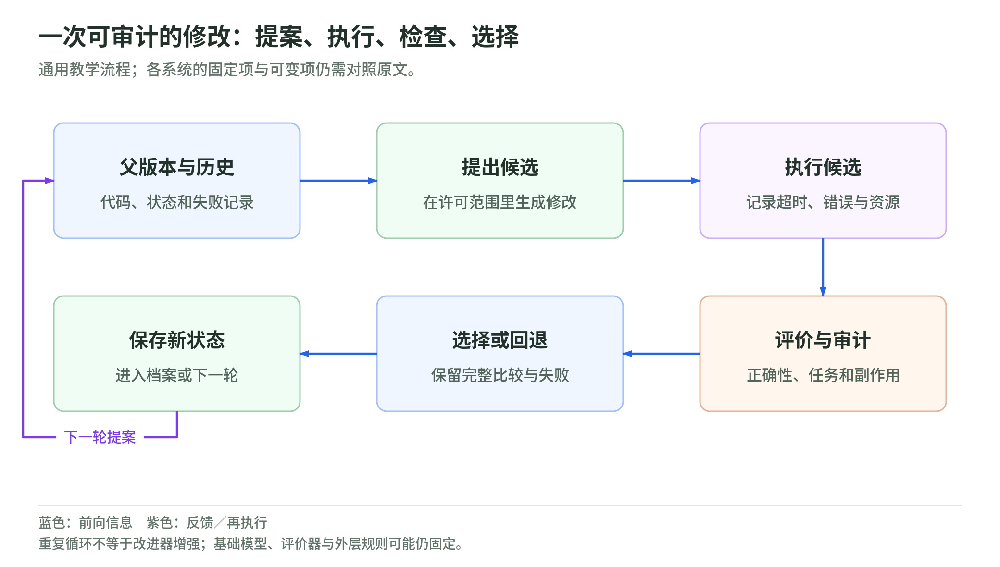

# 04 算法发现：从可检验程序到实际计算应用

资料核验截止：2026-10-17。Wiki 整理日期：2026-11-04。[返回专题](README.md)。

发现一个更好的算法，和让发现算法的系统自己变强，是同一件事吗？

本页按此前研究快照组织。论文成绩和公司案例保留原作者报告及当时的实验条件；本次没有重新训练模型、运行这些系统或将材料更新为 11 月的新结论。术语可查[速查表](glossary.md)，来源身份与版本可查[来源台账](sources.md)。

## DeepMind 的算法发现路线怎样走向实际应用

### AlphaTensor：把算法设计变成可评分的搜索

AlphaTensor 在 2022 年发表于 Nature。它把矩阵乘法算法的发现表示成一个搜索问题：系统不断寻找一种分解，最终要能正确完成乘法，并尽量减少所需标量乘法次数。它使用强化学习和搜索，不是让 LLM 凭文字直觉宣布发现了算法。[^40]

官方给出的一个例子是，将 4×5 矩阵乘 5×5 矩阵，朴素算法需要 100 次乘法，已有人工方法为 80 次，系统找到 76 次的方案。这是特定尺寸和计算设置里的结果，不是任意矩阵乘法都固定加速同一个比例。

把这个工作放进 RSI 背景，是因为它展示了“产生候选—检查正确性—按目标筛选”怎样形成可用的发现过程。发现较好算法之后，还要考虑硬件、数值条件和实现成本；较少操作不自动等于每台机器上更快。

它改进的是被搜索的算法。负责学习和搜索的规则仍由研究团队设定，因此应归为算法发现的方法里程碑，不把它直接叫作自主递归改进器。

### AlphaDev：研究结果进入算法库

2023 年的 AlphaDev 同样发表于 Nature，但搜索对象更接近机器执行。它把构造汇编指令序列变成一个游戏，检验排序结果是否正确，同时测量性能，寻找人类不容易从高层代码里看出的优化。[^41]

结果有明确的应用去向：发现的排序改进进入 LLVM libc++。官方报告，特定短序列上最高约 70% 更快，较大序列上的收益约 1.7%。这不是所有程序的端到端加速，短序列内核经常被调用，才使局部改进值得部署。

这个例子比一个更高的抽象分数多了一层依据：程序要通过工程检查，并进入供开发者使用的库。它仍没有证明 AlphaDev 会自行重写自己的强化学习算法，但说明自动发现可以产生实际被使用的成果。

### FunSearch：LLM 负责提案，程序负责检验

<!-- illustration: rsi-cycle-ea732f5635 -->

*图：一次可审计的修改：提案、执行、检查、选择。通用教学流程；各系统的固定项与可变项仍需对照原文。*
<!-- /illustration: rsi-cycle-ea732f5635 -->

FunSearch 在 2023 年在线发表，正式刊载于 Nature 2024 年卷。它把预训练 LLM 的代码生成，与自动评价及进化式程序搜索组合起来。LLM 提出候选函数，执行器检查结果并评分，较好的程序继续成为后续提案的参考。[^42]

与只生成一段听起来像证明的文字相比，可运行函数让结果更容易检查。它在 cap set 的组合构造中找到新的结果，也探索了在线装箱启发式。前者是相应构造和界限的进展，不是宣布彻底解决所有 cap set 问题。

这条路线也说明，所谓“AI 的发现”并不发生在没有约束的空间里。任务描述、程序骨架、正确性规则和评分目标由研究者设定，系统在其中探索。固定 LLM 加进化程序，不代表 LLM 参数随每次发现变强。

它与后来 AlphaEvolve、EvoX 等程序搜索工作放在一起读，能够看清几种变化：搜索对象更广、评价更工程化，或者连搜索策略也开始被优化。每一步都应说明新增的可变部分是什么。

### AlphaEvolve 的实际价值在哪里

AlphaEvolve 把模型生成程序、自动验证、性能测量和进化搜索连接起来。候选可以是算法或计算代码，评价则结合问题的正确性和性能要求。它的收益不只存在于抽象小任务，也包含支撑 AI 基础设施的应用。[^16]

Google DeepMind 报告了数据中心调度改进，平均回收约 0.7% 的全球计算资源；一个关键 Gemini 训练内核加速 23%，对应整个模型训练时间约下降 1%。局部和端到端收益的差距，正好说明为什么必须把优化范围写清楚。

这些工作支持 AI 加速 AI 研发的工程价值。但固定 LLM 提案、固定程序搜索、固定验证器的组合，仍有边界。它优化了 AI 会使用的程序，不意味着负责产生和验证下一轮修改的机制都自主增强。

如果要把这一方向推进成更明确的 RSI 研究，需要把节省的资源反馈到下一轮，并计算净收益。发现更快程序用了多少搜索和验证成本？真正部署后能节省多少？把同样预算直接用在更多研发实验上，会不会更划算？这是后文研究方案里的一个方向。

### 为什么这些研究值得优先阅读

这几项工作共同提供了较明确的检查路径。AlphaTensor 验证算法构造，AlphaDev 连接工程代码库，FunSearch 将语言模型提案接到可执行评价，AlphaEvolve 进一步报告基础设施应用。

它们不是一条每个项目都直接继承前一个项目的单线历史，也不都属于严格 RSI。放在同一节，是为了说明当前很多自改进系统借用的反馈式发现方法，以及从数学结果到真实部署所需的不同证据。

## 继续学习

下一页：[继续这条路线](ai-scientists.md)。想检验预算和评分归因，可做[三个离线小实验](lab.md)。

相关材料：[自动研究与 oracle](../diffusion/04-autoresearch-and-oracles.md)、[Agentic RL 的优化目标](../training/agentic-rl-lab/policy-objectives.md)、[权重空间编程](../weight-space-programming.md)。这些相邻读本不替代本页的证据条件。

[^40]: Fawzi 等，[Discovering faster matrix multiplication algorithms with reinforcement learning（AlphaTensor），Nature 2022](https://www.nature.com/articles/s41586-022-05172-4)；Google DeepMind，[官方方法与应用说明](https://deepmind.google/blog/discovering-novel-algorithms-with-alphatensor/)。
[^41]: Mankowitz 等，[Faster sorting algorithms discovered using deep reinforcement learning（AlphaDev），Nature 2023](https://www.nature.com/articles/s41586-023-06004-9)；Google DeepMind，[官方 LLVM libc++ 应用与性能说明](https://deepmind.google/blog/alphadev-discovers-faster-sorting-algorithms/)。速度数字受序列长度、硬件与测量设置限制。
[^42]: Romera-Paredes 等，[Mathematical discoveries from program search with large language models（FunSearch），2023 在线发表 / Nature 625，2024](https://www.nature.com/articles/s41586-023-06924-6)；Google DeepMind，[官方方法与问题说明](https://deepmind.google/blog/funsearch-making-new-discoveries-in-mathematical-sciences-using-large-language-models/)。
[^16]: Novikov 等，[AlphaEvolve 技术报告，2025](https://arxiv.org/abs/2506.13131)；Google DeepMind，[官方应用介绍，2025](https://deepmind.google/blog/alphaevolve-a-gemini-powered-coding-agent-for-designing-advanced-algorithms/)。
