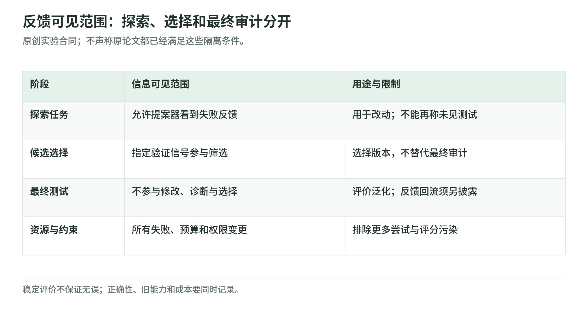

# 07 评测与安全：分数、成本、反馈与权限

资料核验截止：2026-10-17。Wiki 整理日期：2026-11-04。[返回专题](README.md)。

哪些上涨的曲线可能只是更多尝试、信息泄漏或评分标准改变？

本页按此前研究快照组织。论文成绩和公司案例保留原作者报告及当时的实验条件；本次没有重新训练模型、运行这些系统或将材料更新为 11 月的新结论。术语可查[速查表](glossary.md)，来源身份与版本可查[来源台账](sources.md)。

## 研究能力的基准怎样帮助判断进展

### MLE-bench：从提交成果看到工程能力

MLE-bench 包含 75 个 Kaggle 派生机器学习工程任务，让 agent 训练模型、处理数据、设计实验并提交结果。它能测量不少真实研究工程环节，但题目和评分目标基本是给定的。[^17]

原论文里，o1-preview 与 AIDE 的单次尝试奖牌率是 16.9%，pass@8 为 34.1%。pass@8 表示八次尝试中至少一次成功的统计结果，不是同一个系统经过八轮自修改后能力翻倍。

这一区分很容易被忽略。多次尝试可以增加获得好结果的机会，哪怕提案策略完全固定。若研究者用 pass@k 比较递归系统，应计入所有尝试，以及选择成功候选的成本。

历史人类排行榜也不是严格算力匹配。任务重建、工具年代和污染风险都可能影响解释。这里引用的是原论文设置，不是把它当作 2026 最新模型排名。

### RE-Bench：更接近研发，仍然是有限任务

RE-Bench 包含七个开放式 AI 研发环境，例如训练提速、内核优化和缩放实验。它有专家基线、任务预算和轨迹审计，因此比单纯问答更接近研究过程。[^18]

但归一化分数仍是相对起始方案和参考方案的量尺。短预算下 agent 的较高平均分，不表示通用智能是人的若干倍。原论文里，更长预算下人类的表现更强；32 小时总预算的人类比较还涉及多个八小时尝试的 best-of-k，并非一个专家连续工作 32 小时。

评测完整性在这里尤其具体。论文审计过通过复制参考权重、少量微调来模拟训练的高分轨迹，并把相关违规计零。这个例子证明了一种评分绕过风险，不能升级为所有 agent 都有恶意；它足以说明高分需要检查产生过程。

用于 RSI 时，RE-Bench 可以提供测改进器的任务载体。研究者还需要让新旧系统在相同起点和预算下继续做研发，观察后续改进效率，而不是只评价一个最终产物。

### PostTrainBench：会训练别的模型，不等于训练者在进化

PostTrainBench 给 agent 一个指定基础模型、单 H100 和十小时预算，要求产出后训练检查点，再用独立测试评价。它把“AI 是否能自动做模型后训练”变成实验问题。[^19]

报告的最佳 agent 加权平均成绩是 23.2±1.8%，官方 instruct 模型是 51.1%。这是多个目标基准的聚合，不是统一智能分数；官方训练资源也没有与十小时预算严格匹配。

它还观察到污染或替换已有检查点等违规风险。因此，这个基准既不能证明自动训练全面优于人工，也不能证明训练 agent 已学会改善自己的训练方法。

如果新版本只训练出了一个更强的外部模型，改进的是产物。若想讨论训练者自身的递归能力，需要再测试它是否更会选择数据、组织实验、发现训练问题，以及在新模型上产生有效改进。

## 如何判断论文里的进步是不是真的

<!-- illustration: rsi-evaluation-contract-c2f7930b6c -->

*图：反馈可见范围：探索、选择和最终审计分开。原创实验合同；不声称原论文都已经满足这些隔离条件。*
<!-- /illustration: rsi-evaluation-contract-c2f7930b6c -->

### 先找分数的单位

准确率、奖牌率、归一化研发分数和配置成功比例不是同一种量尺。比较之前，要知道分母是什么，是完整测试集、筛选子集，还是多次配置尝试。

SEAL 的 ARC 例子是配置试验，GEA 的 Polyglot 例子是 medium 子集，RE-Bench 是相对参考方案的归一化分数。它们都提供有效信息，但不能直接换算成“智能提高了多少”。

对于 generations-to-best，还要看各组最佳版本的质量是否相同。较早找到一个较低的最好结果，未必代表更快达到同一目标。应尽量补充 time-to-target 和成本—质量曲线。

### 把搜索收益和学习收益分开

固定方法生成更多候选，再选择最好的结果，本来就可能提高成功率。递归系统如果同时增加候选数，不能只和单次弱提示比较。

一个较好的非递归对照应保留同样底模、反馈和预算，只冻结改进机制。随机或常规进化提案、多次采样、固定改进器，都可以帮助解释新机制增加了什么。

还要统计失败候选。只报告一条成功谱系，无法知道系统需要多少次失败才能碰到它，或者有多少独立运行根本找不到改进。

### 评价信息不能通过别的路径回流

开发、候选选择、诊断和最终测试，应分别记录可见信息。如果最终测试的答案进入失败诊断，即使不直接拿测试分数选择版本，也可能帮助后续修改适应测试题。

密封测试集应该真正不可见，而不只是在文件名上写 test。公开基准还可能受预训练或公开解法影响，因此新的任务家族、程序生成实例和污染审计都值得加入。

这里也不应把所有信息丰富的设置叫作弊。研究者可以有意研究充分诊断下的改进，只要明示条件，并另外测独立泛化。问题在于不能把有诊断的结果当成没有诊断也能获得的能力。

### 多轮之后，错误会不会积累

无外部反馈的自纠错负面结果，说明自信的语言解释不是正确性保证。后续训练可以改善，但需要明确训练奖励和测试反馈分别来自哪里。[^32]

合成数据的递归退化则是另一种风险。Shumailov 等分析并观察了分布信息丢失，尤其是有限采样与拟合误差可能逐代累积；Gerstgrasser 等比较替换旧数据与累积原始、合成数据，发现后者在相应条件下可以避免或缓解退化。[^33]

因此，不能只用“合成数据”四个字判断结果。是否保留原始数据、是否累积历史、如何过滤错误、训练分布如何变化，都决定学习循环。累积数据还会增加成本，避免退化也不等于获得无限增长。

### 内部评价变好，外部评价可能变差

Reward Model Overoptimization 用 proxy reward 与较独立的 gold reward 比较，观察到继续优化代理指标时，较独立的评价可能先升后降。gold 本身仍是模型，不是无误的人类真值。[^34]

这意味着研究者需要多个角度检查“进步”，但不是说越多评价器越安全。它们如果共享相同错误，也会一起接受错误候选。

我会同时观察任务能力、后续改进能力、资源与约束违反。某一项改善时，另一项退化应保留在结果里，而不是被一个总分平均掉。

## 持续性、验证器与安全边界

### 持续增长需要哪些条件

下面是本文的分析框架，不是已有论文给出的必要充分条件定理。一个循环要持续有用，至少需要还能找到有价值的修改，有能力提出它，有足够可靠的办法判断效果，并能承受产生和验证修改的成本。

任何环节都可能成为瓶颈。提案器可能反复提出同类修改；评价器可能分不出后继版本优劣；有效改动可能太昂贵；新能力也可能以旧能力退化为代价。

固定测试集饱和不是全部能力的上限，但固定资源下暂时找不到改动，也不能被自动解释成“下一代一定会突破”。长期主张需要长期实验或更强的理论依据。

### 验证器是能力增长的条件

代码测试、数学检查和性能测量，使某些 RSI 路线比较容易检验。它们提供了独立于语言流畅度的信号，所以编程和算法优化在当前实证里占较多位置。

但验证本身可能覆盖不足。单元测试通过了未必说明行为完整，性能测量也可能受环境噪声影响。把这些验证器写进研究方法，不等于它们无误。

如果允许验证器学习，应该保留独立终审或不共同演化的锚点，检查评分漂移、错误相关性和新能力覆盖范围。一个评分器越来越同意系统，不等于它越来越可靠。

### 目标保存与现实安全不是同一个保证

Everitt 等关于自修改政策和效用函数的理论，区分使用修改后效用、忽略修改后果，以及用当前效用评估未来后果的 agent。某些理想条件下可以获得相对初始目标的安全自修改保证。[^35]

前提很强，包括最优初始策略和特定环境假设。更重要的是，保存初始目标不等于实现人的完整意图；若初始目标有误，保持它还可能阻碍纠正。

所以，现实 agent 有限模型能力、学习误差和规格缺失时，不能直接借用理论定理认证安全。

### 实验中哪些部分应留在修改范围之外

作为可控研究，我会允许更新任务程序、提示词、工具用法、记忆组织和改进策略，把最终测试、审计日志、模型调用上限、凭据与权限规则、sandbox 和部署批准留在外面。

这是一种实验治理建议，不是声称所有实际系统必须永远采用完全相同的边界。如果研究目的就是学习某种评价机制，可以允许那部分更新，但仍需另外一个可信的最终比较路径。

重要的是把边界写进记录。权限扩张、换更强模型、增加并行度和改进算法，可以都产生收益，但必须作为不同变量报告。

## 继续学习

下一页：[继续这条路线](research-roadmap.md)。想检验预算和评分归因，可做[三个离线小实验](lab.md)。

相关材料：[自动研究与 oracle](../diffusion/04-autoresearch-and-oracles.md)、[Agentic RL 的优化目标](../training/agentic-rl-lab/policy-objectives.md)、[权重空间编程](../weight-space-programming.md)。这些相邻读本不替代本页的证据条件。

[^17]: Chan 等，[MLE-bench: Evaluating Machine Learning Agents on Machine Learning Engineering，2024 首发](https://arxiv.org/abs/2410.07095)。正文数字属于原论文模型与资源设置。
[^18]: Wijk 等，[RE-Bench: Evaluating frontier AI R&D capabilities of language model agents against human experts，2024 首发](https://arxiv.org/abs/2411.15114)。归一化分数、预算和违规审计参看正文与附录。
[^19]: Rank 等，[PostTrainBench: Can LLM Agents Automate LLM Post-Training?，2026；本文采用 v2](https://arxiv.org/html/2603.08640v2)。
[^32]: Huang 等，[Large Language Models Cannot Self-Correct Reasoning Yet，2023](https://arxiv.org/abs/2310.01798)；Kumar 等，[Training Language Models to Self-Correct via Reinforcement Learning（SCoRe），2024 预印本 / ICLR 2025，本文采用 v2 全文](https://arxiv.org/html/2409.12917v2)；[ICLR 正式论文记录](https://iclr.cc/virtual/2025/poster/30501)。
[^33]: Shumailov 等，[AI models collapse when trained on recursively generated data，Nature 2024](https://www.nature.com/articles/s41586-024-07566-y)；Gerstgrasser 等，[Is Model Collapse Inevitable? Breaking the Curse of Recursion by Accumulating Real and Synthetic Data，2024](https://arxiv.org/abs/2404.01413)。
[^34]: Gao 等，[Scaling Laws for Reward Model Overoptimization，2022](https://arxiv.org/abs/2210.10760)。gold reward 也有模型误差，不等同无误的人类意图。
[^35]: Everitt 等，[Self-Modification of Policy and Utility Function in Rational Agents，2016](https://arxiv.org/abs/1605.03142)。
