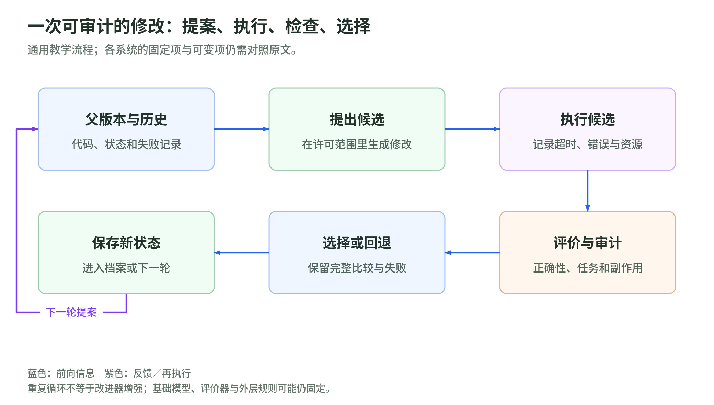

# 06 工业研发与自动实验：可变部分和固定合同

资料核验截止：2026-10-17。Wiki 整理日期：2026-11-04。[返回专题](README.md)。

公司自报的研发参与、局部框架迭代和公开自动实验，各自说明了什么？

本页按此前研究快照组织。论文成绩和公司案例保留原作者报告及当时的实验条件；本次没有重新训练模型、运行这些系统或将材料更新为 11 月的新结论。术语可查[速查表](glossary.md)，来源身份与版本可查[来源台账](sources.md)。

## 模型参与自身研发与开源自动实验

### 从“会做实验”到“进入模型研发流程”

科学家智能体多数优化外部研究产物。另一类行业进展更直接地接近 AI 研发反馈：团队使用早期模型帮助训练、检查或部署后续模型，或者让研究 agent 修改自己的运行框架。

这类流程值得记录，但公开程度通常低于一个完整实验论文。研发工具参与了多少工作、哪些决策由人完成、后续模型的增益怎样归因，不能只靠产品分数回答。下面将它们明确列为公司自报，不与独立复现实验混写。

### GPT-5.3-Codex：早期版本帮助研发后续版本

OpenAI 在 2026 年 2 月 5 日的发布稿中表示，团队使用 GPT-5.3-Codex 的早期版本协助调试该模型的训练、管理部署、诊断测试和评价结果，并帮助改进运行框架。引用这个型号，是因为该公开研发案例，不是声称它在核验日仍是最新或性能最高的模型。[^47]

这个案例与“AI 自己创造了自己”之间有明显距离。发布稿里的主体是团队使用早期版本：人类组织研究、提供基础设施并决定训练过程，模型在其中承担部分分析和工程工作。

同日系统卡也没有将其 AI self-improvement 能力评为 High。High 是 OpenAI 风险框架的特定阈值，不是本篇的 RSI 判据；未达 High 不等于没有任何研发帮助，达到某项能力门槛也不能代替多代递归的因果实验。

这项记录支持，模型已经被有意用于自己后续版本的研发。公开材料没有分离这种帮助的全部贡献，也没有证明模型独立决定、执行和验证多代升级。阅读时应同时保留参与事实与人的组织角色。

### MiniMax M2.7：公司报告了更具体的 harness 自改进

MiniMax 在 2026 年 3 月的发布稿中称，内部版 M2.7 参与强化学习研发，能够处理文献、数据和实验启动，监测日志、诊断问题、修改代码并发起测试。研究者仍提出方向、预设要求并参与关键决策。[^48]

其中一个编程 scaffold 实验更接近前面的 agent 自改进路线。公司报告，模型分析失败轨迹、改写框架、评价并保留或回退，自主迭代超过 100 轮，内部评价性能提高 30%。具体修改包括采样参数、工作流指引和循环检测，不应直接转述成基础模型权重已经自动升级。

这里的“30%”也不能自行换成准确率提高 30 个百分点。公开发布没有充分交代该内部指标、基线、统计不确定性和完整复现实验包。另一项承担部分研发工作流的比例，也不等于替代相同比例研究人员。

它提供了局部 harness 优化进入内部研发的第一方记录。若要升级为更强 RSI 结论，需要公开固定起点、预算、验证隔离和新任务迁移，并证明新的改进方法在后续轮次确实更有效。公司自报可以是研究线索，但不充当独立认证。

### autoresearch：把自动实验压缩成几个可检查的部件

<!-- illustration: rsi-cycle-30ceff5979 -->

*图：一次可审计的修改：提案、执行、检查、选择。通用教学流程；各系统的固定项与可变项仍需对照原文。*
<!-- /illustration: rsi-cycle-30ceff5979 -->

Karpathy 的 autoresearch 在 2026 年提供了一个小型开源研究循环。它的三个部件很容易理解：`prepare.py` 固定数据和评价工具，agent 修改 `train.py` 里的模型、优化器和训练过程，人类通过 `program.md` 设定研究指令。[^49]

每次训练有五分钟墙钟预算，不包括启动和编译；运行后用验证 bits per byte 判断效果，较好改动保留，较差改动丢弃，再开展下一次尝试。这个指标衡量验证文本每字节所需的编码比特，较低表示预测更好，也便于比较不同词表的模型。

它值得作为工程参考，因为可变部分、固定评价和实验记录比较清楚。五分钟约束也有边界：同一机器上便于控制训练时长，不代表不同硬件、编译成本、评价开销和 agent 推理成本都严格相同。

默认版本里，`program.md` 仍由人编辑。代码目标反复变化，并不自动证明研究指令生成器也在学习。README 的万代代码引子是设想性叙述，不是已经完成万代递归的实验统计；本篇也没有运行这些训练。

如用于研究，应保留权限、资源与可修改范围限制，不把“让它自动跑”理解为需要取消安全边界。开源可检查性是它的优点，社区关注度则不能替代独立实验。

### 三类流程为什么不能放进同一个成功率

OpenAI 的案例是早期模型进入后续版本研发；MiniMax 的案例更具体地涉及内部框架迭代；autoresearch 则是公开的固定预算训练程序搜索。它们优化的对象、公开程度和可归因证据不同。

这几项足以说明，AI 参与 AI 研发已经不只有概念设想。但“有研发反馈”到“持续自主提升改进能力”之间，还需要独立评价、成本记录、多次运行和长期验证。补进产业版图之后，递归结论仍应按实际修改面和证据判断。

## 继续学习

下一页：[继续这条路线](evaluation-and-safety.md)。想检验预算和评分归因，可做[三个离线小实验](lab.md)。

相关材料：[自动研究与 oracle](../diffusion/04-autoresearch-and-oracles.md)、[Agentic RL 的优化目标](../training/agentic-rl-lab/policy-objectives.md)、[权重空间编程](../weight-space-programming.md)。这些相邻读本不替代本页的证据条件。

[^47]: OpenAI，[Introducing GPT-5.3-Codex，2026-02-05](https://openai.com/index/introducing-gpt-5-3-codex/)；[同日系统卡的 AI self-improvement 评价](https://deploymentsafety.openai.com/gpt-5-3-codex/ai-self-improvement)及[内部部署风险记录](https://deploymentsafety.openai.com/gpt-5-3-codex/misalignment-risks-and-internal-deployment)。公司第一方记录，不等于独立验证；其风险门槛不与本文 RSI 判据等同。
[^48]: MiniMax，[MiniMax M2.7: Early Echoes of Self-Evolution，2026-03-18 原始发布稿](https://www.minimax.io/news/minimax-m27-en)；[同公司同文 Research 页面](https://www.minimax.io/blog/minimax-m27)。两个页面不是两份独立验证；内部增益与工作流比例按公司自报处理。
[^49]: Karpathy，[autoresearch 官方仓库与 README，2026](https://github.com/karpathy/autoresearch)。本文只核对公开流程，未运行训练；固定训练时长不等于所有资源已匹配。
