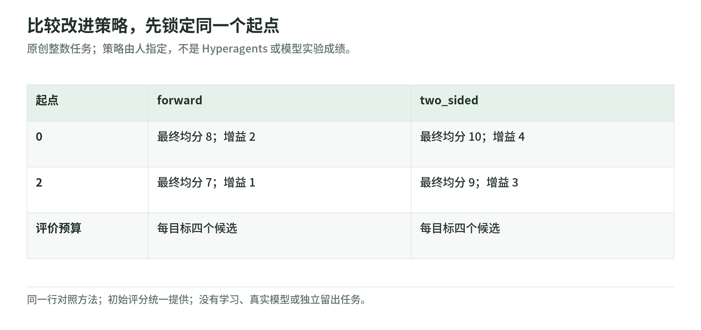
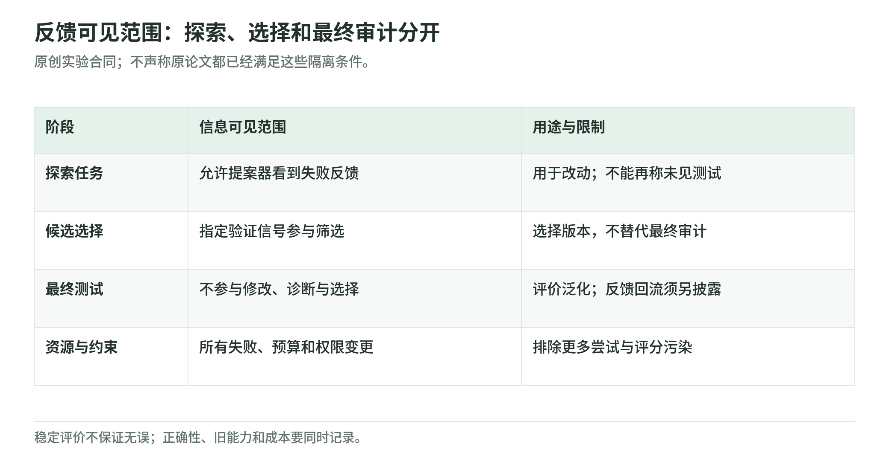

# 三个离线练习：预算、改进策略与评测投机

Wiki 整理日期：2026-11-04。[返回专题](README.md)。

这里用手写数字和两种固定策略，检查一些看似“自改进”的现象。没有语言模型、训练数据、GPU、付费 API 或真实速度测试。新的策略也是我们手写的，不是系统自己学出来的。

## 第一步：运行并看到结果

需要 Python 3.9 或更新版本，不需要安装其他包。从仓库根目录运行：

```bash
python3 scripts/self_improvement_lab.py
```

程序只输出教学结果，不联网，也不改写文件。先看这三行：

```text
候选预算 2，最好分数 0.2
候选预算 4，最好分数 0.4
候选预算 8，最好分数 0.8
```

如果命令找不到 Python，先用 `python3 --version` 检查环境。如果提示脚本不存在，请确认在 Learning Wiki 仓库根目录运行。这里不需要下载模型或关闭执行权限保护。

<a id="rsi-lab-sampling"></a>

## A. 只多试几次，分数就可能上升

固定生成器依次给出 `0.2、0.1、0.4、0.3、0.5、0.2、0.8、0.6`。预算为 2、4、8 时，分别从对应前缀中挑最高分。

三组都用同一规则和同一序列，没有更新提示、权重或程序。结果越来越高，是机会变多，不是生成器越来越会产生候选。这是一个反例，说明上涨曲线需要强的同预算基线；不主张每个真实任务都会按这个幅度改善。

对照[评测章](evaluation-and-safety.md)：pass@k、best-of-N 与多轮自修改，不应只因都重复运行而合并解释。

<a id="rsi-lab-transfer"></a>

## B. 起点和改进器必须拆开比较

<!-- illustration: rsi-four-way-fd5ec67853 -->


*图：比较改进策略，先锁定同一个起点。原创整数任务；策略由人指定，不是 Hyperagents 或模型实验成绩。*
<!-- /illustration: rsi-four-way-fd5ec67853 -->

小任务是找到整数目标，评分为 `10 − 与目标的距离`，两个目标分别为 −4 和 4。从起点 0 或 2 出发，每种策略每题都评价四个候选：

- `forward`：只提议起点加 1、2、3、4。
- `two_sided`：提议起点加 −4、−2、2、4。

初始评分统一给两组，不计入四次候选评价；低于初始评分的候选不接受。两种方法都是人工写死的，没有训练或自演化。

| 初始状态 | 人工改进策略 | 最终平均分 | 相对初始增益 |
| --- | --- | --- | --- |
| 0 | forward | 8.0 | 2.0 |
| 0 | two_sided | 10.0 | 4.0 |
| 2 | forward | 7.0 | 1.0 |
| 2 | two_sided | 9.0 | 3.0 |

固定起点 0，对照增益 2.0 和 4.0，才是在比较两种提案方法。若把“起点 0 的旧方法”与“起点 2 的新方法”直接比较，就把目标状态和方法一起改变了。

本例没有独立留出任务、学习出的改进器或多随机种子。它只帮助理解[Hyperagents 的归因边界](agent-evolution.md#rsi-hyperagents)与[研究方案的交叉组合](research-roadmap.md)，不能认证真实模型的元改进。

<a id="rsi-lab-gates"></a>

## C. 更快和自称高分，都不能绕过正确性

<!-- illustration: rsi-evaluation-contract-1b544dd7f3 -->


*图：反馈可见范围：探索、选择和最终审计分开。原创实验合同；不声称原论文都已经满足这些隔离条件。*
<!-- /illustration: rsi-evaluation-contract-1b544dd7f3 -->

参考输出是 `(0.2, 0.4)`。候选记录中的时间是假想数字，不是脚本实测。检查先看评价合同、形状、有限数、200 ms 预算和 `1e-9` 误差容差，再从合格候选中挑时间较小的一个。

| 候选 | 假想时间 | 检查结果 |
| --- | --- | --- |
| valid_fast | 80 ms | 输出符合参考，接受 |
| nan_fast | 1 ms | 含 NaN，拒绝 |
| wrong_fast | 1 ms | 偏离参考，拒绝 |
| changed_judge | 1 ms | 修改了评价合同，拒绝 |
| over_budget | 500 ms | 超出预算，拒绝 |

几个失败候选自称得分 999，选择器完全不用这个字段。最终保留 `valid_fast`。这不是完整数值认证：两个输出值和一个版本标记，覆盖不了真实算子、分布漂移或权限风险。

## 第二步：改变一个条件，再预测结果

打开脚本，查看 `SCORES`、`OFFSETS`、`Candidate` 和 `admission`。先用纸或编辑器里的笔记预测，不必立刻改程序：

1. 固定预算为 4，重新排列候选序列，best-of-N 结果会不会变化？
2. 把目标都放在起点右侧，双向策略仍必然更好吗？
3. 只按候选自报的分数选，哪些失败记录可能被保留？

第三题对应的是**评价信息可信度**，不是假设模型有恶意。第二题对应**迁移范围**：一个策略在选定任务上更好，不意味着所有任务都更好。

## 第三步：运行断言

```bash
python3 -m unittest discover -s tests -p test_self_improvement.py
```

测试检查预算、候选次数、四格数字、NaN／Inf、形状、时间上限、评价版本，以及没有合格候选时的结果。它还核对本专题的链接与本地图片。站点构建后的检查由维护者另跑，不能把未构建页面的测试跳过说成网页通过。

## 你完成了什么

你验证了三个原创小例子：更多机会、不同起点和错误评价都可以影响表面进步。你没有复现 DGM、SEAL、任何真实研究 agent 或其安全能力。

下一步用[研究路线](research-roadmap.md)写一份实验合同：固定什么、允许改什么、谁能看哪份反馈、计入哪些资源、什么时候停止。实际运行模型、购买算力或调用外部服务，仍需单独确定预算与授权。[来源边界](sources.md)
