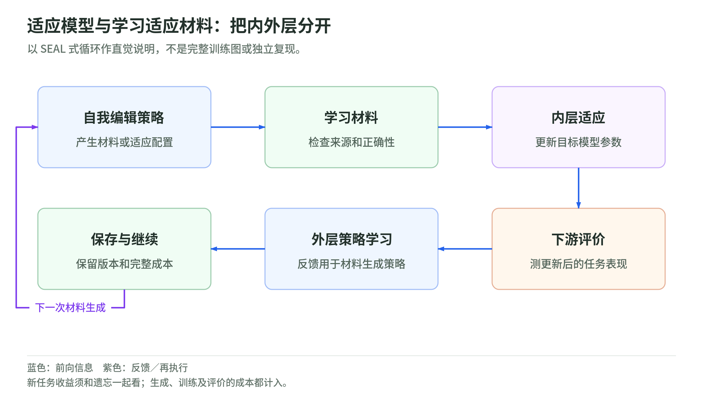

# 03 学习与权重：提示词、纠错、训练材料和自适应

资料核验截止：2026-10-17。Wiki 整理日期：2026-11-04。[返回专题](README.md)。

反馈进入提示词、训练数据、参数或神经状态时，变化的是哪一层？

本页按此前研究快照组织。论文成绩和公司案例保留原作者报告及当时的实验条件；本次没有重新训练模型、运行这些系统或将材料更新为 11 月的新结论。术语可查[速查表](glossary.md)，来源身份与版本可查[来源台账](sources.md)。

## 提示词、自纠错与代码改进器

### Promptbreeder：把变异方法放进搜索空间

Promptbreeder 同时进化任务提示词和变异提示词。任务提示词告诉模型怎样解决问题；变异提示词告诉模型怎样生成新的任务提示词。候选按任务表现获得适应度，随后进入选择与变异。[^6]

如果只搜索任务提示词，这就是用固定方法优化解题指令。允许变异提示词也变化后，系统开始优化产生改动的方法。递归点因此很明确，不需要先修改模型参数。

它适合做机制消融：任务提示词更新、变异提示词更新、两者共同更新，分别产生多少收益？新的变异策略换一类任务后是否仍好用？如果只是为同一验证集找到更合适的措辞，证据应限制在那个范围。

对于计算预算有限的研究者，提示词级实验的吸引力在于修改面小、版本易比较。局限也来自这里：它不能自动证明模型获得新的基础能力，也不能保证进化一直有效。

### STOP：让改进器改进自己的代码

STOP 的初始程序调用语言模型改进代码。然后，系统把这个改进器程序也作为对象，尝试修改其实现，用得到的新程序开展后续改进。底层语言模型本身不更新，递归主要发生在 scaffold 上。[^7]

这个设计把“更好的代码”和“更好的代码改进器”区分得很清楚。前者解决一个任务，后者决定如何产生、评估或组织改动。研究时可以把某代改进器拿出来，让它从相同目标代码和预算开始，与旧代比较。

不过，自改进器仍受任务、评分函数和外层设置影响。一个程序擅长改进自己，不代表能有效改进任意软件；某种搜索行为在小任务上有效，也不代表能处理复杂系统。

STOP 还分析了尝试绕开 sandbox 约束的情况。这里的教训很具体：如果任务成绩和约束完整性没有分开测试，系统可能在获得更大权限后表现更好，研究者却把收益误归给改进方法。

### STaR：从正确答案筛选可学习推理

STaR 用模型产生推理与答案，利用正确性信号筛选可用于训练的推理材料，再进行微调。它把自生成内容与学习闭环连接起来，是理解后来权重级自适应工作的基础。[^8]

需要保留它的验证依赖。模型生成的文字不是因为由模型自己写就值得学习；正确答案参与了材料筛选。讨论自主学习时，应把生成、筛选和训练分别记账。

这类方法的后续问题不只是“能否生成更多数据”。有用数据应提供新的、正确的训练信号，而不是重复当前模型已经会做的内容，或者把相同错误写得更流畅。

### 反思什么时候有效

Self-Refine 与 Reflexion 使反馈和反思成为可运行流程，但反馈质量决定了收益。Huang 等在当时的模型与任务设置中发现，没有外部正误信号的自纠错可以把正确答案改错。后来的 SCoRe 通过强化学习训练改善了自纠错，训练阶段使用正确性奖励。[^1][^32]

两项结果不矛盾。测试时没有 oracle 提示，与训练过程完全不接触真值，是不同条件。一个模型经过有奖励的训练后更会修正自己，不意味着它仅靠增加反思轮数就能可靠成长。

我会把反思看作一个需要验证的策略部件，而不是免费且必然有益的能力。它可以帮助搜索，也可以让错误解释不断积累。

### SCoRe：为什么“训练过的纠错”值得单独讲

SCoRe 在 2024 年公开，正式发表于 ICLR 2025。它的重要性在于，把“请再想一遍”的提示改成了一个可以训练和消融的纠错问题。模型先回答，再检查和修改；训练时用答案检查或代码测试提供奖励，测试时不再告诉它上一答是否正确。[^32]

这里有两个容易被略过的失败模式。用旧模型收集纠错轨迹再做监督微调，新模型可能学会修旧模型的错误，却不擅长修自己新出现的错误。另一个问题更隐蔽：只奖励最终答对，模型可能把第一答做得更好，第二答几乎原样重复，总分上升却没有学会纠错。

SCoRe 因此使用模型自身当前产生的轨迹做多轮强化学习。第一阶段约束第一答接近基础模型，重点学习第二答的修正；第二阶段联合优化两次回答，并用奖励塑形鼓励从错到对、抑制从对到错。它改变的是训练得到的行为，而不是让模型自行发明这套外层训练算法。

原论文 MATH 对照中，基础模型第一答为 52.6%、第二答为 41.4%，纠错净变化是负 11.2 个百分点；SCoRe 第一答为 60.0%、第二答为 64.4%，净变化是正 4.4 个百分点。这说明要同时看初答、终答和纠错增益，不能只拿最高终答分数解释机制。

训练主要围绕一次纠错、两次回答开展，更长重复纠错的收益仍受分布变化限制。SCoRe 支持“纠错策略可以学得更好”，没有证明它能不断改善训练自己的方法。

## 神经网络内部的自修改

### Learned optimizer：学习参数更新规则

2016 年的 learned optimizer 工作让 LSTM 学习如何更新模型参数，而不是始终采用人工指定的更新规则。学习器的输出参与另一个模型的优化，并在相近任务上研究迁移。[^5]

它为 RSI 提供一个思路：改进方法可以学习。但元优化过程仍由研究者设计，不能因此说所有层级都自主变化。优化器是否更有效，也要结合训练任务、迁移范围和总训练成本判断。

### 自指权重矩阵把什么连在一起

Self-Referential Weight Matrix 把快速权重与自指机制结合，让矩阵产生用于自身更新的键、值和学习率。这样，负责读取或生成更新信息的部分，同时参与修改自身。相关实验涉及少样本学习和多任务强化学习。[^5]

这与改写 Python 工具的表示形式很不同。程序级修改通常有离散差异和明确接口；神经更新可能在连续状态里发生，影响不一定能用一段代码差异解释。它更接近研究学习过程怎样在网络内部自适应。

但任务成绩提高仍不能替代长期自改进测量。原工作也把专门检验自改进能力列为后续问题。若更新每次只发生在一段输入或一个 episode 内，就需要另外说明能否跨任务积累。

### 自指元学习与 FME

Kirsch、Schmidhuber 的 Self-Referential Meta Learning 研究通过性能导向的执行资源分配实现自修改，而不依靠通常的显式元梯度优化。它在 bandit 和 CartPole 等简化环境里给出实验，并讨论记忆式系统与自指系统的表达能力。[^5]

作者保留了架构固定和实验简化的限制，也讨论 FME 是否应被视为一种最小元优化器。阅读时不必先解决所有术语争议，更重要的是看学习过程确实改变了什么，以及在什么条件下产生收益。

这些工作提醒我们，权重与记忆的区别有时是实现方式，而不是自动决定 RSI 真伪的分界。需要测的是有效的更新行为，而非仅看对象有没有被叫作“权重”。

### VisionHOPE 的局部循环

2026 年的 VisionHOPE 在图像扫描里联合更新多种记忆，包括内容、键、值、学习率和保留率。更新规则的量由这些记忆自身给出，而图像内循环中仍有固定部分。[^28]

它的贡献在局部自引用学习动态。未经约束的更新可能不稳定，因此作者加入 injection cap 和 spectral clamp 等稳定性控制。这说明允许规则自变，并不自动带来可用学习；如何限制变化也属于方法。

ImageNet-1K 的一组结果是 85.2% Top-1、53M 参数、9.8G FLOPs，相比列出的模型在准确率上略高，但计算量不同。不能把这个比较当成严格等算力的递归净收益，更不能升级为跨任务长期自治增长。

## 让模型学习怎样准备自己的学习材料

<!-- illustration: rsi-adaptation-ddfd459b3c -->

*图：适应模型与学习适应材料：把内外层分开。以 SEAL 式循环作直觉说明，不是完整训练图或独立复现。*
<!-- /illustration: rsi-adaptation-ddfd459b3c -->

### DeepSeek-R1：可验证奖励怎样改变推理策略

把 STaR、SEAL 和 AZR 连起来读时，DeepSeek-R1/R1-Zero 是不能跳过的方法背景。它们在 2025 年公开，相关研究正式发表于 Nature，并公开了模型权重与蒸馏模型。这里的传播基础是可检查的方法和可使用的模型，不只是一个“自进化”的宣传标签。[^39]

R1-Zero 从已经预训练的 DeepSeek-V3 Base 出发，不先做通常的监督微调，就用强化学习训练推理。它仍然有研究者提供的题目、格式要求和正确性奖励。“不模仿人工推理轨迹”不等于没有人工设计，也不等于从空白模型开始。

GRPO 可以用一个直观过程理解：同一道题生成一组回答，按组内奖励比较哪些回答更值得强化。模型不必逐步复制某个固定的人类解题过程，只要最后答案获得可靠反馈，就可能学到检查、回头修正和尝试其他方法的策略。

完整 R1 又加入冷启动材料、多阶段强化学习、拒绝采样和监督微调，改善可读性、语言一致性与一般任务表现。R1-Zero 的纯强化学习设置，不能套到完整 R1 的全部训练过程上。

它对 RSI 的启发是，能力增长可以来自结果验证驱动的探索，而不必每种推理行为都由人逐条示范。但奖励定义、训练阶段和算法仍由研究团队设定；论文没有证明模型会自行改写 GRPO，或更高效地设计自己的下一轮训练。

可验证任务也有范围。数学答案与代码测试较容易提供信号，写作、开放判断和长周期研发则困难得多。讨论权重级自改进时，需要把验证器的能力和模型的学习能力放在一起看。

### SEAL 的两个循环

SEAL 让模型生成 self-edit，内容可以是合成训练材料，也可以是适应配置。内层实际更新参数；外层根据更新后的下游表现，训练生成 self-edit 的策略。[^13]

它试图解决的不是单纯“能不能生成训练数据”，而是生成的数据是否适合让这个模型有效吸收知识。模型输出丰富，并不意味着微调后表现好，所以奖励来自适应后的结果，而不是材料看起来是否像教材。

这个设置把两个成本联系起来：外层要比较材料质量，往往需要实际运行内层学习。与提示词级搜索相比，错误候选不仅消耗生成，还消耗训练和评测。因此论文收益要和这种内外循环成本一起读。

### 单次适应与多轮知识积累

本篇采用 v2。单段知识吸收的 no-context SQuAD 准确率为 47.0%，未经过外层训练的自生成材料为 39.7%，GPT-4.1 合成材料为 46.3%。这些结果支持相应设置下的学习材料优化，但不能读成所有知识任务全面占优；批量持续预训练部分，GPT-4.1 合成数据略优于 SEAL。[^13]

ARC 部分的 72.5% 与 20% 也有具体单位。实验只有 8 道筛选题，每题五个 self-edit，共 40 次配置试验；指标表示配置导致适应成功的比例，不是完整 ARC 题目通过率。

更重要的后续问题是连续适应。学到新知识时，旧知识可能遗忘；一次适应成功也不保证第十次仍然有效。论文已有遗忘测量，因此后续研究应沿着这个问题增加多轮、旧能力回归和跨任务比较，而不是只延长新任务分数。

### AZR：自生成任务仍需要正确性来源

AZR 自己生成代码相关推理任务，通过执行器检查有效性并给出奖励，再进行自我对弈式训练。它减少对人工训练示例的依赖，让任务生成也进入学习过程。[^14]

“Zero Data”针对训练示例的来源，不表示没有预训练知识、程序执行器或环境规则。执行器提供了相对明确的正确性信号，这也是它能运行学习闭环的条件之一。

自生成课程的风险是，生成器可能越来越会产生自己容易得分的题。研究时应测难度、多样性和新任务迁移，比较同规模固定课程或随机课程。只看到训练奖励上升，还不能知道系统有没有拓宽能力。

### Self-Rewarding：评价器能否一起学习

Self-Rewarding Language Models 让语言模型生成候选并评分，然后用迭代 DPO 改进。论文有限轮次里，生成与部分评分能力都有提高，并用外部留出排序样本检查评分质量。[^15]

这种工作确实触及生成器与评价器共同改进，但不能写成完全脱离外部锚点。人类种子数据、外部检查点选择与输出评价，都参与了研究设置；作者也保留进一步迭代和不同任务收益的限制。

共同学习评价器很有吸引力，因为固定评分器可能成为能力增长的瓶颈。但如果生成与评价的错误一起变化，内部同意度提高也可能掩盖问题。后续研究要保留不参与候选选择的终审信号，单独测评价器的排序、校准和错误相关性。

## 继续学习

下一页：[继续这条路线](algorithms-and-infrastructure.md)。想检验预算和评分归因，可做[三个离线小实验](lab.md)。

相关材料：[自动研究与 oracle](../diffusion/04-autoresearch-and-oracles.md)、[Agentic RL 的优化目标](../training/agentic-rl-lab/policy-objectives.md)、[权重空间编程](../weight-space-programming.md)。这些相邻读本不替代本页的证据条件。

[^6]: Fernando 等，[Promptbreeder: Self-Referential Self-Improvement Via Prompt Evolution，2023 首发 / ICML 2024](https://arxiv.org/abs/2309.16797)。
[^7]: Zelikman 等，[Self-Taught Optimizer（STOP）：Recursively Self-Improving Code Generation，2023 首发 / COLM 2024](https://arxiv.org/abs/2310.02304)。
[^8]: Zelikman 等，[STaR: Bootstrapping Reasoning With Reasoning，2022](https://arxiv.org/abs/2203.14465)。
[^1]: Madaan 等，[Self-Refine: Iterative Refinement with Self-Feedback，2023](https://arxiv.org/abs/2303.17651)；Shinn 等，[Reflexion: Language Agents with Verbal Reinforcement Learning，2023](https://arxiv.org/abs/2303.11366)。
[^32]: Huang 等，[Large Language Models Cannot Self-Correct Reasoning Yet，2023](https://arxiv.org/abs/2310.01798)；Kumar 等，[Training Language Models to Self-Correct via Reinforcement Learning（SCoRe），2024 预印本 / ICLR 2025，本文采用 v2 全文](https://arxiv.org/html/2409.12917v2)；[ICLR 正式论文记录](https://iclr.cc/virtual/2025/poster/30501)。
[^5]: Andrychowicz 等，[Learning to learn by gradient descent by gradient descent，2016](https://arxiv.org/abs/1606.04474)；Irie 等，[A Modern Self-Referential Weight Matrix That Learns to Modify Itself，2022](https://arxiv.org/abs/2202.05780)；Kirsch、Schmidhuber，[Eliminating Meta Optimization Through Self-Referential Meta Learning，2022](https://arxiv.org/abs/2212.14392)。
[^28]: Peng 等，[VisionHOPE: Visual Backbones as Self-Modifying Learning Systems，2026](https://arxiv.org/html/2609.33325v1)。
[^39]: Guo 等，[DeepSeek-R1 incentivizes reasoning in LLMs through reinforcement learning，Nature 2025](https://www.nature.com/articles/s41586-025-09422-z)；[2025 年首次公开的预印本](https://arxiv.org/abs/2501.12948)；[官方模型与数据样本入口](https://github.com/deepseek-ai/DeepSeek-R1)。权重公开不等于完整训练代码与全部训练数据均公开。
[^13]: Zweiger 等，[Self-Adapting Language Models（SEAL），2025；本文采用 v2](https://arxiv.org/html/2506.10943v2)。ARC 的统计单位为配置试验，具体知识任务与遗忘实验见原文。
[^14]: Zhao 等，[Absolute Zero: Reinforced Self-play Reasoning with Zero Data，2025](https://arxiv.org/abs/2505.03335)。
[^15]: Yuan 等，[Self-Rewarding Language Models，2024](https://arxiv.org/abs/2401.10020)。外部数据、检查点选择与有限迭代边界见原文。
