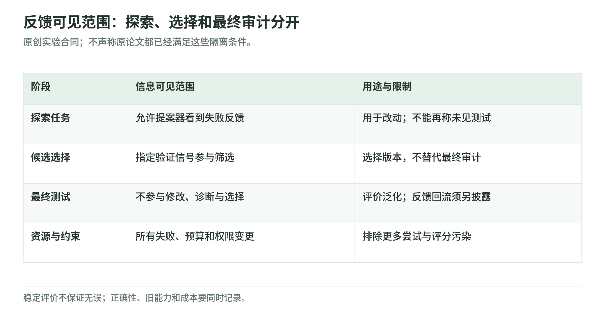
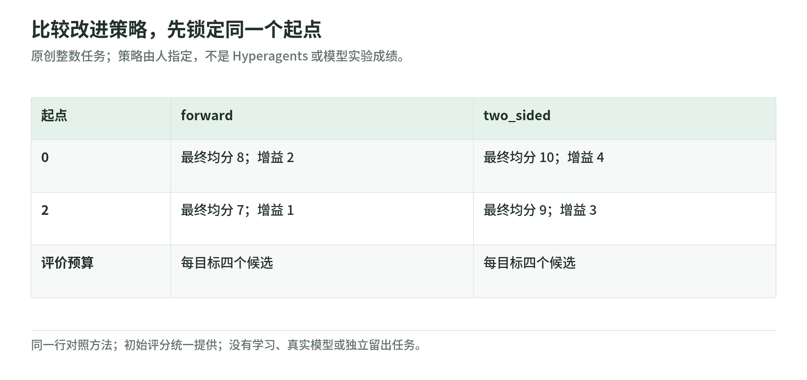

# 08 研究路线：怎样提出可归因的自改进问题

资料核验截止：2026-10-17。Wiki 整理日期：2026-11-04。[返回专题](README.md)。

在固定预算和未见任务上，如何比较新旧改进器，并保留失败与退化记录？

本页按此前研究快照组织。论文成绩和公司案例保留原作者报告及当时的实验条件；本次没有重新训练模型、运行这些系统或将材料更新为 11 月的新结论。术语可查[速查表](glossary.md)，来源身份与版本可查[来源台账](sources.md)。

## 可以怎样做一项有辨识度的研究

<!-- illustration: rsi-evaluation-contract-87ecc37ebe -->

*图：反馈可见范围：探索、选择和最终审计分开。原创实验合同；不声称原论文都已经满足这些隔离条件。*
<!-- /illustration: rsi-evaluation-contract-87ecc37ebe -->

### 课题一：同预算的改进器迁移

我最建议先研究这个问题：可演化改进器在未见任务上，能否比固定改进器更有效地优化一个给定系统？

先选规模小、可自动检验、能够生成新实例的程序任务。初始 agent 应已经能运行，输出格式正确，避免把修复一个格式错误造成的零分提升，当成全部元改进。

开发任务族用于产生候选；迁移任务族用于测改进能力；最终密封集不参与诊断和选择；旧能力回归集检查退化。这些集合按任务家族区分，比只随机分开同一类题更能解释迁移。

对照至少应包含固定改进器、普通进化搜索、多次采样和可演化改进器。全部使用相同底模、任务反馈与预算。不能同时匹配所有资源时，分别报告等 token、等成本等口径，而不是把它们混成“同预算”。

核心结果应回答，新方法找到有效修改的概率、达到给定性能所需资源和未见任务上的增益是否更好。最高分可以报告，但不应取代多次独立运行和完整成本。

### 用交叉组合拆开 task agent 与 meta agent

<!-- illustration: rsi-four-way-347e97d73a -->

*图：比较改进策略，先锁定同一个起点。原创整数任务；策略由人指定，不是 Hyperagents 或模型实验成绩。*
<!-- /illustration: rsi-four-way-347e97d73a -->

Hyperagents 迁移同时带入两种实现，提供了一个可以加强的对照设计。把旧 task agent、旧 meta agent、新 task agent、新 meta agent 交叉组合，比较四种条件：

- 旧任务程序，由旧改进器继续改进；
- 旧任务程序，由新改进器继续改进；
- 新任务程序，由旧改进器继续改进；
- 新任务程序，由新改进器继续改进。

如果只换新改进器就带来额外后续增益，元机制的归因更直接。若收益主要来自新任务程序，那么应报告目标系统已经变好，而不是把贡献全部给改进器。

还可以重置外部记忆与历史档案，检查机制变化与经验积累的贡献。重置会改变系统条件，因此应作为单独消融，不能偷偷把对照组所需的信息去掉。

### 课题二：评价器接受了什么错误修改

固定终审任务之外，可以构造变异测试、反例或轨迹交叉检查，用来研究候选评价质量。指标可以包括错误接受率、错误拒绝率、评价耗时和约束绕过率。

这样做的贡献不必是一个更高排行榜分数。若一种检查能用较低成本减少接受错误更新，或者在新任务上保持校准，就有清晰的科研问题。

但不要只用“加一个更强 LLM 评价器”解释可靠性。新评价器的能力、价格和与提案器的错误相关性，都需要分开测。

### 课题三：多轮权重适应怎样保留旧能力

沿着 SEAL，可以在连续阶段加入新知识或技能，同时复测早期内容与通用能力。自生成材料、固定模板、外部材料和检索增强等方法，应控制训练 token、更新预算及任务可见信息。

这里值得问的不只是平均正确率。旧任务里哪一类更容易遗忘？新材料是否只是改写已知内容？训练后的自编辑策略能否换模型或任务继续有效？

我会先做小规模、多轮和完整回归，再决定是否扩大训练。一次适应的漂亮结果不够解释知识积累。

### 课题四：自生成课程是否真正扩展能力

沿着 AZR，可以比较自生成课程、固定课程与随机课程，控制任务数量和训练预算。需要追踪可验证性、难度、多样性以及课程外迁移。

难度不能只由系统当前是否会做来决定。越来越容易评分的任务，可能减少学习价值；表面复杂的任务，也可能因验证错误被错误接受。

生成器与求解器共同演化时，保留独立任务测试很重要。课程奖励上升应和未见任务能力一起展示。

### 课题五：研发工具优化的净反馈

沿着 AlphaEvolve，可以研究一个优化过的内核、搜索工具或实验调度方法，究竟提高了多少端到端研发吞吐量。需扣掉寻找、验证和部署优化的成本，测量收益多久能摊销。

把节省的资源再次投入研发，与直接将原预算用于更多任务比较。如果后续单位预算增益更高，才更接近一条被测量的反馈循环。

这个方向有工程价值，也容易出现量尺混淆。局部内核更快、总训练更快、总研究周期更快，应分别报告。

### 一次完整实验应留下什么

每次候选修改应记录父版本、代码或参数差异、使用的反馈、模型版本、资源、分数、接受规则和失败原因。最终版本之外，保留失败轨迹与回滚快照。

统计方案在最终结果出来前确定，使用多个独立运行。种子数量应考虑先导实验的方差与预算，不应事后只挑成功运行。

我会画出任务能力、后续改进增益和累计资源曲线，并报告失败、退化和约束违反。这样能看到新能力增长是否真实，以及增长换来了什么成本。

对于研究结论，限定范围并不降低价值。“这个改进器在三种新任务族、相同预算里更有效”比一个没有控制条件的“实现 RSI”标签更容易积累知识。

## 阅读路线与最终判断

### 按兴趣选择论文顺序

想抓住最近的元改进问题，可以读 DGM、Hyperagents、AIDE²。三者依次让你看到自修改编码系统、直接的改进能力测量，以及研究效率与 ignition test 之间的差距。

想做较小且可控的实验，先读 Promptbreeder、STOP，再看固定与可变提案策略怎样消融。做 agent 工程时，ADAS、SICA、Meta-Harness 的程序表示与轨迹利用值得比较。

关注模型训练，则读 STaR、DeepSeek-R1、SCoRe、SEAL、AZR、Self-Rewarding，并把验证信号、遗忘与数据机制放在同一张研究记录里。关注网络内部学习过程，先用 MAML、RL² 理清内外层，再读 learned optimizer、SRWM、自指元学习和 VisionHOPE。

关注行业进展，可以把 AlphaTensor、AlphaDev、FunSearch 与 AlphaEvolve 串起来读，再比较科学家智能体和模型内部研发。前者提供程序检查与部署的案例，科学家智能体展示研究过程和人的实验责任，内部研发报告则需要补看开发者自报与公开边界。

研究评测时，把 MLE-bench、RE-Bench、PostTrainBench 与奖励过度优化、模型崩溃和自纠错研究一起读。正面机制和负面结果需要相互限定，不能单独选一边推导全部领域结论。

### 最新综述应该怎么用

2026 年的 RSI 综述有助于建立检索地图，尤其是区分结果层面的改进与过程层面的改进。但其报告的 1,250 篇是检索语料，不是 1,250 个成功 RSI 实验；分类由单一标注者完成，也有外围检索噪声。[^36]

因此，综述可以帮助找到研究，但关键结论仍应回到原实验。不同作者对 bounded refinement、open-ended RSI 的边界也不一致，不能只采用术语最强烈的一种说法。

### 这组文献支持什么

它们支持 AI 能在若干条件下改进自己的提示词、工具、执行程序、学习材料与探索策略。部分 2026 工作更直接地测量改进机制的迁移，说明“改进能力”已经可以被设计成实验对象。行业案例还提供了算法库应用、半自主科研流程，以及模型参与后续版本研发的公开记录。

它们尚不足以确认持续、自加速、跨域通用的长期闭环。主要缺口包括因果归因、资源匹配、独立评价、长期退化，以及新旧改进器在相同起点上的可重复比较。

我的研究兴趣因此集中在可验证的元改进。先确认系统更会产生有效修改，再研究这种优势能否迁移和持续。对更远的增长命题，可以保留开放态度，但不把它写成当前实验已经取得的结果。

## 继续学习

下一页：[继续这条路线](lab.md)。想检验预算和评分归因，可做[三个离线小实验](lab.md)。

相关材料：[自动研究与 oracle](../diffusion/04-autoresearch-and-oracles.md)、[Agentic RL 的优化目标](../training/agentic-rl-lab/policy-objectives.md)、[权重空间编程](../weight-space-programming.md)。这些相邻读本不替代本页的证据条件。

[^36]: Chen 等，[Recursive Self-Improvement in AI: From Bounded Self-Refinement to Autonomous Research Loops，2026；v2](https://arxiv.org/html/2607.07663v2)。1,250 为语料规模；标注、外围检索与术语边界见原文。
