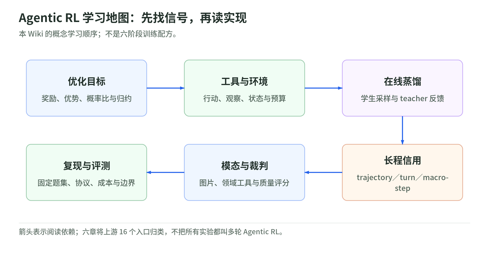
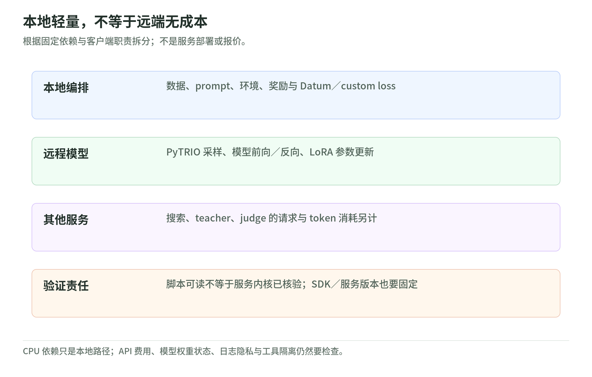

# Agentic-RL Lab：把后训练配方拆成可理解的实验

研究日期：2026-11-03。[训练专题](../README.md) · [源码与核验边界](sources.md)。

[Datawhale 官方仓库](https://github.com/datawhalechina/agentic-rl-lab)适合回答“这些算法在代码里到底改了哪一段”，[Rufus-Air](../rufus-air/README.md)则适合回答“多个阶段怎样组成后训练流水线”。两者互补，不是小模型教程已经复现了大型模型 recipe。

本读本依据固定源码版本重新组织知识，没有照搬上游课号、截图和实验曲线。仓库的 16 个目录入口也不等于 16 个新算法或 16 篇同规模论文；有基础损失说明、训练实验、领域应用和评测方法。[固定实验目录](https://github.com/datawhalechina/agentic-rl-lab/blob/8493321013c02eef6cf79ca2594811f53c6fdac1/experiments/README.md)

## 1. 先看学习地图：六类问题，不是算法名字串

<!-- illustration: arl-learning-map-f930ad1342 -->

*图：Agentic RL 学习地图：先找信号，再读实现。本 Wiki 的概念学习顺序；不是六阶段训练配方。*
<!-- /illustration: arl-learning-map-f930ad1342 -->

| 学习问题 | 本 Wiki 章节 | 看完应该能解释 |
| --- | --- | --- |
| 奖励怎样改变下次生成？ | [01 优化目标](policy-objectives.md) | advantage、IS、PPO、CISPO；GRPO／DAPO／GSPO 的不同 |
| 一段回答怎样变成多轮行动？ | [02 工具与环境](tools-and-environments.md) | Search-R1、ReTool、ALFWorld；动作、观察、mask 与安全 |
| 老师不提供示范回答，还能教吗？ | [03 在线蒸馏](on-policy-distillation.md) | OPD、OPSD、teacher 条件、reverse KL 与训练特权 |
| 最后失败了，究竟哪一步该改？ | [04 长程信用分配](credit-assignment.md) | trajectory／turn／macro-step；AgentOPSD 与 TEMPO |
| 图片、领域工具和裁判怎样接进来？ | [05 多模态与评分器](multimodal-and-judges.md) | Vision GRPO、Spec-o3、Jev、Tournament-GRPO |
| 怎样知道真的改善，而非换了协议？ | [06 评测与复现](evaluation-and-reproduction.md) | train／dev／test、预算、服务、数据、失败与测量合同 |
| 不用模型服务能检查什么？ | [标准库实验](lab.md) | 优势、裁剪梯度、归约、动态采样与几何平均 |

## 2. 上游 16 个入口怎样落到这张地图

下面的任务与结构来自各目录的教程／源码，不表示我们运行了这些模型实验。

| 上游目录 | 核心教学对象 | 本读本入口 |
| --- | --- | --- |
| `loss-functions` | IS、PPO、CISPO 的学习信号 | 01 |
| `grpo` | GSM8K，同题多候选的相对反馈 | 01、实验 |
| `dapo` | 非对称裁剪、补采、token 归约、长度惩罚 | 01、06 |
| `gspo` | 序列级比率、裁剪与分母 | 01、实验 |
| `general-opd` | student 采样，teacher 评分 | 03 |
| `medical-opd` | 医疗与通用目标的蒸馏实验，不是临床验收 | 03、06 |
| `opsd` | 固定 self-teacher 与不同训练条件 | 03 |
| `agentopsd` | 带 skill 的 teacher 与 turn-level credit | 03、04 |
| `search-r1` | 搜索行动与外部证据 | 02、06 |
| `retool` | 推理与代码执行交织 | 02、06 |
| `alfworld` | 持久的 TextWorld 家务任务 | 02、04 |
| `tempo` | macro-step actor-critic | 04 |
| `vision-grpo` | GeoQA 图片条件下的回答优化 | 05 |
| `spec-o3` | 光谱分类、工具、SFT → GRPO | 05 |
| `pytrio-jev` | 判断 token 的 SFT、概率与校准 | 05 |
| `tournament-grpo` | 同题报告比赛与相对奖励 | 05、06 |

想查上游原课序与执行入口，回到[固定目录](https://github.com/datawhalechina/agentic-rl-lab/blob/8493321013c02eef6cf79ca2594811f53c6fdac1/experiments/README.md)；本课按概念依赖排序，不宣称各实验共用完全相同的损失、模型、数据或服务配置。

## 3. 为什么“本地不用 GPU”不等于没有计算成本

<!-- illustration: arl-local-remote-664f073d20 -->

*图：本地轻量，不等于远端无成本。根据固定依赖与客户端职责拆分；不是服务部署或报价。*
<!-- /illustration: arl-local-remote-664f073d20 -->

仓库将训练和采样交给远程 PyTRIO，本地负责数据、环境、评分与训练载荷。固定 `pyproject.toml` 要求 Python ≥3.13，固定 `pytrio==0.2.9`、`swanlab==0.9.2`，Torch／TorchVision 使用 CPU 源；ALFWorld 另有 optional extra。[依赖与职责说明](https://github.com/datawhalechina/agentic-rl-lab/blob/8493321013c02eef6cf79ca2594811f53c6fdac1/pyproject.toml)

API 可以降低本地训练栈的搭建门槛，不能消除远程 GPU、模型服务、搜索、裁判和环境的费用。异步主要改善等待与并发，也不自动代表 off-policy 算法或训练／采样流水线并行。要继续检查每个脚本的权重同步与等待位置。

公开脚本让我们读到算法载荷，并不让远端实现的正确性自动可见。内置 loss 的归约、梯度传输、checkpoint 恢复、服务端版本，需要另行核验；不能把一个 `forward_backward` 调用当成完整框架的审计证据。

## 4. 与 Rufus-Air 的对照：从局部机制到整条流水线

| Rufus-Air 中的问题 | Lab 可用于拆解的局部机制 | 仍然缺的证据 |
| --- | --- | --- |
| Reasoning RL 怎样产生优势？ | GRPO、DAPO、GSPO | 同模型同数据的全规模消融与真实梯度 |
| Search／Coding Agent 怎样记轨迹？ | Search-R1／ReTool 的 rollout 与 mask | Rufus 专用环境、token 接口与预算 |
| 长任务的终局反馈怎样传回前面？ | ALFWorld、AgentOPSD、TEMPO | 大模型长轨迹迁移与环境独立评测 |
| 评分反馈能否代表真实质量？ | Jev、Tournament-GRPO、蒸馏 teacher | 独立 judge、人类验收与非目标能力 |
| 开放 recipe 能否直接复现？ | 可读的局部实验脚本 | 完整状态、专用适配、服务与数据合同 |

这张对照是 Wiki 的教学连接，不是两组作者做过的联合实验。Rufus-Air 最终 RLHF 不会因为这里讨论 OPD 或 DPO 就变成另一种更新方法。

## 5. 建议路线与边界

先记住几个最小术语，读代码时会反复出现：

| 术语 | 在这里的含义 | 别混成什么 |
| --- | --- | --- |
| policy／策略 | 给定当前上下文，生成下一步行动的模型分布 | 不是一条固定提示词 |
| rollout／轨迹采样 | 用指定权重实际生成回答，必要时与工具／环境交互 | 不是事后编辑好的聊天记录 |
| episode／turn | 一整局任务／其中一次 assistant 生成 | 不自动等于一次 optimizer update |
| state／observation | 世界状态／模型实际看到的部分信息 | 环境变化和文本变化不是同一件事 |
| advantage／优势 | 相对基线的学习方向与强度估计 | 不是逐步因果贡献或“绝对质量” |
| critic／价值估计 | 预测从某个状态继续的后续回报 | 不是最终正确性验证器 |
| mask／监督位置 | 哪些位置进入某项学习信号 | 不是哪些上下文对模型不可见 |
| on-policy／off-policy | 样本是否来自对应更新所假定的策略 | 用了 async 就自动 off-policy |

工具 Agent 可以借用状态、行动、转移、回报的强化学习语言。模型常只见观察和历史，未必知道完整环境状态；代码里一个高层工具调用又由多个 token 生成。因此“生成 token 的学习信号”和“语义行动对任务结果的贡献”需要分别解释，不能直接等号连接。具体的客户端合同见 [02](tools-and-environments.md) 和 [04](credit-assignment.md)。

30 分钟：本页 → 01 → 02，每页先回答自测。两小时：六章顺序读，在每章找出“谁采样、谁打分、谁更新”。半天：运行标准库实验，静态沿上游的 `data → rollout → reward → datum/loss → train → eval` 读一条链，填写复现合同。

这里的半天是学习任务，不是模型训练时间。本文不覆盖完整预训练课程，也不把本仓库扩展解释为生产级安全框架、通用多智能体 RL、机器人策略控制或完整分布式训练教程。

本次没有运行真实模型训练、下载模型权重或训练数据，没有调用远程训练、搜索、judge 服务。**源码静态核验、作者报告、原创教学计算和真实运行**分开记录；本 Wiki 实际执行的只有标准库机制实验和文档／网页验证。
