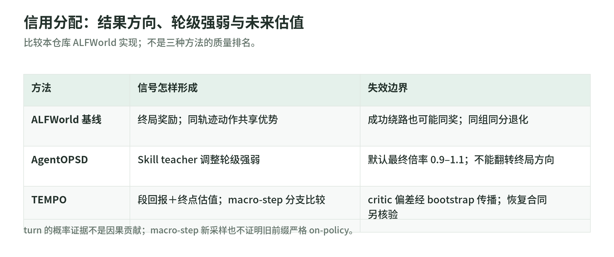

# 04 信用分配：从整条轨迹，到 turn，再到 macro-step

研究日期：2026-11-03。[读本导读](README.md) · [固定版本与来源](sources.md)。这里比较具体实现，不把教程当原论文逐项复现，也不把概率差当因果贡献。

## 1. ALFWorld：整局赢了，绕路也会被奖励

同一游戏从相同起点采样多条独立轨迹，基线 `rollout.py` 给每局一个分数：

$$
R_i=\mathbf1[\mathrm{won}_i]-0.1\,n_{\mathrm{invalid},i},
\qquad A_i=R_i-\operatorname{mean}(R).
$$

`advantages.py` 只减同组均值，没有除标准差。`train.py` 把同一 $A_i$ 赋给整条轨迹所有 assistant completion，包括推理和工具调用；prompt、工具观察优势为零，但仍保留在上下文。随后用内置 PPO，传入 ratio 阈值 0.8／1.2。[奖励][fr]、[优势][fa]、[Datum][ft]、[PPO 调用][fu]

因此它是 trajectory-level 的 GRPO-style 分组优势加 PPO 更新，不是逐动作奖励。成功但先开错柜门的轨迹，其绕路也可能一起被鼓励；全组同分则无信号。原始环境 `score` 被记录，不直接用作训练分数。[实现说明][fn]

原创手算：两条都成功的轨迹分别有两次、零次非法动作，分数为 0.8、1，优势为 −0.1、0.1。成功不保证正优势，“全成功”也不保证基线退化，因为惩罚还能拉开分数。后面的 AgentOPSD 去掉惩罚后，全成功组才必然退化。不能把两套奖励口径混用。[基线奖励][fr]、[Agent 奖励][arr]

## 2. AgentOPSD：结果定方向，teacher 调强弱

<!-- illustration: arl-credit-scales-b1e8c86d8f -->

*图：信用分配：结果方向、轮级强弱与未来估值。比较本仓库 ALFWorld 实现；不是三种方法的质量排名。*
<!-- /illustration: arl-credit-scales-b1e8c86d8f -->

AgentOPSD 先完成整条学生轨迹，奖励改为纯成功 1／失败 0，不再扣非法动作分。`train.py` 用更新前同一快照完成学生采样和 teacher 复评；只有 teacher 的初始 system prompt 多了固定 Skill。`teacher.py` 接上学生真实 token 后缀，一次请求整条轨迹，再按 action span 切出各轮证据。[奖励][arr]、[teacher][at]、[训练][atr]

这里的 action span 实际是该轮完整 assistant completion，不只是解析后的命令字符串。teacher 不重跑环境。整轨迹请求也不应等于未来泄漏：各 token 必须按自回归前缀评分；这是服务合同，本文未验证远端的因果实现。[span][ar]、[teacher][at]

每轮证据为 teacher 与学生 log-prob 差之和，不做长度平均。`advantages.py` 以组平均成功率作初始 belief，经裁剪到 $[\epsilon,1-\epsilon]$ 后，用 logit 加累计证据：

$$
E_t=0.95E_{t-1}+e_t,\qquad
B_t=\sigma(\operatorname{logit}(B_0)+E_t).
$$

它取 $\operatorname{sign}(A_i)(B_t-B_{t-1})$，在该轨迹各轮内标准化；权重裁剪到 0.8–1.2，再以 $\lambda=0.5$ 与原优势混合。组级 $A_i$ 这里除 population std 加 `epsilon=1e-4`，与基线不同。[优势实现][aa]

由代码可直接推出：最终每轮优势只在原 $A_i$ 的 0.9–1.1 倍内，不翻转符号；全组成功或全组失败仍是零。失败轨迹中 teacher 认可的一轮也不会被改成正优势。这不是“只靠过程评分训练”，而是终局方向上的有界重分配。[aa]

`loss.py` 用完整学生轨迹，只有 action span 携带所在轮优势，再调用 PPO；ratio 阈值是 0.8／1.24，别与 0.8–1.2 的 credit 权重混淆。[loss][al]

局限也具体：长 completion 容易累积更大证据，sigmoid 饱和会抹平轮间差异；belief 未经概率校准。`teacher._score_turns` 的概率相减使用普通 `zip`，未显式检查返回切片长度，短返回可能静默漏计；这不是已完成的全链路对齐保证。[teacher][at]、[优势][aa]

还有一个反直觉处：本轮证据为零，belief 也可能改变，因为历史累计证据仍在衰减。轮级 credit 因而包含时间递推的影响，并非独立裁判给每个动作的真值标签。错误 Skill、风格偏好或错误终局验证器，都不会被有界重塑自动纠正；裁剪只能限制强度，不能证明归因正确。[优势][aa]

## 3. TEMPO：未到终局，也能比较后续希望

TEMPO 在此是 ALFWorld 上的算法级移植，默认每个起点采 4 个分支，每段 10 轮、总上限 50 轮。它不是原博客环境与成绩的复现。actor 与生成式 critic 共用一个模型／LoRA，仅 prompt 和训练信号不同；walkthrough 专家动作只给 critic，不给 actor。[说明][tn]、[critic][tc]、[训练][tt]

`tempo.py` 给分支构造 $Q_i=r_i+\hat V(s'_i)$，起点目标 $G=\operatorname{mean}(Q)$，actor 优势为 $Q_i-G$。本实现没有额外折扣项；只有 `macro_boundary` 允许 bootstrap，其余终止原因尾部价值置零。两个尚未成功的分支，也能因终点估值不同获得相反优势。[信号][ts]

原创手算：段内奖励都零，终点估值分别 0.2、0.6，得到目标 0.4、actor 优势 −0.2、0.2。如果起点 critic 的两个回答估值为 0.3、0.8，误差奖励为 −0.1、−0.4，中心化后优势为 0.15、−0.15。前者比较行动分支，后者比较估值回答；两种 group 不是同一批样本。[信号][ts]

critic 在同一起点生成多次估值，以 $-|\hat V-G|$ 为奖励，`R_MAX=1`，再减组均值。它训练的是整段估值 completion，不是标量 value head 的均方误差。先跑完整轨迹，用真实终局 0/1 对边界状态做 MC warm-up；随后 TD 阶段合并 actor、critic Datum，以 `importance_sampling` 累积梯度，再更新共享参数。因此“warm-up 只训 critic”不表示 actor 权重独立且不变。[信号][ts]、[warm-up／更新][tt]、[loss 调用][tu]

## 4. 状态恢复与失效条件，比算法名更重要

`states.py` 同时保存动作历史、真实 token 前缀与环境 seed；`rollout.py` 新开环境重放动作，逐字核对观察，不一致就拒绝继续。segment Datum 保留旧前缀但不给它优势，只优化当前段生成内容。[状态][st]、[恢复][tr]、[Datum][td]

状态库是 FIFO 容量队列，均匀抽样不删除，旧前缀可被反复消费；代码未做前缀重要性比率修正。所以“当前段新采样”不能推出“整条历史严格 on-policy”，更不能直接套完整轨迹梯度等价保证。[状态][st]、[复现边界][tn]

critic 解析并不如文档所称的“严格单值模板”：代码取最后一个匹配 `<value>`，并裁到 0–1。终点全部解析失败时估值取零；过长 prompt 跳过也保留默认零。critic 训练样本解析失败得 −1，但同组全失败时中心化仍为零，无法自行学习修格式；错误估值又会经 bootstrap 传给 actor。[解析][tc]、[终点兜底][te]、[信号][ts]、[调用][tt]

另一个边界需结合停止顺序读：rollout 先检查总轮数，再检查段边界，最后才检查 token 预算；恰在段末超预算仍可能标成 `macro_boundary`，但状态保存又拒绝没有续跑前缀的终点。估值是否应继续 bootstrap，需要按实际剩余预算审计，不能只看“分支非成功”这一标签。[停止顺序][tb]、[入库条件][st]

PyTRIO 服务端 loss reduction、裁剪实现和跨块梯度累积语义未核验；本文只确认本地字段与调用，不声称远端数值等价。

与 Rufus-Air 对照：其 General Agent 明确只用终局验证奖励；Search Agent 用 mean-only 优势应对有噪声裁判。后者与本基线“只减均值”相似，但任务与奖励不同。可共同复用的是 token 保真、观察 mask、终止原因审计，而非认定 Rufus 已采用 AgentOPSD 或 TEMPO。[§3.5][r]、[§3.7][rs]、[§4.2][re]、[本站环境笔记](../rufus-air/agentic-environments.md)

## 5. 自测

1. 全组失败，Skill teacher 很有把握，还能让 AgentOPSD 更新吗？答：不能，终局组优势为零。
2. 哪个阈值保证默认 turn 不翻方向？答：credit 权重 0.8–1.2 与混合系数 0.5；不是 PPO ratio 裁剪。
3. TEMPO 段内奖励都零就一定无梯度吗？答：不一定，终点估值可拉开 return；估值也相同才退化。

## 来源与读取边界

实读 ALFWorld／AgentOPSD 的相关 README、start 及实现，TEMPO 的 README、dev 和下列代码；未发现独立 TEMPO start 文件。只静态核验，未运行上游、下载模型／数据或调用付费服务。公式与推论为机制解释，不引用原曲线作独立验证。

[fr]: https://github.com/datawhalechina/agentic-rl-lab/blob/8493321013c02eef6cf79ca2594811f53c6fdac1/experiments/alfworld/rollout.py#L563-L582
[fa]: https://github.com/datawhalechina/agentic-rl-lab/blob/8493321013c02eef6cf79ca2594811f53c6fdac1/experiments/alfworld/advantages.py#L18-L41
[ft]: https://github.com/datawhalechina/agentic-rl-lab/blob/8493321013c02eef6cf79ca2594811f53c6fdac1/experiments/alfworld/train.py#L249-L347
[fu]: https://github.com/datawhalechina/agentic-rl-lab/blob/8493321013c02eef6cf79ca2594811f53c6fdac1/experiments/alfworld/train.py#L523-L585
[fn]: https://github.com/datawhalechina/agentic-rl-lab/blob/8493321013c02eef6cf79ca2594811f53c6fdac1/experiments/alfworld/readme.md#L263-L330
[ar]: https://github.com/datawhalechina/agentic-rl-lab/blob/8493321013c02eef6cf79ca2594811f53c6fdac1/experiments/agentopsd/rollout.py#L371-L389
[arr]: https://github.com/datawhalechina/agentic-rl-lab/blob/8493321013c02eef6cf79ca2594811f53c6fdac1/experiments/agentopsd/rollout.py#L615-L630
[at]: https://github.com/datawhalechina/agentic-rl-lab/blob/8493321013c02eef6cf79ca2594811f53c6fdac1/experiments/agentopsd/teacher.py#L43-L122
[atr]: https://github.com/datawhalechina/agentic-rl-lab/blob/8493321013c02eef6cf79ca2594811f53c6fdac1/experiments/agentopsd/train.py#L496-L558
[aa]: https://github.com/datawhalechina/agentic-rl-lab/blob/8493321013c02eef6cf79ca2594811f53c6fdac1/experiments/agentopsd/advantages.py#L54-L151
[al]: https://github.com/datawhalechina/agentic-rl-lab/blob/8493321013c02eef6cf79ca2594811f53c6fdac1/experiments/agentopsd/loss.py#L24-L89
[tn]: https://github.com/datawhalechina/agentic-rl-lab/blob/8493321013c02eef6cf79ca2594811f53c6fdac1/experiments/tempo/readme.md#L99-L113
[tc]: https://github.com/datawhalechina/agentic-rl-lab/blob/8493321013c02eef6cf79ca2594811f53c6fdac1/experiments/tempo/critic.py#L63-L125
[te]: https://github.com/datawhalechina/agentic-rl-lab/blob/8493321013c02eef6cf79ca2594811f53c6fdac1/experiments/tempo/critic.py#L253-L262
[tt]: https://github.com/datawhalechina/agentic-rl-lab/blob/8493321013c02eef6cf79ca2594811f53c6fdac1/experiments/tempo/train.py#L318-L654
[tu]: https://github.com/datawhalechina/agentic-rl-lab/blob/8493321013c02eef6cf79ca2594811f53c6fdac1/experiments/tempo/train.py#L263-L278
[ts]: https://github.com/datawhalechina/agentic-rl-lab/blob/8493321013c02eef6cf79ca2594811f53c6fdac1/experiments/tempo/tempo.py#L53-L129
[td]: https://github.com/datawhalechina/agentic-rl-lab/blob/8493321013c02eef6cf79ca2594811f53c6fdac1/experiments/tempo/tempo.py#L155-L293
[st]: https://github.com/datawhalechina/agentic-rl-lab/blob/8493321013c02eef6cf79ca2594811f53c6fdac1/experiments/tempo/states.py#L23-L137
[tr]: https://github.com/datawhalechina/agentic-rl-lab/blob/8493321013c02eef6cf79ca2594811f53c6fdac1/experiments/tempo/rollout.py#L418-L495
[tb]: https://github.com/datawhalechina/agentic-rl-lab/blob/8493321013c02eef6cf79ca2594811f53c6fdac1/experiments/tempo/rollout.py#L302-L327
[r]: https://arxiv.org/html/2609.29421v2#S3.SS5
[rs]: https://arxiv.org/html/2609.29421v2#S3.SS7
[re]: https://arxiv.org/html/2609.29421v2#S4.SS2
