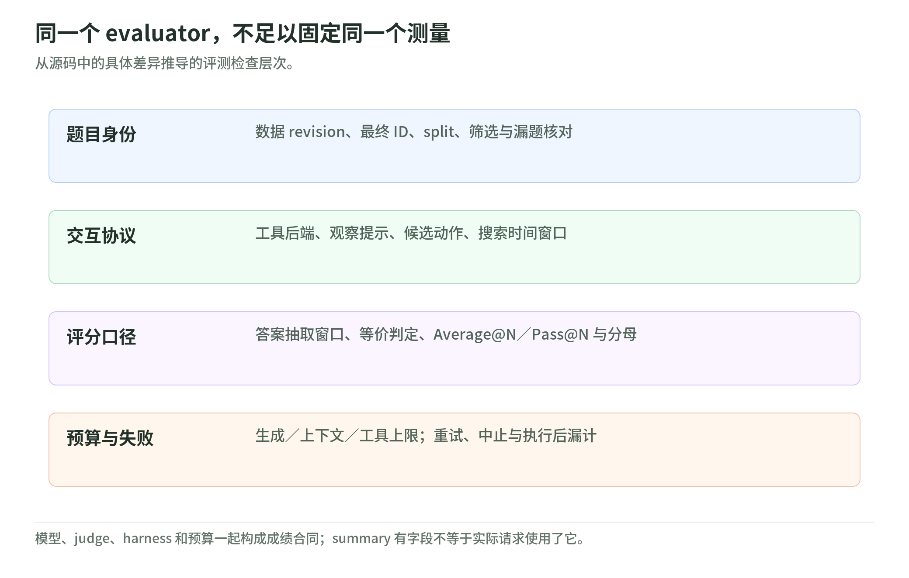

# 06 评测与复现：固定成绩背后的合同

研究日期：2026-11-03；[读本导读](README.md) · [固定源码版本](sources.md)。本章重点静态核验 Search-R1、ReTool、ALFWorld 的 README、启动指南、数据与评测／训练客户端，不表示复现过训练或作者成绩，也不表示审计过 PyTRIO 服务内核。协议与执行风险见 [工具与环境](tools-and-environments.md)。

## 1. 先问“成功率的分母是什么”

| 实验 | 题集与默认采样 | 成绩口径 |
| --- | --- | --- |
| Search-R1 | 固定 dev 共 70 题；每题一条，温度 `0` | 各来源 EM，再等权宏平均 |
| ReTool | AIME25 共 30 题；每题 12 条，温度 `1`、top-p `0.7` | Average@12、Pass@12、格式率 |
| ALFWorld | seen／unseen；每游戏一条，温度 `0.01` | 分 split 的 `won` 比例及行为指标 |

Search 数据准备按来源各取 10 题，默认七来源时宏平均等于总体正确率；但 evaluator 只强制总量 70，不验证七来源等量，更不验证文件哈希。`--limit` 在完整题集数量检查之后生效。[Search 数据][search-data] [Search 评测][search-eval]

还有静态可见的漏计边界：Search 的首轮 prompt 若已耗尽 token 预算，根轨迹被标记结束却不加入返回列表，该题会从成绩分母消失，而非计作失败。应核对输入题目数、返回轨迹数与 ID 一致性。[首轮轨迹构造][search-roots]

ReTool 的 Average@N 是答对轨迹数／全部轨迹数；Pass@N 是“至少一次答对”的题数／全部题数，并非把前者乘以 N。原创例：一题十二次只对一次，两个指标分别是 `1/12` 和 `1`，更大的采样预算可能抬高后者。[ReTool 聚合][retool-summary]

ALFWorld README 报告 seen=140、unseen=134；代码实际发现、筛选游戏，不强制这些数量。需保存最终游戏 ID 清单、split 和筛选条件，不能只认“274”。成功率按游戏，工具格式／动作合法率按步骤；平均 reward 还含非法动作惩罚，不是完成率。[游戏筛选][alf-data] [分母与指标][alf-eval] [作者题量][alf-readme]

## 2. 同一个 evaluator，也可能有两套判卷器

<!-- illustration: arl-evaluation-ledger-7de32820aa -->

*图：同一个 evaluator，不足以固定同一个测量。从源码中的具体差异推导的评测检查层次。*
<!-- /illustration: arl-evaluation-ledger-7de32820aa -->

ReTool 的工具模式沿用 reward：只取末尾 300 字符内最后一个 boxed 答案，以 `math_verify` 判数学等价；text-only 模式却扫描全文、规范成整数再比较。例如 boxed 分数或 boxed 后有很长尾文，两模式可能给不同分数。这是工具／纯文本对照中的评分混杂因素，不能全归因于工具效果。[数学 reward][retool-reward] [两模式代码][retool-eval]

README 写 `--mode text`，实际参数只接受 `retool`／`text-only`；`--top-k` 也只在 text-only 采样参数中生效，工具模式虽把它写入 summary，却没有传给 rollout。核验运行配置须跟到实际请求，不能只看日志里的字段。[README 偏差][retool-readme] [参数与请求][retool-eval]

三套 summary 都不是完整复现清单：Search 缺温度、种子与轨迹预算；ReTool 缺工具／轮数／沙箱预算；ALFWorld JSONL summary 只有模型与指标，完整 args 另交 SwanLab。源码中的 game_file 与参数还可能记录本机绝对路径，公开前需脱敏。[Search summary][search-summary] [ReTool summary][retool-summary] [ALFWorld 落盘][alf-eval] [轨迹字段][alf-record]

## 3. 固定代码，还要固定数据与环境

项目要求 Python≥3.13，固定 `pytrio==0.2.9`；ALFWorld 可选依赖为 `alfworld==0.4.2`，锁文件选择 TextWorld 1.7.0。模型采样／LoRA 更新通过远程服务，ReTool Python 执行和 ALFWorld 环境在本地，不能把“本地 CPU 可用”理解成离线免费训练。[依赖合同][dependencies] [锁文件][lock] [训练入口][retool-train]

Search 准备脚本固定 ModelScope 数据 revision；AIME25 经 OPSD 脚本固定 revision。ReTool 的 DAPO Hub 加载却未传 revision，也未验证本地原始文件哈希；其开发集默认 50 条，不是 AIME25。ALFWorld 下载后还筛掉非 solvable、指定路径类型和非六类任务，应另存数据清单与哈希。[Search revision][search-data] [AIME revision][aime-data] [DAPO 准备][retool-data] [ALFWorld 筛选][alf-data]

TextWorld wrapper 为 Python 3.13 的动态作用域、worker 清理及进程内 parser 并发加入兼容逻辑。这证明本快照依赖特定环境行为，不证明未来版本也兼容；仅更新一项依赖就需要重核合同。[环境兼容][alf-environment]

## 4. 预算不只是“训练多少步”

Search／ReTool 默认完整轨迹上限 8192 token、最多四次工具与六轮 assistant；ALFWorld CLI 默认 12000 token、50 次交互、单轮 2048 token。完整上下文含工具观察，不只是生成长度；轮数上限还会使最后一轮的工具请求不执行。[Search 配置][search-rollout] [ReTool 配置][retool-rollout] [ALFWorld 配置][alf-start]

教学账本：八题×八候选×四工具，最多 256 次逻辑调用机会；这不是已执行请求，更不是账单。Search 的失败重试会增加 HTTP 次数，`billable_requests` 是客户端按成功响应非空结果估计，不是服务账单；两实验的工具计数还在观察成功装入上下文后才递增，可能漏掉已执行却未接入的调用。[Search 请求统计][search-client] [Search 接回观察][search-finish] [ReTool 接回观察][retool-rollout]

长轨迹多轮会重复携带历史，prefill、sample、train、工具 CPU／网络应分账。README 的历史消费截图不是当前报价；Wikipedia 免搜索密钥也不免远端模型服务费用。训练 state 用于续训，评测需要 sampler weights；关闭周期保存并不取消正常结束后的最终保存。[搜索启动说明][search-start] [ALFWorld 保存说明][alf-start] [ReTool 保存][retool-train]

## 5. 运行前检查表：先静态，后另行授权

- 固定代码、模型／tokenizer、依赖锁、数据 revision／哈希及筛选后的 ID；区分开发选点与最终测试。
- 固定 prompt、候选动作提示、搜索后端／字段、判卷器、采样次数、解码、所有预算和失败计分，记录评测时间窗口。
- 核对账户授权、配额与止损，检查真实代码执行的隔离措施；不把 README 的 smoke 命令当作免费检查。
- 为输出选新文件名：Search 会覆盖；ReTool 首批会覆盖后续追加；ALFWorld 默认拒绝覆盖。发布前移除凭据、邮箱和本机路径。[Search 输出][search-eval] [ReTool 输出][retool-eval] [ALFWorld 输出][alf-eval]

协议相同仍不保证网页证据不变或消除随机波动；原论文环境、这里的简化配方、作者单次结果与本 Wiki 静态核验须分开。参照 [Rufus-Air：评测合同](../rufus-air/infrastructure-and-evaluation.md) 和 [复现合同模板](../rufus-air/lab.md)。

## 6. 自测

1. Pass@12 上升，是否证明单次回答更可靠？
2. 两个模式都写“boxed”，判卷器就相同吗？
3. 同为 70 题、同一权重，足以复现历史搜索成绩吗？

答案：①不一定，须看 Average@12 与预算。②不相同，须检查抽取窗口与等价判定。③不足，还缺题目身份、后端证据、请求合同和评测窗口。

[search-data]: https://github.com/datawhalechina/agentic-rl-lab/blob/8493321013c02eef6cf79ca2594811f53c6fdac1/experiments/search-r1/prepare_data.py
[search-eval]: https://github.com/datawhalechina/agentic-rl-lab/blob/8493321013c02eef6cf79ca2594811f53c6fdac1/experiments/search-r1/eval.py
[retool-summary]: https://github.com/datawhalechina/agentic-rl-lab/blob/8493321013c02eef6cf79ca2594811f53c6fdac1/experiments/retool/eval.py#L343
[alf-data]: https://github.com/datawhalechina/agentic-rl-lab/blob/8493321013c02eef6cf79ca2594811f53c6fdac1/experiments/alfworld/data.py#L80
[alf-eval]: https://github.com/datawhalechina/agentic-rl-lab/blob/8493321013c02eef6cf79ca2594811f53c6fdac1/experiments/alfworld/eval.py#L178
[alf-readme]: https://github.com/datawhalechina/agentic-rl-lab/blob/8493321013c02eef6cf79ca2594811f53c6fdac1/experiments/alfworld/readme.md#L401
[retool-reward]: https://github.com/datawhalechina/agentic-rl-lab/blob/8493321013c02eef6cf79ca2594811f53c6fdac1/experiments/retool/reward.py#L52
[retool-eval]: https://github.com/datawhalechina/agentic-rl-lab/blob/8493321013c02eef6cf79ca2594811f53c6fdac1/experiments/retool/eval.py
[retool-readme]: https://github.com/datawhalechina/agentic-rl-lab/blob/8493321013c02eef6cf79ca2594811f53c6fdac1/experiments/retool/readme.md#L399
[search-summary]: https://github.com/datawhalechina/agentic-rl-lab/blob/8493321013c02eef6cf79ca2594811f53c6fdac1/experiments/search-r1/eval.py#L98
[alf-record]: https://github.com/datawhalechina/agentic-rl-lab/blob/8493321013c02eef6cf79ca2594811f53c6fdac1/experiments/alfworld/rollout.py#L585
[dependencies]: https://github.com/datawhalechina/agentic-rl-lab/blob/8493321013c02eef6cf79ca2594811f53c6fdac1/pyproject.toml
[lock]: https://github.com/datawhalechina/agentic-rl-lab/blob/8493321013c02eef6cf79ca2594811f53c6fdac1/uv.lock#L2294
[retool-train]: https://github.com/datawhalechina/agentic-rl-lab/blob/8493321013c02eef6cf79ca2594811f53c6fdac1/experiments/retool/train.py#L465
[aime-data]: https://github.com/datawhalechina/agentic-rl-lab/blob/8493321013c02eef6cf79ca2594811f53c6fdac1/experiments/opsd/00-datasets.py#L50
[retool-data]: https://github.com/datawhalechina/agentic-rl-lab/blob/8493321013c02eef6cf79ca2594811f53c6fdac1/experiments/retool/prepare_data.py
[alf-environment]: https://github.com/datawhalechina/agentic-rl-lab/blob/8493321013c02eef6cf79ca2594811f53c6fdac1/experiments/alfworld/environment.py
[search-rollout]: https://github.com/datawhalechina/agentic-rl-lab/blob/8493321013c02eef6cf79ca2594811f53c6fdac1/experiments/search-r1/rollout.py#L24
[retool-rollout]: https://github.com/datawhalechina/agentic-rl-lab/blob/8493321013c02eef6cf79ca2594811f53c6fdac1/experiments/retool/rollout.py#L31
[alf-start]: https://github.com/datawhalechina/agentic-rl-lab/blob/8493321013c02eef6cf79ca2594811f53c6fdac1/experiments/alfworld/start.md
[search-client]: https://github.com/datawhalechina/agentic-rl-lab/blob/8493321013c02eef6cf79ca2594811f53c6fdac1/experiments/search-r1/search.py#L133
[search-finish]: https://github.com/datawhalechina/agentic-rl-lab/blob/8493321013c02eef6cf79ca2594811f53c6fdac1/experiments/search-r1/rollout.py#L273
[search-start]: https://github.com/datawhalechina/agentic-rl-lab/blob/8493321013c02eef6cf79ca2594811f53c6fdac1/experiments/search-r1/start.md
[search-roots]: https://github.com/datawhalechina/agentic-rl-lab/blob/8493321013c02eef6cf79ca2594811f53c6fdac1/experiments/search-r1/rollout.py#L369
