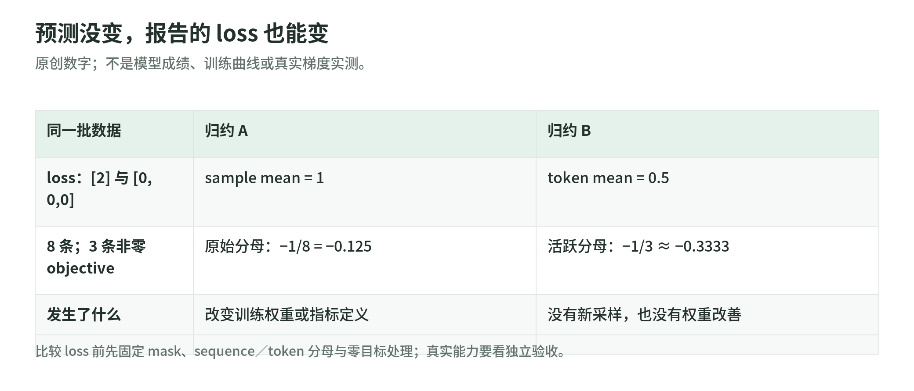

# Agentic-RL 标准库实验：在付费训练前验算学习信号

研究日期：2026-11-03。[读本导读](README.md) · [优化目标](policy-objectives.md)。

这些实验只用 Python 标准库，不调用模型、搜索或训练 API。它们验证小数组、标量导数与计数规则，**不是上游模型训练复现**，不证明真实 tokenizer、SDK custom loss、模型反向与并行服务正确。

源码：[机制实验](https://github.com/IanLiYi1996/learning-wiki/blob/main/scripts/agentic_rl_lab.py) · [自动测试](https://github.com/IanLiYi1996/learning-wiki/blob/main/tests/test_agentic_rl_lab.py)。在本 Wiki 仓库根目录运行：

```bash
python -B scripts/agentic_rl_lab.py
python -B -m unittest discover -s tests -p 'test_agentic_rl_lab.py'
```

## A. 同一组奖励，两种优势数值

输入 `[1,1,0,0]`：

- 仅中心化：`[0.5,0.5,-0.5,-0.5]`。
- 用 N−1 样本标准差标准化：约 `[0.8660254,0.8660254,-0.8660254,-0.8660254]`。
- `[1,1,1,1]`：两种相对优势均为 0。

后一组不表示“模型没学会”，也不能把全对和全错退化组混成同一种质量。记录成功率与有效组率两条曲线。改变标准差约定、奖励尺度或组大小，可能改变更新强度，不能只说“都是 GRPO”。

## B. 裁剪不等于所有越界 token 停学

固定 ratio=1.4、边界 `[0.8,1.2]`，检查对当前 logprob 的标量导数：

| 情形 | loss | 梯度 |
| --- | --- | --- |
| IS，A=1 | −1.4 | −1.4 |
| PPO，A=1 | −1.2 | 0 |
| PPO，A=−1 | 1.4 | 1.4 |
| CISPO，A=1 | 此 toy 令 old logprob=0 | −1.2 |

CISPO 的 weight detach，不等于当前 logprob detach。测试同时验算 PPO 的有限差分与 CISPO **固定权重**的有限差分；如果重新计算 detach 权重的变化来做数值导数，就不是对应的自动微分路径。

梯度的符号和大小是局部机制，不能直接换算成真实网络下一步概率变化；学习率、其他 token、共享参数和 optimizer 都会介入。边界点的导数约定不在这个连续段验算范围内。

## C. 同一批预测，换分母就能换 loss

<!-- illustration: arl-denominator-toy-086d002503 -->


*图：预测没变，报告的 loss 也能变。原创数字；不是模型成绩、训练曲线或真实梯度实测。*
<!-- /illustration: arl-denominator-toy-086d002503 -->

输入两条逐 token loss：`[2]`、`[0,0,0]`。

先回答内部平均再对回答平均：`(2+0)/2=1`。全部 token 平均：`2/4=0.5`。没有新采样，也没有任何模型改善。

另一个分母陷阱：8 条序列里只有 3 条非零 objective，分别 `[1,-1,1]`。原分母 loss 是 `−1/8=−0.125`；改成活跃样本分母则是 `−1/3≈−0.3333333`。Lab 的 GSPO 为避免这种变化，将省略计算的零目标保留在原分母中。

这些例子不说明哪个分母普遍最好，只让你在比较曲线前确认训练权重和指标定义。

## D. GSPO 的几何平均

构造两个 token ratio 为 1.2、0.8，实际输入用合法的非正 logprob：

```text
old = [-2, -2]
current = [-2+log(1.2), -2+log(0.8)]
```

序列比率是 `sqrt(1.2×0.8)≈0.9797959`，不是乘积 0.96，也不是算术平均 1。重复相同 token 比率不会因为序列变长就使几何平均指数膨胀。测试检查对齐、空序列、正 logprob、非有限数与溢出。

这里没有多轮工具观察；真实轨迹不能把观察位置或 prompt 位置纳入 action 平均，也不能用重新分词后的文本替换旧采样 token。

## E. 动态采样：有效组是额外采来的

候选组依次是“全对、全错、有对有错、全对”。请求 2 个有效组、候选预算为 4：

```text
candidate_groups = 4
effective_groups = 1
update_possible = true
full_batch = false
```

toy 在预算耗尽后返回部分 batch；只有退化组时不能做这个相对目标的有效更新。停止规则先于无限补采，“反复采直到有信号”不是无成本教学建议。

本例仅演示原始正确性筛选，不模拟 API 失败、数据 cursor、异步调度或上游完整训练循环。

## F. 长度 shaping 与任务正确性分开

max tokens=100、cache=20 时，长度为 80、90、100、110 的惩罚分别是 `0,-0.5,-1,-1`。这是惩罚项，不是最终正确性分数；上游 DAPO 还要叠加 ±1 的基础 reward。

reward 下降可能来自长答案，不一定是数学变差；reward 上升也可能来自变短，不一定是推理变好。长度、截断、格式、正确性和 shaped reward 要分开看。

## 练习与参考答案

1. 保持预测不变，怎样让报告的 loss 变小？答：改归约／mask／分母就可能做到，所以先固定指标合同。
2. 对全对组加入不同长度惩罚，就一定成为 DAPO 有效组吗？答：不一定；当前上游筛选看原始正确性，不看 shaped reward 方差。
3. 为什么 stdlib 实验不能证明 PyTRIO 训练正确？答：没有 tokenizer、模型网络、真实梯度、远端服务与优化状态。
4. token replay 与工具失败分类在哪里继续练？答：[Rufus-Air 实验](../rufus-air/lab.md)，两套实验互补而不重复大型模型训练。
