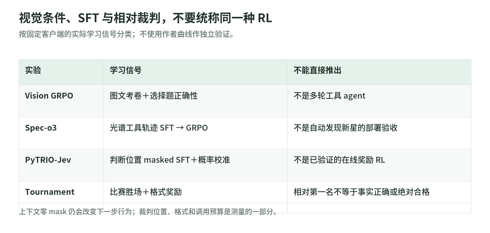

# 05 多模态与裁判：看见什么、训练什么、谁来判好坏

研究日期：2026-11-03。[读本导读](README.md) · [固定提交与来源](sources.md)；下文源码链接均锁定该版本。这里是四组实验的教材解读，不是训练复现。

先分清三件事：视觉输入不自动产生 Agentic RL；能输出概率不等于做了 RL；组内获胜不等于绝对合格。

| 实验 | 实际学习信号 | 工具与边界 |
| --- | --- | --- |
| Vision GRPO | 几何选择题正确性奖励 | 一次图文回答，不是多轮工具 agent |
| Spec-o3 | 完整轨迹 SFT，再接工具交互 GRPO | 主动选波段，取得新图 |
| PyTRIO-Jev | 标签驱动的 masked SFT | 决策概率与温度校准，不是已验证 RL |
| Tournament-GRPO | 淘汰赛反馈＋格式奖励 | 搜索、浏览与报告生成 |

分类依据见后文训练入口；仓库名不能替代逐实验分类。

## 1. Vision GRPO：图片可见，不代表图片位置要算 loss

可以把图文输入想成考卷，把 completion 想成学生作答。`build_prompt_chunks` 将模板拆成文本、`ImageChunk`、文本；图片先合成白底 RGB，再按 image processor 计算 `expected_tokens`。采样端返回的输入长度必须等于本地长度，否则停止，避免视觉位置错位后把整条监督数组移歪。[V1：图文编码与长度检查](https://github.com/datawhalechina/agentic-rl-lab/blob/8493321013c02eef6cf79ca2594811f53c6fdac1/experiments/vision-grpo/train.py#L125)

设图文 prompt 长度为 $L$，回答有 $T$ 个 token：输入保留完整 prompt，再接 `completion[:-1]`；target 前置 $L-1$ 个占位，随后是完整回答，old logprob 和 advantage 同样对齐。上下文 advantage 为零，回答位置才有策略损失。这里的“mask”由零 advantage 实现，**不是 attention mask，也不证明视觉编码器被冻结**；图片仍影响回答概率。[V2：Datum](https://github.com/datawhalechina/agentic-rl-lab/blob/8493321013c02eef6cf79ca2594811f53c6fdac1/experiments/vision-grpo/train.py#L253)

奖励只比对最后一个 `\boxed{A-D}` 与标签，不核验推理过程；本实现用 $A_i=r_i-\bar r$，没有再除标准差。同题全对或全错均无相对信号，直接跳组。评测分别统计准确率和可解析率，因此“更会交卷”与“更会几何”须分开；默认只测固定抽取的 100 题，不是完整 test。[V3：组优势](https://github.com/datawhalechina/agentic-rl-lab/blob/8493321013c02eef6cf79ca2594811f53c6fdac1/experiments/vision-grpo/train.py#L197) [V4：评测](https://github.com/datawhalechina/agentic-rl-lab/blob/8493321013c02eef6cf79ca2594811f53c6fdac1/experiments/vision-grpo/eval.py#L58)

## 2. Spec-o3：学习“下一块证据看哪里”

这是已有候选天体的五类 YES/NO 光谱审核，不是自动发现新星。领域工具接收波长窗口，先算静止系波长 $\lambda/(1+z)$，再从通量数组选点重绘；不足两个点时返回失败文字。教学直觉是放大镜：模型决定放大哪里，但放大不会制造新的观测信息。[任务说明](https://github.com/datawhalechina/agentic-rl-lab/blob/8493321013c02eef6cf79ca2594811f53c6fdac1/experiments/spec-o3/readme.md#L69) [S1：领域工具](https://github.com/datawhalechina/agentic-rl-lab/blob/8493321013c02eef6cf79ca2594811f53c6fdac1/experiments/spec-o3/tools.py#L10)

先用完整轨迹做 SFT，监督 assistant 思考、调用和答案；再让模型实际交互，以“答案正确得 1、格式错误扣 0.2”训练 GRPO。图片、工具观察和程序补入的分隔符只作上下文，动作 mask 为零；实际生成 token 与采样 logprob 原样保留，不用重新编码的文字替换。[S2：两种 Datum](https://github.com/datawhalechina/agentic-rl-lab/blob/8493321013c02eef6cf79ca2594811f53c6fdac1/experiments/spec-o3/protocol.py#L131) [S3：轨迹追加](https://github.com/datawhalechina/agentic-rl-lab/blob/8493321013c02eef6cf79ca2594811f53c6fdac1/experiments/spec-o3/rollout.py#L79) [S4：奖励](https://github.com/datawhalechina/agentic-rl-lab/blob/8493321013c02eef6cf79ca2594811f53c6fdac1/experiments/spec-o3/train_rl.py#L91)

必须澄清“模拟数据”：此快照从公开 Parquet 提取光谱数组，**没有随机合成光谱模拟器**；README 所述模型辅助生成、专家审核的是 cold-start 示范轨迹，不能混称所有光谱为模拟观测。若教学改用手画或合成曲线，只能检查窗口选择、消息与 mask 合同，不能证明星体识别、真实噪声鲁棒性；这是教学边界，不是上游已完成的实验。[S5：数组来源](https://github.com/datawhalechina/agentic-rl-lab/blob/8493321013c02eef6cf79ca2594811f53c6fdac1/experiments/spec-o3/prepare_data.py#L290) [S6：示范说明](https://github.com/datawhalechina/agentic-rl-lab/blob/8493321013c02eef6cf79ca2594811f53c6fdac1/experiments/spec-o3/readme.md#L206)

源码按对象排除 SFT/dev 重叠，却只统计、不自动清除 SFT/test 重叠；start 文档报告尚有两个重叠对象。损坏科学符号也有保留标记。训练奖励允许部分缺标签答案，评测提取则要求完整 answer 块：训练正确率与验收准确率不是同一事件。[S5](https://github.com/datawhalechina/agentic-rl-lab/blob/8493321013c02eef6cf79ca2594811f53c6fdac1/experiments/spec-o3/prepare_data.py#L352) [S7：评测提取](https://github.com/datawhalechina/agentic-rl-lab/blob/8493321013c02eef6cf79ca2594811f53c6fdac1/experiments/spec-o3/eval.py#L46) [S8：已披露重叠](https://github.com/datawhalechina/agentic-rl-lab/blob/8493321013c02eef6cf79ca2594811f53c6fdac1/experiments/spec-o3/start.md#L182)

## 3. Jev：先学分类，再校准置信度

本地 `pytrio-jev` 将 state、问题和带 marker 的 JSON 骨架放进输入，只在 marker 前一位置监督正确候选符号；`train.py` 明确调用 `cross_entropy`、记录 `masked-sft`。没有在线奖励驱动的策略更新，所以不能称为“Jev RL 已验证”；Tournament 调用的商业 Jev 裁判也不是本地这份 SFT 权重。[J1：监督位置](https://github.com/datawhalechina/agentic-rl-lab/blob/8493321013c02eef6cf79ca2594811f53c6fdac1/experiments/pytrio-jev/data.py#L169) [J2：训练入口](https://github.com/datawhalechina/agentic-rl-lab/blob/8493321013c02eef6cf79ca2594811f53c6fdac1/experiments/pytrio-jev/train.py#L90)

推理读取 marker 的候选 logprob，做受限分布 $p_i=\operatorname{softmax}(\ell/T)_i$：choice 取最大项，noul 取 yes 概率，score 取期望。未进入服务端 top-k 的候选用 `min(topk)-10` 补值，因此并非精确的全候选分布；概率和为一更不代表已校准。[J3：推理](https://github.com/datawhalechina/agentic-rl-lab/blob/8493321013c02eef6cf79ca2594811f53c6fdac1/experiments/pytrio-jev/inference.py#L26)

校准在独立 calibration 划分最小化 NLL；实际代码在 `log T` 上做黄金分割，不是 README 所说的逆温度二分。固定 logprob、$T>0$ 时不改变 argmax；应另看测试 ECE/Brier，不能把校准当推理能力提升。没有输入其他字段的正确答案，不等于字段或选项换序不影响概率：编码仍保留顺序，须做置换测试。[J4：校准](https://github.com/datawhalechina/agentic-rl-lab/blob/8493321013c02eef6cf79ca2594811f53c6fdac1/experiments/pytrio-jev/calibrate.py#L66) [J5：评测](https://github.com/datawhalechina/agentic-rl-lab/blob/8493321013c02eef6cf79ca2594811f53c6fdac1/experiments/pytrio-jev/eval.py#L72)

## 4. Tournament：相对反馈不是质量刻度

同题候选随机组队、胜者晋级，重复四次累计胜场 $s_i$，再算 $q_i=(s_i-s_{\min})/(s_{\max}-s_{\min})$；同分给 0.5，无答案者归一化后置零，但仍参加比较。总奖励 $r_i=q_i+f_i$，其中格式分 $f_i\in\{0,1\}$，再按组内样本标准差计算优势。[T1：奖励流程](https://github.com/datawhalechina/agentic-rl-lab/blob/8493321013c02eef6cf79ca2594811f53c6fdac1/experiments/tournament-grpo/reward.py#L170) [T2：优势与更新](https://github.com/datawhalechina/agentic-rl-lab/blob/8493321013c02eef6cf79ca2594811f53c6fdac1/experiments/tournament-grpo/train.py#L48)

原创例：裁判排名最优但格式失败者得 $1+0=1$，排名较低但格式合规者得 $0.4+1=1.4$，后者反而更受鼓励。格式协议还要求至少搜索一次，裁判却只看最终答案，不检查搜索证据链。应分别报告交卷率、格式率和内容质量，而非把总 reward 当研究能力。[T3：格式规则](https://github.com/datawhalechina/agentic-rl-lab/blob/8493321013c02eef6cf79ca2594811f53c6fdac1/experiments/tournament-grpo/reward.py#L108)

裁判强制选一个胜者，没有真正的平局；重复抽签不证明消除了位置、长度或文风偏差。评测 RACE 也固定待评报告为 article 1、参考为 article 2，输出按细则与维度加权后的相对比例，不是正确概率或四维简单平均。教学审计应交换候选位置、加入等质对与独立事实核查；源码未完成这些验证。[T4：裁判协议](https://github.com/datawhalechina/agentic-rl-lab/blob/8493321013c02eef6cf79ca2594811f53c6fdac1/experiments/tournament-grpo/judge.py#L24) [T5：RACE](https://github.com/datawhalechina/agentic-rl-lab/blob/8493321013c02eef6cf79ca2594811f53c6fdac1/experiments/tournament-grpo/race.py#L27)

## 5. 先固定预算，再比较

<!-- illustration: arl-modalities-judges-cae6f5ce15 -->

*图：视觉条件、SFT 与相对裁判，不要统称同一种 RL。按固定客户端的实际学习信号分类；不使用作者曲线作独立验证。*
<!-- /illustration: arl-modalities-judges-cae6f5ce15 -->

八候选一次淘汰赛需七场，四次共 **28 场**，等于两两全比的 $\binom{8}{2}$；每步八题需 224 场，尚未计重试。调用数相同也不等于 token、时间相同。[T1](https://github.com/datawhalechina/agentic-rl-lab/blob/8493321013c02eef6cf79ca2594811f53c6fdac1/experiments/tournament-grpo/reward.py#L176)

Tournament 默认六轮、四次工具调用，18,000 response token **包含工具返回**；最后一次观察附收尾提示，其 loss mask 为零，但它会改变行为。Spec-o3 历史 SFT 单轮 2,048、RL 6,144 token，统一预算的新命令不代表已完成同预算复测。[T6：轨迹预算](https://github.com/datawhalechina/agentic-rl-lab/blob/8493321013c02eef6cf79ca2594811f53c6fdac1/experiments/tournament-grpo/rollout.py#L18) [S8](https://github.com/datawhalechina/agentic-rl-lab/blob/8493321013c02eef6cf79ca2594811f53c6fdac1/experiments/spec-o3/start.md#L182)

比较时固定题集、模型规模、提示词、工具结果窗口、生成/上下文/调用上限、裁判与失败计分，再记录实际消耗；同时看全体样本和双方完成子集，后者存在选择偏差，不能替代全体成绩。方法参见[基础设施与评测合同](../rufus-air/infrastructure-and-evaluation.md)；概率与相对优势参见[扩散奖励与裁判](../../diffusion/03-rewards-judges-and-advantages.md)，这里只迁移概念，不迁移去噪 loss。

## 6. 读代码顺序与自测

每组先读 README/start 的边界，再沿以下顺序定位数据与监督：

1. Vision：`download-dataset.py → train.py` 的编码、组奖励、Datum → `eval.py`。
2. Spec：`prepare_data.py → protocol.py → tools.py → rollout.py → train_sft.py/train_rl.py → eval.py`。
3. Jev：`data.py → train.py → inference.py → calibrate.py → eval.py`。
4. Tournament：`protocol.py/rollout.py → reward.py/judge.py → train.py → eval.py/race.py`。

自测：①图片 mask 为零，模型就看不见吗？②$T$ 变大必然更准吗？③淘汰赛第一名必然合格吗？④四次八人赛比全配对省请求吗？

答案：①仍可见，mask 限制直接损失。②固定分数下 argmax 不变，校准还须留出集检验。③只表示当前组的相对胜出，取决于裁判。④本配置都是 28 场，重试与输入长度另算。可接着做[标准库 mask 与合同练习](../rufus-air/lab.md)。

## 7. 真实覆盖与源码风险

实读四组 README/start 的相关章节，以及相关训练、评测、数据准备、视觉协议、工具/rollout、Jev 推理/校准、Tournament reward/judge/RACE。仅静态核验本页机制；没有逐项核验所有论文、外部服务实现、数据标签或远端成绩。例子与审计建议为原创，没有搬用原图、曲线、账单；未执行上游、下载数据/权重或调用付费服务。

除上述协议差异，还须注意：部分数据或模型默认跟随 `main`；Jev top-k 补值及顺序不变性未经验证；工具文字虽不算 loss，却参与 Tournament 格式解析。自定义 PPO 每批仅更新一次，以 `current.detach()` 作 old，不能直接改成多轮更新后仍声称旧概率正确。[T7：自定义 loss 边界](https://github.com/datawhalechina/agentic-rl-lab/blob/8493321013c02eef6cf79ca2594811f53c6fdac1/experiments/tournament-grpo/train.py#L104) 静态代码可说明“信号怎样进入训练”，不能证明裁判可信、领域泛化或完整实验成功。
