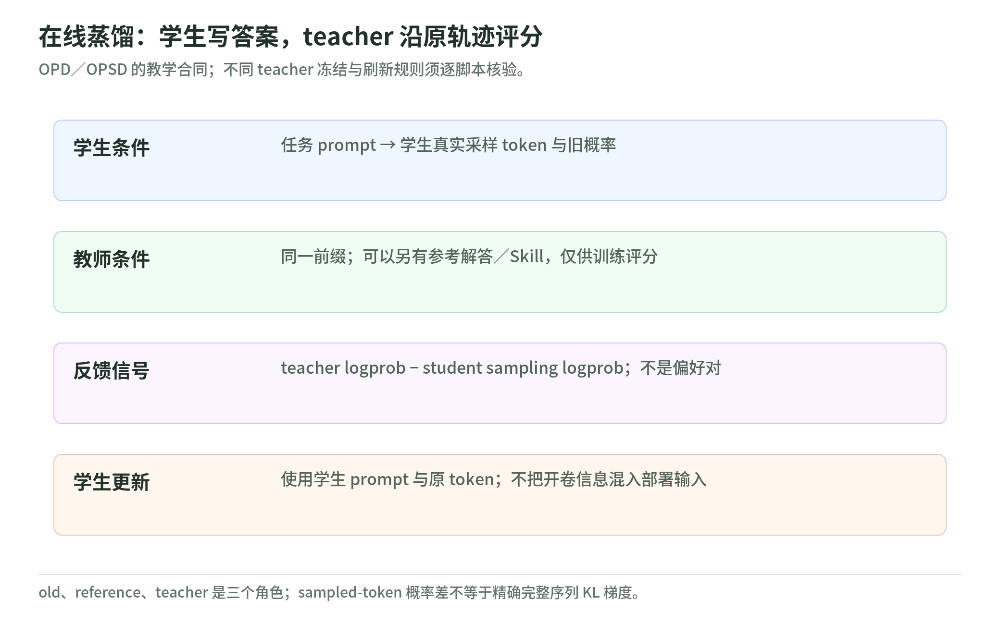

# 03 On-policy 蒸馏：谁采样，谁提供反馈

研究日期：2026-11-03。[读本导读](README.md) · [固定版本与来源](sources.md)。本文静态核验 Agentic-RL Lab，不复现训练成绩；文末代码链接均固定到该版本。

## 1. 先从学生实际会犯的错学起

传统示范学习让学生沿专家答案训练；部署时，它却必须接着自己写出的前缀继续回答。OPD（on-policy distillation）的直觉是：学生先作答，teacher 再沿学生原来的 token 评分。teacher 不另写答案，也不替学生修正轨迹。[G代码][g]

这里的 OPD 不是 DPO：实现没有消费 chosen/rejected 偏好对，而是把同一采样 token 的两个 log-prob 差交给策略更新。OPSD 的 S 表示 self-distillation，强调 teacher 与学生的模型来源关系；不是换个名字的偏好优化。[O代码][o]

在本仓库的 sampled-token 路径，记学生采样策略为 $S$，teacher 为 $T$：

$$
A_t=\beta\bigl(\log p_T(y_t\mid h_t,z)-\log p_S(y_t\mid h_t)\bigr).
$$

$h_t$ 是实际前缀，$z$ 是可选的 teacher 特权信息。teacher 更认可该 token 时优势为正。目标方向称为 reverse KL，即学生到 teacher 的 $D_{\mathrm{KL}}(S\Vert T)$，不是反向那一项。单个采样差可为负，不能把它当非负的精确 KL。[G代码][g]

更要区分目标与实现：代码只取得已采样 token 的概率，构造局部优势；没有全词表分布，也没有把未来所有 KL 项累加成 reward-to-go。不能据此宣称实现了完整序列 KL 的精确梯度。[G代码][g]

“密集反馈”也不等于“每个推理步骤都有正确性标签”。概率差可能奖励表达风格，也可能惩罚本来正确但罕见的解法；teacher 的信心不是题目验证器。不过，它不依赖同组有人答对：即使所有学生答案都错，只要两侧概率不同，普通 OPD／OPSD 仍可有学习信号。这与后文 AgentOPSD 必须保留终局优势的设计不同。[O代码][o]、[A训练][a]

## 2. 四个目录，四种 teacher 合同

<!-- illustration: arl-distillation-contract-7fdfa14bce -->

*图：在线蒸馏：学生写答案，teacher 沿原轨迹评分。OPD／OPSD 的教学合同；不同 teacher 冻结与刷新规则须逐脚本核验。*
<!-- /illustration: arl-distillation-contract-7fdfa14bce -->

| 目录 | 学生生成什么 | teacher 从哪里来、看什么 | 本地信号与更新 |
| --- | --- | --- | --- |
| general-opd | 当前学生的回答 | 默认较大模型，看相同题目与学生前缀 | token 概率差；`importance_sampling` |
| opsd | 只看题目的学生回答 | 固定 step-0 同源基座，另看参考解答 | token 概率差；`importance_sampling` |
| medical-opd | 当前学生的领域／通用回答 | 冻结医疗 SFT teacher，或原始 base teacher | token 概率差；默认 `ppo` |
| agentopsd | 无 Skill 的完整工具轨迹 | 当前学生同一快照，另看固定 Skill | 终局优势加轮级重塑；`ppo` |

表中依据分别为 [G][g]、[O][o]、[M][m]、[A][a]。模型大小不是 OPD 的定义条件；四条路径都是学生采样，不是 teacher 采样后供学生模仿。

`general-opd` 只从 DeepMath 读取 `question`，不使用答案、不算数学正确率。`group_size` 只是多采几份回答，没有 GRPO 式组内奖励中心化。prompt 的优势填零，回答才接受反馈。[数据读取][gd]、[G代码][g]

`opsd` 则构造两份 prompt：学生只有 `problem`，teacher 多了 `solution`；teacher 客户端只创建一次、不带学生 LoRA 路径，所以一直停在 step-0。训练 Datum 仍使用学生 prompt，而非开卷 prompt；AIME 评测也只向学生提供题目。[双 prompt][o]、[初始化／更新][oc]、[评测][oe]

沿代码追踪时，先找学生生成的 token 与旧概率，再看 teacher 概率切片，最后检查训练序列的右移对齐：输入去掉最后一个 token，目标从下一 token 开始。prompt 区间填零优势；这里零目标只是占位，不能把它理解成“训练模型输出零”。参考解答不直接进入学生输入或目标，但会通过反馈影响学生权重，训练期特权与推理期开卷必须分开。[Datum][o]

这份 OPSD 使用 sampled-token 近似，不是 README 所述论文的全词表 JSD 主实验。开卷也不保证可靠：teacher 不理解参考解答、解答错误或格式偏好压过推理质量，都可能产生误导反馈。[实现说明][or]

`agentopsd` 又不同：每步先导出当前权重，学生 rollout 和 Skill teacher 复评使用同一个 sampler，再更新。teacher 因而会随训练步改变，并非固定 step-0。Skill 只进入训练评分分支，学生和评测不注入 Skill；本地 SkillBank 按任务类型固定映射，不存在自动总结经验、持续自我改进的已实现闭环。[训练][a]、[技能][as]、[评测][ae]

## 3. 医疗案例：能力保留，不是临床验证

Medical OPD 的学生从 fresh base LoRA 初始化，并非继续训练医疗 SFT 权重；SFT checkpoint 是冻结 teacher。OPD 阶段只取医疗 `question`，不把 `complex_cot`、`response` 再当答案监督。[初始化][m]、[输入与反馈][mp]

SAR-OPD 先做医疗蒸馏，再从保存的训练 state 创建后续客户端，以 base teacher 蒸馏非医疗 C-Eval prompts。IDT-OPD 则在同一学生与优化器循环里按默认 1:1 交替医疗／通用步骤，分别切换 teacher；不是每个 token 同时混合两位教师。C-Eval 组装 prompt 时不读取答案标签。[阶段恢复][ms]、[交替调度][mi]、[prompt][mip]

数据合同也应独立检查：准备脚本把有答案的 C-Eval 行按固定种子留出测试池，默认训练比例八成；无答案行另并入训练池。训练不使用答案，不代表题目从未被训练访问，更不代表可拿训练池再当留出评测。阶段恢复调用了训练 state 接口，但远端究竟恢复哪些优化器状态，仍须服务实现证明。[数据切分][md]、[恢复接口][ms]

这解释了“锚点”的直觉：专精后，再施加基础能力方向的约束。但两个 teacher 可能拉扯，同步改善不是保证。MedQA-zh、C-Eval 的离线成绩只刻画相应题集和协议，不证明诊断、处方或临床安全；本文不提供可用医疗建议，也不把 benchmark 当医疗服务验收。[实验边界][mr]

## 4. 必须留下的实现缺口

严格的新鲜采样需 `sampler_refresh_steps=1`；间隔更大就会使用旧学生轨迹。还需检查 token ID、词表与特殊符号兼容，以及评分切片长度，不能靠模型家族名保证。[G][g]、[O][o]

服务端 PyTRIO 实现未在该快照内核验：采样 log-prob 是原始分布还是 temperature／截断后的分布、PPO 默认阈值、loss 的 token／sequence reduction，均不能自行补全。Medical 脚本只传 loss 名称，未显式传 PPO 裁剪阈值；“默认 PPO”不等于已验证其完整公式。[默认配置][mc]、[M调用][m]、[交替更新][mi]

与 Rufus-Air 的联系是审计视角，而非方法等同：其最终 RLHF 用奖励模型给当前策略回答打分，再做 GRPO；这里多用 teacher token 概率。二者都要问“谁采样、谁评分、谁被更新”，不能见到 teacher 就统称 OPD，也不能见到偏好数据就统称 DPO。[Rufus-Air §3.8][r]、[本站奖励笔记](../rufus-air/reward-and-stability.md)

## 5. 自测

1. teacher 的 log-prob 为 −1，学生为 −2，该 token 被鼓励还是压低？答：$\beta>0$ 时优势为正，被鼓励。
2. OPSD 的参考解答应进学生训练 prompt 吗？答：不应；它只改变 teacher 的条件分布。
3. AgentOPSD teacher 是固定初始模型吗？答：不是，是每步更新前的当前快照；Skill 只进评分侧。

## 来源与读取边界

实读各目录相关 README／start 与下列实现；通用 OPD 的启动说明在 README 内。只静态检查，不下载数据／权重、不调用训练或付费服务；没有复制原文图表。

[g]: https://github.com/datawhalechina/agentic-rl-lab/blob/8493321013c02eef6cf79ca2594811f53c6fdac1/experiments/general-opd/01-demo-sync.py#L267-L360
[gd]: https://github.com/datawhalechina/agentic-rl-lab/blob/8493321013c02eef6cf79ca2594811f53c6fdac1/experiments/general-opd/01-demo-sync.py#L141-L161
[o]: https://github.com/datawhalechina/agentic-rl-lab/blob/8493321013c02eef6cf79ca2594811f53c6fdac1/experiments/opsd/01-opsd-sync.py#L244-L395
[oc]: https://github.com/datawhalechina/agentic-rl-lab/blob/8493321013c02eef6cf79ca2594811f53c6fdac1/experiments/opsd/01-opsd-sync.py#L515-L617
[oe]: https://github.com/datawhalechina/agentic-rl-lab/blob/8493321013c02eef6cf79ca2594811f53c6fdac1/experiments/opsd/00-eval-aime25.py#L180-L230
[or]: https://github.com/datawhalechina/agentic-rl-lab/blob/8493321013c02eef6cf79ca2594811f53c6fdac1/experiments/opsd/readme.md#L238-L269
[m]: https://github.com/datawhalechina/agentic-rl-lab/blob/8493321013c02eef6cf79ca2594811f53c6fdac1/experiments/medical-opd/03-medical-opd-sync.py#L422-L504
[mp]: https://github.com/datawhalechina/agentic-rl-lab/blob/8493321013c02eef6cf79ca2594811f53c6fdac1/experiments/medical-opd/03-medical-opd-sync.py#L197-L327
[mc]: https://github.com/datawhalechina/agentic-rl-lab/blob/8493321013c02eef6cf79ca2594811f53c6fdac1/experiments/medical-opd/03-medical-opd-sync.py#L150-L161
[ms]: https://github.com/datawhalechina/agentic-rl-lab/blob/8493321013c02eef6cf79ca2594811f53c6fdac1/experiments/medical-opd/04-ceval-opd-async.py#L535-L565
[mi]: https://github.com/datawhalechina/agentic-rl-lab/blob/8493321013c02eef6cf79ca2594811f53c6fdac1/experiments/medical-opd/05-interleaved-multi-teacher-opd.py#L777-L914
[mip]: https://github.com/datawhalechina/agentic-rl-lab/blob/8493321013c02eef6cf79ca2594811f53c6fdac1/experiments/medical-opd/05-interleaved-multi-teacher-opd.py#L362-L386
[mr]: https://github.com/datawhalechina/agentic-rl-lab/blob/8493321013c02eef6cf79ca2594811f53c6fdac1/experiments/medical-opd/readme.md#L159-L191
[md]: https://github.com/datawhalechina/agentic-rl-lab/blob/8493321013c02eef6cf79ca2594811f53c6fdac1/experiments/medical-opd/00-download-dataset.py#L363-L380
[a]: https://github.com/datawhalechina/agentic-rl-lab/blob/8493321013c02eef6cf79ca2594811f53c6fdac1/experiments/agentopsd/train.py#L496-L558
[as]: https://github.com/datawhalechina/agentic-rl-lab/blob/8493321013c02eef6cf79ca2594811f53c6fdac1/experiments/agentopsd/skills.py#L30-L69
[ae]: https://github.com/datawhalechina/agentic-rl-lab/blob/8493321013c02eef6cf79ca2594811f53c6fdac1/experiments/agentopsd/eval.py#L228-L269
[r]: https://arxiv.org/html/2609.29421v2#S3.SS8
