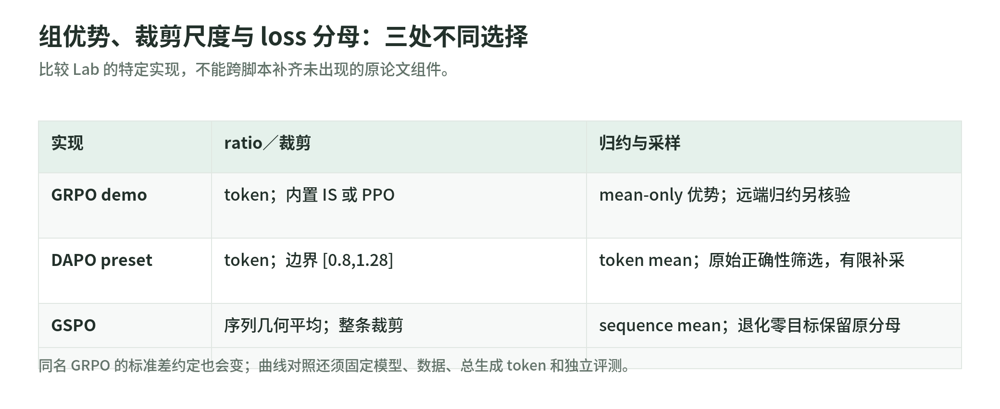

# 01 优化目标：GRPO、DAPO、GSPO 到底分别改了什么

研究日期：2026-11-03。[读本导读](README.md) · [标准库验算](lab.md)。

想象模型同一道题写出四个答案。验证器只说“哪个对”，优化器需要另一本账：哪个答案比同组更好、生成时的概率是多少、这次允许改多少。奖励、优势、概率比和损失分别解决这些问题，不能混叫“reward”。

## 1. 从奖励到优势：同题比较，不是所有题混着排

GRPO 用同一个 prompt 的候选回答估计相对优势，省去单独学习的 value model。常见形式为：

$$
A_i=\frac{R_i-\bar R}{s_R+\epsilon}.
$$

$\bar R$ 是同组平均，$s_R$ 的计算约定也属于算法配置。同一回答的输出 token 在结果级版本中共享 $A_i$；这不是验证了每一个推理步骤的因果贡献。[DeepSeekMath §4](https://arxiv.org/html/2402.03300v3)

**源码差异：**上游 `grpo/03-grpo.py` 使用 `reward − mean_reward`，不除标准差；`dapo/rollout.py` 和 `gspo/rollout.py` 则使用 N−1 分母的样本标准差。于是奖励 `[1,1,0,0]` 的前者优势为 `[0.5,0.5,−0.5,−0.5]`，后者约为 `[0.866,0.866,−0.866,−0.866]`，不是数值完全相同的实现。[GRPO 示例](https://github.com/datawhalechina/agentic-rl-lab/blob/8493321013c02eef6cf79ca2594811f53c6fdac1/experiments/grpo/03-grpo.py) · [DAPO 优势计算](https://github.com/datawhalechina/agentic-rl-lab/blob/8493321013c02eef6cf79ca2594811f53c6fdac1/experiments/dapo/rollout.py)

全对、全错，甚至全得到同一非零奖励，都可能令相对优势为零。这说明这组**相对结果信号**没有区分度，不表示训练完全没成本，也不代表 KL、蒸馏或别的辅助目标必然没有梯度。

## 2. 三种 loss：裁剪对象和梯度路径不同

<!-- illustration: arl-signed-clipping-95d41bcc7a -->
![PPO 是否停学，要同时看 ratio 与优势符号。原创标量导数；边界 [0.8,1.2]、ratio=1.4；不代表真实网络更新幅度。](../../images/arl-signed-clipping.png)

*图：PPO 是否停学，要同时看 ratio 与优势符号。原创标量导数；边界 [0.8,1.2]、ratio=1.4；不代表真实网络更新幅度。*
<!-- /illustration: arl-signed-clipping-95d41bcc7a -->

令 $\ell_t$ 为当前策略对已采样 token 的 logprob，$\ell_t^{old}$ 为实际生成时记录的 logprob，则 $r_t=\exp(\ell_t-\ell_t^{old})$。此处 old 是采样策略，**不是**固定 reference，也不必等于蒸馏 teacher。

| 目标，忽略归约与其他正则 | 最小化的示意 loss | 理解要点 |
| --- | --- | --- |
| IS surrogate | $-r_t A_t$ | 比率参与梯度；大的比率可能放大学习信号 |
| PPO clipped surrogate | $-\min(r_tA_t,\operatorname{clip}(r_t,l,u)A_t)$ | 是否进入平台区取决于优势符号和越界方向 |
| CISPO 示例 | $-\operatorname{sg}(\operatorname{clip}(r_t,l,u))A_t\ell_t$ | clip 后权重停止梯度，学习仍经过当前 logprob |

`sg` 表示停止梯度。上述 token surrogate 不应不加限定地称为对整段轨迹分布的精确 importance sampling；上下文、动作分布、mask、归约和采样设置还要对上。[上游损失讲解](https://github.com/datawhalechina/agentic-rl-lab/blob/8493321013c02eef6cf79ca2594811f53c6fdac1/experiments/loss-functions/readme.md)

以 $[l,u]=[0.8,1.2]$、$r=1.4$ 为例：$A=1$ 时 PPO 选择 1.2，越界后这一项对 $\ell$ 的梯度为零；$A=-1$ 时选择 −1.4，仍有梯度。不是“ratio 一出区间全部都不学”。CISPO 的 detach 权重为 1.2，梯度仍为 $-1.2A$。**裁剪 surrogate 也不是硬性约束实际 KL 或参数更新幅度**；还要监控学习率、多次更新与真实策略漂移。

上游异步 GRPO demo 有本地 custom CISPO；较简化的 `03-grpo.py` 只开放 IS／PPO。其代码没有本地显式添加 reference KL 项；内置 loss 的完整远端行为未在本课验证。不要把原论文所有组成默认补进脚本。[实际 custom loss 与入口](https://github.com/datawhalechina/agentic-rl-lab/blob/8493321013c02eef6cf79ca2594811f53c6fdac1/experiments/grpo/02-demo-async.py)

## 3. DAPO：四个开关，不只换 clip 数字

[DAPO 原论文 §3](https://arxiv.org/html/2503.14476v2)讨论非对称 clip、动态采样、token-level loss 与超长奖励处理。下面解释的是 **Lab 的具体实现**，不声称完整重现原论文系统和成绩。

- **Clip-Higher**：本地 GRPO preset 的 ratio 边界是 `[0.8,1.2]`，DAPO 是 `[0.8,1.28]`。上侧空间扩大，不等于无限探索。
- **Dynamic Sampling**：从同题 group 筛出既有对又有错的完整组；补采直到有效组数够或候选预算耗尽。预算耗尽可以返回部分 batch，没有有效组则跳过参数更新。
- **Token mean**：GRPO preset 先对每条回答求均值，再对回答求均值；DAPO 合并有效 completion token 后求均值。长回答因此占不同权重。
- **Soft overlong**：基础正确性 reward 是 ±1，再叠加长度惩罚。接近 token 上限时分段线性降到 −1，而不是越界瞬间扣同一分。

[训练 preset 与 reduction](https://github.com/datawhalechina/agentic-rl-lab/blob/8493321013c02eef6cf79ca2594811f53c6fdac1/experiments/dapo/train.py) · [补采与筛选](https://github.com/datawhalechina/agentic-rl-lab/blob/8493321013c02eef6cf79ca2594811f53c6fdac1/experiments/dapo/rollout.py) · [正确性与长度 reward](https://github.com/datawhalechina/agentic-rl-lab/blob/8493321013c02eef6cf79ca2594811f53c6fdac1/experiments/dapo/reward.py)

特别容易漏掉的是：**筛选有效组看原始正确性，优势计算看 shaped reward**。全对但长度不同的组，即使 shaped reward 不同，也不会因此被当前 dynamic sampling 接纳。长度惩罚的变化不能代替正确性曲线；补采后的训练组变好了，也可能只是选择分布变化。

例：两条回答的逐 token 损失分别为 `[2]` 和 `[0,0,0]`，sample mean 是 1，token mean 是 0.5。同一批预测、不更新任何权重，仅换归约就能得到不同 loss。比较曲线前先读分母。

## 4. GSPO：几何平均是序列尺度，不是全序列概率乘积

<!-- illustration: arl-objective-scales-e430f9ed95 -->

*图：组优势、裁剪尺度与 loss 分母：三处不同选择。比较 Lab 的特定实现，不能跨脚本补齐未出现的原论文组件。*
<!-- /illustration: arl-objective-scales-e430f9ed95 -->

Lab 的 GSPO 在 completion 范围上先求 log-ratio 的均值，再取指数：

$$
s_i=\exp\left(\frac1{T_i}\sum_{t=1}^{T_i}
(\ell_{i,t}-\ell^{old}_{i,t})\right).
$$

因此它是 token ratio 的几何平均，不是算术平均，也不是未归一化的序列 likelihood ratio。整条回答共享 ratio、优势和裁剪决定；仍然通过各 token logprob 回传梯度。[GSPO 原论文 §4](https://arxiv.org/html/2507.18071v2) · [本地 loss](https://github.com/datawhalechina/agentic-rl-lab/blob/8493321013c02eef6cf79ca2594811f53c6fdac1/experiments/gspo/loss.py)

两个 token ratio 是 1.2、0.8，几何平均约 0.9798；乘积是 0.96，算术平均是 1。默认 clip 偏移是 `3e-4 / 4e-4`，边界为 `[0.9997,1.0004]`，不是 token PPO 示例的 `[0.8,1.2]`。不能只拿“clip fraction 较高”判定某算法更坏：序列尺度与 token 尺度不同。

实现还保留归约账本：退化组不发送到远端计算，但零目标仍计入原始 `normalization_sequences` 分母；token clip fraction 也使用原始 token 分母。[训练载荷与分母](https://github.com/datawhalechina/agentic-rl-lab/blob/8493321013c02eef6cf79ca2594811f53c6fdac1/experiments/gspo/train.py)

## 5. 读代码的最短路径

先找到 `reward` 的取值／格式验证，再看 group 是否完整、优势是否标准化，再看 prompt／action mask、旧概率、loss 中的 clip／detach／归约，最后看 optimizer 是否真正执行与权重何时供下一轮采样。

“同题几条答案”是相对结果 RL 的组，不是可以任意拼出的 batch；工具观察是上下文，不是模型 action。多轮版本继续读 [02](tools-and-environments.md)。长程 credit 与单条答案内部逐步核验也不是同一件事，继续读 [04](credit-assignment.md)。

## 自测

1. 全对组的 advantage 为零，说明模型差还是说明相对信号退化？
2. $A=-1,r=1.4$ 时 PPO 为什么不是全部截平？CISPO 的 detach 停止了哪条梯度路径？
3. DAPO 补采 20 组、留下 4 组，和普通 GRPO 采 4 组能直接比较每 step 吗？

答案要点：相对信号退化；`min` 受符号影响，CISPO 停的是权重路径而非当前 logprob；不行，还需比较生成 token、wall time、筛选率、有效训练 token 和独立评测。
