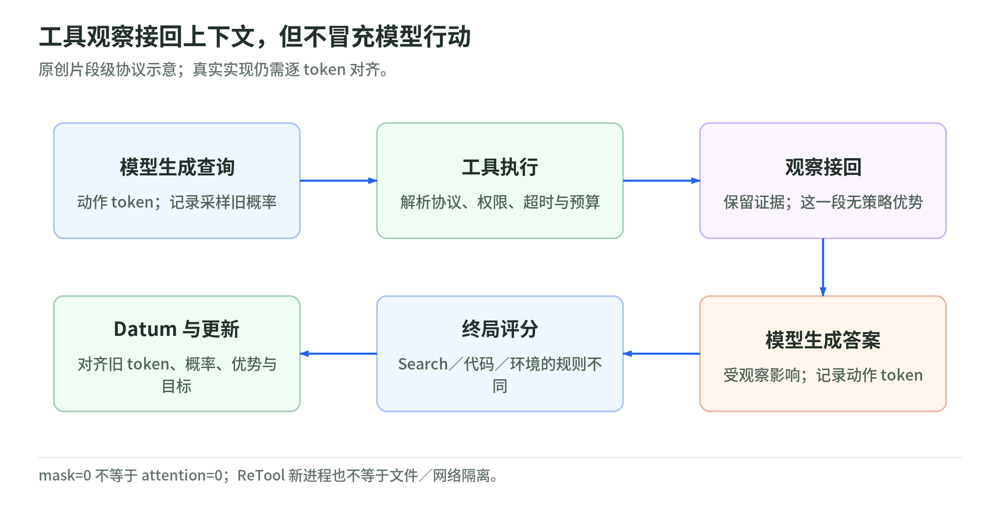

# 02 工具与环境：动作、观察和真实执行的边界

研究日期：2026-11-03；[读本导读](README.md) · [固定核验版本](sources.md)。本章静态阅读 agentic-rl-lab 的 Search-R1、ReTool、ALFWorld 客户端实现，没有运行上游代码、下载权重／数据或调用付费服务；PyTRIO 服务内核不在核验范围。读完应能区分“工具执行成功”“任务完成”和“哪些 token 接收训练信号”。配套：[评测与复现](evaluation-and-reproduction.md)。

## 1. 三种工具，不是同一种世界

| 实验 | 模型动作与返回观察 | 谁决定结束／得分 |
| --- | --- | --- |
| Search-R1 | `search(query)`；网页摘要或英文 Wikipedia 词条片段 | 最终答案格式与规范化 EM |
| ReTool | `code_interpreter(code)`；本机 Python 的输出或报错 | 最终数学答案验证器 |
| ALFWorld | `alfworld_step(action)`；TextWorld 状态与可执行动作 | 环境的 `won`／`done`，另扣非法动作分 |

搜索不是把完整网页交给模型：DeepSeek 请求固定 `need_content=False`，优先 `snippet`，缺失才用 `summary`；Wikipedia 返回词条导言片段。ReTool 每次起新进程；ALFWorld 则为同一游戏创建独立、有状态的分支。这套 ALFWorld 是文字环境，不是视觉机器人训练。[搜索实现][search] [执行实现][sandbox] [环境实现][environment]

教学直觉：搜索像翻资料，ReTool 像按计算器，ALFWorld 像移动棋子。资料和输出是观察；移动物品会改变之后能做什么。三者都能训练逐步决策，却不能互换成功合同。

## 2. 解析器才是可执行协议

Search-R1 与 ReTool 的解析器接受指定 XML 风格 `<tool_call>`：一个匹配调用，后面不能再跟文字；前面可以有推理。搜索 query 要非空且不含尖括号，代码则允许比较符号。Search 客户端还限制 query 为 1–128 个 Unicode 字符。工具 schema 描述不等于支持任意 JSON 或代码围栏。[Search 协议][search-protocol] [ReTool 协议][retool-protocol] [query 校验][search]

ALFWorld 更明确地检查恰好一对工具标签，兼容 XML／JSON，动作转小写、压平空白，拒绝多行；物体编号仍须准确。默认观察包含 admissible actions，属于“给候选动作的辅助环境”，不是无提示的自由探索；关闭候选列表就改变了测量条件。[ALFWorld 协议][alf-protocol]

协议说明也可能强于奖励器：Search 提示要求独立的最终答案轮，但奖励只检查一个可抽取的非空 `Answer:`，不禁止其他说明文字，也不要求先搜索。非法工具输出在 rollout 中结束后仍按最终文本评分，并没有统一的“解析非法必扣分”分支；ReTool 也会再检查其中的 boxed 答案。[Search 评分][search-reward] [Search 消费动作][search-rollout] [ReTool 消费动作][retool-rollout]

## 3. 观察 mask：保留证据，不冒充动作

<!-- illustration: arl-action-observation-f5544dbd9d -->

*图：工具观察接回上下文，但不冒充模型行动。原创片段级协议示意；真实实现仍需逐 token 对齐。*
<!-- /illustration: arl-action-observation-f5544dbd9d -->

三套 Datum 构造都保留采样 completion token 和当时的 old logprob；下一轮 prompt 必须是已有 token 的前缀扩展。环境增量，包括观察和模板边界，填零 advantage／零 old logprob；模型 completion 填整条轨迹的组内 advantage。最后对 input、target、概率与优势统一做一位自回归对齐，并检查长度。[Search Datum][search-datum] [ReTool Datum][retool-datum] [ALFWorld Datum][alf-datum]

原创小例：“生成查询 → 收到页面 → 生成答案”的片段级动作 mask 是 `(1,0,1)`。零信号不是删除页面，也不是把 attention mask 关掉；零 old logprob 只是占位。这里客户端没有另发显式 `mask` 字段，不能据此宣称已核验远端 loss 的归一化、数值稳定性或全部梯度行为。

## 4. 失败要按合同分类

搜索超时、429 等经有限重试后变成错误观察，模型可继续调整；空结果也有单独观察。代码异常、非零退出码或超时同样回喂模型，不立即判整条轨迹失败。最终 Search 奖励为正确 `1`、错答 `0`、无合法答案 `-0.1`；ReTool 检查末尾 300 字符内最后一个 boxed 答案，正确 `+1`，错误／格式失败 `-1`。[搜索错误处理][search] [代码反馈][sandbox] [答案评分][search-reward] [数学评分][retool-reward]

ALFWorld 的 return 是 `1[won] - 0.1 × invalid_actions`，环境原生 score 不用于该奖励；所以成功率与平均 reward 不能互代。格式非法会被转为哨兵动作并提交 `env.step`，仍消耗交互次数；观察中“状态没有推进”不能读成“不耗预算”。步数／上下文耗尽有 `stop_reason` 和 `truncated`；环境或采样异常则向外抛出，没有统一的基础设施中止样本排除器。[ALFWorld rollout][alf-rollout]

对照 [Rufus-Air：失败分类](../rufus-air/agentic-environments.md)：不能把其 `aborted` 排除规则自动搬来；其 Search 正奖励的工具门槛也不是这里的规则。

## 5. “新进程”不等于安全沙箱

ReTool 真正执行模型代码。列表 argv 避开 shell；默认 30 秒 wall-clock 超时、进程组杀死、CPU 时间限制、线程限额和输出尾部截取，只是部分资源措施。子进程继承父进程环境，未设置文件／网络隔离、内存上限或临时输出文件的磁盘配额；同机文件和凭据仍可能被访问。提示词“不要读写文件”不是权限控制，“无状态”仅能说明 Python 变量不跨新进程延续。[执行与环境继承][sandbox]

另有具体文档偏差：README 称执行前自动补 `print()`，但 `ensure_trailing_print` 只有定义，实际 `run_code` 未调用；没打印就可能得到空观察。特殊模板标记替换也只是保护部分消息边界，不是通用注入防护。[README 说法][retool-readme] [辅助函数][auto-print] [实际调用链][sandbox]

## 6. 运行前检查与自测

- 核对 tokenizer 模板、原始 token／概率长度和前缀扩展，避免用重编码文本代替动作。
- 分开记录协议错误、不可执行动作、工具故障、预算截断和基础设施异常。
- 执行模型代码前，另行获批隔离环境：无敏感凭据、限制文件和网络、补齐内存／磁盘约束；本笔记不授权执行。
- 发布日志前检查观察、traceback、游戏路径与凭据泄露；mask=0 不会使敏感内容消失。

自测：①观察 mask=0，还能影响下一步吗？②新 Python 进程保证磁盘不留状态吗？③ALFWorld 成功但有两次非法动作，reward 是多少？

答案：①能，只是不作为策略动作获得这里的优势信号。②不能。③`0.8`，成功率该局仍记 `1`。延伸：[Rufus-Air 的 token 与环境合同](../rufus-air/agentic-environments.md)。

[search]: https://github.com/datawhalechina/agentic-rl-lab/blob/8493321013c02eef6cf79ca2594811f53c6fdac1/experiments/search-r1/search.py
[sandbox]: https://github.com/datawhalechina/agentic-rl-lab/blob/8493321013c02eef6cf79ca2594811f53c6fdac1/experiments/retool/sandbox.py#L148
[environment]: https://github.com/datawhalechina/agentic-rl-lab/blob/8493321013c02eef6cf79ca2594811f53c6fdac1/experiments/alfworld/environment.py#L168
[search-protocol]: https://github.com/datawhalechina/agentic-rl-lab/blob/8493321013c02eef6cf79ca2594811f53c6fdac1/experiments/search-r1/protocol.py#L147
[retool-protocol]: https://github.com/datawhalechina/agentic-rl-lab/blob/8493321013c02eef6cf79ca2594811f53c6fdac1/experiments/retool/protocol.py#L177
[alf-protocol]: https://github.com/datawhalechina/agentic-rl-lab/blob/8493321013c02eef6cf79ca2594811f53c6fdac1/experiments/alfworld/protocol.py#L100
[search-reward]: https://github.com/datawhalechina/agentic-rl-lab/blob/8493321013c02eef6cf79ca2594811f53c6fdac1/experiments/search-r1/reward.py#L32
[search-rollout]: https://github.com/datawhalechina/agentic-rl-lab/blob/8493321013c02eef6cf79ca2594811f53c6fdac1/experiments/search-r1/rollout.py#L232
[retool-rollout]: https://github.com/datawhalechina/agentic-rl-lab/blob/8493321013c02eef6cf79ca2594811f53c6fdac1/experiments/retool/rollout.py#L201
[search-datum]: https://github.com/datawhalechina/agentic-rl-lab/blob/8493321013c02eef6cf79ca2594811f53c6fdac1/experiments/search-r1/train.py#L62
[retool-datum]: https://github.com/datawhalechina/agentic-rl-lab/blob/8493321013c02eef6cf79ca2594811f53c6fdac1/experiments/retool/train.py#L54
[alf-datum]: https://github.com/datawhalechina/agentic-rl-lab/blob/8493321013c02eef6cf79ca2594811f53c6fdac1/experiments/alfworld/train.py#L249
[retool-reward]: https://github.com/datawhalechina/agentic-rl-lab/blob/8493321013c02eef6cf79ca2594811f53c6fdac1/experiments/retool/reward.py#L52
[alf-rollout]: https://github.com/datawhalechina/agentic-rl-lab/blob/8493321013c02eef6cf79ca2594811f53c6fdac1/experiments/alfworld/rollout.py#L287
[retool-readme]: https://github.com/datawhalechina/agentic-rl-lab/blob/8493321013c02eef6cf79ca2594811f53c6fdac1/experiments/retool/readme.md#L233
[auto-print]: https://github.com/datawhalechina/agentic-rl-lab/blob/8493321013c02eef6cf79ca2594811f53c6fdac1/experiments/retool/sandbox.py#L103
