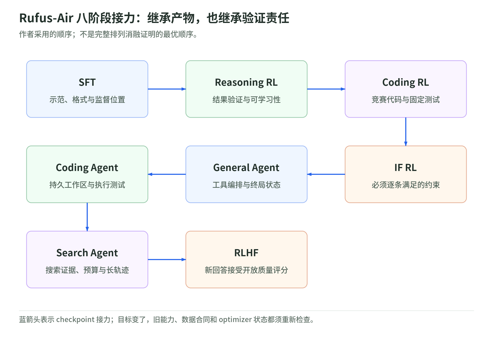

# Rufus-Air 训练配方：把八阶段接力拆成四类工程问题

研究日期：2026-11-03。[训练分组](../README.md) · [五方向目录](../../README.md) · [来源与复现边界](sources.md)。

原文：Chang 等，*Rufus-Air: An Open LLM Post-Training Recipe*，固定读取 [arXiv:2609.29421v2](https://arxiv.org/abs/2609.29421v2)，修订日期 2026-09-25。本读本用原创解释、机制图和小实验整理它，不逐表转录 48 页论文，也没有重跑其模型成绩。

## 1. 先确认：这是后训练，不是从零预训练

起点为 GLM-4.5-Air-Base。官方模型卡将它标为 base、不是聊天模型；106B 总参数、12B 激活参数是两种不同口径。MoE 每次选择部分专家参与计算，不能把 12B 当成全部存储量，也不能仅凭参数数目推算完整训练成本。[官方模型卡](https://huggingface.co/zai-org/GLM-4.5-Air-Base)

Rufus-Air 是论文最终产物的名称；官方 GLM-4.5-Air 是另一个后训练结果。起点相同可以减少一个比较变量，不意味着全部差异都已因果归属于某一个步骤。[论文 §2、§5](https://arxiv.org/html/2609.29421v2#S2)

原创教学账本：若全部 106 billion 权重各用两 bytes，**仅原始权重**为 212 GB；把激活参数乘两 bytes 得到 24 GB，并不能代替这个容量账。梯度、优化器状态、激活和并行通信另计；这是算术示例，不是对某台机器的显存承诺。

106B 是架构简介的口径，不是发布文件逐张量的精确计数。当日官方索引的 `total_size` 约为 **220.94 GB**，配置还包含一个 next-token 预测层；实际产物应清点索引与张量，不能把 212 GB 教学值当作实测文件大小，也不将全部差额只归给一个模块。[官方配置](https://huggingface.co/zai-org/GLM-4.5-Air-Base/blob/main/config.json) · [张量索引](https://huggingface.co/zai-org/GLM-4.5-Air-Base/blob/main/model.safetensors.index.json)

## 2. 八阶段接力：每一棒都有不同输入与验收

<!-- illustration: ruf-stage-handoff-b152ea6721 -->

*图：Rufus-Air 八阶段接力：继承产物，也继承验证责任。作者采用的顺序；不是完整排列消融证明的最优顺序。*
<!-- /illustration: ruf-stage-handoff-b152ea6721 -->

论文顺序为 SFT → Reasoning RL → Coding RL → Instruction-Following RL → General Agent → Coding Agent → Search Agent → RLHF。每阶段继承上一阶段产物，顺序结合能力依赖和奖励被利用的风险；它是作者跑通的一条路径，不是经完整排列消融证明的最优顺序。[§2.1、§6](https://arxiv.org/html/2609.29421v2#S2.SS1)

下面是本课对阶段的**阅读问题**，不是新增 benchmark 或完整超参数表：

| 阶段 | 先问什么 | 本课归属 |
| --- | --- | --- |
| SFT | 哪些示范被保留？哪些 token 真正计损失？ | 01 数据与监督 |
| Reasoning RL | 答案如何核验？当前策略在哪些题上有学习信号？ | 01 可验证 RL |
| Coding RL | 生成程序怎样测试？测试通过能证明多大范围？ | 01 代码验证 |
| IF RL | 每条约束是否必须满足？机械与语义条件谁判断？ | 03 奖励协议 |
| General Agent | 工具成功与环境任务成功怎样区别？ | 02 环境合同 |
| Coding Agent | 工作区怎样跨轮保持？测试失败还是服务故障？ | 02 持久沙箱 |
| Search Agent | 工具证据、上下文、预算怎样保真？ | 02 长轨迹 |
| RLHF | 谁评分？实际用的是旧偏好对还是新回答？ | 03 开放质量 |

“Coding”是任务领域，“RL”是更新方式，“Agentic”是交互形态。“奖励是 0/1”则只是输出格式，不能单凭它判断裁判可靠性。这样拆开，才能比较方法而不混淆名词。

## 3. 四章目录：从学习信号到测量合同

- [01 数据、SFT 与可验证 RL](data-sft-and-rlvr.md)：监督账本、难度筛选、数学／代码检查器、污染与选点。
- [02 Agentic RL：工具、环境与长轨迹](agentic-environments.md)：三类 Agent、token-in/token-out、mask、沙箱和失败分类。
- [03 奖励可靠性、RLHF 与稳定性](reward-and-stability.md)：IF rubric、奖励模型、相对优势、路由回放、阶段交接与奖励黑客。
- [04 基础设施、计算预算与评测](infrastructure-and-evaluation.md)：batch 单位、训练／rollout 分工、资源账和跨阶段归因。
- [标准库实验与复现检查表](lab.md)：验证教学数字与数据合同，零模型／GPU 调用。
- [一手来源与复现边界](sources.md)：所读版本、访问范围、公开组件与未核验产物。

按信号拆章比按八个阶段复制八篇配置说明更容易复用：同一个 loss mask、评测协议或环境错误，可以同时影响多棒训练。

## 4. 读超参数时，别漏掉单位与变更历史

论文附录 C 表 16 是配置查询入口。建议每次读一个阶段时，把参数映射到下面的合同，而不是把 `batch=4096` 记成统一含义：

| 字段 | 必须补问 |
| --- | --- |
| learning rate／optimizer | 从哪些状态初始化？warm-up、clip、精度是什么？ |
| batch | prompt 数、response 数、sequence 数还是 token 数？ |
| samples per prompt | 是预筛样本数还是每次训练 rollout 的组大小？ |
| optimizer steps per rollout | 收集一批后更新几次？何时同步新权重？ |
| response／context budget | 单轮、整轨迹、生产模板后长度，分别指什么？ |
| nodes | 每节点几张卡？训练、采样、RM、沙箱分别占什么资源？ |

只有字段名字相同，不足以证明两个阶段在同一预算下训练。论文中的旧组件 commit、build-time patch 和专用适配层，也不能被今天的 `latest` 替代后继续叫精确复现。[§4、附录 C](https://arxiv.org/html/2609.29421v2#S4)

## 5. 最值得带走的判断，而不是排行榜

数据、奖励和环境共同决定优化对象。监督位置、候选筛选、工具预算或评分视图改变后，表面“相同算法”也可能在训练另一个目标。这是本课的合同视角。

阶段顺序还会影响遗忘与成本。后阶段仍更新同一套参数，“先学会”不意味着之后永久保留。至少应保留前阶段 checkpoint 与非目标能力检查，区分训练奖励、开发选点指标和独立最终评测。

论文明确没有同一套 benchmark 覆盖每阶段，部分结果表协议也不同。本读本不把这些分数拼成单调上升曲线，也不以外部报告列制作统一排名。[§5.2、§6](https://arxiv.org/html/2609.29421v2#S5.SS2)

## 6. 阅读路线与三道自测

30 分钟：本页 → 每章首节与自测。90 分钟：四章顺读，手算 batch、mask、有限采样与成本。半天：完成 [实验与合同模板](lab.md)，写出你真正能复现的范围；这不是 106B 模型的运行计划。

1. 12B 激活参数是否意味着只需存储 12B 权重？答：不是，总参数、参与计算量和训练状态的账不同。
2. 末阶段奖励变高，能否证明八阶段顺序最优？答：不能，还需匹配预算、起点、数据与对照顺序；这里没有完整排列消融。
3. 一个阶段表中的分数比 headline 表更高，能否判定退化？答：先核对采样、题集、harness 和聚合口径，不能跨协议直接作差。

## 来源与执行边界

论文、官方模型卡及上游文档的所读范围记录在 [sources](sources.md)。8 张图为原创机制重画，数字示例与标准库实验为教学构造；没有复制原文曲线或截图。正文出现作者配置和观察时明确归属，不把静态源码检查称为训练复现。

本次不下载权重、不运行训练、不调用付费裁判、不部署沙箱，也不宣称全部 Rufus 专用补丁、环境或最终权重已核验公开。参见 [复现缺口清单](sources.md#reproduction-boundaries)。
