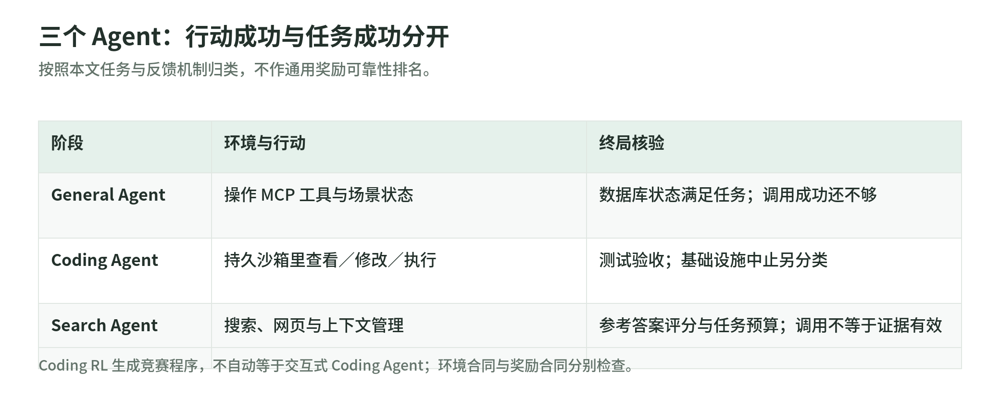
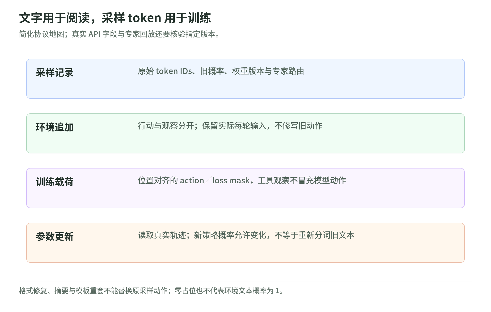

# 02 Agentic RL：工具、环境与长轨迹

[专题导读](README.md) · 阅读日期：2026-11-03 · 论文版本：arXiv:2609.29421v2

读完本章，应能区分“程序通过测试”和“智能体在环境中完成任务”，并判断一条失败轨迹该拿零奖励、退出训练，还是继续探索。依据是 *Rufus-Air: An Open LLM Post-Training Recipe* 的指定章节；以下小例子与合同检查方法是原创教学设计，不是独立复现实验。[论文](https://arxiv.org/abs/2609.29421v2)

## 1. 从 Coding RL 到三个 Agent 阶段

深度学习是上层领域，后训练是训练阶段，RL 是优化方式；“Coding”描述任务，“Agentic”描述模型是否反复行动并接收观察。它们不是互斥的学科标签。论文的 Coding RL 主要生成竞赛程序，再由沙箱测试评分；Coding Agent 则要查看工作区、修改文件、运行命令、读报错再修正。两者都能用终局测试奖励，但交互结构不同。[§3.3](https://arxiv.org/html/2609.29421v2#S3.SS3) [§3.6](https://arxiv.org/html/2609.29421v2#S3.SS6)

General Agent 先练通用工具编排：通过 MCP 工具读写场景数据库，结束后检查状态。Coding Agent 把这种习惯放进持久沙箱；Search Agent 面对开放网页，反复搜索、抓取与核对，最后给出事实答案。三者训练的是规划、行动、观察和纠错，而不只是输出长文本。[§3.5–3.7](https://arxiv.org/html/2609.29421v2#S3.SS5)

教学归类宜采用“训练方式／交互形态／任务领域”三个轴。不要因为 General Agent 的工具能写数据库，就把它归为编程；也不要因为搜索过程中调用 Python，就把整个任务算成 Coding RL。

## 2. 环境合同和奖励合同必须分开

<!-- illustration: ruf-agent-contracts-0b6f0e2e3e -->

*图：三个 Agent：行动成功与任务成功分开。按照本文任务与反馈机制归类，不作通用奖励可靠性排名。*
<!-- /illustration: ruf-agent-contracts-0b6f0e2e3e -->

论文的统一接口接收 `Task`，包括起始提示、上下文与真值，返回 `RolloutResult`：token 轨迹、奖励、类型化终止原因。环境规定允许什么行动、怎样返回观察、状态如何延续；奖励规定怎样判定结果。工具执行成功只满足环境合同，不自动满足任务合同。[§4.2](https://arxiv.org/html/2609.29421v2#S4.SS2)

General Agent 在终局用代码检查服务器状态，成功为 1、否则为 0，不加逐步或 LLM 裁判奖励。例如“创建指定歌曲的歌单”，不能仅凭 `create_playlist` 返回成功就验收，还须检查歌单属于谁、包含哪些曲目。[§3.5](https://arxiv.org/html/2609.29421v2#S3.SS5)

Coding Agent 的任务目录统一包含说明、环境 Dockerfile 和测试脚本；`execute_command` 返回 stdout、stderr 与退出码，最终由测试验收。论文运行时的沙箱是 Firecracker microVM，并非每回合临时起一个容器；文件和进程在整条轨迹中延续。[§3.6](https://arxiv.org/html/2609.29421v2#S3.SS6) [§4.2](https://arxiv.org/html/2609.29421v2#S4.SS2)

Search Agent 用 LLM 对照参考答案给连续分数。正奖励要求至少两次成功工具调用；预算耗尽却没有最终答案有负奖励。这个门槛只确认调用执行过，不能证明答案依赖返回证据，“随便搜两次再背答案”仍是残余漏洞。[§3.7](https://arxiv.org/html/2609.29421v2#S3.SS7)

## 3. Token-in/token-out：训练对象不是聊天截图

<!-- illustration: ruf-token-fidelity-3afe743caf -->

*图：文字用于阅读，采样 token 用于训练。简化协议地图；真实 API 字段与专家回放还要核验指定版本。*
<!-- /illustration: ruf-token-fidelity-3afe743caf -->

策略更新需要知道模型当时真正采样了哪些 token，以及对应的概率。把聊天记录重新套模板、转文本再分词，可能改变旧回合；外部修好了工具调用的格式，也不能把修好后的字符串冒充模型原始动作。论文因此逐回合追加 token，文本副本用于检查，token 轨迹才是训练依据。[§4.2](https://arxiv.org/html/2609.29421v2#S4.SS2)

其后端适配层使用 token-in/token-out，并向训练器传递逐 token log-probability、loss mask 和专家路由信息。所核 SGLang 原生代码确有 `input_ids`、`output_ids` 与概率字段；这不等于普通生成 API 自动产出完整 RL 训练样本，仍需要轨迹适配。[请求字段](https://github.com/sgl-project/sglang/blob/24c91001cf99ba642be791e099d358f4dfe955f5/python/sglang/srt/managers/io_struct.py#L163) [返回字段](https://github.com/sgl-project/sglang/blob/24c91001cf99ba642be791e099d358f4dfe955f5/python/sglang/srt/managers/tokenizer_manager.py#L1527)

loss mask 回答“哪些位置算策略损失”。Slime 的搜索示例把模型输出置 1，工具观察置 0；观察位置补零概率只是对齐占位，不代表页面是模型以概率 1 生成的。[实读示例](https://github.com/THUDM/slime/blob/540ea919e45b8b929198abce008a103be9cfc779/examples/search-r1/generate_with_search.py#L197)

原创小例：模型发检索请求 → 工具返回页面 → 模型给结论，片段级 mask 示意为 `(1,0,1)`，实际需逐 token 展开。页面仍进入上下文，影响下一步决策；mask=0 既不是删除观察，也不是把整条轨迹奖励改为零。

## 4. 超时、截断与策略失败不是一个标签

Coding Agent 中，正常运行后测试不通过是策略失败，奖励为 0；沙箱启动失败、验证器超时或连接断开等基础设施问题标为 `aborted`，在计算组内优势前移除，不能让这些零分污染同组基线。[§3.6](https://arxiv.org/html/2609.29421v2#S3.SS6)

但 Search 评测的网页不可达或抓取超时，会返回错误观察，智能体应尝试恢复，整条轨迹仍正常评分。失败规则取决于合同，不能一看到 timeout 就全丢弃。Coding RL 的生成长度截断又另有 loss 屏蔽规则，也不能直接搬成所有 Agent 的统一处理。[附录 F](https://arxiv.org/html/2609.29421v2#A6) [§3.3](https://arxiv.org/html/2609.29421v2#S3.SS3)

工程检查建议同时记录“终止原因／奖励有效性／是否参与优势计算”。模型声明完成不等于验证器判成功；预算耗尽也不等于环境宕机。还应避免盲重试：论文只在能确认命令尚未执行时重发，否则可能重复修改状态。[§4.2](https://arxiv.org/html/2609.29421v2#S4.SS2)

## 5. 长轨迹压缩：保留证据，也保留边界

先区分三种操作。截短工具日志限制一次观察的体积；网页摘要保留关键姓名、日期和数字；对话 compaction 则改变下一回合模型能看到的历史。它们都能节省上下文，但丢掉错误细节、未解决问题或证据出处，会使后续行动失去依据。[§4.2](https://arxiv.org/html/2609.29421v2#S4.SS2) [§3.7](https://arxiv.org/html/2609.29421v2#S3.SS7)

附录 F 的搜索评测采用外部 scratchpad：研究轮次后记录发现、假设与开放问题，活动上下文只保留当前步骤。关闭它时，同一 checkpoint 的 BrowseComp 准确率下降 10.7 个百分点。这是该 harness 的消融，不是“任何摘要都提高 10.7 点”。清空历史并从原题重试则被作者视为推理计算扩展，不等于一次固定预算轨迹中的压缩。[附录 F](https://arxiv.org/html/2609.29421v2#A6)

教学建议：压缩后至少留下证据地址、关键事实、已否定路径及未决条件；训练记录还应保留压缩前后各自实际输入和输出。不能拿新摘要反向重写旧 token，再声称概率仍对应原动作。Slime 当前定制文档支持将压缩前后表示成共享 `rollout_id` 的多个训练片段；这是上游接口能力，不是 Rufus 专用实现已公开的证明。[Slime 定制合同](https://github.com/THUDM/slime/blob/540ea919e45b8b929198abce008a103be9cfc779/docs/en/get_started/customization.md#returning-multiple-training-samples-for-one-prompt)

## 6. 分数必须连同 Harness 阅读

Search 训练使用内部搜索后端，评测换成标准化的 Serper、Jina Reader、独立裁判及上下文管理，不能把两套协议混成一个接口。附录还限定网页实时读取，结果只宜在同一评测窗口内比较。[§3.7](https://arxiv.org/html/2609.29421v2#S3.SS7) [附录 F](https://arxiv.org/html/2609.29421v2#A6)

调用更多不保证更好：难题可能需要长探索，卡住也会产生长轨迹。附录中的“越长越常错”是观察关联，不证明强行提前停止会提高准确率。Coding Agent 本次按算力预算结束，也没有证明已收敛。[附录 F](https://arxiv.org/html/2609.29421v2#A6) [§3.6](https://arxiv.org/html/2609.29421v2#S3.SS6)

## 7. 三道自测与答案

1. 创建歌单的工具成功返回，General Agent 应得到 1 吗？

   答案：不一定。工具调用成功与任务成功不同，须由终局验证器检查数据库状态是否满足要求。

2. 工具页面的 mask=0，模型是不是不能利用页面？外部修好的工具调用可以代替原 token 吗？

   答案：页面仍是下一步的上下文，只不作为策略采样动作计损失；修复结果不能替代原动作，否则 token 和采样概率不再对应。

3. 验证器超时、正常测试失败、评测网页超时，应该都按零奖励训练吗？

   答案：不应。Coding Agent 的基础设施中止在优势计算前排除；测试失败有效得零；Search 评测的网页超时是可恢复观察，最终仍评分。

## 8. 一手来源、版本与阅读范围

全部读取日期为 2026-11-03，仅静态阅读，没有运行训练、下载权重或调用付费服务。

- [Chang 等，Rufus-Air](https://arxiv.org/abs/2609.29421v2)：2026 年 arXiv 预印本，首发 2026-09-24，所读 v2 为 2026-09-25；公开 PDF。重点实读 §3.5–3.7、§4.2、附录 F，另对照 §3.3；未核引用数，不把预印本当正式会议发表。
- [Slime 上游](https://github.com/THUDM/slime/tree/540ea919e45b8b929198abce008a103be9cfc779)：固定 `540ea919`，快照日期 2026-10-27；实读定制文档、`Sample` 字段及搜索示例相关代码。不是作者的 Rufus-Slime 补丁。
- [SGLang 上游](https://github.com/sgl-project/sglang/tree/24c91001cf99ba642be791e099d358f4dfe955f5)：固定 `24c91001`，快照日期 2026-01-03；实读请求及返回字段，不展开全部服务配置。
- [Strands Hooks 事件文档](https://strandsagents.com/docs/user-guide/sdk/agents/hooks-events/)：读取当日在线版，无独立发布日期；实读 Python 生命周期及事件表。官方使用 `MessageAddedEvent`，论文写 `OnMessageAddedEvent`，名称不能照抄成可运行 API。

这些框架链接用于核验接口机制；不能据此推断已有独立 Rufus 仓库、checkpoint 或完整环境发布。奖励有效性审计、三轴分类和小例子属于本章教学建议。
