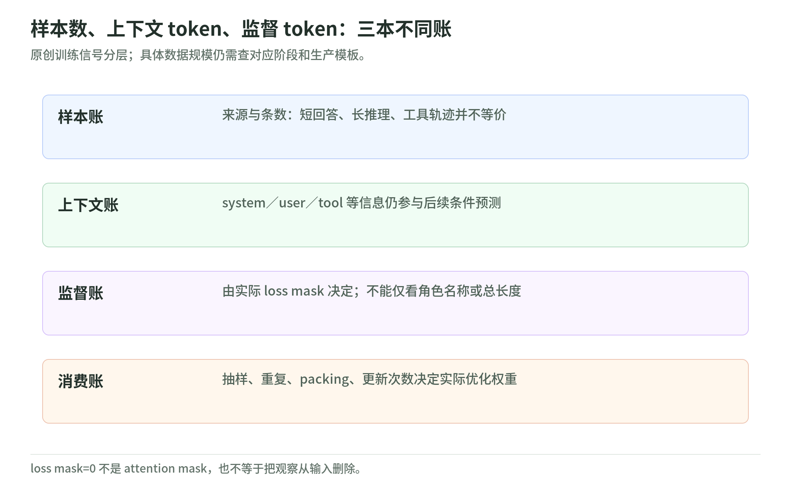

# 01 数据、SFT 与可验证 RL

研究日期：2026-11-03。[专题总览](README.md)。本章解读 Chia-Yuan Chang 等（Amazon）的预印本 *Rufus-Air: An Open LLM Post-Training Recipe*，固定 arXiv:2609.29421v2，聚焦 §3.1–3.3 与附录 C、D 的相关内容；机制说明和手算例子为原创教学，不是逐段翻译，也不宣称独立复现。

## 学习信号地图：模仿示范与验证结果分属不同分支

可以把本章放进更细的分类：深度学习 → 语言生成模型 → 后训练 → 监督微调／奖励驱动训练。预训练学习一般文本规律；SFT 用现成回答作目标；RLVR 则让当前策略生成候选，再用程序核验结果。偏好学习与 RLVR 也不能混称：前者提供相对选择，后者在这里提供任务是否通过的反馈。这是依据训练信号构造的教学分类，不是作者定义的新 taxonomy。[§3.1–3.2](https://arxiv.org/html/2609.29421v2#S3.SS1)

本章从已有的 GLM-4.5-Air-Base 开始，顺序是 **SFT → Reasoning RL → Coding RL**，不是从随机权重预训练。数学、科学问答、谜题与竞赛代码是任务分类；SFT、GSPO 是训练方法；验证器是反馈组件，三个维度应分开。后续多轮工具代理训练属于另一个阶段，不能把竞赛代码奖励当作整个代理能力的证明。[论文 §2.1、§3.1–3.4](https://arxiv.org/html/2609.29421v2#S2.SS1)

## SFT 监督账本：上下文可见不等于每个 token 都计损失

<!-- illustration: ruf-supervision-ledger-8d08505d96 -->

*图：样本数、上下文 token、监督 token：三本不同账。原创训练信号分层；具体数据规模仍需查对应阶段和生产模板。*
<!-- /illustration: ruf-supervision-ledger-8d08505d96 -->

作者报告的混合来自 17 个公开数据集，约 901 万条，没有 Rufus 侧重新生成回答或新增人工标注；正文区分了 445 亿原始 token 与 270 亿计入损失的 token。公开不等于人工标注：Nemotron 数据卡明确说明回答由模型合成，Toucan 数据卡也区分教师配置与单独的 SFT 子集，不能直接拿卡片总量当作 Rufus 的用量。[论文 §3.1、附录 D](https://arxiv.org/html/2609.29421v2#S3.SS1)；[Nemotron 数据卡](https://huggingface.co/datasets/nvidia/Nemotron-Post-Training-Dataset-v1/blob/74e23eb6f830fef4a9e96a92f6f6262214cbb9a8/README.md)；[Toucan 数据卡](https://huggingface.co/datasets/Agent-Ark/Toucan-1.5M/blob/0df3cf37f2abefb380370cfb02eabea2a35ae782/README.md)

预处理统一角色与逐消息 loss mask，修复推理标签和不完整结尾；推理用 `<think>…</think>` 包裹，校验角色转换与工具链掩码。调用后立即接工具结果的 assistant 算中间步骤；否则视为完成回答并切分样本，保留完整思考—行动—观察链。早先对话只作上下文，其 assistant 推理被移除并屏蔽；从最后真实用户请求起监督带推理的 assistant 步骤，system、user、tool 观察均为零损失。[论文 §3.1](https://arxiv.org/html/2609.29421v2#S3.SS1)

想象“用户提问 → 调用工具 → 工具返回价格 → assistant 总结”。工具返回价格仍能帮助预测总结，但不要求模型学会生成环境的回包。用教学式记号，`m_t=0` 是该位置不贡献预测损失，`m_t=1` 才计入负对数概率；这是 loss mask，不是 attention mask，更不是把整个工具链删除。

原创直觉：十条各监督一百 token 的短答，与一条监督一万 token 的长轨迹，前者条数占优，后者监督量占优。因此样本份额、原始文本长度和计损失 token 是三本不同账，不能由“大量工具数据”推断工具调用获得了最多优化信号。

长度也有两层：§3.1 的过滤上限是套用生产 GLM chat template 后的 120K；训练打包上下文及附录 C 表 16 则为 128K。用于后续 RL 的是选出的 step 3799，而非最终 step。应追踪“来源 → 格式化 → 掩码 → 被选 checkpoint”，不能只记训练了几轮。[§3.1](https://arxiv.org/html/2609.29421v2#S3.SS1)；[附录 C](https://arxiv.org/html/2609.29421v2#A3)

## 可学习性闸门：观测到零成功不是不可能性证明

Reasoning RL 先用 GPT-OSS-120B 的正奖励筛题，再按当前策略成功率过滤；在线从四倍候选中保留组均奖励 `0 < r̄ ≤ 0.8` 的题组。第一道门询问“有没有观察到可通过路径”，第二道门询问“当前预算下是否值得学习”，不是同一个质量标签。[论文 §3.2](https://arxiv.org/html/2609.29421v2#S3.SS2)

**观测到 `0/G` ≠ 真正不可能。** 原创反例：假设每次独立成功概率为 5%，采样 16 次仍全败的概率是 `0.95^16≈44%`。这只用于解释有限采样误差，不声称真实 rollout 独立。教师零成功同样不是无解证书；教师通过一次也只证明在该验证器下出现过可接受候选，不能排除检查器漏洞。

筛选规则还会改变数据分布：剔除容易题能集中预算，却不能证明容易题已经永久掌握。报告平均奖励时，要问均值是在候选全集、保留题组还是某个训练批次上计算的，否则“更高奖励”可能部分来自换题。

## 推理奖励回路：终点可核验不代表整条思路都正确

数学用 Math-Verify，谜题用生成的 Python 检查器，科学问答用参考答案的模糊字符串匹配；这些不是同等强度的证明系统。Math-Verify 官方说明的链路是抽取答案、转换表达式、比较 gold；Reasoning Gym 则把题目、答案、元数据与任务评分接口连接起来。奖励的可靠性依赖抽取配置、答案定义和检查器覆盖。[论文 §3.2](https://arxiv.org/html/2609.29421v2#S3.SS2)；[Math-Verify 文档](https://github.com/huggingface/Math-Verify/blob/ba3d3aaff23b3f4cac7a14672b4f6e293d97c98b/README.md#architecture)；[Reasoning Gym 文档](https://github.com/open-thought/reasoning-gym/blob/49b07130b3fcd12f2d064bba7c43869543a0e7e7/README.md#-training)

原创手算：同题四个奖励为 `[0,0,1,1]`，减去均值后得到 `[-0.5,-0.5,0.5,0.5]`。这个简化例子解释组内对比信号，不是完整 GSPO 损失；全同奖励时，该奖励对比项为零，不能推广成“一切训练项都必然零更新”。

实际推理阶段每题采 16 个回答，以 GSPO 更新；截断回答屏蔽损失，并相对组内最短正确回答施加长度惩罚。教学上应同时问正确性与长度，不能把这个相对基准误读成“任何短答都更好”。[§3.2](https://arxiv.org/html/2609.29421v2#S3.SS2)；[附录 C 表 16](https://arxiv.org/html/2609.29421v2#A3)

## 代码执行回路：固定测试集合给出有限而稳定的奖励

Coding RL 区分函数型 assert 测试与 stdin/stdout 配对。作者从 EvolveCoder、Nemotron、Dolci、ADR 聚合题目：先要求非空测试、去重与查漏，再做教师可解性筛选。基准策略每题预采四次，只删四次全过的题，保留零成功题，而且训练中不重复该难度筛选。这与推理阶段在线删除全败组不同。[论文 §3.3](https://arxiv.org/html/2609.29421v2#S3.SS3)

回答取最后一个 Python fenced block，在沙箱执行；每题最多选 50 个测试，用题目相关的 SHA-256 种子固定抽样，全部通过才得 1。固定测试减少奖励随抽样漂移，却不等于覆盖全部输入。原创反例：求最大值的代码若只在正数上通过，仍可能在全负数上失败；它对训练测试是“通过”，对完整规格不是“已证明”。[论文 §3.3](https://arxiv.org/html/2609.29421v2#S3.SS3)

代码阶段每题采 64 次，回答上限从 64K 延长到 128K。作者同时观察到截断减少与指标上升；因预算、长度和有效训练样本一起改变，不能把它写成控制变量实验所证明的“长思考必然更聪明”。[§3.3](https://arxiv.org/html/2609.29421v2#S3.SS3)；[附录 C 表 16](https://arxiv.org/html/2609.29421v2#A3)

## 训练与评测边界：查漏、选点与最终验收不能合并

SFT 与推理数据使用串联词级 8-gram 去污染，对容易泄漏的数学／知识基准另加穷举 8-gram、稠密检索与人工复核。检测包含全部消息，所以不计损失的上下文也不能免查。代码则针对 LCB v6 的 1,055 题检查 400 字符前缀哈希和字符级 60-gram：作者未发现前缀相同或共享至少五个 60-gram 的训练题，同时明确不能排除改写及语义等价题。[§3.1](https://arxiv.org/html/2609.29421v2#S3.SS1)；[§3.2–3.3](https://arxiv.org/html/2609.29421v2#S3.SS3)

LCB 官方文档确认 `release_v6` 覆盖 2023-05 至 2025-04，默认版本却是 `release_latest`；复核必须固定版本，不能默默换题。[LCB 版本说明](https://github.com/LiveCodeBench/LiveCodeBench/blob/28fef95ea8c9f7a547c8329f2cd3d32b92c1fa24/README.md#dataset-versions)

论文用 GPQA 调推理阶段，用 LCB 曲线选代码 checkpoint。它们虽不直接提供训练轨迹奖励，却参与选择，不能再称完全未触碰的最终保留集。教学建议：区分训练反馈、开发选点和封存验收；比较 pass@1、pass@8 时也要固定采样与推理预算。论文特别提醒代码阶段表与 headline 表的协议不同，不能直接拼接分数。[§3.2–3.3、附录 C](https://arxiv.org/html/2609.29421v2#S3.SS3)

## 三道自测：检查监督、采样和泛化是否被混淆

1. tool 消息被 loss-mask 后，模型还能据此回答吗？**答：能。**不计该位置的预测损失，不等于遮掉上下文。
2. 预采四次全过，是否以后无需再学？**答：不是。**这是有限样本难度启发式；后续成功率仍可变化。
3. 训练测试全过、文本查漏为零，能否宣布无污染且代码正确？**答：不能。**测试覆盖和泄漏检测都有盲区，还需独立验收。

## 一手来源账本：固定版本与实际读取范围

全部读取日期为 **2026-11-03**；以下文档快照不冒充作者部署的组件版本。论文为 Chang 等，2026，arXiv 预印本；全文读取为公开 HTML，未查询引用数。组件核验限于说明文档，不包含安装、数据下载或运行；最终以 arXiv 直读 v2 校正检索缓存中的标题、模板及附录差异。

| 来源 | 读取日期 | 版本／快照 | 实际读取范围 |
| --- | --- | --- | --- |
| [Rufus-Air](https://arxiv.org/html/2609.29421v2) | 2026-11-03 | 2609.29421v2 | §2.1、§3.1–3.3；§3.4 仅阶段边界；附录 C 表 15–16、D 表 17 |
| [NVIDIA Nemotron 数据卡](https://huggingface.co/datasets/nvidia/Nemotron-Post-Training-Dataset-v1/blob/74e23eb6f830fef4a9e96a92f6f6262214cbb9a8/README.md) | 2026-11-03 | v1；`74e23eb6` | schema、类别、合成来源、格式建议 |
| [Agent-Ark Toucan 数据卡](https://huggingface.co/datasets/Agent-Ark/Toucan-1.5M/blob/0df3cf37f2abefb380370cfb02eabea2a35ae782/README.md) | 2026-11-03 | `0df3cf37` | 教师配置、SFT 子集、工具轨迹 schema、注意事项 |
| [Math-Verify 官方 README](https://github.com/huggingface/Math-Verify/blob/ba3d3aaff23b3f4cac7a14672b4f6e293d97c98b/README.md) | 2026-11-03 | `ba3d3aaf` | 抽取、解析、比较流程与奖励配置 FAQ |
| [Reasoning Gym 官方 README](https://github.com/open-thought/reasoning-gym/blob/49b07130b3fcd12f2d064bba7c43869543a0e7e7/README.md) | 2026-11-03 | `49b07130` | 生成器、Quickstart、评分与训练接口 |
| [LiveCodeBench 官方 README](https://github.com/LiveCodeBench/LiveCodeBench/blob/28fef95ea8c9f7a547c8329f2cd3d32b92c1fa24/README.md) | 2026-11-03 | `28fef95e`；`release_v6` | 数据版本、评测选项与时间窗口 |

本次仅核验公开论文和文档，没有运行模型、训练、下载数据集／权重或调用付费服务；数据配比与实验增益仍归属于作者报告。
