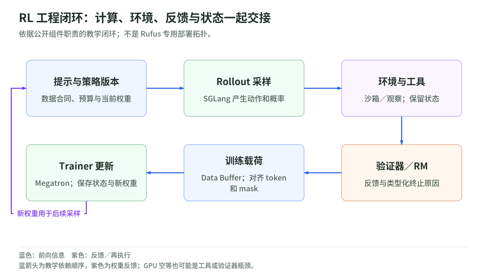
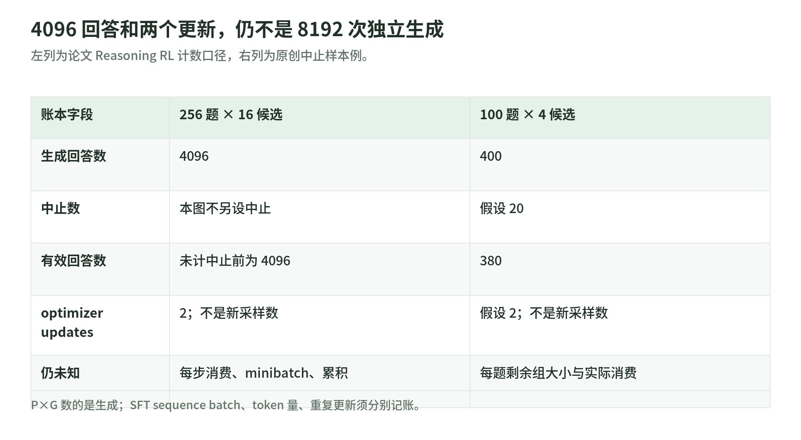

# 04 基础设施、计算预算与评测：配方的另一半

研究日期：2026-11-03。[配方总览](README.md)。本章读 Rufus-Air v2 的 §4、§5、§6 和附录 C／F／G，结合上游组件说明，建立原创工程账本。没有执行部署、benchmark 或资源采购。

## 1. 训练、采样、环境与反馈，是四种工作

<!-- illustration: ruf-runtime-loop-49a4cec55a -->

*图：RL 工程闭环：计算、环境、反馈与状态一起交接。依据公开组件职责的教学闭环；不是 Rufus 专用部署拓扑。*
<!-- /illustration: ruf-runtime-loop-49a4cec55a -->

参数更新器处理前向／反向、梯度与状态；rollout 服务用某个策略版本生成 token；环境处理工具、沙箱和观察；验证器／评分器产出反馈。它们相互依赖，但不能用“总共占用了很多 GPU”掩盖职责。

Slime 官方 README 将 Megatron 训练、SGLang rollout 与 Data Buffer 分开：训练读数据并同步新参数，rollout 写入候选和反馈，buffer 连接数据准备与生成。这是上游架构能力，不证明团队专用适配与当前 main 完全相同。[Slime README](https://github.com/THUDM/slime)

原创故障例：GPU 利用率很低，可能是工具测试排队让 rollout 迟迟不齐；增加训练卡却没有增加测试并发，不一定改善端到端速度。反过来，更多采样服务若读到旧参数，也可能增加数量但破坏实验合同。

## 2. Batch 单位：收集次数不等于更新次数

<!-- illustration: ruf-batch-ledger-70617eb301 -->

*图：4096 回答和两个更新，仍不是 8192 次独立生成。左列为论文 Reasoning RL 计数口径，右列为原创中止样本例。*
<!-- /illustration: ruf-batch-ledger-70617eb301 -->

设每次收集 $P$ 个提示词，每题采 $G$ 个候选：

$$
N_{\rm rollout}=P G.
$$

论文 Reasoning RL 的例子为 $256\times16=4096$ 个回答；SFT 的 4096 则是 sequence batch，两者不能因为整数相同就视为同一工作量。Coding RL 的提示词 batch 随回答预算调整，说明长度与样本量一起影响成本。[附录 C 表 16](https://arxiv.org/html/2609.29421v2#A3)

原创教学：收集 100 题×4 回答，共 400 个候选；若 20 个中止，只有 380 个有效。再对这批数据走两轮，不应在实验日志写成“生成了 800 条独立轨迹”。重复更新、minibatch 切分、梯度累积和新 rollout 需要分别记账。

分组优势还依赖每题剩余候选数。删除中止样本后若只有一个有效候选，中心化反馈没有组内对比；不能用另一个提示词的失败样本补成“同题组”。

## 3. 固定版本：公开框架不等于相同二进制

论文记录容器内组件版本，并在 Megatron-LM、SGLang 的固定上游 commit 上加入 build-time patches。复现应记录 base image、CUDA／驱动、编译选项、补丁和运行参数，而不只写 `pip install latest`。[附录 C](https://arxiv.org/html/2609.29421v2#A3)

SGLang 官方仓库提供 serving、并行及运行接口，Slime 提供训练／rollout 集成；它们用于核验机制，不能替代 Rufus-Slime／Rufus-Gym 的完整配置。[SGLang README](https://github.com/sgl-project/sglang) · [Slime README](https://github.com/THUDM/slime)

教学复现分三级：复现一个公式和数据合同；复现一个小模型的局部阶段；匹配整条大型流水线。做成第一级不能写成第三级。后者还需要数据版本、适配补丁、环境镜像、阶段产物与评测协议。

## 4. GPU 账之外还有沙箱与外部调用

资源至少分成：训练／采样 GPU、CPU 与内存、长期沙箱、工具请求、奖励模型／裁判、存储和网络。不同资源的寿命也不同：一次生成结束不代表整条 coding trajectory 的沙箱可销毁。

论文使用有状态 microVM。Firecracker 官方说明其通过 Linux KVM 管理轻量虚拟机，并以 jailer 补充用户态隔离；这支持“microVM 与共享内核容器不同”的机制说明，不保证任意部署绝对安全或达到论文吞吐。[Firecracker 官方说明](https://firecracker-microvm.github.io/)

不要把作者案例中的服务月成本或 API 单价直接当作今天你的账单。本课只做数量／时间换算，不报价，不给采购建议。

原创算术对照：64 个节点连续占用 13 天，是 **832 node-days**；若每节点八张卡，则为 **6656 GPU-days**。这是明确假设下的资源时长，不是有效 FLOPs，也不是按价格算出的美元成本。GPU 型号、利用率、抢占、空等和收费合同都还没进入计算。

## 5. 评测合同：同名 benchmark 仍可能测量不同东西

一份可比较的成绩至少绑定：题集版本、工具与环境、用户模拟器、评分器、解码、回答／轨迹预算、采样次数和聚合规则。将其中一项改变，可能影响分数而不改变权重。

论文自己的同 harness 比较与外部报告列分开；Tau2 的用户模拟器属于测量条件，Search 评测的工具与上下文管理也不等同训练接口。[§5、附录 E／F／G](https://arxiv.org/html/2609.29421v2#S5)

失败计分也属于协议：Tau2／MCP-Atlas 使用团队自建 harness，不是参考实现；MCP-Atlas 的工具错误样本会重试，而非直接计作任务失败。这个分数因此不能当作包含所有服务故障的端到端可用性。Search 读取实时、无缓存网页，日期窗口、locale、泄题域名过滤与网页错误处理也要记录；固定权重仍无法保证历史网页原样重现。[§5.1、附录 F](https://arxiv.org/html/2609.29421v2#S5.SS1)

原创示例：同样四次生成，可以报告“任一次成功”的 best-of-four 事件，也可以报告四次成功率的均值。一次成功、三次失败，前者为 1，后者为 0.25。它们不能仅凭都写“4 次”而相互替代。avg、pass@$k$ 和 win rate 的事件及分母必须写清。

## 6. 跨阶段变化：缺测和换协议不能补成因果链

若只在 Coding Agent 后和最终模型测一次编程成绩，中间经过 Search、RLHF，那么两个数的差包含这整段。不能挑一个最后阶段单独负责，也不能由几项保留下来的指标证明所有能力都未遗忘。

论文明确没有每阶段统一全量 benchmark，部分阶段表与 headline 表协议不同。阅读时优先核对相邻、匹配协议的 before／after；把缺测留为空，不插值成单调曲线。[§5.2、§6](https://arxiv.org/html/2609.29421v2#S5.SS2)

如果一个 benchmark 用来挑 checkpoint，它已参与开发选择；换一批题但继续用训练奖励模型，也只隔离了 prompt，不一定隔离评分盲点。最终验收应与这些诊断区分；这是本课的证据建议。

## 7. 三道自测与参考答案

1. 400 条 rollout 更新两轮，可以报告 800 条独立生成数据吗？
2. 6656 GPU-days 是否等于已知美元成本和有效计算量？
3. 权重没变，只换用户模拟器，分数能否变化？

答案：①不能，重复消费与重新采样不同。②不能，尚缺价格、型号、利用率与资源计费口径。③可以，模拟器属于 harness；不固定它就不能把差异只归于策略。

## 8. 一手来源与阅读边界

以下于 2026-11-03 静态阅读，不执行原文／README 中的安装或运行命令。

| 来源 | 版本与实读范围 | 不支持什么 |
| --- | --- | --- |
| [Rufus-Air](https://arxiv.org/html/2609.29421v2) | v2；§4、§5、§6，附录 C／E／F／G 的相关契约 | 未复跑成绩；不把阶段配置外推为最优 |
| [Slime](https://github.com/THUDM/slime) | 当日 README：架构、训练／rollout／Data Buffer 与定制说明 | 不是 Rufus 专用补丁的完整核验 |
| [SGLang](https://github.com/sgl-project/sglang) | 当日 README：serving 角色与项目接口入口 | 不声称重现论文 pinned build |
| [Firecracker](https://firecracker-microvm.github.io/) | 当日架构、KVM 与 jailer 说明 | 不是安全认证、吞吐或成本实测 |

下一步：[标准库实验与复现检查表](lab.md)。
